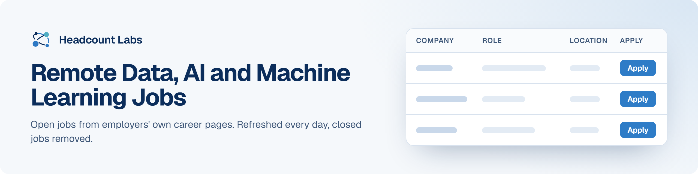

# Remote Data, AI and Machine Learning Jobs

Remote data science, data engineering, analytics, AI and machine learning jobs at US employers.

**400 open jobs** · 152 new since the last update · 152 removed because they closed or left the employer's board · updated October 22, 2026 at 5:42 AM EDT

This list is built and refreshed every day by [Headcount Labs](https://headcountlabs.com/?utm_source=github&utm_medium=job-list&utm_campaign=remote-data-jobs), which reads jobs straight from employers' own career pages and job boards. Every job here was still listed on its source board when we last read that board, within the past 3 days, and was posted in the past 30 days. Copies of the same job are merged into one row, and jobs that close are removed at the next update.

Want this data in your own app or agent? Use the [Headcount Labs jobs API](https://headcountlabs.com/docs/?utm_source=github&utm_medium=job-list&utm_campaign=remote-data-jobs) (free tier), the [MCP server](https://headcountlabs.com/mcp/?utm_source=github&utm_medium=job-list&utm_campaign=remote-data-jobs) for Claude, ChatGPT and other AI assistants, or the [open dataset](https://huggingface.co/datasets/HeadcountLabs/job-postings) on Hugging Face ([example queries](https://github.com/HeadcountLabs/job-postings)).

**Full dataset.** A bigger, one-off snapshot dated 2026-10-19 (all matching jobs, not only the open jobs below) is on Hugging Face: [Remote jobs](https://huggingface.co/datasets/HeadcountLabs/remote-jobs) · [Tech and software jobs](https://huggingface.co/datasets/HeadcountLabs/tech-jobs). It loads with `datasets.load_dataset` and is under the Open Database License (ODbL) 1.0.

**Jump to:** [Posted in the last 7 days (325)](#posted-in-the-last-7-days) · [Posted 8 to 30 days ago (75)](#posted-8-to-30-days-ago)

**Columns.** *Apply* opens the original posting on the employer's site. *Details* opens the job on Headcount Labs, with every posting we found for it. *Remote* shows what the employer states; a dash means the posting doesn't say. *Pay* is the range the employer published.

## Posted in the last 7 days

| Company | Role | Location | Remote | Pay | Posted | Apply | Details |
| --- | --- | --- | --- | --- | --- | :---: | :---: |
| **ZipRecruiter** | Sr. Decision Scientist, Mobile | Santa Monica, CA | Remote | $148k–$175k/yr | Oct 21 |  | <a href="https://headcountlabs.com/catalog/jobs/07ec646b-3168-4b5b-a31b-d2253016536c?utm_source=github&utm_medium=job-list&utm_campaign=remote-data-jobs">via Headcount Labs</a> |
| **ZINC Zillow, Inc.** | Senior Program Manager, People Data Access &amp; Governance | United States | Remote | $130k–$208k/yr | Oct 21 |  | <a href="https://headcountlabs.com/catalog/jobs/9643e38b-de21-467d-9f66-578d6e7d6601?utm_source=github&utm_medium=job-list&utm_campaign=remote-data-jobs">via Headcount Labs</a> |
| **UserTesting Technologies, Inc.** | AI Systems Administrator | United States | Remote | — | Oct 21 |  | <a href="https://headcountlabs.com/catalog/jobs/45346c12-63e2-4dd6-9077-10dd3010f4a2?utm_source=github&utm_medium=job-list&utm_campaign=remote-data-jobs">via Headcount Labs</a> |
| **TrustEngine** | Lead Data Platform &amp; Database Engineer | tampa, FL | Remote | — | Oct 21 |  | <a href="https://headcountlabs.com/catalog/jobs/a016a07f-6d94-4eba-85b2-7ed13f4731f5?utm_source=github&utm_medium=job-list&utm_campaign=remote-data-jobs">via Headcount Labs</a> |
| **Tiger Analytics Inc.** | Senior Data Scientist - Pharma | 

2 locations
Los Angeles, CA San Francisco, CA
 | Remote | — | Oct 21 |  | <a href="https://headcountlabs.com/catalog/jobs/84765434-2a8a-48fe-ab93-4d019fa89020?utm_source=github&utm_medium=job-list&utm_campaign=remote-data-jobs">via Headcount Labs</a> |
| **The Hanover Insurance Group** | Associate Information Data Architect (REMOTE) | Worcester, MA | Remote | — | Oct 21 |  | <a href="https://headcountlabs.com/catalog/jobs/e59c4a83-e425-4470-84a8-b6425163678a?utm_source=github&utm_medium=job-list&utm_campaign=remote-data-jobs">via Headcount Labs</a> |
| **Super.com** | Engineering Manager, Data | United States | Remote | $140k–$196k/yr | Oct 21 |  | <a href="https://headcountlabs.com/catalog/jobs/94833c01-a71e-4272-a405-ef018753d633?utm_source=github&utm_medium=job-list&utm_campaign=remote-data-jobs">via Headcount Labs</a> |
| **ServiceNow** | Senior Staff Outbound Product Manager - GTM / Data &amp; Analytics | 

2 locations
New York, NY Washington, DC
 | Remote | $191k–$334k/yr | Oct 21 |  | <a href="https://headcountlabs.com/catalog/jobs/da4ad92f-16ba-4110-968c-cd2b08b5bb3d?utm_source=github&utm_medium=job-list&utm_campaign=remote-data-jobs">via Headcount Labs</a> |
| **Samsara** | Digital Customer Success Manager, AI &amp; Automation | United States | Remote | $106k–$160k/yr | Oct 21 |  | <a href="https://headcountlabs.com/catalog/jobs/d6b673cc-ab60-4452-abc6-3c786dc419b7?utm_source=github&utm_medium=job-list&utm_campaign=remote-data-jobs">via Headcount Labs</a> |
| **SAMC SitusAMC Holdings Corp** | AI Prompt Writer - Remote US | United States | Remote | $70k–$80k/yr | Oct 21 |  | <a href="https://headcountlabs.com/catalog/jobs/446f51c0-80fe-4462-82bb-843ccc52ac22?utm_source=github&utm_medium=job-list&utm_campaign=remote-data-jobs">via Headcount Labs</a> |
| **Salesforce, Inc.** | AI Innovation Lead, Life Sciences Acceleration Hub | 

5 locations
New York City Metro, NJ San Francisco Metro, CA Atlanta Metro, GA Chicago Metro, IL Washington DC Metro, VA
 | Remote | $191k–$321k/yr | Oct 21 |  | <a href="https://headcountlabs.com/catalog/jobs/499c2468-9d81-4d0f-b119-28ab9fae1962?utm_source=github&utm_medium=job-list&utm_campaign=remote-data-jobs">via Headcount Labs</a> |
| **Red Hat, LLC** | Senior AI Platform Specialist Solution Architect | 

3 locations
California Oregon Washington
 | Remote | $172k–$275k/yr | Oct 21 |  | <a href="https://headcountlabs.com/catalog/jobs/d1b3ac42-05c8-486e-9dba-80e811f06c82?utm_source=github&utm_medium=job-list&utm_campaign=remote-data-jobs">via Headcount Labs</a> |
| **Provectus** | AI Architect | 

15 locations
San Francisco Bay Area, CA Los Angeles, CA Berkeley Oakland Daly City San Mateo Palo Alto, CA San Jose New York City Metropolitan Area New Jersey New York Manhattan, NY +3 more
 | Remote | $180k–$200k/yr | Oct 21 |  | <a href="https://headcountlabs.com/catalog/jobs/d4878fbe-e9e8-4451-8697-a55d7ffc64df?utm_source=github&utm_medium=job-list&utm_campaign=remote-data-jobs">via Headcount Labs</a> |
| **Pencil** | AI Transformation Lead | 

2 locations
Atlanta Toronto
 | Remote | — | Oct 21 |  | <a href="https://headcountlabs.com/catalog/jobs/ebf0bf82-e738-4352-b0c2-5fcdebccbce0?utm_source=github&utm_medium=job-list&utm_campaign=remote-data-jobs">via Headcount Labs</a> |
| **Pax8, Inc** | Senior Data Engineer II - Data Platforms | United States | Remote | $175k–$225k/yr | Oct 21 |  | <a href="https://headcountlabs.com/catalog/jobs/679bb882-308d-452f-967a-4f939fb74a7e?utm_source=github&utm_medium=job-list&utm_campaign=remote-data-jobs">via Headcount Labs</a> |
| **PatientPoint** | Manager, Analytics Engineering | 

2 locations
Cincinnati, OH New York City, NY
 | Remote | $130k–$185k/yr | Oct 21 |  | <a href="https://headcountlabs.com/catalog/jobs/c04bb2a7-a74a-4125-b489-7d276402e967?utm_source=github&utm_medium=job-list&utm_campaign=remote-data-jobs">via Headcount Labs</a> |
| **PatientPoint** | Sr. Data Analyst | United States | Remote | $74k–$136k/yr | Oct 21 |  | <a href="https://headcountlabs.com/catalog/jobs/3460bf59-cfde-48ff-bed1-d674cd01c0f5?utm_source=github&utm_medium=job-list&utm_campaign=remote-data-jobs">via Headcount Labs</a> |
| **Parexel International, LLC** | Clinical Scientist - FSP | 

51 locations
North Carolina Any Region Alabama Alaska Arizona Arkansas California Colorado Connecticut Delaware Florida Georgia +39 more
 | Remote | — | Oct 21 |  | <a href="https://headcountlabs.com/catalog/jobs/c5ef1b7d-586d-451b-88d1-d539613ef271?utm_source=github&utm_medium=job-list&utm_campaign=remote-data-jobs">via Headcount Labs</a> |
| **OnHires** | Senior Technical Trainer — AI / DevOps Remote, worldwide | United States | Remote | — | Oct 21 |  | <a href="https://headcountlabs.com/catalog/jobs/b9f16048-0455-4b03-bb3e-d8d846c7388b?utm_source=github&utm_medium=job-list&utm_campaign=remote-data-jobs">via Headcount Labs</a> |
| **OnHires** | Senior Technical Trainer — Machine Learning Remote, worldwide | United States | Remote | — | Oct 21 |  | <a href="https://headcountlabs.com/catalog/jobs/a4069ef7-d2b9-4eca-9d58-e47217f1b6ef?utm_source=github&utm_medium=job-list&utm_campaign=remote-data-jobs">via Headcount Labs</a> |
| **Omnicell (temp)** | Data Governance Manager | Atlanta, GA | Remote | $155k/yr | Oct 21 |  | <a href="https://headcountlabs.com/catalog/jobs/093f8d61-aaec-4f78-a17f-4eb2546a42e8?utm_source=github&utm_medium=job-list&utm_campaign=remote-data-jobs">via Headcount Labs</a> |
| **neurohire.ai** | AI/ML Engineer | United States | Remote | — | Oct 21 |  | <a href="https://headcountlabs.com/catalog/jobs/b08e16fd-9ead-4999-848e-354e6fd6bc13?utm_source=github&utm_medium=job-list&utm_campaign=remote-data-jobs">via Headcount Labs</a> |
| **MDU Medtronic USA Inc** | Senior Director, Digital Transformation &amp; AI Strategy, Customer Experience &amp; Enablement | Minneapolis, MN | Remote | $213k–$319k/yr | Oct 21 |  | <a href="https://headcountlabs.com/catalog/jobs/eb4ed463-d293-4382-aeb9-ce7bdca413e6?utm_source=github&utm_medium=job-list&utm_campaign=remote-data-jobs">via Headcount Labs</a> |
| **Luxury Presence** | Staff Product Manager, Search and AI Visibility - US (Remote) | United States | Remote | $170k–$200k/yr | Oct 21 |  | <a href="https://headcountlabs.com/catalog/jobs/88e93d79-5d79-4920-962c-b8992dd55078?utm_source=github&utm_medium=job-list&utm_campaign=remote-data-jobs">via Headcount Labs</a> |
| **Kite Pharma, Inc.** | Sr Manager, Clinical Data Management | offsite | Remote | $143k–$185k/yr | Oct 21 |  | <a href="https://headcountlabs.com/catalog/jobs/87a823a0-afa0-4a95-ba7b-9e94c2b8c67d?utm_source=github&utm_medium=job-list&utm_campaign=remote-data-jobs">via Headcount Labs</a> |
| **Jobgether** | Snowflake Data Engineer | United States | Remote | $46–$56/hr | Oct 21 |  | <a href="https://headcountlabs.com/catalog/jobs/d0f066c2-2a96-42f5-a641-00a207e8a47a?utm_source=github&utm_medium=job-list&utm_campaign=remote-data-jobs">via Headcount Labs</a> |
| **Jobgether** | Staff Software Engineer - Market Data | United States | Remote | — | Oct 21 |  | <a href="https://headcountlabs.com/catalog/jobs/9fbf9a2d-b37f-4c46-bf43-d9095b91513f?utm_source=github&utm_medium=job-list&utm_campaign=remote-data-jobs">via Headcount Labs</a> |
| **Jobgether** | Software Engineer 5 – Model Development and Management, AI Platform | United States | Remote | $466k–$750k/yr | Oct 21 |  | <a href="https://headcountlabs.com/catalog/jobs/9ea694e7-57de-4c69-ad32-d819e1a5b03f?utm_source=github&utm_medium=job-list&utm_campaign=remote-data-jobs">via Headcount Labs</a> |
| **Jobgether** | Sr. Data Platform Engineer | United States | Remote | $170k/yr | Oct 21 |  | <a href="https://headcountlabs.com/catalog/jobs/88759bdf-140d-453d-8250-0f83d1bfc390?utm_source=github&utm_medium=job-list&utm_campaign=remote-data-jobs">via Headcount Labs</a> |
| **Jobgether** | RN Clinical Data Annotation Specialist | United States | Remote | — | Oct 21 |  | <a href="https://headcountlabs.com/catalog/jobs/54b04825-9960-498c-b011-de7786494777?utm_source=github&utm_medium=job-list&utm_campaign=remote-data-jobs">via Headcount Labs</a> |
| **Jobgether** | Senior Data Analyst, Network Optimization | United States | Remote | — | Oct 21 |  | <a href="https://headcountlabs.com/catalog/jobs/2ece1394-a308-4d9a-896a-00753f80ac58?utm_source=github&utm_medium=job-list&utm_campaign=remote-data-jobs">via Headcount Labs</a> |
| **Jobgether** | Senior Manager, Clinical Data Management, Study Lead | United States | Remote | $134k–$219k/yr | Oct 21 |  | <a href="https://headcountlabs.com/catalog/jobs/e4de9bca-74af-41e5-aa09-cc3fc5612855?utm_source=github&utm_medium=job-list&utm_campaign=remote-data-jobs">via Headcount Labs</a> |
| **Jobgether** | Senior Software Engineer, Applied AI | United States | Remote | $298k–$358k/yr | Oct 21 |  | <a href="https://headcountlabs.com/catalog/jobs/da79cc43-81be-4c31-bfdb-38138a450575?utm_source=github&utm_medium=job-list&utm_campaign=remote-data-jobs">via Headcount Labs</a> |
| **HJF** | Scientist I - Department of Family Medicine | Bethesda, MD | Remote | $58k–$80k/yr | Oct 21 |  | <a href="https://headcountlabs.com/catalog/jobs/38336d98-69c3-4750-83f5-76d81aacb2ab?utm_source=github&utm_medium=job-list&utm_campaign=remote-data-jobs">via Headcount Labs</a> |
| **Guidewire Software, Inc. (US)** | Junior AI Engineer- Applied AI | United States | Remote | — | Oct 21 |  | <a href="https://headcountlabs.com/catalog/jobs/dd61a15d-22b0-4fe4-bafb-e3d965c810e9?utm_source=github&utm_medium=job-list&utm_campaign=remote-data-jobs">via Headcount Labs</a> |
| **FTINC Fortrea Inc.** | Senior Clinical Data Manager | 

2 locations
Durham Durham, NC
 | Remote | $110k–$130k/yr | Oct 21 |  | <a href="https://headcountlabs.com/catalog/jobs/17830e8f-1366-4654-b67b-a04635a5609b?utm_source=github&utm_medium=job-list&utm_campaign=remote-data-jobs">via Headcount Labs</a> |
| **Exadel Inc (Website)** | Senior Privacy Review Specialist (AI/LLM Governance) | United States | Remote | $50–$100/hr | Oct 21 |  | <a href="https://headcountlabs.com/catalog/jobs/5c6d4afd-562e-4084-81e1-8bfc00bd4a00?utm_source=github&utm_medium=job-list&utm_campaign=remote-data-jobs">via Headcount Labs</a> |
| **Endava** | Principal Data &amp; AI Consultant | United States | Remote | — | Oct 21 |  | <a href="https://headcountlabs.com/catalog/jobs/1643f186-4185-48b3-8ed5-55817b5a6d88?utm_source=github&utm_medium=job-list&utm_campaign=remote-data-jobs">via Headcount Labs</a> |
| **Cribl** | Sr. Staff Engineer, Security AI-SOC | United States | Remote | $230k–$280k/yr | Oct 21 |  | <a href="https://headcountlabs.com/catalog/jobs/611cb541-7700-41ae-8bf2-7b2823292341?utm_source=github&utm_medium=job-list&utm_campaign=remote-data-jobs">via Headcount Labs</a> |
| **Cribl** | Staff GTM AI Product Manager | United States | Remote | $122k–$190k/yr | Oct 21 |  | <a href="https://headcountlabs.com/catalog/jobs/4aafb6cd-773e-4c8a-91fb-57185b6ed1c0?utm_source=github&utm_medium=job-list&utm_campaign=remote-data-jobs">via Headcount Labs</a> |
| **Cotiviti** | Data and Insight Analyst | United States | Remote | $75k–$110k/yr | Oct 21 |  | <a href="https://headcountlabs.com/catalog/jobs/cb67128f-f91c-407e-8ef4-26952eaa5994?utm_source=github&utm_medium=job-list&utm_campaign=remote-data-jobs">via Headcount Labs</a> |
| **Connect Centric** | Membership Data SME | United States | Remote | — | Oct 21 |  | <a href="https://headcountlabs.com/catalog/jobs/39428346-e839-4f76-98b1-96c3fef08e29?utm_source=github&utm_medium=job-list&utm_campaign=remote-data-jobs">via Headcount Labs</a> |
| **Computer Services, Inc.** | AI Engineer II | United States | Remote | — | Oct 21 |  | <a href="https://headcountlabs.com/catalog/jobs/4487fc42-ecd6-4b23-b976-bff8566716dd?utm_source=github&utm_medium=job-list&utm_campaign=remote-data-jobs">via Headcount Labs</a> |
| **Commerce.com US, Inc.** | Lead AI Software Engineer | 

3 locations
United States Atlanta, GA Austin, TX
 | Remote | $182k–$259k/yr | Oct 21 |  | <a href="https://headcountlabs.com/catalog/jobs/370bc2df-d5ce-44b8-887d-b5406240870a?utm_source=github&utm_medium=job-list&utm_campaign=remote-data-jobs">via Headcount Labs</a> |
| **Commerce.com US, Inc.** | Senior Backend Engineer (AI Agent) | 

4 locations
Austin, TX Georgia United States Atlanta, GA
 | Remote | $116k–$195k/yr | Oct 21 |  | <a href="https://headcountlabs.com/catalog/jobs/196197e9-b6d9-4965-98f2-67c07c9ff1ce?utm_source=github&utm_medium=job-list&utm_campaign=remote-data-jobs">via Headcount Labs</a> |
| **Clera** | Principal AI Architect | New York, NY | Remote | — | Oct 21 |  | <a href="https://headcountlabs.com/catalog/jobs/26ac4f2b-1229-4355-9c82-062a6be5cb2c?utm_source=github&utm_medium=job-list&utm_campaign=remote-data-jobs">via Headcount Labs</a> |
| **Clera** | Computational and Experimental Scientist | New York, NY | Remote | — | Oct 21 |  | <a href="https://headcountlabs.com/catalog/jobs/0a96a3ba-4c86-4ff6-a70c-9535516ea004?utm_source=github&utm_medium=job-list&utm_campaign=remote-data-jobs">via Headcount Labs</a> |
| **Clarus Technology Inc.** | Data Governance Analyst | 

2 locations
Georgia United States
 | Remote | — | Oct 21 |  | <a href="https://headcountlabs.com/catalog/jobs/a4d22251-8408-49ca-aacd-603d3bde8fb2?utm_source=github&utm_medium=job-list&utm_campaign=remote-data-jobs">via Headcount Labs</a> |
| **Bright Vision Technologies** | AI Prompt Designer | San Diego (Mira Mesa / 4S Ranch / Carmel Valley), CA | Remote | $100k/yr | Oct 21 |  | <a href="https://headcountlabs.com/catalog/jobs/e3d3963d-1cb1-4b01-b8dd-ddf1a67beaff?utm_source=github&utm_medium=job-list&utm_campaign=remote-data-jobs">via Headcount Labs</a> |
| **Bright Vision Technologies** | AI Infrastructure Engineer | 

2 locations
Piscataway, NJ Wesley Chapel, FL
 | Remote | $100k–$160k/yr | Oct 21 |  | <a href="https://headcountlabs.com/catalog/jobs/d7e0c519-a4fb-48a2-a13f-74d794bcbbb3?utm_source=github&utm_medium=job-list&utm_campaign=remote-data-jobs">via Headcount Labs</a> |
| **Bright Vision Technologies** | SAP Data Integration Consultant | Alpharetta, GA | Remote | $100k–$150k/yr | Oct 21 |  | <a href="https://headcountlabs.com/catalog/jobs/79ddcd17-bbe0-498e-9f6f-1c2f591d77aa?utm_source=github&utm_medium=job-list&utm_campaign=remote-data-jobs">via Headcount Labs</a> |
| **Bright Vision Technologies** | Generative AI Specialist | Highlands Ranch, CO | Remote | $100k–$150k/yr | Oct 21 |  | <a href="https://headcountlabs.com/catalog/jobs/2f258837-3c88-44f9-847c-908f65cf6873?utm_source=github&utm_medium=job-list&utm_campaign=remote-data-jobs">via Headcount Labs</a> |
| **Bright Vision Technologies** | Generative AI Engineer | San Diego (Mira Mesa / 4S Ranch / Carmel Valley), CA | Remote | $90k–$115k/yr | Oct 21 |  | <a href="https://headcountlabs.com/catalog/jobs/1e45faa3-476c-4a22-9e53-2ce902338a80?utm_source=github&utm_medium=job-list&utm_campaign=remote-data-jobs">via Headcount Labs</a> |
| **Bright Vision Technologies** | AI Security Engineer | 

2 locations
Piscataway, NJ Schaumburg, IL
 | Remote | $100k–$150k/yr | Oct 21 |  | <a href="https://headcountlabs.com/catalog/jobs/ff849082-61ba-4b42-a150-18c572314d3e?utm_source=github&utm_medium=job-list&utm_campaign=remote-data-jobs">via Headcount Labs</a> |
| **Bright Vision Technologies** | Machine Learning Infrastructure Engineer | San Diego (Mira Mesa / 4S Ranch / Carmel Valley), CA | Remote | $105k–$143k/yr | Oct 21 |  | <a href="https://headcountlabs.com/catalog/jobs/eb669bf3-ec94-4c10-a763-1f2db098c4ae?utm_source=github&utm_medium=job-list&utm_campaign=remote-data-jobs">via Headcount Labs</a> |
| **Bright Vision Technologies** | Cloud Data Architect | Overland Park, KS | Remote | $145k–$160k/yr | Oct 21 |  | <a href="https://headcountlabs.com/catalog/jobs/c885e47d-aeb5-4734-a04e-13b473b63210?utm_source=github&utm_medium=job-list&utm_campaign=remote-data-jobs">via Headcount Labs</a> |
| **Bjak** | Product Lead - AI Stockbroking | United States | Remote | — | Oct 21 |  | <a href="https://headcountlabs.com/catalog/jobs/e4156a98-f3fd-4133-b7ef-c5615e9f31cf?utm_source=github&utm_medium=job-list&utm_campaign=remote-data-jobs">via Headcount Labs</a> |
| **Bjak** | Product Manager - AI Stockbroking | United States | Remote | — | Oct 21 |  | <a href="https://headcountlabs.com/catalog/jobs/f957e783-7ce7-41c9-a99d-87153165a01d?utm_source=github&utm_medium=job-list&utm_campaign=remote-data-jobs">via Headcount Labs</a> |
| **Bjak** | Product Manager - AI Investing | United States | Remote | — | Oct 21 |  | <a href="https://headcountlabs.com/catalog/jobs/2b7566d3-6a66-4441-820f-6d085f8f970c?utm_source=github&utm_medium=job-list&utm_campaign=remote-data-jobs">via Headcount Labs</a> |
| **Bjak** | Product Manager - AI Finance | United States | Remote | — | Oct 21 |  | <a href="https://headcountlabs.com/catalog/jobs/157462c9-7225-4e6b-a0db-9faa6ce89236?utm_source=github&utm_medium=job-list&utm_campaign=remote-data-jobs">via Headcount Labs</a> |
| **Bjak** | Product Engineer - AI Stockbroking | United States | Remote | — | Oct 21 |  | <a href="https://headcountlabs.com/catalog/jobs/f84b25c3-8868-4b88-acb6-63f3352b3694?utm_source=github&utm_medium=job-list&utm_campaign=remote-data-jobs">via Headcount Labs</a> |
| **Bjak** | Product Owner, Technical - AI Stockbroking | United States | Remote | — | Oct 21 |  | <a href="https://headcountlabs.com/catalog/jobs/a1bc9135-f5a6-442c-b6e3-eee0f71a29e0?utm_source=github&utm_medium=job-list&utm_campaign=remote-data-jobs">via Headcount Labs</a> |
| **Bjak** | Product Owner, Technical - AI Investing | United States | Remote | — | Oct 21 |  | <a href="https://headcountlabs.com/catalog/jobs/9427c791-5db1-4333-bcc4-0e0cdb71c56f?utm_source=github&utm_medium=job-list&utm_campaign=remote-data-jobs">via Headcount Labs</a> |
| **Bjak** | Product Engineer - AI Neobank | United States | Remote | — | Oct 21 |  | <a href="https://headcountlabs.com/catalog/jobs/3c625f3f-44b8-403f-ac90-da7c56ef2856?utm_source=github&utm_medium=job-list&utm_campaign=remote-data-jobs">via Headcount Labs</a> |
| **Allstate Insurance Co.** | Managing Engineer - Risk Data &amp; AI (Remote, US) | USA -, IL | Remote | — | Oct 21 |  | <a href="https://headcountlabs.com/catalog/jobs/71919408-b01c-4aeb-b806-1fd2a63740ee?utm_source=github&utm_medium=job-list&utm_campaign=remote-data-jobs">via Headcount Labs</a> |
| **AECOM** | Senior Control System Designer, Data Centers - Remote (U.S.) | 

3 locations
Phoenix, AZ Dallas, TX Arlington, VA
 | Remote | $150k–$235k/yr | Oct 21 |  | <a href="https://headcountlabs.com/catalog/jobs/f4ec7a3d-e24e-4dc8-94ea-817850046806?utm_source=github&utm_medium=job-list&utm_campaign=remote-data-jobs">via Headcount Labs</a> |
| **AECOM** | Senior Plumbing Engineer/Designer, Data Centers - Remote (U.S.) | 

6 locations
Arlington, VA Chicago, IL Columbus, OH Phoenix, AZ Los Angeles, CA Dallas, TX
 | Remote | $120k–$210k/yr | Oct 21 |  | <a href="https://headcountlabs.com/catalog/jobs/fb1e3cda-73f7-4b3d-ab34-4ced82e523bd?utm_source=github&utm_medium=job-list&utm_campaign=remote-data-jobs">via Headcount Labs</a> |
| **AECOM** | Senior Project Manager, Data Centers - Remote (U.S.) | Arlington, VA | Remote | $150k–$170k/yr | Oct 21 |  | <a href="https://headcountlabs.com/catalog/jobs/843989ae-50ce-4a3c-8400-40e8570deb5d?utm_source=github&utm_medium=job-list&utm_campaign=remote-data-jobs">via Headcount Labs</a> |
| **ZINC Zillow, Inc.** | Senior Fullstack Engineer, Mortgage Fulfillment AI | United States | Remote | $164k–$263k/yr | Oct 20 |  | <a href="https://headcountlabs.com/catalog/jobs/b95549cf-b6ad-4bb0-bd16-c6a8d56bc2bf?utm_source=github&utm_medium=job-list&utm_campaign=remote-data-jobs">via Headcount Labs</a> |
| **ZINC Zillow, Inc.** | Principal Applied Scientist (User Modeling) | United States | Remote | $196k–$312k/yr | Oct 20 |  | <a href="https://headcountlabs.com/catalog/jobs/b226677d-baea-430d-99b0-4d2a2b31ea53?utm_source=github&utm_medium=job-list&utm_campaign=remote-data-jobs">via Headcount Labs</a> |
| **ZINC Zillow, Inc.** | Applied Scientist (Economics) Intern | United States | Remote | $104k–$166k/yr | Oct 20 |  | <a href="https://headcountlabs.com/catalog/jobs/a6df0eb2-851d-4b1e-91bf-a78f526c24a6?utm_source=github&utm_medium=job-list&utm_campaign=remote-data-jobs">via Headcount Labs</a> |
| **ZINC Zillow, Inc.** | Applied Research Scientist, World Model | United States | Remote | $196k–$312k/yr | Oct 20 |  | <a href="https://headcountlabs.com/catalog/jobs/9f06da4e-1849-4355-a4a7-5e1a6d368ed7?utm_source=github&utm_medium=job-list&utm_campaign=remote-data-jobs">via Headcount Labs</a> |
| **ZINC Zillow, Inc.** | Senior Applied Scientist (Post-Training) | United States | Remote | $164k–$263k/yr | Oct 20 |  | <a href="https://headcountlabs.com/catalog/jobs/6c5a5438-b9e2-4210-ab6f-a772dd5edaa1?utm_source=github&utm_medium=job-list&utm_campaign=remote-data-jobs">via Headcount Labs</a> |
| **ZINC Zillow, Inc.** | Principal Machine Learning Engineer (Memory &amp; Context) | United States | Remote | $209k–$335k/yr | Oct 20 |  | <a href="https://headcountlabs.com/catalog/jobs/5154f0b0-9381-4102-8da6-e86d6bdb2c51?utm_source=github&utm_medium=job-list&utm_campaign=remote-data-jobs">via Headcount Labs</a> |
| **ZINC Zillow, Inc.** | Principal Applied Scientist, Generative AI | United States | Remote | $196k–$312k/yr | Oct 20 |  | <a href="https://headcountlabs.com/catalog/jobs/1ff8bc94-25cc-4d30-82d9-c4fd5435a93d?utm_source=github&utm_medium=job-list&utm_campaign=remote-data-jobs">via Headcount Labs</a> |
| **West 4th Strategy** | Junior Data Scientist/Dashboard Developer | Arlington, VA | Remote | $100k–$165k/yr | Oct 20 |  | <a href="https://headcountlabs.com/catalog/jobs/aab5e553-b6ec-43b9-831d-76a86817307f?utm_source=github&utm_medium=job-list&utm_campaign=remote-data-jobs">via Headcount Labs</a> |
| **West 4th Strategy** | Data Engineer (Remote) | Arlington, VA | Remote | $125k–$135k/yr | Oct 20 |  | <a href="https://headcountlabs.com/catalog/jobs/2dbe9f8c-3e70-47ee-9367-40a6a7c43126?utm_source=github&utm_medium=job-list&utm_campaign=remote-data-jobs">via Headcount Labs</a> |
| **Volga Partners** | Data Annotation Specialist - Object Detection | United States | Remote | — | Oct 20 |  | <a href="https://headcountlabs.com/catalog/jobs/c87077a5-d164-4318-8f4f-98d66a9a004b?utm_source=github&utm_medium=job-list&utm_campaign=remote-data-jobs">via Headcount Labs</a> |
| **Volga Partners** | Insurance Risk Subject Matter Expert &#124; AI Evaluation Specialist (On-Call) | United States | Remote | — | Oct 20 |  | <a href="https://headcountlabs.com/catalog/jobs/e5cbe959-7ee6-4c38-a98e-55e561e35601?utm_source=github&utm_medium=job-list&utm_campaign=remote-data-jobs">via Headcount Labs</a> |
| **Volga Partners** | Claims Auditing Subject Matter Expert &#124; AI Evaluation Specialist (On-Call) | United States | Remote | — | Oct 20 |  | <a href="https://headcountlabs.com/catalog/jobs/db6ed484-c369-49a2-a050-e78f6fa115e0?utm_source=github&utm_medium=job-list&utm_campaign=remote-data-jobs">via Headcount Labs</a> |
| **Volga Partners** | Contract Compliance Subject Matter Expert &#124; AI Evaluation Specialist (On-Call) | United States | Remote | — | Oct 20 |  | <a href="https://headcountlabs.com/catalog/jobs/9ad36779-b286-413c-adcf-639608d0608f?utm_source=github&utm_medium=job-list&utm_campaign=remote-data-jobs">via Headcount Labs</a> |
| **Volga Partners** | Forensic Auditing Subject Matter Expert &#124; AI Evaluation Specialist (On-Call) | United States | Remote | — | Oct 20 |  | <a href="https://headcountlabs.com/catalog/jobs/737e9b73-666a-4efe-bf00-a009f61eaae3?utm_source=github&utm_medium=job-list&utm_campaign=remote-data-jobs">via Headcount Labs</a> |
| **Volga Partners** | Commercial Disputes Subject Matter Expert &#124; AI Evaluation Specialist (On-Call) | United States | Remote | — | Oct 20 |  | <a href="https://headcountlabs.com/catalog/jobs/3b3da33a-3a54-4f3c-ae7c-ddc3ca2169cf?utm_source=github&utm_medium=job-list&utm_campaign=remote-data-jobs">via Headcount Labs</a> |
| **Vericast** | Senior Data Engineer | San Antonio, TX | Remote | $130k–$150k/yr | Oct 20 |  | <a href="https://headcountlabs.com/catalog/jobs/675de478-61c1-4e5c-a9a2-ed8c49db26f9?utm_source=github&utm_medium=job-list&utm_campaign=remote-data-jobs">via Headcount Labs</a> |
| **TWG Global AI** | Director, Data Science | California | Remote | — | Oct 20 |  | <a href="https://headcountlabs.com/catalog/jobs/d17d4bea-226e-43ee-bbc4-c3ff8819e9e1?utm_source=github&utm_medium=job-list&utm_campaign=remote-data-jobs">via Headcount Labs</a> |
| **The Cigna Group** | Senior Director, Head of Enterprise Clinical AI &amp; Technology - Remote - The Cigna Group | United States | Remote | $193k–$322k/yr | Oct 20 |  | <a href="https://headcountlabs.com/catalog/jobs/dee53855-cf2d-46c8-bc0b-c3950836647c?utm_source=github&utm_medium=job-list&utm_campaign=remote-data-jobs">via Headcount Labs</a> |
| **TechInsights** | Applied AI Solutions Architect (Remote USA) | United States | Remote | $207k–$219k/yr | Oct 20 |  | <a href="https://headcountlabs.com/catalog/jobs/8cdd4bf3-7dd8-4b84-9041-07762d4c0ab6?utm_source=github&utm_medium=job-list&utm_campaign=remote-data-jobs">via Headcount Labs</a> |
| **TD SYNNEX Corporation** | Vice President, Enterprise Data &amp; AI | Florida | Remote | — | Oct 20 |  | <a href="https://headcountlabs.com/catalog/jobs/98be6e2e-6669-4d11-ab00-7de21b438a99?utm_source=github&utm_medium=job-list&utm_campaign=remote-data-jobs">via Headcount Labs</a> |
| **Tallwave** | AI Systems Configurator | Phoenix, AZ | Remote | $110k–$160k/yr | Oct 20 |  | <a href="https://headcountlabs.com/catalog/jobs/9d980541-fe76-47dd-9ec4-f7c6b1788c51?utm_source=github&utm_medium=job-list&utm_campaign=remote-data-jobs">via Headcount Labs</a> |
| **Stand Together** | KIP Spring 2027 - Policy Data Analyst Intern - Empire Center for Public Policy | New York | Remote | $6k–$8k/yr | Oct 20 |  | <a href="https://headcountlabs.com/catalog/jobs/d9bdd3f5-77a5-43f3-a3b9-95eb5ea67385?utm_source=github&utm_medium=job-list&utm_campaign=remote-data-jobs">via Headcount Labs</a> |
| **SIC Standard Insurance Company - 3000** | Actuarial Developer II - Reporting &amp; Analytics | 

3 locations
Portland, OR Oregon United States
 | Remote | $110k–$160k/yr | Oct 20 |  | <a href="https://headcountlabs.com/catalog/jobs/7b54eed6-bb76-4d18-9567-ccdc640d9c2d?utm_source=github&utm_medium=job-list&utm_campaign=remote-data-jobs">via Headcount Labs</a> |
| **ServiceNow** | Technical Product Manager, Legal AI and Platforms | Chicago, IL | Remote | $132k–$230k/yr | Oct 20 |  | <a href="https://headcountlabs.com/catalog/jobs/f24d4624-af63-47d6-9dc1-bcf0e2d7ff99?utm_source=github&utm_medium=job-list&utm_campaign=remote-data-jobs">via Headcount Labs</a> |
| **ServiceNow** | Sr. Solution Sales Executive - Data &amp; Analytics - Healthcare (Payer) | Chicago, IL | Remote | $125k–$187k/yr | Oct 20 |  | <a href="https://headcountlabs.com/catalog/jobs/e6aee0a4-2e0e-4881-bc84-cc9f16120b09?utm_source=github&utm_medium=job-list&utm_campaign=remote-data-jobs">via Headcount Labs</a> |
| **ServiceNow** | Sr Staff Outbound Product Manager - AI Assistant | Mountain View, CA | Remote | $191k–$334k/yr | Oct 20 |  | <a href="https://headcountlabs.com/catalog/jobs/a25718ff-86ca-40f6-a691-7f67f1d1c2df?utm_source=github&utm_medium=job-list&utm_campaign=remote-data-jobs">via Headcount Labs</a> |
| **SAIC** | Program Data &amp; Systems Analyst | 

2 locations
Work, TX Flexwork, TX
 | Remote | — | Oct 20 |  | <a href="https://headcountlabs.com/catalog/jobs/afc54592-849b-4a92-bd6e-ac36a5d2950c?utm_source=github&utm_medium=job-list&utm_campaign=remote-data-jobs">via Headcount Labs</a> |
| **RWS TrainAI** | AI Voice Recording Contributor - Spanish (Puerto Rico) | 

15 locations
Orlando, FL Kissimmee, FL Philadelphia, PA Allentown, PA New York City, NY Newark, NJ Reading, PA Springfield, MA Jersey City, NJ Paterson, NJ Elizabeth, NJ Yonkers, NY +3 more
 | Remote | — | Oct 20 |  | <a href="https://headcountlabs.com/catalog/jobs/7bc5cf27-510d-4e18-a6ba-07797f849e7e?utm_source=github&utm_medium=job-list&utm_campaign=remote-data-jobs">via Headcount Labs</a> |
| **Rula** | Staff Forward Deployed Engineer - Applied AI (Remote) | United States | Remote | $192k–$240k/yr | Oct 20 |  | <a href="https://headcountlabs.com/catalog/jobs/183cac2a-ab84-4064-9c8d-8cd86b1f5db4?utm_source=github&utm_medium=job-list&utm_campaign=remote-data-jobs">via Headcount Labs</a> |
| **Regeneron Pharmaceuticals, Inc (USA)** | Senior Manager, Clinical Data Management, Study Lead | United States | Remote | $134k–$219k/yr | Oct 20 |  | <a href="https://headcountlabs.com/catalog/jobs/3bbd5e0f-d16c-4653-9c34-7919b780246a?utm_source=github&utm_medium=job-list&utm_campaign=remote-data-jobs">via Headcount Labs</a> |
| **Real HR Hero - Thompson HR Consulting** | Senior Data Analyst | Sacramento, CA | Remote | $115k–$143k/yr | Oct 20 |  | <a href="https://headcountlabs.com/catalog/jobs/d41559a7-30e8-4456-9c8c-9c99665b96f3?utm_source=github&utm_medium=job-list&utm_campaign=remote-data-jobs">via Headcount Labs</a> |
| **Raydar** | Senior Data Scientist | United States | Remote | — | Oct 20 |  | <a href="https://headcountlabs.com/catalog/jobs/edfa734b-4778-4c8f-813f-e1ebe021ec26?utm_source=github&utm_medium=job-list&utm_campaign=remote-data-jobs">via Headcount Labs</a> |
| **Raydar** | Senior Applied AI Engineer | United States | Remote | — | Oct 20 |  | <a href="https://headcountlabs.com/catalog/jobs/517fbb19-8681-4b47-9d97-8ad518f19fe2?utm_source=github&utm_medium=job-list&utm_campaign=remote-data-jobs">via Headcount Labs</a> |
| **Rankings.io** | Sr. Video Editor &amp; Motion Designer – AI Workflows (Remote, LATAM) | United States | Remote | $2k–$4k/mo | Oct 20 |  | <a href="https://headcountlabs.com/catalog/jobs/6fc4d850-dc8a-434f-820c-8148f0da0cca?utm_source=github&utm_medium=job-list&utm_campaign=remote-data-jobs">via Headcount Labs</a> |
| **Professional Physical Therapy** | AI &amp; Automation Developer | United States | Remote | — | Oct 20 |  | <a href="https://headcountlabs.com/catalog/jobs/575e07c0-0fb5-44e4-92ee-d193861fa971?utm_source=github&utm_medium=job-list&utm_campaign=remote-data-jobs">via Headcount Labs</a> |
| **Praecipio Consulting** | AI Transformation Lead | Chicago, IL | Remote | — | Oct 20 |  | <a href="https://headcountlabs.com/catalog/jobs/1d7c507c-8e11-4d48-8083-81a074787b23?utm_source=github&utm_medium=job-list&utm_campaign=remote-data-jobs">via Headcount Labs</a> |
| **Pindrop** | Research Scientist | United States | Remote | — | Oct 20 |  | <a href="https://headcountlabs.com/catalog/jobs/c6e4adc8-80d4-452a-b516-3b544cb0b838?utm_source=github&utm_medium=job-list&utm_campaign=remote-data-jobs">via Headcount Labs</a> |
| **Peraton** | Remote System &amp; Data Integration Specialist | United States | Remote | $135k–$216k/yr | Oct 20 |  | <a href="https://headcountlabs.com/catalog/jobs/b90ededc-ad02-4abe-b47a-f1e592fe3f44?utm_source=github&utm_medium=job-list&utm_campaign=remote-data-jobs">via Headcount Labs</a> |
| **Penumbra** | Clinical Data Manager (Temporary Position, 20 hours/week) | Your US Home Office | Remote | $50–$80/hr | Oct 20 |  | <a href="https://headcountlabs.com/catalog/jobs/a798e340-4881-42c3-b166-05d3f960f095?utm_source=github&utm_medium=job-list&utm_campaign=remote-data-jobs">via Headcount Labs</a> |
| **Penn Interactive** | Senior Data Engineer | United States | Remote | $130k–$175k/yr | Oct 20 |  | <a href="https://headcountlabs.com/catalog/jobs/fad651c7-029b-4975-b9ed-7596240399a1?utm_source=github&utm_medium=job-list&utm_campaign=remote-data-jobs">via Headcount Labs</a> |
| **Parallel Partners** | Applied Machine Learning (ML) Engineer, Machine Learning (ML) and Artificial Intelligence (AI) Required, Work From Home | San Francisco, CA | Remote | $120k–$160k/yr | Oct 20 |  | <a href="https://headcountlabs.com/catalog/jobs/a57b6c1c-0c1e-44d8-b195-81260df6f280?utm_source=github&utm_medium=job-list&utm_campaign=remote-data-jobs">via Headcount Labs</a> |
| **Parallel Partners** | Machine Learning (ML) Engineer, Ranking &amp; Retrieval, Machine Learning (ML) and Artificial Intelligence (AI) Required, Work From Home | San Francisco, CA | Remote | $120k–$160k/yr | Oct 20 |  | <a href="https://headcountlabs.com/catalog/jobs/451d835a-5c4a-4723-974c-1f1e96c947f5?utm_source=github&utm_medium=job-list&utm_campaign=remote-data-jobs">via Headcount Labs</a> |
| **Onyx Government Services,LLC** | Senior Technical Lead, Data Analytics | Chantilly, VA | Remote | $140k–$155k/yr | Oct 20 |  | <a href="https://headcountlabs.com/catalog/jobs/2e61df0d-1e9b-4a64-bf06-5d8ab96cf768?utm_source=github&utm_medium=job-list&utm_campaign=remote-data-jobs">via Headcount Labs</a> |
| **OnTrac** | Data Analytics &amp; BI Senior Specialist | 

3 locations
Ohio Chicago, IL New Jersey
 | Remote | $84k–$105k/yr | Oct 20 |  | <a href="https://headcountlabs.com/catalog/jobs/04004603-0c35-44d6-b117-781bf107262d?utm_source=github&utm_medium=job-list&utm_campaign=remote-data-jobs">via Headcount Labs</a> |
| **Nex** | Senior Business Data Engineer | United States | Remote | $140k–$170k/yr | Oct 20 |  | <a href="https://headcountlabs.com/catalog/jobs/7131d964-81d3-4f47-9bdd-3d47fe6a6c5b?utm_source=github&utm_medium=job-list&utm_campaign=remote-data-jobs">via Headcount Labs</a> |
| **Netflix, Inc.** | Analytics Engineer 5 - Ads Identity &amp; Signals | United States | Remote | $330k–$566k/yr | Oct 20 |  | <a href="https://headcountlabs.com/catalog/jobs/b37ec2fc-f2fd-4623-9845-d5e77648f04c?utm_source=github&utm_medium=job-list&utm_campaign=remote-data-jobs">via Headcount Labs</a> |
| **Netflix, Inc.** | Software Engineer 4/5 – Model Development and Management, AI Platform | United States | Remote | $466k–$750k/yr | Oct 20 |  | <a href="https://headcountlabs.com/catalog/jobs/a3eafffc-a2b6-460f-910f-480e02bd655b?utm_source=github&utm_medium=job-list&utm_campaign=remote-data-jobs">via Headcount Labs</a> |
| **Netflix, Inc.** | Software Engineer 5 – Model Development and Management, AI Platform | United States | Remote | $466k–$750k/yr | Oct 20 |  | <a href="https://headcountlabs.com/catalog/jobs/a39b6b7f-362a-4449-8ddb-0795a7b4e6a9?utm_source=github&utm_medium=job-list&utm_campaign=remote-data-jobs">via Headcount Labs</a> |
| **NBCUniversal** | Data Architect (Microsoft Fabric) | New York, NY | Remote | $120k–$140k/yr | Oct 20 |  | <a href="https://headcountlabs.com/catalog/jobs/5165aa36-9640-451d-8c53-261c81e067c8?utm_source=github&utm_medium=job-list&utm_campaign=remote-data-jobs">via Headcount Labs</a> |
| **Mysten Labs** | Product Lead, AI | United States | Remote | $185k–$270k/yr | Oct 20 |  | <a href="https://headcountlabs.com/catalog/jobs/77ac95e4-b4fa-4346-ba26-3a204528ce1a?utm_source=github&utm_medium=job-list&utm_campaign=remote-data-jobs">via Headcount Labs</a> |
| **Mysten Labs** | Enterprise Sales Lead, AI | United States | Remote | $185k–$270k/yr | Oct 20 |  | <a href="https://headcountlabs.com/catalog/jobs/6afef286-7cdb-484d-937d-9fce2843fc0e?utm_source=github&utm_medium=job-list&utm_campaign=remote-data-jobs">via Headcount Labs</a> |
| **Mission Underwriting Services** | Applied AI Engineer | United States | Remote | — | Oct 20 |  | <a href="https://headcountlabs.com/catalog/jobs/213fc2f8-e086-4112-8612-ba331ffa6f37?utm_source=github&utm_medium=job-list&utm_campaign=remote-data-jobs">via Headcount Labs</a> |
| **Mindrift** | Freelance Mechanical CFD Engineer - AI Trainer | 

26 locations
Florida North Carolina Oklahoma Pennsylvania Virginia United States Brooklyn, NY New York, NY Queens, NY Arizona Colorado Kentucky +14 more
 | Remote | — | Oct 20 |  | <a href="https://headcountlabs.com/catalog/jobs/e3858e92-a6eb-4f24-b730-096b832fd298?utm_source=github&utm_medium=job-list&utm_campaign=remote-data-jobs">via Headcount Labs</a> |
| **Mindrift** | CFD Engineer - AI Trainer | 

27 locations
Arizona Colorado Kentucky Mississippi Rhode Island South Carolina Brooklyn, NY New York, NY Queens, NY New York Florida North Carolina +15 more
 | Remote | — | Oct 20 |  | <a href="https://headcountlabs.com/catalog/jobs/c4bed1ae-5f52-44f6-ac80-b3003c4db1ca?utm_source=github&utm_medium=job-list&utm_campaign=remote-data-jobs">via Headcount Labs</a> |
| **Mindrift** | Hospitalist / Internist - Medical AI Evaluation (Remote, Part-Time) | United States | Remote | — | Oct 20 |  | <a href="https://headcountlabs.com/catalog/jobs/07ddfee1-9e90-404f-9e50-339f4e26aa5f?utm_source=github&utm_medium=job-list&utm_campaign=remote-data-jobs">via Headcount Labs</a> |
| **Megaport** | Commercial Analytics Leader | 

2 locations
California Washington
 | Remote | — | Oct 20 |  | <a href="https://headcountlabs.com/catalog/jobs/204caf15-eca2-4734-ab2d-8c3cdc8ff412?utm_source=github&utm_medium=job-list&utm_campaign=remote-data-jobs">via Headcount Labs</a> |
| **Lunar Solar Group** | Data Scientist | United States | Remote | — | Oct 20 |  | <a href="https://headcountlabs.com/catalog/jobs/45ddb78b-4cd5-4292-8eef-add89507fd2a?utm_source=github&utm_medium=job-list&utm_campaign=remote-data-jobs">via Headcount Labs</a> |
| **Lineage Logistics** | AI Engineer - Finance | Novi, MI | Remote | — | Oct 20 |  | <a href="https://headcountlabs.com/catalog/jobs/aa19a3a9-0307-4767-aaf8-b82db7d05452?utm_source=github&utm_medium=job-list&utm_campaign=remote-data-jobs">via Headcount Labs</a> |
| **Kaizen Analytix** | Jr. Business Analyst – Enterprise Data | Atlanta, GA | Remote | $40–$55/hr | Oct 20 |  | <a href="https://headcountlabs.com/catalog/jobs/deaaecba-699c-4702-bc5e-22d6dce3d782?utm_source=github&utm_medium=job-list&utm_campaign=remote-data-jobs">via Headcount Labs</a> |
| **Junction** | Data Scientist | 

2 locations
EDT / EST (US East Coast only) New York City Metro
 | Remote | $180k–$200k/yr | Oct 20 |  | <a href="https://headcountlabs.com/catalog/jobs/197855a2-4736-402d-9da9-c940adfde9e6?utm_source=github&utm_medium=job-list&utm_campaign=remote-data-jobs">via Headcount Labs</a> |
| **John Wiley &amp; Sons, Inc.** | Principal Data Scientist | 

2 locations
Hoboken, NJ New Jersey
 | Remote | $140k–$201k/yr | Oct 20 |  | <a href="https://headcountlabs.com/catalog/jobs/da9add61-805a-41d1-95cd-f286f6813e14?utm_source=github&utm_medium=job-list&utm_campaign=remote-data-jobs">via Headcount Labs</a> |
| **Jerry.ai** | Data Scientist | 

4 locations
New York, NY Chicago, IL Boston, MA San Francisco Bay Area, CA
 | Remote | $140k–$160k/yr | Oct 20 |  | <a href="https://headcountlabs.com/catalog/jobs/36580264-9a92-45b3-b01f-6f4b64e9d0b2?utm_source=github&utm_medium=job-list&utm_campaign=remote-data-jobs">via Headcount Labs</a> |
| **Jerry.ai** | Senior Associate, Business Operations &amp; Analytics | 

4 locations
New York, NY Chicago, IL Boston, MA San Francisco Bay Area, CA
 | Remote | $140k–$160k/yr | Oct 20 |  | <a href="https://headcountlabs.com/catalog/jobs/89108f88-78e0-4728-80f5-d44fff75ee00?utm_source=github&utm_medium=job-list&utm_campaign=remote-data-jobs">via Headcount Labs</a> |
| **Jerry.ai** | Associate Data Scientist | 

4 locations
New York, NY Chicago, IL Boston, MA San Francisco Bay Area, CA
 | Remote | $110k–$140k/yr | Oct 20 |  | <a href="https://headcountlabs.com/catalog/jobs/1493d1d6-4454-4adb-96c9-212099bb9109?utm_source=github&utm_medium=job-list&utm_campaign=remote-data-jobs">via Headcount Labs</a> |
| **ITC Federal, Inc.** | Data Scientist (Top-Secret) | 

3 locations
Springfield, VA Reston, VA Redmond, WA
 | Remote | $120k–$160k/yr | Oct 20 |  | <a href="https://headcountlabs.com/catalog/jobs/876bbe7d-45a9-46b2-ac18-c07117c0a6a1?utm_source=github&utm_medium=job-list&utm_campaign=remote-data-jobs">via Headcount Labs</a> |
| **Insulet Corporation** | Manager, Insights &amp; Analytics - Remote or Hybrid (Acton, MA or San Diego, CA) | 

2 locations
United States Acton, MA
 | Remote | $126k–$189k/yr | Oct 20 |  | <a href="https://headcountlabs.com/catalog/jobs/a19de4f6-74ca-45e1-9ddd-5ef512be0492?utm_source=github&utm_medium=job-list&utm_campaign=remote-data-jobs">via Headcount Labs</a> |
| **Insmed Incorporated** | Director, DSPV Data, Technology and Innovation | United States | Remote | $185k–$252k/yr | Oct 20 |  | <a href="https://headcountlabs.com/catalog/jobs/baa5b661-c241-4dd2-968f-bdbd6cb652a3?utm_source=github&utm_medium=job-list&utm_campaign=remote-data-jobs">via Headcount Labs</a> |
| **Huzzle** | Accounting Expert: AI Model Evaluation | United States | Remote | — | Oct 20 |  | <a href="https://headcountlabs.com/catalog/jobs/54c849ed-5c18-46b0-b8c5-10d04c119448?utm_source=github&utm_medium=job-list&utm_campaign=remote-data-jobs">via Headcount Labs</a> |
| **Health Care Service Corp.** | Analytics Consultant (Remote) | United States | Remote | $70k–$126k/yr | Oct 20 |  | <a href="https://headcountlabs.com/catalog/jobs/b11c35b7-99f4-447c-afaa-a00d51dbc8c3?utm_source=github&utm_medium=job-list&utm_campaign=remote-data-jobs">via Headcount Labs</a> |
| **Hard Rock Digital** | Specialist - HR Tech &amp; Data | United States, FL | Remote | — | Oct 20 |  | <a href="https://headcountlabs.com/catalog/jobs/2cb825e1-ac69-4e50-bb54-fb76a9d4d494?utm_source=github&utm_medium=job-list&utm_campaign=remote-data-jobs">via Headcount Labs</a> |
| **Ginas Tech Jobs** | Product Engineer, AI Email Applications, Artificial Intelligence (AI) Required - Work From Home | San Francisco, CA | Remote | $150k–$185k/yr | Oct 20 |  | <a href="https://headcountlabs.com/catalog/jobs/028e9bf5-2287-471a-be30-2d6c8bd0742b?utm_source=github&utm_medium=job-list&utm_campaign=remote-data-jobs">via Headcount Labs</a> |
| **G2i Inc.** | Staff Software Engineer (AI Evals) | Miami, FL | Remote | — | Oct 20 |  | <a href="https://headcountlabs.com/catalog/jobs/b9e26b33-625b-4f33-acc2-cea8fc933b4f?utm_source=github&utm_medium=job-list&utm_campaign=remote-data-jobs">via Headcount Labs</a> |
| **Fortra, LLC** | Strategic Account Executive, Data Security | 

2 locations
MINNESOTA United States
 | Remote | $150k–$170k/yr | Oct 20 |  | <a href="https://headcountlabs.com/catalog/jobs/dea3ed52-381c-4ba7-8c55-e3ecd2cb4bb7?utm_source=github&utm_medium=job-list&utm_campaign=remote-data-jobs">via Headcount Labs</a> |
| **Forbes Advisor** | Business Analytics Manager (Remote) | Wilmington, DE | Remote | — | Oct 20 |  | <a href="https://headcountlabs.com/catalog/jobs/bb9d8eca-e707-4dbb-83de-051cc9f1235c?utm_source=github&utm_medium=job-list&utm_campaign=remote-data-jobs">via Headcount Labs</a> |
| **Dynatrace** | Partner Solution Architect - Cloud and AI Alliances (West Coast) | San Francisco | Remote | $168k–$210k/yr | Oct 20 |  | <a href="https://headcountlabs.com/catalog/jobs/e94cae76-2733-460e-bc8a-509a346b0020?utm_source=github&utm_medium=job-list&utm_campaign=remote-data-jobs">via Headcount Labs</a> |
| **Dynatrace** | Partner Solution Architect - Cloud and AI Alliances (East Coast) | Boston | Remote | $168k–$210k/yr | Oct 20 |  | <a href="https://headcountlabs.com/catalog/jobs/0c1c8acf-143f-4b6a-9205-bead0644ebe7?utm_source=github&utm_medium=job-list&utm_campaign=remote-data-jobs">via Headcount Labs</a> |
| **Dragonfly Health** | Implementation Operations &amp; Analytics Lead - Remote | Mesa, AZ | Remote | $70k–$80k/yr | Oct 20 |  | <a href="https://headcountlabs.com/catalog/jobs/30865a26-5f9c-4c14-bb9d-62d2f29dc8a2?utm_source=github&utm_medium=job-list&utm_campaign=remote-data-jobs">via Headcount Labs</a> |
| **Docker** | Principal Product Manager, AI Gateway | San Francisco, WA | Remote | — | Oct 20 |  | <a href="https://headcountlabs.com/catalog/jobs/f81ab7b7-e27d-49d4-8d0f-4ff6333e6891?utm_source=github&utm_medium=job-list&utm_campaign=remote-data-jobs">via Headcount Labs</a> |
| **DLH** | IT Architect/Data Scientist (Job 1499) | United States | Remote | $180k–$190k/yr | Oct 20 |  | <a href="https://headcountlabs.com/catalog/jobs/2d23c7cf-4f23-4374-9316-bb482cd41807?utm_source=github&utm_medium=job-list&utm_campaign=remote-data-jobs">via Headcount Labs</a> |
| **Dell Technologies** | Associate Systems Engineer, Data Management | NC | Remote | $127k–$164k/yr | Oct 20 |  | <a href="https://headcountlabs.com/catalog/jobs/8be67cf5-22d9-4dfe-b946-46959b2ac025?utm_source=github&utm_medium=job-list&utm_campaign=remote-data-jobs">via Headcount Labs</a> |
| **Dell Inc.** | Associate Systems Engineer, Data Management | NC | Remote | — | Oct 20 |  | <a href="https://headcountlabs.com/catalog/jobs/7d006704-aea5-4723-80df-8fc6d5b6c250?utm_source=github&utm_medium=job-list&utm_campaign=remote-data-jobs">via Headcount Labs</a> |
| **Deepgram** | Staff Sales Engineer, Voice AI | United States | Remote | $185k–$230k/yr | Oct 20 |  | <a href="https://headcountlabs.com/catalog/jobs/e0aeb5f6-26fd-4fe8-9b96-c432e5e5ef09?utm_source=github&utm_medium=job-list&utm_campaign=remote-data-jobs">via Headcount Labs</a> |
| **Datavail** | Senior Advisor AI and Data Governance | 

2 locations
Anywhere USA Boulder, CO
 | Remote | — | Oct 20 |  | <a href="https://headcountlabs.com/catalog/jobs/e2b2eeeb-3d39-4a13-b3cf-645e24fbccb1?utm_source=github&utm_medium=job-list&utm_campaign=remote-data-jobs">via Headcount Labs</a> |
| **Cupertino Electric** | Assistant Product Developer - Modular - Data Center | 

5 locations
Edgerton, WI United States Houston, TX Salt Lake City, UT San Francisco, CA
 | Remote | $80k–$104k/yr | Oct 20 |  | <a href="https://headcountlabs.com/catalog/jobs/0123c1f4-c35c-41f8-b8b2-6d88de360114?utm_source=github&utm_medium=job-list&utm_campaign=remote-data-jobs">via Headcount Labs</a> |
| **CrossCountry Consulting** | Manager-PE Analytics | United States | Remote | — | Oct 20 |  | <a href="https://headcountlabs.com/catalog/jobs/79d75774-0587-413e-b2bf-5cf75999ef00?utm_source=github&utm_medium=job-list&utm_campaign=remote-data-jobs">via Headcount Labs</a> |
| **Cribl** | Analytics Business Partner | United States | Remote | $190k–$255k/yr | Oct 20 |  | <a href="https://headcountlabs.com/catalog/jobs/eb7df9a5-cbd8-4a27-8090-364b9e66a0ca?utm_source=github&utm_medium=job-list&utm_campaign=remote-data-jobs">via Headcount Labs</a> |
| **ConsumerAffairs** | AI Native, QA Engineer | United States | Remote | — | Oct 20 |  | <a href="https://headcountlabs.com/catalog/jobs/65bc8fe8-6a8a-43b4-b5d4-3543a1762bfa?utm_source=github&utm_medium=job-list&utm_campaign=remote-data-jobs">via Headcount Labs</a> |
| **Cohere Health** | Manager, Forward Deployed Healthcare Analytics | United States | Remote | $123k–$148k/yr | Oct 20 |  | <a href="https://headcountlabs.com/catalog/jobs/22016426-234e-43cd-a098-d323ce571b7d?utm_source=github&utm_medium=job-list&utm_campaign=remote-data-jobs">via Headcount Labs</a> |
| **Cloudera Inc.** | Sales Executive, Applied AI, Cloudera | Texas | Remote | — | Oct 20 |  | <a href="https://headcountlabs.com/catalog/jobs/7bdfaaab-1c89-45b4-80c5-522d6d1ba6b5?utm_source=github&utm_medium=job-list&utm_campaign=remote-data-jobs">via Headcount Labs</a> |
| **Cloudera Inc.** | Applied AI Specialist | 

12 locations
US-Washington US-California US-Colorado US-Illinois US-North Carolina US-Texas Washington California Colorado Illinois North Carolina Texas
 | Remote | $171k–$200k/yr | Oct 20 |  | <a href="https://headcountlabs.com/catalog/jobs/4e95b01f-86b7-4410-9966-fa5eafa7d144?utm_source=github&utm_medium=job-list&utm_campaign=remote-data-jobs">via Headcount Labs</a> |
| **Clera** | Founding Data Engineer (Pricing/Comps) | New York, NY | Remote | — | Oct 20 |  | <a href="https://headcountlabs.com/catalog/jobs/4aaa9316-4455-4985-9087-9cff7a579316?utm_source=github&utm_medium=job-list&utm_campaign=remote-data-jobs">via Headcount Labs</a> |
| **Cityblock Health, Inc.** | Staff Data Engineer | United States | Remote | $153k–$210k/yr | Oct 20 |  | <a href="https://headcountlabs.com/catalog/jobs/0e91e030-a83d-44ae-886e-c45b2282b96f?utm_source=github&utm_medium=job-list&utm_campaign=remote-data-jobs">via Headcount Labs</a> |
| **Canacre USA, LLC** | Environmental Scientist I | 

2 locations
North Carolina SC
 | Remote | — | Oct 20 |  | <a href="https://headcountlabs.com/catalog/jobs/f9eb3727-92b1-408d-8855-d0b456df4867?utm_source=github&utm_medium=job-list&utm_campaign=remote-data-jobs">via Headcount Labs</a> |
| **Canacre USA, LLC** | Environmental Scientist II | Florida | Remote | — | Oct 20 |  | <a href="https://headcountlabs.com/catalog/jobs/05f62e08-27cb-4f8e-8d17-181d14551eb4?utm_source=github&utm_medium=job-list&utm_campaign=remote-data-jobs">via Headcount Labs</a> |
| **Brightside Health** | Senior Data Analyst, Network Optimization | United States | Remote | — | Oct 20 |  | <a href="https://headcountlabs.com/catalog/jobs/0c97d4d0-6b74-4d0d-9585-5857c5d515a4?utm_source=github&utm_medium=job-list&utm_campaign=remote-data-jobs">via Headcount Labs</a> |
| **Bolder Apps** | Head of GTM (AI Agents) | United States | Remote | — | Oct 20 |  | <a href="https://headcountlabs.com/catalog/jobs/6257d60f-fc5d-4f41-8bb5-ba7bd6e00dfe?utm_source=github&utm_medium=job-list&utm_campaign=remote-data-jobs">via Headcount Labs</a> |
| **Bolder Apps** | Founding Harness Engineer - AI Agents (US only) | United States | Remote | — | Oct 20 |  | <a href="https://headcountlabs.com/catalog/jobs/6257b1ef-494e-4f02-9b1c-bfcd140e2d8c?utm_source=github&utm_medium=job-list&utm_campaign=remote-data-jobs">via Headcount Labs</a> |
| **Bidgely** | SVP &amp; GM, Data Center | United States | Remote | $230k–$260k/yr | Oct 20 |  | <a href="https://headcountlabs.com/catalog/jobs/2aeaa10a-cc8a-404d-a7ca-b40c07dc2846?utm_source=github&utm_medium=job-list&utm_campaign=remote-data-jobs">via Headcount Labs</a> |
| **BCBST BlueCross BlueShield of Tennessee, Inc.** | Senior AI Engineer | Chattanooga, TN | Remote | — | Oct 20 |  | <a href="https://headcountlabs.com/catalog/jobs/8e3e6c78-8b99-4075-a560-5f7ce5f7ede8?utm_source=github&utm_medium=job-list&utm_campaign=remote-data-jobs">via Headcount Labs</a> |
| **Barnes - US** | Manager, Procurement Compliance, Governance and Data &amp; Analytics | United States | Remote | $110k–$172k/yr | Oct 20 |  | <a href="https://headcountlabs.com/catalog/jobs/8c93a5d6-8625-45ec-8fcd-da5d612cf856?utm_source=github&utm_medium=job-list&utm_campaign=remote-data-jobs">via Headcount Labs</a> |
| **All Kingspan and Affiliate Companies** | Business Development Manager- Data Center: Texas | Texas | Remote | — | Oct 20 |  | <a href="https://headcountlabs.com/catalog/jobs/60a844ef-9fcb-4b62-9dbc-146ab99b706a?utm_source=github&utm_medium=job-list&utm_campaign=remote-data-jobs">via Headcount Labs</a> |
| **Aledade PBC** | Senior Software Engineer II- AI Platform | United States | Remote | — | Oct 20 |  | <a href="https://headcountlabs.com/catalog/jobs/9b5d7ee0-bbad-476c-b407-27423c00e3aa?utm_source=github&utm_medium=job-list&utm_campaign=remote-data-jobs">via Headcount Labs</a> |
| **Affirm** | Senior Software Engineer, Backend (Identity Data) | United States | Remote | $195k–$255k/yr | Oct 20 |  | <a href="https://headcountlabs.com/catalog/jobs/cfc81fc1-479e-4aee-a83c-4f5d761f7d54?utm_source=github&utm_medium=job-list&utm_campaign=remote-data-jobs">via Headcount Labs</a> |
| **AECOM** | Electrical Engineer, Data Centers - Remote (U.S.) | 

6 locations
Chicago, IL Arlington, VA Los Angeles, CA Dallas, TX Phoenix, AZ Columbus, OH
 | Remote | $140k–$180k/yr | Oct 20 |  | <a href="https://headcountlabs.com/catalog/jobs/56e21495-be63-4a27-9f81-1cc2becb76b1?utm_source=github&utm_medium=job-list&utm_campaign=remote-data-jobs">via Headcount Labs</a> |
| **AbbVie** | Data Scientist, Risk Based Quality Management Analytics | North Chicago, IL | Remote | $96k–$184k/yr | Oct 20 |  | <a href="https://headcountlabs.com/catalog/jobs/6bb3307f-714f-40bc-9618-ffa53c437cf2?utm_source=github&utm_medium=job-list&utm_campaign=remote-data-jobs">via Headcount Labs</a> |
| **40 CCC Intelligent Solutions Inc.** | Lead Backend Engineer – DPS Core &amp; Data Engine Squad | Chicago, IL | Remote | $119k–$165k/yr | Oct 20 |  | <a href="https://headcountlabs.com/catalog/jobs/6316de1e-9e72-4da3-8c1e-80e6961bd8c4?utm_source=github&utm_medium=job-list&utm_campaign=remote-data-jobs">via Headcount Labs</a> |
| **1mind** | AI Product Manager, Agents &amp; Orchestration | United States | Remote | $185k–$260k/yr | Oct 20 |  | <a href="https://headcountlabs.com/catalog/jobs/79a11429-e114-4234-826f-2c5263f073ec?utm_source=github&utm_medium=job-list&utm_campaign=remote-data-jobs">via Headcount Labs</a> |
| **. Crane Worldwide Logistics .** | Data Engineer I, Data Products | Houston, TX | Remote | — | Oct 20 |  | <a href="https://headcountlabs.com/catalog/jobs/b2110a6c-ab65-4eaa-a383-13cd3c11efd3?utm_source=github&utm_medium=job-list&utm_campaign=remote-data-jobs">via Headcount Labs</a> |
| **Volga Partners** | Government Subject Matter Expert (SME) - AI Model Evaluation | United States | Remote | — | Oct 19 |  | <a href="https://headcountlabs.com/catalog/jobs/ef4de55d-c98f-4143-a0ed-9309a354fd29?utm_source=github&utm_medium=job-list&utm_campaign=remote-data-jobs">via Headcount Labs</a> |
| **Volga Partners** | IM &amp; PA Medical Student SME - AI Model Evaluation (USA) | United States | Remote | — | Oct 19 |  | <a href="https://headcountlabs.com/catalog/jobs/9a5068b9-cac1-4924-b81d-d1c9dbcdf8b6?utm_source=github&utm_medium=job-list&utm_campaign=remote-data-jobs">via Headcount Labs</a> |
| **UWMSN University of Wisconsin Madison** | Data Entry Operator | Madison, WI | Remote | $17.51/hr | Oct 19 |  | <a href="https://headcountlabs.com/catalog/jobs/7e353e55-495c-4bd9-bf9f-a7d1f57ec834?utm_source=github&utm_medium=job-list&utm_campaign=remote-data-jobs">via Headcount Labs</a> |
| **UpToDate, Inc.** | Director, Product Management, Content Strategy &amp; AI Readiness | 

14 locations
Massachusetts Austin, TX Coppell, TX Glen Allen, VA Greenwood Village, CO Indianapolis, IN Philadelphia, PA Princeton, NJ Tampa, FL Waltham, MA Washington, DC California +2 more
 | Remote | $152k–$271k/yr | Oct 19 |  | <a href="https://headcountlabs.com/catalog/jobs/daf5f328-4cb0-400e-b3f6-49087a21efa4?utm_source=github&utm_medium=job-list&utm_campaign=remote-data-jobs">via Headcount Labs</a> |
| **UpToDate, Inc.** | Lead Technology Product Manager, AI Quality &amp; Evaluation | 

10 locations
Massachusetts Coppell, TX Greenwood Village, CO Indianapolis, IN Philadelphia, PA Riverwoods, IL Waltham, MA Illinois Pennsylvania Austin, TX
 | Remote | $108k–$188k/yr | Oct 19 |  | <a href="https://headcountlabs.com/catalog/jobs/abab5138-3153-43e2-9c8e-33f5b1d78a2c?utm_source=github&utm_medium=job-list&utm_campaign=remote-data-jobs">via Headcount Labs</a> |
| **The Global Talent Co.** | Enterprise Account Executive (AI Research SaaS) | 

3 locations
Dallas, TX New York, NY San Francisco, CA
 | Remote | — | Oct 19 |  | <a href="https://headcountlabs.com/catalog/jobs/44b56782-beff-4484-8e7d-ec3ef0ecbcfc?utm_source=github&utm_medium=job-list&utm_campaign=remote-data-jobs">via Headcount Labs</a> |
| **The Cigna Group** | Provider Data Lead Representative - Evernorth - Remote | United States | Remote | $24–$36/hr | Oct 19 |  | <a href="https://headcountlabs.com/catalog/jobs/3d83a069-0d21-452a-85d3-8685cd9524ed?utm_source=github&utm_medium=job-list&utm_campaign=remote-data-jobs">via Headcount Labs</a> |
| **The Cigna Group** | Data Ops - Lead Data Builder | United States | Remote | $115k–$192k/yr | Oct 19 |  | <a href="https://headcountlabs.com/catalog/jobs/dbc1f7bc-6cee-43a6-b804-5a1d93b58986?utm_source=github&utm_medium=job-list&utm_campaign=remote-data-jobs">via Headcount Labs</a> |
| **The Cigna Group** | Data Ops - Data Builder | United States | Remote | $102k–$171k/yr | Oct 19 |  | <a href="https://headcountlabs.com/catalog/jobs/bfaead63-30c2-42e8-80cb-6e9c23864f60?utm_source=github&utm_medium=job-list&utm_campaign=remote-data-jobs">via Headcount Labs</a> |
| **Terac** | Data Annotators: Paid Tasks for AI Model Training | United States | Remote | — | Oct 19 |  | <a href="https://headcountlabs.com/catalog/jobs/02e392a6-712d-415f-90e6-3ce2cea3cd60?utm_source=github&utm_medium=job-list&utm_campaign=remote-data-jobs">via Headcount Labs</a> |
| **TD Bank, N.A.** | Principal Data Scientist (US) | Southfield, MI | Remote | $149k–$223k/yr | Oct 19 |  | <a href="https://headcountlabs.com/catalog/jobs/b7e15eb1-fbaa-49e4-ac72-60e7af6b6f09?utm_source=github&utm_medium=job-list&utm_campaign=remote-data-jobs">via Headcount Labs</a> |
| **TD Bank, N.A.** | Manager, Analytics &amp; Insights (US) | New York, NY | Remote | $96k–$156k/yr | Oct 19 |  | <a href="https://headcountlabs.com/catalog/jobs/30aaf9c0-5d17-461c-ae0a-bef039e24c03?utm_source=github&utm_medium=job-list&utm_campaign=remote-data-jobs">via Headcount Labs</a> |
| **Sunblink** | Technical Artist (AI Tools &amp; Pipeline) | Boulder, CO | Remote | — | Oct 19 |  | <a href="https://headcountlabs.com/catalog/jobs/351499bb-4dcd-40c2-a00b-49f2cc0a7447?utm_source=github&utm_medium=job-list&utm_campaign=remote-data-jobs">via Headcount Labs</a> |
| **Sports Info Solutions** | 2027 Baseball Data Scout | Bethlehem, PA | Remote | $12/hr | Oct 19 |  | <a href="https://headcountlabs.com/catalog/jobs/87a4090e-9fbf-45e2-8013-933b4ed5bbec?utm_source=github&utm_medium=job-list&utm_campaign=remote-data-jobs">via Headcount Labs</a> |
| **SIC Standard Insurance Company - 3000** | Product Manager - Data &amp; AI Platform | 

2 locations
Portland, OR United States
 | Remote | $110k–$186k/yr | Oct 19 |  | <a href="https://headcountlabs.com/catalog/jobs/453c3176-4658-4440-af68-10619f55c356?utm_source=github&utm_medium=job-list&utm_campaign=remote-data-jobs">via Headcount Labs</a> |
| **REDICA Systems** | Associate Data Analyst | Pleasanton, CA | Remote | — | Oct 19 |  | <a href="https://headcountlabs.com/catalog/jobs/e94b56aa-0f5f-4beb-9e6f-338f3d0eaa9b?utm_source=github&utm_medium=job-list&utm_campaign=remote-data-jobs">via Headcount Labs</a> |
| **REDICA Systems** | Senior Data Engineer | Pleasanton, CA | Remote | — | Oct 19 |  | <a href="https://headcountlabs.com/catalog/jobs/8ceeaa28-39ce-4f0e-aa31-903d1e06a296?utm_source=github&utm_medium=job-list&utm_campaign=remote-data-jobs">via Headcount Labs</a> |
| **Reddit** | Lead Forward Deployed Engineer (AI Enablement) | United States | Remote | $195k–$272k/yr | Oct 19 |  | <a href="https://headcountlabs.com/catalog/jobs/b4812dcc-8da2-4210-9ce6-aaf84bd3f7e7?utm_source=github&utm_medium=job-list&utm_campaign=remote-data-jobs">via Headcount Labs</a> |
| **Reddit** | Senior Forward Deployed Engineer (AI Enablement) | United States | Remote | $180k–$252k/yr | Oct 19 |  | <a href="https://headcountlabs.com/catalog/jobs/838a4d3f-60e1-4671-b4a6-acd3c602cf3d?utm_source=github&utm_medium=job-list&utm_campaign=remote-data-jobs">via Headcount Labs</a> |
| **RBGlobal** | Data Scientist Lead | 

2 locations
Richmond, VA Westchester, IL
 | Remote | $122k–$152k/yr | Oct 19 |  | <a href="https://headcountlabs.com/catalog/jobs/bd3f830a-7d04-45cd-a594-65541b6ed01c?utm_source=github&utm_medium=job-list&utm_campaign=remote-data-jobs">via Headcount Labs</a> |
| **Pinterest** | Staff Software Engineer, Infrastructure Data Engineering | New York, NY | Remote | $177k–$365k/yr | Oct 19 |  | <a href="https://headcountlabs.com/catalog/jobs/55d8c274-8a99-4a56-ac63-5c0313b79a11?utm_source=github&utm_medium=job-list&utm_campaign=remote-data-jobs">via Headcount Labs</a> |
| **Peraton** | Junior Business Analyst (Data &amp; Integration) | United States | Remote | $51k–$82k/yr | Oct 19 |  | <a href="https://headcountlabs.com/catalog/jobs/80ec3eca-7468-4937-b1be-9bdb26238213?utm_source=github&utm_medium=job-list&utm_campaign=remote-data-jobs">via Headcount Labs</a> |
| **PEMCO** | Senior Data Scientist - Actuarial | 

11 locations
Seattle, WA IL WA ID OR FL OH SC TX NC AZ
 | Remote | $155k–$189k/yr | Oct 19 |  | <a href="https://headcountlabs.com/catalog/jobs/e952d1cd-609d-4361-bbec-b301bd50b657?utm_source=github&utm_medium=job-list&utm_campaign=remote-data-jobs">via Headcount Labs</a> |
| **PEMCO** | Data Scientist - Actuarial | 

11 locations
Seattle, WA IL WA ID OR FL OH SC TX NC AZ
 | Remote | $128k–$156k/yr | Oct 19 |  | <a href="https://headcountlabs.com/catalog/jobs/e62f00cd-4660-40dc-8b2b-61f23ea857e7?utm_source=github&utm_medium=job-list&utm_campaign=remote-data-jobs">via Headcount Labs</a> |
| **Palo Alto Networks** | Senior Consulting Director, AI Security, Proactive Services (Unit 42) | 

2 locations
Santa Clara, CA Santa Clara, United States of America
 | Remote | $248k–$289k/yr | Oct 19 |  | <a href="https://headcountlabs.com/catalog/jobs/c75c8188-ed2f-4c75-b40f-e1fb45056245?utm_source=github&utm_medium=job-list&utm_campaign=remote-data-jobs">via Headcount Labs</a> |
| **Oregon Health &amp; Science University Foundation** | Managing Senior Director of Data Solutions &amp; Insights | Portland, OR | Remote | $146k–$204k/yr | Oct 19 |  | <a href="https://headcountlabs.com/catalog/jobs/5f0ee7c0-49dc-42ba-9d17-88449448248e?utm_source=github&utm_medium=job-list&utm_campaign=remote-data-jobs">via Headcount Labs</a> |
| **Optro** | Senior Sales Strategy &amp; Analytics Manager | United States | Remote | $130k–$178k/yr | Oct 19 |  | <a href="https://headcountlabs.com/catalog/jobs/bcf3c11f-755e-4e6f-b490-31db11dc122d?utm_source=github&utm_medium=job-list&utm_campaign=remote-data-jobs">via Headcount Labs</a> |
| **Nubank** | Nu AI Core Summer PhD Research Internship | 

3 locations
Palo Alto, CA Virginia, VA Miami, FL
 | Remote | — | Oct 19 |  | <a href="https://headcountlabs.com/catalog/jobs/93e9ac10-679b-47b6-a355-0f4a68afebf3?utm_source=github&utm_medium=job-list&utm_campaign=remote-data-jobs">via Headcount Labs</a> |
| **Netflix, Inc.** | Research Scientist 5- Ad Marketplace | United States | Remote | $466k–$750k/yr | Oct 19 |  | <a href="https://headcountlabs.com/catalog/jobs/ecef7bbc-730c-4bff-860d-331ff736dc34?utm_source=github&utm_medium=job-list&utm_campaign=remote-data-jobs">via Headcount Labs</a> |
| **Netflix, Inc.** | Data Engineer (L5) | Los Gatos, CA | Remote | $380k–$610k/yr | Oct 19 |  | <a href="https://headcountlabs.com/catalog/jobs/816c15f0-1098-4e64-8e71-86fa960d81cd?utm_source=github&utm_medium=job-list&utm_campaign=remote-data-jobs">via Headcount Labs</a> |
| **Netflix, Inc.** | Software Engineer 5 – Agent Platform, AI Platform | United States | Remote | $466k–$750k/yr | Oct 19 |  | <a href="https://headcountlabs.com/catalog/jobs/0a692b1a-3f36-4d44-b0f7-60122702b85a?utm_source=github&utm_medium=job-list&utm_campaign=remote-data-jobs">via Headcount Labs</a> |
| **Netflix, Inc.** | Senior Engineering Manager - Agent Platform, AI Platform | United States | Remote | $676k–$1,195k/yr | Oct 19 |  | <a href="https://headcountlabs.com/catalog/jobs/03ce82f6-563a-4502-980f-47a2b56a0330?utm_source=github&utm_medium=job-list&utm_campaign=remote-data-jobs">via Headcount Labs</a> |
| **NerdWallet** | Senior Engineering Manager, Partner Data Ingestion | NerdWallet US | Remote | $176k–$330k/yr | Oct 19 |  | <a href="https://headcountlabs.com/catalog/jobs/3c475b66-b441-4884-9879-cad13483ba4a?utm_source=github&utm_medium=job-list&utm_campaign=remote-data-jobs">via Headcount Labs</a> |
| **NeoReach** | Senior Data &amp; AI Engineer | United States | Remote | — | Oct 19 |  | <a href="https://headcountlabs.com/catalog/jobs/56e5efde-6c6b-460d-9155-cb2323393a63?utm_source=github&utm_medium=job-list&utm_campaign=remote-data-jobs">via Headcount Labs</a> |
| **NBCUniversal** | Senior AI Platform Governance Engineer | New York, NY | Remote | $115k–$145k/yr | Oct 19 |  | <a href="https://headcountlabs.com/catalog/jobs/7955b8ee-3b4c-46e8-ad57-3b3fb5abdf5c?utm_source=github&utm_medium=job-list&utm_campaign=remote-data-jobs">via Headcount Labs</a> |
| **MSR-FSR** | Power BI Developer/Data Analyst | Chandler, AZ | Remote | — | Oct 19 |  | <a href="https://headcountlabs.com/catalog/jobs/75f1a234-c812-43cc-b397-73ddc16025eb?utm_source=github&utm_medium=job-list&utm_campaign=remote-data-jobs">via Headcount Labs</a> |
| **Moxie** | Staff Data Engineer | United States | Remote | $162k–$209k/yr | Oct 19 |  | <a href="https://headcountlabs.com/catalog/jobs/1dc13f85-5140-48b4-a694-cdb16755016c?utm_source=github&utm_medium=job-list&utm_campaign=remote-data-jobs">via Headcount Labs</a> |
| **Mineralys Therapeutics** | HR Technology &amp; Analytics Specialist | United States | Remote | $125k–$140k/yr | Oct 19 |  | <a href="https://headcountlabs.com/catalog/jobs/c42fcc19-1b82-4ef6-99e8-0f0b32269363?utm_source=github&utm_medium=job-list&utm_campaign=remote-data-jobs">via Headcount Labs</a> |
| **Mindrift** | Physicians (MD/DO) - Review Clinical Cases for Medical AI, Remote, Up to $70/hr | Philadelphia | Remote | — | Oct 19 |  | <a href="https://headcountlabs.com/catalog/jobs/c5362a62-5cfa-4348-b94b-b6bc759e4fc1?utm_source=github&utm_medium=job-list&utm_campaign=remote-data-jobs">via Headcount Labs</a> |
| **Mindrift** | Freelance Mechanical CAD&amp;Simulation Engineer - AI Trainer | 

27 locations
Brooklyn, NY New York, NY Queens, NY New York Arizona Colorado Kentucky Mississippi Rhode Island South Carolina Austin, TX Dallas, TX +15 more
 | Remote | — | Oct 19 |  | <a href="https://headcountlabs.com/catalog/jobs/af811f63-7324-4d33-8c6a-44d56f2ed50b?utm_source=github&utm_medium=job-list&utm_campaign=remote-data-jobs">via Headcount Labs</a> |
| **Mindrift** | CAD Engineer - AI Trainer | 

27 locations
Arizona Colorado Kentucky Mississippi Rhode Island South Carolina Brooklyn, NY New York, NY Queens, NY New York Florida North Carolina +15 more
 | Remote | — | Oct 19 |  | <a href="https://headcountlabs.com/catalog/jobs/6bef76c2-c015-475b-abd6-4da00f05a9d3?utm_source=github&utm_medium=job-list&utm_campaign=remote-data-jobs">via Headcount Labs</a> |
| **Milliman** | Healthcare Data Analyst (Medicaid Finance &amp; Policy) | 

2 locations
Seattle, WA Chicago, IL
 | Remote | $72k–$132k/yr | Oct 19 |  | <a href="https://headcountlabs.com/catalog/jobs/dd7b9b7e-10c4-4766-9351-cdbd967464ea?utm_source=github&utm_medium=job-list&utm_campaign=remote-data-jobs">via Headcount Labs</a> |
| **Mercy** | Oncology Data Services Assistant/Remote East | 

2 locations
East Chesterfield, MO
 | Remote | — | Oct 19 |  | <a href="https://headcountlabs.com/catalog/jobs/0580fb57-1e4c-4c3b-82d1-3215996a0839?utm_source=github&utm_medium=job-list&utm_campaign=remote-data-jobs">via Headcount Labs</a> |
| **MedReview** | Data Mining Senior Auditor | New York, NY | Remote | $85k–$90k/yr | Oct 19 |  | <a href="https://headcountlabs.com/catalog/jobs/2fa2b311-6b49-4723-ae87-a537f39a5d6a?utm_source=github&utm_medium=job-list&utm_campaign=remote-data-jobs">via Headcount Labs</a> |
| **KLDiscovery** | Sr. Director, eDiscovery Technology &amp; AI | United States | Remote | $156k–$195k/yr | Oct 19 |  | <a href="https://headcountlabs.com/catalog/jobs/4a533265-14ef-4d15-9621-eebbd1716bd4?utm_source=github&utm_medium=job-list&utm_campaign=remote-data-jobs">via Headcount Labs</a> |
| **JobStack, Inc.** | BIM Specialist - Structured Cable (Data Center) | Dallas, TX | Remote | — | Oct 19 |  | <a href="https://headcountlabs.com/catalog/jobs/fb53b89c-a262-4e12-8844-c00e495f3089?utm_source=github&utm_medium=job-list&utm_campaign=remote-data-jobs">via Headcount Labs</a> |
| **Jobs for Humanity** | Psychology Expert (AI Community) | English, IN | Remote | $20–$50/hr | Oct 19 |  | <a href="https://headcountlabs.com/catalog/jobs/f07500dc-ed12-49b2-b7e9-c7fc8a4c850a?utm_source=github&utm_medium=job-list&utm_campaign=remote-data-jobs">via Headcount Labs</a> |
| **International Rescue Committee** | AI Platform Engineer | New York | Remote | $88k–$102k/yr | Oct 19 |  | <a href="https://headcountlabs.com/catalog/jobs/1655325f-10f9-40e5-ad41-224fa52d58e6?utm_source=github&utm_medium=job-list&utm_campaign=remote-data-jobs">via Headcount Labs</a> |
| **ICR United States USA** | Senior Clinical Scientist | 

3 locations
Blue Bell Burlington Montreal
 | Remote | — | Oct 19 |  | <a href="https://headcountlabs.com/catalog/jobs/7c37a396-3914-46f4-91ed-62df31d2b01b?utm_source=github&utm_medium=job-list&utm_campaign=remote-data-jobs">via Headcount Labs</a> |
| **HM Health Solutions Inc.** | Data Protection Engineer | 

50 locations
Working at Home, PA Working at Home, AK Working at Home, AL Working at Home, AR Working at Home, AZ Working at Home, CA Working at Home, CO Working at Home, CT Working at Home, DC Working at Home, DE Working at Home, FL Working at Home, GA +38 more
 | Remote | — | Oct 19 |  | <a href="https://headcountlabs.com/catalog/jobs/338d97a8-6efd-48cc-8141-ae9efb8f0297?utm_source=github&utm_medium=job-list&utm_campaign=remote-data-jobs">via Headcount Labs</a> |
| **Highmark Health** | Summer 2027 Data Science R&amp;D Graduate Intern | 

50 locations
Working at Home, PA Working at Home, AK Working at Home, AL Working at Home, AR Working at Home, AZ Working at Home, CA Working at Home, CO Working at Home, CT Working at Home, DC Working at Home, DE Working at Home, FL Working at Home, GA +38 more
 | Remote | — | Oct 19 |  | <a href="https://headcountlabs.com/catalog/jobs/4a0c4689-08c5-46f1-a3d6-09b330841c90?utm_source=github&utm_medium=job-list&utm_campaign=remote-data-jobs">via Headcount Labs</a> |
| **Group 1001 Resources, LLC** | Operations Data Product Owner | 

2 locations
Location United States
 | Remote | — | Oct 19 |  | <a href="https://headcountlabs.com/catalog/jobs/dd5c756c-da3e-4608-9e4b-237948c54680?utm_source=github&utm_medium=job-list&utm_campaign=remote-data-jobs">via Headcount Labs</a> |
| **Gramian Consulting Group** | Business Analyst - AI Response Evaluation Specialist | United States | Remote | — | Oct 19 |  | <a href="https://headcountlabs.com/catalog/jobs/c9b3fda3-3899-46fa-851b-c20a97a3acc8?utm_source=github&utm_medium=job-list&utm_campaign=remote-data-jobs">via Headcount Labs</a> |
| **Grafana Labs** | Senior Full-Stack Engineer - Grafana Analytics&#124; NASA &#124; (Remote, USA) | United States | Remote | $154k–$185k/yr | Oct 19 |  | <a href="https://headcountlabs.com/catalog/jobs/fd8659a4-2959-4630-998e-9815f6fd2fe9?utm_source=github&utm_medium=job-list&utm_campaign=remote-data-jobs">via Headcount Labs</a> |
| **GHX** | Data Analyst III - Consulting | United States | Remote | $74k–$98k/yr | Oct 19 |  | <a href="https://headcountlabs.com/catalog/jobs/207881ae-2e03-4399-a6ab-f2ccc66a10fb?utm_source=github&utm_medium=job-list&utm_campaign=remote-data-jobs">via Headcount Labs</a> |
| **Evidence Action** | Manager / Senior Manager, Incubation, The AI Access Initiative | United States | Remote | — | Oct 19 |  | <a href="https://headcountlabs.com/catalog/jobs/901e7b91-6ccf-451d-b5ef-cdde21bf2553?utm_source=github&utm_medium=job-list&utm_campaign=remote-data-jobs">via Headcount Labs</a> |
| **EVERSANA** | Senior AI Application Engineer | New York, NY | Remote | $178k–$215k/yr | Oct 19 |  | <a href="https://headcountlabs.com/catalog/jobs/cf68a562-06ec-46ba-9785-e4af03fa6ec5?utm_source=github&utm_medium=job-list&utm_campaign=remote-data-jobs">via Headcount Labs</a> |
| **ElevenLabs** | Research Engineer - Data Infrastructure | United States | Remote | — | Oct 19 |  | <a href="https://headcountlabs.com/catalog/jobs/34f120f0-eca9-442b-b9d7-2117d3976bc0?utm_source=github&utm_medium=job-list&utm_campaign=remote-data-jobs">via Headcount Labs</a> |
| **Dune** | Staff Software Engineer - Market Data | East Coast US &amp; Europe | Remote | — | Oct 19 |  | <a href="https://headcountlabs.com/catalog/jobs/30db2de4-80b5-47e4-b382-4c55878d9f2c?utm_source=github&utm_medium=job-list&utm_campaign=remote-data-jobs">via Headcount Labs</a> |
| **Definitive Healthcare, US** | Data Engineer | Framingham, MA | Remote | $93k–$141k/yr | Oct 19 |  | <a href="https://headcountlabs.com/catalog/jobs/48ab541d-4c38-4349-b17b-ec663cb7d374?utm_source=github&utm_medium=job-list&utm_campaign=remote-data-jobs">via Headcount Labs</a> |
| **Deepgram** | Research Staff, Applied Voice AI | 

3 locations
United States San Francisco, CA New York City, NY
 | Remote | $178k–$223k/yr | Oct 19 |  | <a href="https://headcountlabs.com/catalog/jobs/5b661d93-2d68-459e-910f-d4f6fea0ad9d?utm_source=github&utm_medium=job-list&utm_campaign=remote-data-jobs">via Headcount Labs</a> |
| **Data Ideology** | Data Governance Analyst | Pittsburgh, PA | Remote | — | Oct 19 |  | <a href="https://headcountlabs.com/catalog/jobs/36d99284-fce9-4907-b071-2cac4eb2b7f1?utm_source=github&utm_medium=job-list&utm_campaign=remote-data-jobs">via Headcount Labs</a> |
| **Danaher** | Principal Clinical Scientist (Neurodegenerative) | 

20 locations
Chaska, MN Atlanta, GA Boston, MA Charlotte, NC Cleveland, OH Dallas, TX Denver, CO Detroit, MI Houston, TX Las Vegas, NV Los Angeles, CA Miami, FL +8 more
 | Remote | $120k–$130k/yr | Oct 19 |  | <a href="https://headcountlabs.com/catalog/jobs/d21995da-5dc3-4e66-9e49-23875b5155a9?utm_source=github&utm_medium=job-list&utm_campaign=remote-data-jobs">via Headcount Labs</a> |
| **Cribl** | Staff Data Analyst | United States | Remote | $150k–$190k/yr | Oct 19 |  | <a href="https://headcountlabs.com/catalog/jobs/f4af46de-9d2a-4915-ada0-0d13ef320f24?utm_source=github&utm_medium=job-list&utm_campaign=remote-data-jobs">via Headcount Labs</a> |
| **Cresa** | Vice President, Strategy and Analytics | Dallas, TX | Remote | — | Oct 19 |  | <a href="https://headcountlabs.com/catalog/jobs/16afb4fc-1414-487d-8965-caf10a3802ac?utm_source=github&utm_medium=job-list&utm_campaign=remote-data-jobs">via Headcount Labs</a> |
| **Cloudera Inc.** | Director, Global AI Industry Solutions - Financial Services (IC Role) | 

3 locations
New York Illinois United States
 | Remote | $200k–$225k/yr | Oct 19 |  | <a href="https://headcountlabs.com/catalog/jobs/b34800ce-40ef-4755-ac2f-7b86c4f82f36?utm_source=github&utm_medium=job-list&utm_campaign=remote-data-jobs">via Headcount Labs</a> |
| **Cloudera Inc.** | Global AI Solutions Director - Financial Services (IC Role) | New York | Remote | $200k–$225k/yr | Oct 19 |  | <a href="https://headcountlabs.com/catalog/jobs/96005cf8-ce6d-4fa5-abca-0e3aa3936165?utm_source=github&utm_medium=job-list&utm_campaign=remote-data-jobs">via Headcount Labs</a> |
| **CBT Nuggets** | Technical Product Owner, AI-Directed Development | Eugene | Remote | — | Oct 19 |  | <a href="https://headcountlabs.com/catalog/jobs/57864488-0d2d-4174-8d0c-1fc41c7a4b22?utm_source=github&utm_medium=job-list&utm_campaign=remote-data-jobs">via Headcount Labs</a> |
| **Builders FirstSource** | Lead Developer - AI | United States | Remote | — | Oct 19 |  | <a href="https://headcountlabs.com/catalog/jobs/d1e36a41-34d8-450e-a96e-8713f611092a?utm_source=github&utm_medium=job-list&utm_campaign=remote-data-jobs">via Headcount Labs</a> |
| **Better Homes and Gardens Real Estate Advantage Realty** | Real Estate Data Entry Operator | West Mifflin, PA | Remote | $26.81–$29.97/hr | Oct 19 |  | <a href="https://headcountlabs.com/catalog/jobs/3fedfafe-11c2-4776-8184-cd084ffcc154?utm_source=github&utm_medium=job-list&utm_campaign=remote-data-jobs">via Headcount Labs</a> |
| **Becton, Dickinson and Company** | Director ISC Data and AI | Utah | Remote | — | Oct 19 |  | <a href="https://headcountlabs.com/catalog/jobs/5f42aebc-52ea-4274-98f6-dc009d6fb05a?utm_source=github&utm_medium=job-list&utm_campaign=remote-data-jobs">via Headcount Labs</a> |
| **Arista Networks** | Technical Architect - Enterprise Data | Dallas, TX | Remote | — | Oct 19 |  | <a href="https://headcountlabs.com/catalog/jobs/98dd8647-85b4-4f81-9882-38d0ed8e46e3?utm_source=github&utm_medium=job-list&utm_campaign=remote-data-jobs">via Headcount Labs</a> |
| **Amplify** | Summer 2027: AI Scientist Intern | United States | Remote | $30–$35/hr | Oct 19 |  | <a href="https://headcountlabs.com/catalog/jobs/b0bcc68b-ee4d-42b0-af54-31ea05f2ae85?utm_source=github&utm_medium=job-list&utm_campaign=remote-data-jobs">via Headcount Labs</a> |
| **Amplify** | Summer 2027: Data Analytics Intern | United States | Remote | $30–$35/hr | Oct 19 |  | <a href="https://headcountlabs.com/catalog/jobs/377e1bc2-1806-4108-8972-ecb9ac9b7d47?utm_source=github&utm_medium=job-list&utm_campaign=remote-data-jobs">via Headcount Labs</a> |
| **Akamai** | Senior Cloud Architect - Data Services | 

2 locations
United States Cambridge, MA
 | Remote | $169k–$305k/yr | Oct 19 |  | <a href="https://headcountlabs.com/catalog/jobs/0bccd243-d884-435f-9413-9b33df01bdfa?utm_source=github&utm_medium=job-list&utm_campaign=remote-data-jobs">via Headcount Labs</a> |
| **Absci** | Staff/Principal AI Scientist - Virtual Tissue | United States | Remote | $238k–$375k/yr | Oct 19 |  | <a href="https://headcountlabs.com/catalog/jobs/7ffc37cd-a885-40f0-983d-9ab4f434593c?utm_source=github&utm_medium=job-list&utm_campaign=remote-data-jobs">via Headcount Labs</a> |
| **AbbVie** | AI &amp; Automation Engineer | North Chicago, IL | Remote | $84k–$162k/yr | Oct 19 |  | <a href="https://headcountlabs.com/catalog/jobs/ac023150-2e77-47f9-8407-091200044c34?utm_source=github&utm_medium=job-list&utm_campaign=remote-data-jobs">via Headcount Labs</a> |
| **AbbVie** | Principal Data Scientist | Mettawa, IL | Remote | $124k–$236k/yr | Oct 19 |  | <a href="https://headcountlabs.com/catalog/jobs/a3a548a9-a35e-4c3d-b4ed-d4f863222e2b?utm_source=github&utm_medium=job-list&utm_campaign=remote-data-jobs">via Headcount Labs</a> |
| **Reddit** | Machine Learning Engineer, Answers Relevance | United States | Remote | $217k–$322k/yr | Oct 18 |  | <a href="https://headcountlabs.com/catalog/jobs/42c01d46-c13a-4d50-8f91-c0f47b3174c0?utm_source=github&utm_medium=job-list&utm_campaign=remote-data-jobs">via Headcount Labs</a> |
| **ELITEBRAIN** | Investment Banking Associate – AI Financial Projects &#124; 100% Remote | Pembroke Pines, FL | Remote | $120–$150/hr | Oct 18 |  | <a href="https://headcountlabs.com/catalog/jobs/51fc474b-2978-46c5-a043-a70876818584?utm_source=github&utm_medium=job-list&utm_campaign=remote-data-jobs">via Headcount Labs</a> |
| **US Tech Solutions** | Analyst Data Analytics # 26-26261 | 

3 locations
New York, NY NYC, NY Columbus, OH
 | Remote | $50–$55/hr | Oct 17 |  | <a href="https://headcountlabs.com/catalog/jobs/18be8d3d-3555-4367-8be1-76faf7d165ef?utm_source=github&utm_medium=job-list&utm_campaign=remote-data-jobs">via Headcount Labs</a> |
| **Palo Alto Networks** | Senior Staff AI Deployment Strategist | Washington | Remote | $113k–$183k/yr | Oct 17 |  | <a href="https://headcountlabs.com/catalog/jobs/a59e74ab-f233-482d-a826-3adf8d20afd9?utm_source=github&utm_medium=job-list&utm_campaign=remote-data-jobs">via Headcount Labs</a> |
| **Palo Alto Networks** | Sr Domain Consultant (AI Security) | 

21 locations
Boston, MA Dallas, TX Nashville, TN Denver, CO Minneapolis, MN Atlanta, GA Charlotte, NC Kansas City, MO New York City, NY Santa Clara, CA Seattle, WA Atlanta +9 more
 | Remote | $233k–$320k/yr | Oct 17 |  | <a href="https://headcountlabs.com/catalog/jobs/57b65136-6060-4e81-af8b-84af2eeba51c?utm_source=github&utm_medium=job-list&utm_campaign=remote-data-jobs">via Headcount Labs</a> |
| **Horizon3** | Senior Marketing Analytics Manager | United States | Remote | — | Oct 17 |  | <a href="https://headcountlabs.com/catalog/jobs/42024030-73d2-45a3-a9e4-8c9a65354e5a?utm_source=github&utm_medium=job-list&utm_campaign=remote-data-jobs">via Headcount Labs</a> |
| **Celestica International LP** | Student Intern, AI / Data Science | San Jose, CA | Remote | — | Oct 17 |  | <a href="https://headcountlabs.com/catalog/jobs/40174526-cae8-40eb-948e-e50af9f699b0?utm_source=github&utm_medium=job-list&utm_campaign=remote-data-jobs">via Headcount Labs</a> |
| **ZoomInfo Technologies LLC** | Principal Data Engineer | United States | Remote | $172k–$270k/yr | Oct 16 |  | <a href="https://headcountlabs.com/catalog/jobs/f2ecd46a-8333-4ee2-8fe8-d23bc52ad993?utm_source=github&utm_medium=job-list&utm_campaign=remote-data-jobs">via Headcount Labs</a> |
| **ZMC-US MA ZOLL Medical Corporation** | Senior Analyst, Procurement Data &amp; Analytics | Chelmsford, MA | Remote | $90k–$120k/yr | Oct 16 |  | <a href="https://headcountlabs.com/catalog/jobs/29afd4f6-cc50-488a-92ae-58a2d1c02081?utm_source=github&utm_medium=job-list&utm_campaign=remote-data-jobs">via Headcount Labs</a> |
| **Zeiders Enterprise Inc.** | Data Architect Supervisor | Woodbridge, VA | Remote | — | Oct 16 |  | <a href="https://headcountlabs.com/catalog/jobs/da5211cd-2fd8-4128-8e91-6ddc0dccdb8d?utm_source=github&utm_medium=job-list&utm_campaign=remote-data-jobs">via Headcount Labs</a> |
| **Vultr** | Sr. Technical Program Manager, Data Center &amp; Network Delivery | United States | Remote | — | Oct 16 |  | <a href="https://headcountlabs.com/catalog/jobs/466ea50b-65e7-4f59-b5bf-8b02466ec137?utm_source=github&utm_medium=job-list&utm_campaign=remote-data-jobs">via Headcount Labs</a> |
| **Upstart** | Staff Applied Scientist | United States | Remote | $200k–$276k/yr | Oct 16 |  | <a href="https://headcountlabs.com/catalog/jobs/e90e2080-d402-48ae-a89e-58f9bcf7dd86?utm_source=github&utm_medium=job-list&utm_campaign=remote-data-jobs">via Headcount Labs</a> |
| **Turner &amp; Townsend** | Cost Manager / Quantity Surveyor - Data Center Construction | USA wide | Remote | $120k–$140k/yr | Oct 16 |  | <a href="https://headcountlabs.com/catalog/jobs/e3169d7c-ee87-4000-9582-fb700fd65243?utm_source=github&utm_medium=job-list&utm_campaign=remote-data-jobs">via Headcount Labs</a> |
| **Tendo** | Principal Data Analyst | United States | Remote | $110k–$150k/yr | Oct 16 |  | <a href="https://headcountlabs.com/catalog/jobs/ddbb8fda-309e-4f04-83ff-ab37533ecee0?utm_source=github&utm_medium=job-list&utm_campaign=remote-data-jobs">via Headcount Labs</a> |
| **SWCA Environmental Consultants** | Marketing Manager – Client Data &amp; Insights | US | Remote | $85k–$126k/yr | Oct 16 |  | <a href="https://headcountlabs.com/catalog/jobs/5204bfcc-f616-44ea-b3ef-b9819949c08c?utm_source=github&utm_medium=job-list&utm_campaign=remote-data-jobs">via Headcount Labs</a> |
| **Stand Together** | Enterprise Architecture &amp; Data Leader | Arlington, VA | Remote | $210k–$250k/yr | Oct 16 |  | <a href="https://headcountlabs.com/catalog/jobs/fe442981-884a-406f-a905-b52cc4372c04?utm_source=github&utm_medium=job-list&utm_campaign=remote-data-jobs">via Headcount Labs</a> |
| **SeatGeek** | Senior Data Analyst, Supply | United States | Remote | $108k–$157k/yr | Oct 16 |  | <a href="https://headcountlabs.com/catalog/jobs/1e76c048-7f64-49a3-ba85-3ef0b3b8634d?utm_source=github&utm_medium=job-list&utm_campaign=remote-data-jobs">via Headcount Labs</a> |
| **Rad AI** | Business Analytics Engineer, Customer Insights | United States | Remote | $150k–$190k/yr | Oct 16 |  | <a href="https://headcountlabs.com/catalog/jobs/5bfab1b9-fc85-4637-aa1f-887e9a00f6fc?utm_source=github&utm_medium=job-list&utm_campaign=remote-data-jobs">via Headcount Labs</a> |
| **Patterson Companies, Inc.** | Enterprise Data and AI Architect | 

2 locations
MN NV
 | Remote | $123k–$164k/yr | Oct 16 |  | <a href="https://headcountlabs.com/catalog/jobs/f40aa7d6-56e7-4528-96f1-1e0006d3a1a5?utm_source=github&utm_medium=job-list&utm_campaign=remote-data-jobs">via Headcount Labs</a> |
| **PADO** | GPU &amp; AI Infrastructure - Reserved Deal Desk Broker | United States | Remote | — | Oct 16 |  | <a href="https://headcountlabs.com/catalog/jobs/ba61998e-77bd-456f-b866-82e39f18549b?utm_source=github&utm_medium=job-list&utm_campaign=remote-data-jobs">via Headcount Labs</a> |
| **OpenAI** | Data Center Design Manager | United States | Remote | $225k–$285k/yr | Oct 16 |  | <a href="https://headcountlabs.com/catalog/jobs/b5a6a9cf-64a4-45f2-82f9-0c8f46a7439e?utm_source=github&utm_medium=job-list&utm_campaign=remote-data-jobs">via Headcount Labs</a> |
| **Nokia** | Sr Principal Program Mgr, PIC Data Eng | 

2 locations
United States US Virtual - NV, NV
 | Remote | $177k–$253k/yr | Oct 16 |  | <a href="https://headcountlabs.com/catalog/jobs/cf698c46-3f52-46ae-bcd7-8f89523dc498?utm_source=github&utm_medium=job-list&utm_campaign=remote-data-jobs">via Headcount Labs</a> |
| **Netflix, Inc.** | Machine Learning Engineer 5 - Ads Signals &amp; Targeting | United States | Remote | $466k–$750k/yr | Oct 16 |  | <a href="https://headcountlabs.com/catalog/jobs/64d0304b-0676-44e5-b4c0-cd49313aa1f9?utm_source=github&utm_medium=job-list&utm_campaign=remote-data-jobs">via Headcount Labs</a> |
| **Mirion** | AI Solutions Engineer | United States | Remote | — | Oct 16 |  | <a href="https://headcountlabs.com/catalog/jobs/6fca9e35-71f2-46d5-96eb-b8070d83c115?utm_source=github&utm_medium=job-list&utm_campaign=remote-data-jobs">via Headcount Labs</a> |
| **Metabase** | Business Operations Manager (Finance &amp; Analytics) | (US | Remote | $150k–$200k/yr | Oct 16 |  | <a href="https://headcountlabs.com/catalog/jobs/99377e48-8fe4-44d5-bfa5-cc31e79e0d8a?utm_source=github&utm_medium=job-list&utm_campaign=remote-data-jobs">via Headcount Labs</a> |
| **Legence** | Data Engineer | Minneapolis, MN | Remote | $105k–$120k/yr | Oct 16 |  | <a href="https://headcountlabs.com/catalog/jobs/bcb74bcd-15b1-491d-a8a8-ef236dbb64c0?utm_source=github&utm_medium=job-list&utm_campaign=remote-data-jobs">via Headcount Labs</a> |
| **Leap** | Technical Product Manager, Data Platform | United States | Remote | $190k–$230k/yr | Oct 16 |  | <a href="https://headcountlabs.com/catalog/jobs/dd79f9dd-dd5e-4ad9-a154-14f0e02fe0fb?utm_source=github&utm_medium=job-list&utm_campaign=remote-data-jobs">via Headcount Labs</a> |
| **Leap** | Head of Data Science &amp; Analytics | United States | Remote | $200k–$250k/yr | Oct 16 |  | <a href="https://headcountlabs.com/catalog/jobs/acc3df19-b653-4dde-8642-60ece255c19e?utm_source=github&utm_medium=job-list&utm_campaign=remote-data-jobs">via Headcount Labs</a> |
| **Kraken** | Senior Analytics Engineer - Finance | United States | Remote | $110k–$221k/yr | Oct 16 |  | <a href="https://headcountlabs.com/catalog/jobs/5fa0f998-0c6f-4564-8b61-939a6d9109f4?utm_source=github&utm_medium=job-list&utm_campaign=remote-data-jobs">via Headcount Labs</a> |
| **KIND** | Manager, Donor Data and Operations | United States | Remote | $76k–$94k/yr | Oct 16 |  | <a href="https://headcountlabs.com/catalog/jobs/270cedf4-314e-4114-90ab-9237f6dece46?utm_source=github&utm_medium=job-list&utm_campaign=remote-data-jobs">via Headcount Labs</a> |
| **HPE** | HPC/AI BU District Service Manager | 

2 locations
All, CA Denver, CO
 | Remote | — | Oct 16 |  | <a href="https://headcountlabs.com/catalog/jobs/7b821de1-3579-4e64-9e0d-bd221d9c1cbd?utm_source=github&utm_medium=job-list&utm_campaign=remote-data-jobs">via Headcount Labs</a> |
| **GreenLight Workforce Solutions Inc** | Policy &amp; Data Quality Specialist (Contract) | 

2 locations
United States San Francisco, CA
 | Remote | — | Oct 16 |  | <a href="https://headcountlabs.com/catalog/jobs/19c19294-7c56-4f7d-86c4-52a2666208a5?utm_source=github&utm_medium=job-list&utm_campaign=remote-data-jobs">via Headcount Labs</a> |
| **DuckDuckGo** | Director, Data Science | United States | Remote | $263k/yr | Oct 16 |  | <a href="https://headcountlabs.com/catalog/jobs/1dd82379-b2b8-41ed-8c5e-f39e18d2d9e9?utm_source=github&utm_medium=job-list&utm_campaign=remote-data-jobs">via Headcount Labs</a> |
| **Delinea** | Director, People Business Partner - Product, Technology &amp; AI | United States | Remote | $170k–$200k/yr | Oct 16 |  | <a href="https://headcountlabs.com/catalog/jobs/ee624d54-08c8-4585-805e-1bd376291845?utm_source=github&utm_medium=job-list&utm_campaign=remote-data-jobs">via Headcount Labs</a> |
| **Deel** | AI Ecosystems Lead | United States | Remote | $180k–$250k/yr | Oct 16 |  | <a href="https://headcountlabs.com/catalog/jobs/7d7cdc5d-9a43-40a8-92a3-264a067c5c3c?utm_source=github&utm_medium=job-list&utm_campaign=remote-data-jobs">via Headcount Labs</a> |
| **Aqurio** | Sr. Project Manager, AI Healthcare | Dania Beach | Remote | $120k–$130k/yr | Oct 16 |  | <a href="https://headcountlabs.com/catalog/jobs/c0f2d50c-f470-475b-bd6b-8f7f2c581264?utm_source=github&utm_medium=job-list&utm_campaign=remote-data-jobs">via Headcount Labs</a> |
| **American Institutes for Research** | Data Scientist, Project Success and Innovation | United States | Remote | $114k–$140k/yr | Oct 16 |  | <a href="https://headcountlabs.com/catalog/jobs/aeeeb975-9e89-4536-b580-5a4aaf15ee58?utm_source=github&utm_medium=job-list&utm_campaign=remote-data-jobs">via Headcount Labs</a> |
| **ALL REALTRUCK** | Vice President of AI, Data &amp; Analytics | United States | Remote | — | Oct 16 |  | <a href="https://headcountlabs.com/catalog/jobs/f984d413-de1c-4076-ac40-5a21e6a1458c?utm_source=github&utm_medium=job-list&utm_campaign=remote-data-jobs">via Headcount Labs</a> |
| **Viz.ai** | Clinical Data Engineer | United States | Remote | $129k–$145k/yr | Oct 15 |  | <a href="https://headcountlabs.com/catalog/jobs/434d2a18-e4ed-45d7-b999-49c5f42c1a85?utm_source=github&utm_medium=job-list&utm_campaign=remote-data-jobs">via Headcount Labs</a> |
| **The Hanover Insurance Group** | Claims Insights - Sr Data Analyst (Worcester, MA or Remote) | Worcester, MA | Remote | — | Oct 15 |  | <a href="https://headcountlabs.com/catalog/jobs/ea1b0dc0-9676-4b6f-ae9e-36a059c2a55b?utm_source=github&utm_medium=job-list&utm_campaign=remote-data-jobs">via Headcount Labs</a> |
| **Sitetracker** | Senior Data Scientist (Agentic UX), Design | All Offices | Remote | $145k–$215k/yr | Oct 15 |  | <a href="https://headcountlabs.com/catalog/jobs/d3e86005-a2e5-486c-b285-fe0f5d77f0e8?utm_source=github&utm_medium=job-list&utm_campaign=remote-data-jobs">via Headcount Labs</a> |
| **Reddit** | Senior Machine Learning Systems Engineer, ML Platform | United States | Remote | $217k–$303k/yr | Oct 15 |  | <a href="https://headcountlabs.com/catalog/jobs/38b8e8b4-1ff7-4f9e-ae15-c539ab5451ff?utm_source=github&utm_medium=job-list&utm_campaign=remote-data-jobs">via Headcount Labs</a> |
| **Rain Technologies Inc.** | Product &amp; Risk Analytics Manager | United States | Remote | — | Oct 15 |  | <a href="https://headcountlabs.com/catalog/jobs/030ce3ef-3166-48d4-9420-89a5492723d0?utm_source=github&utm_medium=job-list&utm_campaign=remote-data-jobs">via Headcount Labs</a> |
| **Quora** | Machine Learning Engineer, New Grad - Quora (Remote) | 

2 locations
Multiple Locations United States
 | Remote | — | Oct 15 |  | <a href="https://headcountlabs.com/catalog/jobs/f8297c8d-6c73-4a2f-be0c-106ab22c9989?utm_source=github&utm_medium=job-list&utm_campaign=remote-data-jobs">via Headcount Labs</a> |
| **Provectus** | Senior Forward Deployed AI Engineer (GenAI, AWS) | 

7 locations
New Jersey New York Pennsylvania North Carolina Connecticut Massachusetts Virginia
 | Remote | $180k–$200k/yr | Oct 15 |  | <a href="https://headcountlabs.com/catalog/jobs/89ae7953-39e4-4dd8-9bb4-67249c0b3cad?utm_source=github&utm_medium=job-list&utm_campaign=remote-data-jobs">via Headcount Labs</a> |
| **Patronus AI, Inc.** | Domain Expert, AI Evaluation Task Writer: Finance (Contract, Remote) | United States | Remote | $50–$150/hr | Oct 15 |  | <a href="https://headcountlabs.com/catalog/jobs/e6a229b9-06c5-463f-8e78-7bf6bc23078c?utm_source=github&utm_medium=job-list&utm_campaign=remote-data-jobs">via Headcount Labs</a> |
| **Patronus AI, Inc.** | Domain Expert, AI Evaluation Task Writer: Healthcare (Contract, Remote) | United States | Remote | $50–$150/hr | Oct 15 |  | <a href="https://headcountlabs.com/catalog/jobs/7c6e68b6-df0b-44e2-b144-070d01c6ad84?utm_source=github&utm_medium=job-list&utm_campaign=remote-data-jobs">via Headcount Labs</a> |
| **Patronus AI, Inc.** | Domain Expert, AI Evaluation Task Writer: Sales (Contract, Remote) | United States | Remote | $50–$150/hr | Oct 15 |  | <a href="https://headcountlabs.com/catalog/jobs/5c0089fb-8db9-40a0-8467-6635523b2aaa?utm_source=github&utm_medium=job-list&utm_campaign=remote-data-jobs">via Headcount Labs</a> |
| **Patronus AI, Inc.** | Domain Expert, AI Evaluation Task Writer: Unreal Game Development (Contract, Remote) | United States | Remote | $50–$150/hr | Oct 15 |  | <a href="https://headcountlabs.com/catalog/jobs/48a86c79-0f28-4229-97d4-dfa11c854af4?utm_source=github&utm_medium=job-list&utm_campaign=remote-data-jobs">via Headcount Labs</a> |
| **Patronus AI, Inc.** | Domain Expert, AI Evaluation Task Writer: Legal (Contract, Remote) | United States | Remote | $50–$150/hr | Oct 15 |  | <a href="https://headcountlabs.com/catalog/jobs/285d5b86-8e7d-483e-9c53-aa658eda2123?utm_source=github&utm_medium=job-list&utm_campaign=remote-data-jobs">via Headcount Labs</a> |
| **Parexel** | Clinical Scientist/Sr. Clinical Scientist - Oncology - Home-based anywhere in the US - FSP | 

51 locations
New Jersey Any Region Alabama Alaska Arizona Arkansas California Colorado Connecticut Delaware Florida Georgia +39 more
 | Remote | — | Oct 15 |  | <a href="https://headcountlabs.com/catalog/jobs/f247f701-6a32-4513-b3b4-826e122a153a?utm_source=github&utm_medium=job-list&utm_campaign=remote-data-jobs">via Headcount Labs</a> |
| **Mom's Meals** | Senior Data Analyst - Finance | Ankeny, IA | Remote | $102k–$113k/yr | Oct 15 |  | <a href="https://headcountlabs.com/catalog/jobs/afc25e14-6468-4b69-b2f8-fefa77f74de8?utm_source=github&utm_medium=job-list&utm_campaign=remote-data-jobs">via Headcount Labs</a> |
| **Life360** | Senior Software Engineer II, Mobile - Revenue Experiences (AI Native) | United States | Remote | $118k–$216k/yr | Oct 15 |  | <a href="https://headcountlabs.com/catalog/jobs/8cc2fd31-231e-4774-9b1c-8cba9ba8f52c?utm_source=github&utm_medium=job-list&utm_campaign=remote-data-jobs">via Headcount Labs</a> |
| **Life360** | Director, AI Platforms | United States | Remote | $216k–$318k/yr | Oct 15 |  | <a href="https://headcountlabs.com/catalog/jobs/1cdb53d1-db18-418d-8b3d-c4feb6ede254?utm_source=github&utm_medium=job-list&utm_campaign=remote-data-jobs">via Headcount Labs</a> |
| **Horizon3** | Federal Senior Data Engineer | United States | Remote | — | Oct 15 |  | <a href="https://headcountlabs.com/catalog/jobs/cf7342ab-9919-4387-8dce-fa87ec654467?utm_source=github&utm_medium=job-list&utm_campaign=remote-data-jobs">via Headcount Labs</a> |
| **Horizon3** | Federal Senior Product Analytics Engineer | United States | Remote | — | Oct 15 |  | <a href="https://headcountlabs.com/catalog/jobs/b2da092b-38af-4b16-980a-8a0d33b351e7?utm_source=github&utm_medium=job-list&utm_campaign=remote-data-jobs">via Headcount Labs</a> |
| **Hewlett Packard Enterprise** | Private Cloud AI Sales Specialist | 

5 locations
All, NC All, DC All, MD All, MA All, VA
 | Remote | — | Oct 15 |  | <a href="https://headcountlabs.com/catalog/jobs/9ed0b9e8-ea11-4bd8-8a91-c7db69c2acbe?utm_source=github&utm_medium=job-list&utm_campaign=remote-data-jobs">via Headcount Labs</a> |
| **GameChanger** | Staff Data Engineer | GameChanger | Remote | $170k–$185k/yr | Oct 15 |  | <a href="https://headcountlabs.com/catalog/jobs/5e29a31e-d6d7-4d81-9ea9-ec16b1afe1ad?utm_source=github&utm_medium=job-list&utm_campaign=remote-data-jobs">via Headcount Labs</a> |
| **Future Works** | AI-Enabled Product Manager | 

2 locations
London Los Angeles, CA
 | Remote | — | Oct 15 |  | <a href="https://headcountlabs.com/catalog/jobs/a4d0c54f-1091-46c6-874d-0f2ebd6f2bfa?utm_source=github&utm_medium=job-list&utm_campaign=remote-data-jobs">via Headcount Labs</a> |
| **Future Works** | Lead AI/Agent Architect | 

2 locations
London United States
 | Remote | — | Oct 15 |  | <a href="https://headcountlabs.com/catalog/jobs/0382d603-4f84-4aa0-ac9c-7d43b1214c1b?utm_source=github&utm_medium=job-list&utm_campaign=remote-data-jobs">via Headcount Labs</a> |
| **Foxit** | Data Engineer-Marketing Technology | Alpharetta, GA | Remote | — | Oct 15 |  | <a href="https://headcountlabs.com/catalog/jobs/ed1ac2e9-9b00-449d-be40-c6658ab88771?utm_source=github&utm_medium=job-list&utm_campaign=remote-data-jobs">via Headcount Labs</a> |
| **Entrada Therapeutics** | Clinical Scientist (CONSULTANT) | Boston, MA | Remote | — | Oct 15 |  | <a href="https://headcountlabs.com/catalog/jobs/9a5ab18a-aa4e-412b-9698-c0a29d55f44a?utm_source=github&utm_medium=job-list&utm_campaign=remote-data-jobs">via Headcount Labs</a> |
| **Docker** | Staff Software Engineer, AI Gateway | San Francisco, WA | Remote | — | Oct 15 |  | <a href="https://headcountlabs.com/catalog/jobs/d3ae182a-154e-4a96-9d28-65223ac12e99?utm_source=github&utm_medium=job-list&utm_campaign=remote-data-jobs">via Headcount Labs</a> |
| **Docker** | Senior Software Engineer, AI Gateway | San Francisco, WA | Remote | — | Oct 15 |  | <a href="https://headcountlabs.com/catalog/jobs/19449bc9-9137-49b0-ab33-c47fafc8f9bd?utm_source=github&utm_medium=job-list&utm_campaign=remote-data-jobs">via Headcount Labs</a> |
| **Chenega Corporation** | Data Engineer | Georgia | Remote | $95k/yr | Oct 15 |  | <a href="https://headcountlabs.com/catalog/jobs/5117a67f-ab36-44a6-a744-6db422cd7bf7?utm_source=github&utm_medium=job-list&utm_campaign=remote-data-jobs">via Headcount Labs</a> |
| **CareOregon, Inc.** | IS Data Warehouse Architect II | WFH | Remote | — | Oct 15 |  | <a href="https://headcountlabs.com/catalog/jobs/9c1e2931-f968-493c-b6d4-a715713076dd?utm_source=github&utm_medium=job-list&utm_campaign=remote-data-jobs">via Headcount Labs</a> |
| **ButterflyMX** | Principal AI-Native Software Engineer | United States | Remote | — | Oct 15 |  | <a href="https://headcountlabs.com/catalog/jobs/f3fa552f-440c-48f1-a270-e2ad471205ee?utm_source=github&utm_medium=job-list&utm_campaign=remote-data-jobs">via Headcount Labs</a> |
| **Bluesight** | Data Analyst | United States | Remote | $70k–$82k/yr | Oct 15 |  | <a href="https://headcountlabs.com/catalog/jobs/7ddce0cf-d290-487b-bc2b-5711d9ec1640?utm_source=github&utm_medium=job-list&utm_campaign=remote-data-jobs">via Headcount Labs</a> |
| **Bentley Systems, Incorporated** | HR AI Solutions Partner | 

3 locations
Exton, PA United States United States Florida
 | Remote | — | Oct 15 |  | <a href="https://headcountlabs.com/catalog/jobs/313938c0-6b58-4ab1-8689-f758d77c4e90?utm_source=github&utm_medium=job-list&utm_campaign=remote-data-jobs">via Headcount Labs</a> |
| **ALTEN Technology USA** | Data Engineer | Dallas, TX | Remote | $130k–$150k/yr | Oct 15 |  | <a href="https://headcountlabs.com/catalog/jobs/533bee2d-5b82-469f-be6c-d15324922d09?utm_source=github&utm_medium=job-list&utm_campaign=remote-data-jobs">via Headcount Labs</a> |
| **ALTEN Technology USA** | Data Analyst / Architect | Dallas, TX | Remote | $140k–$160k/yr | Oct 15 |  | <a href="https://headcountlabs.com/catalog/jobs/3c8a5ae5-f444-402b-8d38-1c7f6956e928?utm_source=github&utm_medium=job-list&utm_campaign=remote-data-jobs">via Headcount Labs</a> |

## Posted 8 to 30 days ago

| Company | Role | Location | Remote | Pay | Posted | Apply | Details |
| --- | --- | --- | --- | --- | --- | :---: | :---: |
| **WeRide.ai** | Senior Business Development Manager – Physical AI Solutions (North America) | San Jose, CA | Remote | $160k–$230k/yr | Oct 14 |  | <a href="https://headcountlabs.com/catalog/jobs/056bbb76-2696-4077-a15e-9c63af0f95eb?utm_source=github&utm_medium=job-list&utm_campaign=remote-data-jobs">via Headcount Labs</a> |
| **TELUS Digital** | Director, Delivery CX AI | 

5 locations
Charlottesville, VA Boston, MA Durham, NC United States Columbus, OH
 | Remote | $132k–$190k/yr | Oct 14 |  | <a href="https://headcountlabs.com/catalog/jobs/3b401802-f508-4825-98b4-817c2eb2f2ac?utm_source=github&utm_medium=job-list&utm_campaign=remote-data-jobs">via Headcount Labs</a> |
| **Spotify** | Senior Machine Learning Engineer, Personalization | New York, NY | Remote | $184k–$263k/yr | Oct 14 |  | <a href="https://headcountlabs.com/catalog/jobs/41e8fd82-6261-4feb-8507-e57b2763919e?utm_source=github&utm_medium=job-list&utm_campaign=remote-data-jobs">via Headcount Labs</a> |
| **SonderMind** | Sr. Staff Data Engineer | 

13 locations
Denver, CO Dallas, TX Salt Lake City, UT Raleigh, NC Columbus, OH Seattle, WA Trenton, NJ Boston, MA Portland, OR Philadelphia, PA Austin, TX New York City, NY +1 more
 | Remote | — | Oct 14 |  | <a href="https://headcountlabs.com/catalog/jobs/cb863fe9-cfcb-4d2c-ba8a-3482397b25aa?utm_source=github&utm_medium=job-list&utm_campaign=remote-data-jobs">via Headcount Labs</a> |
| **Solace** | Data Analyst | United States | Remote | $85k–$115k/yr | Oct 14 |  | <a href="https://headcountlabs.com/catalog/jobs/4afe2139-92ff-4e17-8be7-9ca379f22b1b?utm_source=github&utm_medium=job-list&utm_campaign=remote-data-jobs">via Headcount Labs</a> |
| **Reddit** | Analytics Engineer | United States | Remote | $164k–$230k/yr | Oct 14 |  | <a href="https://headcountlabs.com/catalog/jobs/f248da1c-34da-4e6b-8122-256a66ec10ab?utm_source=github&utm_medium=job-list&utm_campaign=remote-data-jobs">via Headcount Labs</a> |
| **Pinterest** | Staff Machine Learning Engineer | San Francisco, CA | Remote | $228k–$469k/yr | Oct 14 |  | <a href="https://headcountlabs.com/catalog/jobs/f2c4a893-c578-41df-94d4-801c4ffa2f34?utm_source=github&utm_medium=job-list&utm_campaign=remote-data-jobs">via Headcount Labs</a> |
| **MeridianLink** | Sr Data Engineer | United States | Remote | $95k–$135k/yr | Oct 14 |  | <a href="https://headcountlabs.com/catalog/jobs/aba7d0c7-e8ed-453c-8071-14776ea5ae9e?utm_source=github&utm_medium=job-list&utm_campaign=remote-data-jobs">via Headcount Labs</a> |
| **LTK USA** | Sr Manager, Engineering, Data Engineering | United States | Remote | — | Oct 14 |  | <a href="https://headcountlabs.com/catalog/jobs/c78c133d-3271-499e-81ad-ec39e6c39f67?utm_source=github&utm_medium=job-list&utm_campaign=remote-data-jobs">via Headcount Labs</a> |
| **Life360** | Senior Software Engineer II, Mobile (Android), Revenue Experimentation (AI Native) | United States | Remote | $118k–$216k/yr | Oct 14 |  | <a href="https://headcountlabs.com/catalog/jobs/c77da0d5-1e10-4705-8614-c99291651450?utm_source=github&utm_medium=job-list&utm_campaign=remote-data-jobs">via Headcount Labs</a> |
| **Kovo** | Legal &amp; Compliance - sole hire, build with AI | United States | Remote | $200k–$280k/yr | Oct 14 |  | <a href="https://headcountlabs.com/catalog/jobs/f66bbbee-365f-41f8-9837-e78efd9662ec?utm_source=github&utm_medium=job-list&utm_campaign=remote-data-jobs">via Headcount Labs</a> |
| **Kin Insurance** | Senior Data Engineer | United States | Remote | $132k–$153k/yr | Oct 14 |  | <a href="https://headcountlabs.com/catalog/jobs/ee36dd5a-03aa-4d27-a067-6c81ee60f124?utm_source=github&utm_medium=job-list&utm_campaign=remote-data-jobs">via Headcount Labs</a> |
| **Instacart** | Senior Software Engineer II, Ads Data Solutions Engineering | United States | Remote | $230k–$242k/yr | Oct 14 |  | <a href="https://headcountlabs.com/catalog/jobs/db43e2d0-6c92-470f-bc22-f6e1990ac9d3?utm_source=github&utm_medium=job-list&utm_campaign=remote-data-jobs">via Headcount Labs</a> |
| **Inception Point AI** | Principal AI Engineer, Media Pipelines | United States Only | Remote | $175k–$200k/yr | Oct 14 |  | <a href="https://headcountlabs.com/catalog/jobs/1da390f7-17a8-4dbf-876a-f3a702cb4361?utm_source=github&utm_medium=job-list&utm_campaign=remote-data-jobs">via Headcount Labs</a> |
| **HiveMQ GmbH** | Senior Manager, GTM Planning &amp; Analytics | United States | Remote | $136k–$215k/yr | Oct 14 |  | <a href="https://headcountlabs.com/catalog/jobs/df1ff03c-ac7a-4962-a215-fc46578fb705?utm_source=github&utm_medium=job-list&utm_campaign=remote-data-jobs">via Headcount Labs</a> |
| **Hims &amp; Hers** | Manager, Legal Programs (Privacy &amp; AI) | United States | Remote | $130k–$160k/yr | Oct 14 |  | <a href="https://headcountlabs.com/catalog/jobs/9ec08286-e460-4eef-8cc2-18eb463343d7?utm_source=github&utm_medium=job-list&utm_campaign=remote-data-jobs">via Headcount Labs</a> |
| **Grafana Labs** | Senior Fullstack Engineer - Grafana Data Source Plugins &#124; NASA &#124; (Remote, USA) | United States | Remote | $154k–$185k/yr | Oct 14 |  | <a href="https://headcountlabs.com/catalog/jobs/7000b2be-cce5-4c8b-8859-016b6e3c769b?utm_source=github&utm_medium=job-list&utm_campaign=remote-data-jobs">via Headcount Labs</a> |
| **Gopuff** | Senior Data Scientist - Delivery Tech | United States | Remote | $160k–$200k/yr | Oct 14 |  | <a href="https://headcountlabs.com/catalog/jobs/d20d4582-1c0c-4cdb-9de7-0dec5c2c7984?utm_source=github&utm_medium=job-list&utm_campaign=remote-data-jobs">via Headcount Labs</a> |
| **Docker** | Senior Software Engineer, AI Developer Tools | 

2 locations
San Francisco, CA Seattle, WA
 | Remote | — | Oct 14 |  | <a href="https://headcountlabs.com/catalog/jobs/bab0d3ae-4970-493c-b26f-e3fdf98bec23?utm_source=github&utm_medium=job-list&utm_campaign=remote-data-jobs">via Headcount Labs</a> |
| **Docker** | Staff Software Engineer, AI Developer Tools | 

2 locations
San Francisco, CA Seattle, WA
 | Remote | — | Oct 14 |  | <a href="https://headcountlabs.com/catalog/jobs/66496dfb-a52c-4f7f-8c9f-a89faf85428c?utm_source=github&utm_medium=job-list&utm_campaign=remote-data-jobs">via Headcount Labs</a> |
| **Dell Technologies** | Senior Systems Engineer, Data Management | NC | Remote | $205k–$265k/yr | Oct 14 |  | <a href="https://headcountlabs.com/catalog/jobs/7e067ece-1617-45f5-82a8-976f24605703?utm_source=github&utm_medium=job-list&utm_campaign=remote-data-jobs">via Headcount Labs</a> |
| **Dell Inc.** | Senior Systems Engineer, Data Management | NC | Remote | — | Oct 14 |  | <a href="https://headcountlabs.com/catalog/jobs/353a7bce-24a3-4677-8aff-c9953a127aae?utm_source=github&utm_medium=job-list&utm_campaign=remote-data-jobs">via Headcount Labs</a> |
| **Dave** | Lead Machine Learning Scientist | United States | Remote | $174k–$224k/yr | Oct 14 |  | <a href="https://headcountlabs.com/catalog/jobs/feed44e4-47ce-4251-b609-68bdd05014a9?utm_source=github&utm_medium=job-list&utm_campaign=remote-data-jobs">via Headcount Labs</a> |
| **D.A. Davidson** | Data Engineer | Western States or Midwest | Remote | $74k–$118k/yr | Oct 14 |  | <a href="https://headcountlabs.com/catalog/jobs/d98af85e-452e-414f-bd93-30b984b2f220?utm_source=github&utm_medium=job-list&utm_campaign=remote-data-jobs">via Headcount Labs</a> |
| **CrowdHealth** | Software Engineer, AI &amp; Data | United States | Remote | $120k/yr | Oct 14 |  | <a href="https://headcountlabs.com/catalog/jobs/4cc2c743-aac8-4e6e-b417-49393e218421?utm_source=github&utm_medium=job-list&utm_campaign=remote-data-jobs">via Headcount Labs</a> |
| **CareAllies Inc.** | Sr Analytics Consultant | 

3 locations
- Houston, TX Work From Home (HB) United States
 | Remote | $84k–$152k/yr | Oct 14 |  | <a href="https://headcountlabs.com/catalog/jobs/e6e8bd6d-1bf0-45b5-8761-eee12bbdd08d?utm_source=github&utm_medium=job-list&utm_campaign=remote-data-jobs">via Headcount Labs</a> |
| **Businessolver** | Business Intelligence Analyst Internship (Innovation &amp; Data Science) | United States | Remote | $23/hr | Oct 14 |  | <a href="https://headcountlabs.com/catalog/jobs/1f3d30d7-5c08-4477-84da-19ba1f37007a?utm_source=github&utm_medium=job-list&utm_campaign=remote-data-jobs">via Headcount Labs</a> |
| **Avalere Health** | Senior Analyst, Data Strategy | 

2 locations
United States New York, NY
 | Remote | $102k–$120k/yr | Oct 14 |  | <a href="https://headcountlabs.com/catalog/jobs/7a69d960-3dcb-4b46-8765-08e2eba4436f?utm_source=github&utm_medium=job-list&utm_campaign=remote-data-jobs">via Headcount Labs</a> |
| **Astrana Health, Inc.** | Lead - Data Engineer | Monterey Park, CA | Remote | — | Oct 14 |  | <a href="https://headcountlabs.com/catalog/jobs/793fcacf-c94e-4868-878e-1bb7fee61d49?utm_source=github&utm_medium=job-list&utm_campaign=remote-data-jobs">via Headcount Labs</a> |
| **Alignable** | Lead Growth Marketer, Monetization &amp; AI | Boston, MA | Remote | $135k–$180k/yr | Oct 14 |  | <a href="https://headcountlabs.com/catalog/jobs/1f7eb6bd-ab0c-4704-adea-67a349280789?utm_source=github&utm_medium=job-list&utm_campaign=remote-data-jobs">via Headcount Labs</a> |
| **AECOM** | Wetland Soil Scientist | Rocky Hill, CT | Remote | $75k–$117k/yr | Oct 14 |  | <a href="https://headcountlabs.com/catalog/jobs/10b926dc-2b89-488a-9b44-4cf2611924e2?utm_source=github&utm_medium=job-list&utm_campaign=remote-data-jobs">via Headcount Labs</a> |
| **ZMC-US MA ZOLL Medical Corporation** | Senior Manager, Product Data Governance &amp; Lifecycle Management | Chelmsford, MA | Remote | $135k–$175k/yr | Oct 13 |  | <a href="https://headcountlabs.com/catalog/jobs/c75b3854-f235-43e1-b429-b8985fb93dcf?utm_source=github&utm_medium=job-list&utm_campaign=remote-data-jobs">via Headcount Labs</a> |
| **Yale University** | Lead Clinical Data Engineer | 

2 locations
New Haven, CT United States
 | Remote | $90k–$166k/yr | Oct 13 |  | <a href="https://headcountlabs.com/catalog/jobs/4e6bf6ad-71ef-4bf3-8f8a-231969c3d581?utm_source=github&utm_medium=job-list&utm_campaign=remote-data-jobs">via Headcount Labs</a> |
| **Woolpert** | Jr. Data Engineer / Analyst | United States | Remote | $75k–$94k/yr | Oct 13 |  | <a href="https://headcountlabs.com/catalog/jobs/873c13e6-2241-42ba-b363-f3ae2558d8a8?utm_source=github&utm_medium=job-list&utm_campaign=remote-data-jobs">via Headcount Labs</a> |
| **Veeam Software** | AI Solution Architect | United States | Remote | $216k–$400k/yr | Oct 13 |  | <a href="https://headcountlabs.com/catalog/jobs/c56e47fd-afad-431c-92df-e587a358041a?utm_source=github&utm_medium=job-list&utm_campaign=remote-data-jobs">via Headcount Labs</a> |
| **Trilogy Federal** | Data Engineer | Arlington, VA | Remote | $110k–$120k/yr | Oct 13 |  | <a href="https://headcountlabs.com/catalog/jobs/34230725-5cd6-4979-8dfe-0d69bd647a2f?utm_source=github&utm_medium=job-list&utm_campaign=remote-data-jobs">via Headcount Labs</a> |
| **ThoughtSpot** | Senior Manager, AI Outcomes Management - Commercial | 

2 locations
Chicago, IL Mountain View, CA
 | Remote | — | Oct 13 |  | <a href="https://headcountlabs.com/catalog/jobs/49ff4544-4ed3-4438-8f5a-cbb7e635b076?utm_source=github&utm_medium=job-list&utm_campaign=remote-data-jobs">via Headcount Labs</a> |
| **Salesforce, Inc.** | Lead Product Designer - Qualified, AI Products | Seattle, WA | Remote | $172k–$260k/yr | Oct 13 |  | <a href="https://headcountlabs.com/catalog/jobs/1784eb2a-3cc2-4ade-a6f0-7fa6f9554897?utm_source=github&utm_medium=job-list&utm_campaign=remote-data-jobs">via Headcount Labs</a> |
| **Providence** | Senior Data Engineer IS - Remote | Richland, WA | Remote | $61.31–$104.39/hr | Oct 13 |  | <a href="https://headcountlabs.com/catalog/jobs/81af7f81-d140-4d74-922a-75349e1e1387?utm_source=github&utm_medium=job-list&utm_campaign=remote-data-jobs">via Headcount Labs</a> |
| **National Debt Relief, LLC.** | Manager, AI Analytics | United States | Remote | $140k–$160k/yr | Oct 13 |  | <a href="https://headcountlabs.com/catalog/jobs/3be6dc18-afbf-4863-a4a4-9d41b15c1a26?utm_source=github&utm_medium=job-list&utm_campaign=remote-data-jobs">via Headcount Labs</a> |
| **LHH** | CONFIDENTIAL AI Engineer | San Francisco, CA | Remote | $280k–$350k/yr | Oct 13 |  | <a href="https://headcountlabs.com/catalog/jobs/3eeb120f-5f72-4ba5-93e1-bfa5ce4689e6?utm_source=github&utm_medium=job-list&utm_campaign=remote-data-jobs">via Headcount Labs</a> |
| **Lambda** | Technical Program Manager - Data Center Infrastructure Delivery | United States | Remote | $214k–$284k/yr | Oct 13 |  | <a href="https://headcountlabs.com/catalog/jobs/fa3f8d4b-b445-4d30-ade7-91808c7db160?utm_source=github&utm_medium=job-list&utm_campaign=remote-data-jobs">via Headcount Labs</a> |
| **Horizon3** | Principal Software Engineer, Agentic Data Platform | United States | Remote | — | Oct 13 |  | <a href="https://headcountlabs.com/catalog/jobs/306687ed-f0a3-488c-b96a-343af31d30a1?utm_source=github&utm_medium=job-list&utm_campaign=remote-data-jobs">via Headcount Labs</a> |
| **Honeycomb.io** | Staff AI Operations Lead | United States | Remote | — | Oct 13 |  | <a href="https://headcountlabs.com/catalog/jobs/af725bfe-cc8b-40b2-82a6-04dfb6d256a0?utm_source=github&utm_medium=job-list&utm_campaign=remote-data-jobs">via Headcount Labs</a> |
| **HiveMQ GmbH** | Senior Product Manager - Data Streaming | United States | Remote | — | Oct 13 |  | <a href="https://headcountlabs.com/catalog/jobs/01de0e0e-418b-422d-92bf-9d6cc5335e61?utm_source=github&utm_medium=job-list&utm_campaign=remote-data-jobs">via Headcount Labs</a> |
| **Group 1001 Resources, LLC** | Actuarial Analytics Lead, Reinsurance, &amp; Capital Analytics | 

2 locations
Stamford, CT New York, NY
 | Remote | — | Oct 13 |  | <a href="https://headcountlabs.com/catalog/jobs/46e0944c-3411-4468-b306-9875b58f0225?utm_source=github&utm_medium=job-list&utm_campaign=remote-data-jobs">via Headcount Labs</a> |
| **Gramian Consulting Group** | Software Engineer - AI Code Evaluation | United States | Remote | — | Oct 13 |  | <a href="https://headcountlabs.com/catalog/jobs/46b8c3a5-e7f3-4d8f-a1a5-99ebc675ed7b?utm_source=github&utm_medium=job-list&utm_campaign=remote-data-jobs">via Headcount Labs</a> |
| **Gramian Consulting Group** | Video Data Annotation Specialist - AI Training | United States | Remote | — | Oct 13 |  | <a href="https://headcountlabs.com/catalog/jobs/26f05f67-9b30-4023-9e13-eb8022b90a30?utm_source=github&utm_medium=job-list&utm_campaign=remote-data-jobs">via Headcount Labs</a> |
| **Gramian Consulting Group** | Pediatric Hospital Medicine Specialist - AI Clinical Evaluation | United States | Remote | — | Oct 13 |  | <a href="https://headcountlabs.com/catalog/jobs/a4ce2713-6705-4dee-ae01-0d9dc160b958?utm_source=github&utm_medium=job-list&utm_campaign=remote-data-jobs">via Headcount Labs</a> |
| **EnableComp** | AI Engineer (REMOTE) | 

2 locations
Franklin, TN United States
 | Remote | — | Oct 13 |  | <a href="https://headcountlabs.com/catalog/jobs/a2413eb7-067f-47d3-9b15-f9ec889320a3?utm_source=github&utm_medium=job-list&utm_campaign=remote-data-jobs">via Headcount Labs</a> |
| **Dell Technologies** | Principal Consultant - AI Infrastructure Services | 

3 locations
OH United States Seattle, WA
 | Remote | $197k–$255k/yr | Oct 13 |  | <a href="https://headcountlabs.com/catalog/jobs/f529e3e9-c7b1-4af7-a10a-35b73daa7b4b?utm_source=github&utm_medium=job-list&utm_campaign=remote-data-jobs">via Headcount Labs</a> |
| **Dell Technologies** | Director, Data Center Field Service, Denton, Texas | TX | Remote | $173k–$223k/yr | Oct 13 |  | <a href="https://headcountlabs.com/catalog/jobs/a5b2e7ee-09e5-454d-8356-d000b6e6761d?utm_source=github&utm_medium=job-list&utm_campaign=remote-data-jobs">via Headcount Labs</a> |
| **Dell Technologies** | Senior Consultant - AI Infrastructure Services | San Francisco, CA | Remote | $141k–$183k/yr | Oct 13 |  | <a href="https://headcountlabs.com/catalog/jobs/86a8c8f7-b91e-40a1-9d77-d76b06913755?utm_source=github&utm_medium=job-list&utm_campaign=remote-data-jobs">via Headcount Labs</a> |
| **Dell Technologies** | Director, Data Center Field Service - Memphis, Tennessee | TN | Remote | $155k–$201k/yr | Oct 13 |  | <a href="https://headcountlabs.com/catalog/jobs/62966401-4f79-4bc9-a8a1-ed6e625e8949?utm_source=github&utm_medium=job-list&utm_campaign=remote-data-jobs">via Headcount Labs</a> |
| **Dell Technologies** | Director, Data Center Field Service | TX | Remote | $173k–$223k/yr | Oct 13 |  | <a href="https://headcountlabs.com/catalog/jobs/4644669b-568b-4fc3-8d9f-ed24a7f9b282?utm_source=github&utm_medium=job-list&utm_campaign=remote-data-jobs">via Headcount Labs</a> |
| **Dell Inc.** | Senior Consultant - AI Infrastructure Services | San Francisco, CA | Remote | — | Oct 13 |  | <a href="https://headcountlabs.com/catalog/jobs/cb78f0ee-5824-47bf-8826-819b0577583e?utm_source=github&utm_medium=job-list&utm_campaign=remote-data-jobs">via Headcount Labs</a> |
| **Dell Inc.** | Principal Consultant - AI Infrastructure Services | 

3 locations
United States Seattle, WA OH
 | Remote | $197k–$255k/yr | Oct 13 |  | <a href="https://headcountlabs.com/catalog/jobs/7dcc2ea1-48c2-4b64-ad98-e6911bad2c12?utm_source=github&utm_medium=job-list&utm_campaign=remote-data-jobs">via Headcount Labs</a> |
| **Dell Inc.** | Director, Data Center Field Service - Memphis, Tennessee | TN | Remote | $155k–$201k/yr | Oct 13 |  | <a href="https://headcountlabs.com/catalog/jobs/ac3acfcc-0441-4fde-982a-c1e179e81c94?utm_source=github&utm_medium=job-list&utm_campaign=remote-data-jobs">via Headcount Labs</a> |
| **Dell Inc.** | Director, Data Center Field Service | TX | Remote | $172k/yr | Oct 13 |  | <a href="https://headcountlabs.com/catalog/jobs/5f2c4d8c-8cf8-4cf9-a186-5e242e0a1cec?utm_source=github&utm_medium=job-list&utm_campaign=remote-data-jobs">via Headcount Labs</a> |
| **Dell Inc.** | Director, Data Center Field Service, Denton, Texas | TX | Remote | $172k–$223k/yr | Oct 13 |  | <a href="https://headcountlabs.com/catalog/jobs/3020c44a-f20b-4f85-8701-6edbd21e07e1?utm_source=github&utm_medium=job-list&utm_campaign=remote-data-jobs">via Headcount Labs</a> |
| **Deel** | Principal Creative Director, AI Video | United States | Remote | $170k–$225k/yr | Oct 13 |  | <a href="https://headcountlabs.com/catalog/jobs/3e3f3a7b-616c-488f-8d69-c9f12b45be85?utm_source=github&utm_medium=job-list&utm_campaign=remote-data-jobs">via Headcount Labs</a> |
| **Current Opportunities at Sound Physicians** | VP, Data and Analytics | United States | Remote | $185k–$235k/yr | Oct 13 |  | <a href="https://headcountlabs.com/catalog/jobs/169a6790-374c-4c3b-afcc-73d70d15a8fe?utm_source=github&utm_medium=job-list&utm_campaign=remote-data-jobs">via Headcount Labs</a> |
| **Aikido Security** | Account Executive US (AI Pentest) | Chicago, IL | Remote | — | Oct 13 |  | <a href="https://headcountlabs.com/catalog/jobs/8be791dc-8712-4d32-87c2-22f03a8befcb?utm_source=github&utm_medium=job-list&utm_campaign=remote-data-jobs">via Headcount Labs</a> |
| **AECOM** | CFD Engineer, Data Centers - Remote (U.S.) | Arlington, VA | Remote | $120k–$200k/yr | Oct 13 |  | <a href="https://headcountlabs.com/catalog/jobs/5493b3bb-d6a4-4dd9-a9f2-dfebb7940bad?utm_source=github&utm_medium=job-list&utm_campaign=remote-data-jobs">via Headcount Labs</a> |
| **Acquisition.com** | Director of Data | United States | Remote | $250k–$275k/yr | Oct 13 |  | <a href="https://headcountlabs.com/catalog/jobs/4a3ebb85-659d-482e-a8f8-821ede38b071?utm_source=github&utm_medium=job-list&utm_campaign=remote-data-jobs">via Headcount Labs</a> |
| **Vericast** | Principal Data Scientist - Advanced Analytics | San Antonio, TX | Remote | $170k–$200k/yr | Oct 12 |  | <a href="https://headcountlabs.com/catalog/jobs/44babdd7-2f5b-438c-a55a-d9c8a7972158?utm_source=github&utm_medium=job-list&utm_campaign=remote-data-jobs">via Headcount Labs</a> |
| **TDS** | Vice President - AI, Data and Analytics | 

3 locations
Madison, WI Chicago, IL Location
 | Remote | — | Oct 12 |  | <a href="https://headcountlabs.com/catalog/jobs/621b4924-bc1e-4e83-b096-adea712673b7?utm_source=github&utm_medium=job-list&utm_campaign=remote-data-jobs">via Headcount Labs</a> |
| **Parallel Partners** | Senior Technical Product Manager - AI Agents, Evals &amp; Reliability, Artificial Intelligence (AI) Required, Work From Home | San Francisco, CA | Remote | $165k–$200k/yr | Oct 12 |  | <a href="https://headcountlabs.com/catalog/jobs/8527634d-29cd-4cb2-b7dd-6c2378d1db21?utm_source=github&utm_medium=job-list&utm_campaign=remote-data-jobs">via Headcount Labs</a> |
| **Orca Security** | Sales Engineer - AI/AppSec/Cloud Security | Boston, MA | Remote | $140k–$155k/yr | Oct 12 |  | <a href="https://headcountlabs.com/catalog/jobs/807f3ceb-4055-4ecb-8917-915ba7e4716a?utm_source=github&utm_medium=job-list&utm_campaign=remote-data-jobs">via Headcount Labs</a> |
| **OnBoard** | Principal Software Engineer - AI | United States | Remote | — | Oct 12 |  | <a href="https://headcountlabs.com/catalog/jobs/03bab0ec-ea57-4e5b-8413-40e857317245?utm_source=github&utm_medium=job-list&utm_campaign=remote-data-jobs">via Headcount Labs</a> |
| **National Debt Relief, LLC.** | Senior Engineer, Machine Learning/AI Ops | United States | Remote | $150k–$173k/yr | Oct 12 |  | <a href="https://headcountlabs.com/catalog/jobs/c142507a-4057-4aaa-b1cc-8eb70ebda710?utm_source=github&utm_medium=job-list&utm_campaign=remote-data-jobs">via Headcount Labs</a> |
| **M-Files** | Senior Marketing Analytics Manager | United States | Remote | — | Oct 12 |  | <a href="https://headcountlabs.com/catalog/jobs/c6a76451-5e2e-424b-a09f-3e9cc35922c7?utm_source=github&utm_medium=job-list&utm_campaign=remote-data-jobs">via Headcount Labs</a> |
| **Jeeves** | Senior AI Engineer | United States | Remote | — | Oct 12 |  | <a href="https://headcountlabs.com/catalog/jobs/d594639f-f1e2-449f-a208-3c2e6f35a13b?utm_source=github&utm_medium=job-list&utm_campaign=remote-data-jobs">via Headcount Labs</a> |
| **Granicus** | Principal Analytics Engineer | United States | Remote | $149k–$172k/yr | Oct 12 |  | <a href="https://headcountlabs.com/catalog/jobs/1905d0e0-4d41-495d-8040-b5888ea39d0d?utm_source=github&utm_medium=job-list&utm_campaign=remote-data-jobs">via Headcount Labs</a> |
| **Gramian Consulting Group** | Hospitalist Physician - Clinical Documentation &amp; AI Evaluation | United States | Remote | — | Oct 12 |  | <a href="https://headcountlabs.com/catalog/jobs/e542c5d8-6c9e-4906-9137-5304561ccfe3?utm_source=github&utm_medium=job-list&utm_campaign=remote-data-jobs">via Headcount Labs</a> |

## Related data on Headcount Labs

- [Data scientist salary data from posted pay](https://headcountlabs.com/salary-data/data-scientist/)
- [Data engineer job postings dataset](https://headcountlabs.com/data/data-engineer-job-postings/)
- [US job market report: open jobs by state, top employers, pay and remote share](https://headcountlabs.com/reports/us-job-market/)

## More lists from Headcount Labs

[Software Engineering Internships](https://github.com/HeadcountLabs/software-engineering-internships) · [Data Science, AI and Machine Learning Internships](https://github.com/HeadcountLabs/data-science-ai-internships) · [Engineering Internships](https://github.com/HeadcountLabs/engineering-internships) · [Business, Finance and Marketing Internships](https://github.com/HeadcountLabs/business-finance-internships) · [Internships in the US](https://github.com/HeadcountLabs/internships) · [New Grad Software Engineer Jobs](https://github.com/HeadcountLabs/new-grad-software-engineer-jobs) · [Entry-Level and New Grad Jobs](https://github.com/HeadcountLabs/entry-level-jobs) · [Entry-Level Data Analyst Jobs](https://github.com/HeadcountLabs/entry-level-data-analyst-jobs) · [Remote Software Engineer Jobs](https://github.com/HeadcountLabs/remote-software-engineer-jobs) · [Remote Product Manager Jobs](https://github.com/HeadcountLabs/remote-product-manager-jobs) · [Remote Marketing Jobs](https://github.com/HeadcountLabs/remote-marketing-jobs) · [Remote Sales Jobs](https://github.com/HeadcountLabs/remote-sales-jobs) · [Remote Customer Support and Success Jobs](https://github.com/HeadcountLabs/remote-customer-support-jobs) · [Remote Healthcare Jobs](https://github.com/HeadcountLabs/remote-healthcare-jobs) · [Remote Finance and Accounting Jobs](https://github.com/HeadcountLabs/remote-finance-accounting-jobs) · [Remote Jobs in the US](https://github.com/HeadcountLabs/remote-jobs) · [AI and Machine Learning Engineer Jobs](https://github.com/HeadcountLabs/ai-ml-engineer-jobs) · [Data Engineer Jobs](https://github.com/HeadcountLabs/data-engineer-jobs) · [Cybersecurity Jobs](https://github.com/HeadcountLabs/cybersecurity-jobs) · [Product Manager Jobs](https://github.com/HeadcountLabs/product-manager-jobs) · [Registered Nurse Jobs](https://github.com/HeadcountLabs/registered-nurse-jobs) · [Software Jobs Paying $200k+](https://github.com/HeadcountLabs/high-paying-software-jobs) · [Tech and Software Jobs in the US](https://github.com/HeadcountLabs/tech-jobs) · [Jobs with Salary Listed in the US](https://github.com/HeadcountLabs/pay-transparency-jobs) · [San Francisco Bay Area Tech Jobs](https://github.com/HeadcountLabs/bay-area-tech-jobs) · [New York City Tech Jobs](https://github.com/HeadcountLabs/new-york-tech-jobs) · [Seattle Tech Jobs](https://github.com/HeadcountLabs/seattle-tech-jobs) · [Austin Tech Jobs](https://github.com/HeadcountLabs/austin-tech-jobs) · [Boston Tech Jobs](https://github.com/HeadcountLabs/boston-tech-jobs) · [Los Angeles Tech Jobs](https://github.com/HeadcountLabs/los-angeles-tech-jobs) · [Washington, DC Tech Jobs](https://github.com/HeadcountLabs/washington-dc-tech-jobs)

## Contributing

This README is generated, so edits to it are overwritten at the next update. If a job is closed, a link is broken or a detail is wrong, [open an issue](../../issues/new) with the link and we'll fix it in the data, which fixes it everywhere. Requests for new lists are welcome too.

## License

The list data is under the [Open Database License (ODbL) 1.0](LICENSE). Our own values in it are under the [Database Contents License (DbCL) 1.0](https://opendatacommons.org/licenses/dbcl/1-0/). Credit "Headcount Labs (https://headcountlabs.com)" when you reuse it. Job description text is the employer's own text and is not licensed by us. Takedown requests: [https://headcountlabs.com/remove/](https://headcountlabs.com/remove/). Location data includes data from OpenStreetMap contributors (ODbL) and Overture Maps. The same rows are in [`data/jobs.csv`](data/jobs.csv).

Generated by Headcount Labs from the jobs API on October 22, 2026 at 5:42 AM EDT. At most 8 jobs per employer are shown in each list.
