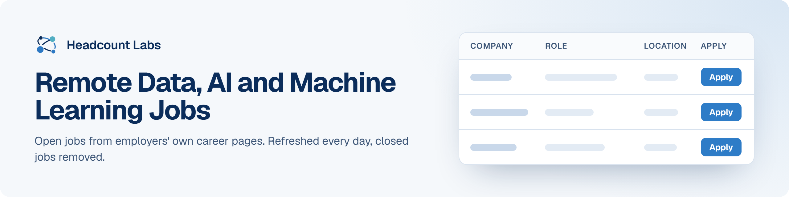

# Remote Data, AI and Machine Learning Jobs

Remote data science, data engineering, analytics, AI and machine learning jobs at US employers.

**400 open jobs** · 173 new since the last update · 173 removed because they closed or left the employer's board · updated November 3, 2026 at 4:42 AM EST

This list is built and refreshed every day by [Headcount Labs](https://headcountlabs.com/?utm_source=github&utm_medium=job-list&utm_campaign=remote-data-jobs), which reads jobs straight from employers' own career pages and job boards. Every job here was still listed on its source board when we last read that board, within the past 3 days, and was posted in the past 30 days. Copies of the same job are merged into one row, and jobs that close are removed at the next update.

Want this data in your own app or agent? Use the [Headcount Labs jobs API](https://headcountlabs.com/docs/?utm_source=github&utm_medium=job-list&utm_campaign=remote-data-jobs) (free tier), the [MCP server](https://headcountlabs.com/mcp/?utm_source=github&utm_medium=job-list&utm_campaign=remote-data-jobs) for Claude, ChatGPT and other AI assistants, or the [public dataset subsets](https://huggingface.co/HeadcountLabs) on Hugging Face (the full dataset is coming soon).

**Full dataset.** A bigger, one-off snapshot dated 2026-10-19 (all matching jobs, not only the open jobs below) is on Hugging Face: [Remote jobs](https://huggingface.co/datasets/HeadcountLabs/remote-jobs) · [Tech and software jobs](https://huggingface.co/datasets/HeadcountLabs/tech-jobs). It loads with `datasets.load_dataset` and is under the Open Database License (ODbL) 1.0.

**Jump to:** [Posted in the last 7 days (351)](#posted-in-the-last-7-days) · [Posted 8 to 30 days ago (49)](#posted-8-to-30-days-ago)

**Columns.** *Apply* opens the original posting on the employer's site. *Details* opens the job on Headcount Labs, with every posting we found for it. *Remote* shows what the employer states; a dash means the posting doesn't say. *Pay* is the range the employer published.

## Posted in the last 7 days

| Company | Role | Location | Remote | Pay | Posted | Apply | Details |
| --- | --- | --- | --- | --- | --- | :---: | :---: |
| **Wesco** | Director - Sales (Global Enterprise, Data Center AI) | Lewisville, TX | Remote | $120k–$156k/yr | Nov 2 |  | <a href="https://headcountlabs.com/catalog/jobs/8002f8f9-81dd-4b41-9002-00114174a648?utm_source=github&utm_medium=job-list&utm_campaign=remote-data-jobs">via Headcount Labs</a> |
| **Uvation** | Linux Infrastructure Engineer (Bare Metal, Storage &amp; AI Factory Infrastructure) | Las Vegas, NV | Remote | — | Nov 2 |  | <a href="https://headcountlabs.com/catalog/jobs/4be372bd-7c95-4f21-a749-38cc4dfbc39f?utm_source=github&utm_medium=job-list&utm_campaign=remote-data-jobs">via Headcount Labs</a> |
| **TowardJobs** | Work at Home Data Entry Clerk - Part Time | 

63 locations
Boise, ID Waco, TX Gilbert, AZ Visalia, CA West Valley City, UT Lansing, MI Midland, TX Costa Mesa, CA Vancouver, WA Pasadena, CA Meridian, ID Chesapeake, VA +51 more
 | Remote | — | Nov 2 |  | <a href="https://headcountlabs.com/catalog/jobs/fe603b3d-d045-4e32-8097-47052bf66382?utm_source=github&utm_medium=job-list&utm_campaign=remote-data-jobs">via Headcount Labs</a> |
| **TowardJobs** | Remote Data Entry Clerk - Work at Home | Buffalo, NY | Remote | $1k/mo | Nov 2 |  | <a href="https://headcountlabs.com/catalog/jobs/034e914d-4d76-4ddf-909c-a24eb213c20a?utm_source=github&utm_medium=job-list&utm_campaign=remote-data-jobs">via Headcount Labs</a> |
| **SupplyHouse.com** | Technical Product Manager - AI | United States | Remote | $122k–$152k/yr | Nov 2 |  | <a href="https://headcountlabs.com/catalog/jobs/dd7daf68-8e57-49e3-ae7a-1799c48fd78b?utm_source=github&utm_medium=job-list&utm_campaign=remote-data-jobs">via Headcount Labs</a> |
| **Sigma Software** | Partner Sales Manager (Cloud &amp; AI) | New York, NY | Remote | — | Nov 2 |  | <a href="https://headcountlabs.com/catalog/jobs/0861d2de-9cf3-4a1f-b14b-0899a26e756e?utm_source=github&utm_medium=job-list&utm_campaign=remote-data-jobs">via Headcount Labs</a> |
| **Rearc** | Senior AI Engineer | United States | Remote | $191k–$209k/yr | Nov 2 |  | <a href="https://headcountlabs.com/catalog/jobs/30453a33-405b-4f4a-a590-645d3d4e18f0?utm_source=github&utm_medium=job-list&utm_campaign=remote-data-jobs">via Headcount Labs</a> |
| **Peraton** | Senior Data Platform Engineer | United States | Remote | $104k–$166k/yr | Nov 2 |  | <a href="https://headcountlabs.com/catalog/jobs/9e3d0219-0b23-4ceb-affb-bd51b7c54df8?utm_source=github&utm_medium=job-list&utm_campaign=remote-data-jobs">via Headcount Labs</a> |
| **NOV** | Marketing and Data Analyst Intern | Houston, TX | Remote | — | Nov 2 |  | <a href="https://headcountlabs.com/catalog/jobs/09e3bdb7-2000-4ebf-b6c8-e57134e4c387?utm_source=github&utm_medium=job-list&utm_campaign=remote-data-jobs">via Headcount Labs</a> |
| **Lifted, an Upwork Company™** | Household Video Data Contributor | 

2 locations
Montgomery, AL Atlanta, GA
 | Remote | — | Nov 2 |  | <a href="https://headcountlabs.com/catalog/jobs/8effbed6-8381-43c3-8505-ba85b05da6bc?utm_source=github&utm_medium=job-list&utm_campaign=remote-data-jobs">via Headcount Labs</a> |
| **LatchBio** | AI Neuroscientist | San Francisco, CA | Remote | $140k–$180k/yr | Nov 2 |  | <a href="https://headcountlabs.com/catalog/jobs/f00fe007-83ac-4516-83a1-99e02596f53b?utm_source=github&utm_medium=job-list&utm_campaign=remote-data-jobs">via Headcount Labs</a> |
| **LatchBio** | AI Biologist - Microscopy | San Francisco, CA | Remote | $140k–$180k/yr | Nov 2 |  | <a href="https://headcountlabs.com/catalog/jobs/ba8e9c84-8aa0-473e-af30-327188a69ec3?utm_source=github&utm_medium=job-list&utm_campaign=remote-data-jobs">via Headcount Labs</a> |
| **LatchBio** | AI Biologist - Proteomics | San Francisco, CA | Remote | $140k–$180k/yr | Nov 2 |  | <a href="https://headcountlabs.com/catalog/jobs/a1b450d5-641d-4491-a5c9-ea75e91cdd05?utm_source=github&utm_medium=job-list&utm_campaign=remote-data-jobs">via Headcount Labs</a> |
| **LatchBio** | AI Biologist - Peptide Discovery | San Francisco, CA | Remote | $140k–$180k/yr | Nov 2 |  | <a href="https://headcountlabs.com/catalog/jobs/889250da-b6b4-4334-bc27-7d860ae4a666?utm_source=github&utm_medium=job-list&utm_campaign=remote-data-jobs">via Headcount Labs</a> |
| **LatchBio** | AI Biologist - Structural Biology | San Francisco, CA | Remote | $140k–$180k/yr | Nov 2 |  | <a href="https://headcountlabs.com/catalog/jobs/798d4919-53ba-4fd8-8061-f51bb030b801?utm_source=github&utm_medium=job-list&utm_campaign=remote-data-jobs">via Headcount Labs</a> |
| **LatchBio** | AI Biologist - Metagenomics | San Francisco, CA | Remote | $140k–$180k/yr | Nov 2 |  | <a href="https://headcountlabs.com/catalog/jobs/4b7097f0-06ec-4aee-9ac1-58419183340e?utm_source=github&utm_medium=job-list&utm_campaign=remote-data-jobs">via Headcount Labs</a> |
| **Jobgether** | Machine Learning Engineer, Perception | United States | Remote | — | Nov 2 |  | <a href="https://headcountlabs.com/catalog/jobs/ef35154b-e744-4336-89e2-defc76338120?utm_source=github&utm_medium=job-list&utm_campaign=remote-data-jobs">via Headcount Labs</a> |
| **Jobgether** | Director, Commercial Data Management Governance | United States | Remote | $215k–$235k/yr | Nov 2 |  | <a href="https://headcountlabs.com/catalog/jobs/ed255c3d-a7f0-4422-861d-47f832390577?utm_source=github&utm_medium=job-list&utm_campaign=remote-data-jobs">via Headcount Labs</a> |
| **Jobgether** | Senior Data Scientist | United States | Remote | — | Nov 2 |  | <a href="https://headcountlabs.com/catalog/jobs/dd61bdc0-8f96-4b2e-b263-fb3c02d38b10?utm_source=github&utm_medium=job-list&utm_campaign=remote-data-jobs">via Headcount Labs</a> |
| **Jobgether** | Senior Director, Data and Digital Solutions | United States | Remote | — | Nov 2 |  | <a href="https://headcountlabs.com/catalog/jobs/cbe3e17a-66f5-4a56-8107-4a7d1c0e7907?utm_source=github&utm_medium=job-list&utm_campaign=remote-data-jobs">via Headcount Labs</a> |
| **Jobgether** | Senior Product Marketing Manager - Emerging AI Accounts and Ecosystem Partner | United States | Remote | $168k–$269k/yr | Nov 2 |  | <a href="https://headcountlabs.com/catalog/jobs/c26936a5-eaa6-419b-afdd-98c234cc83f1?utm_source=github&utm_medium=job-list&utm_campaign=remote-data-jobs">via Headcount Labs</a> |
| **Jobgether** | Principal Engineer, Agentic AI | United States | Remote | — | Nov 2 |  | <a href="https://headcountlabs.com/catalog/jobs/bc3509ff-486d-4cbb-89c0-623aed1cbdad?utm_source=github&utm_medium=job-list&utm_campaign=remote-data-jobs">via Headcount Labs</a> |
| **Jobgether** | Director of AI Operations and Insurance Domain Quality | United States | Remote | $135k–$145k/yr | Nov 2 |  | <a href="https://headcountlabs.com/catalog/jobs/b26ca4bb-bd4a-49dd-9f82-a70567ba01aa?utm_source=github&utm_medium=job-list&utm_campaign=remote-data-jobs">via Headcount Labs</a> |
| **Jobgether** | AI Project &amp; Operations Manager | United States | Remote | — | Nov 2 |  | <a href="https://headcountlabs.com/catalog/jobs/9c4e5ded-107b-4a2b-a600-720ff1e418b4?utm_source=github&utm_medium=job-list&utm_campaign=remote-data-jobs">via Headcount Labs</a> |
| **JBT MAREL CORPORATION** | Senior Workday HR Reporting &amp; Analytics Analyst | 

16 locations
Boxmeer Coimbra Barcelona Madrid Murcia Navarra San Fernando de Henares Baud La Voulte Sur Rhone Pontoise Souffelweyersheim Taverny +4 more
 | Remote | — | Nov 2 |  | <a href="https://headcountlabs.com/catalog/jobs/0cee19f0-e76c-4896-bc17-5f7a7caf41f0?utm_source=github&utm_medium=job-list&utm_campaign=remote-data-jobs">via Headcount Labs</a> |
| **itD Tech** | Data Scientist IV (6367) | United States | Remote | — | Nov 2 |  | <a href="https://headcountlabs.com/catalog/jobs/06d60794-f76d-4462-9e8f-7d836b05c802?utm_source=github&utm_medium=job-list&utm_campaign=remote-data-jobs">via Headcount Labs</a> |
| **FMC Freedom Mortgage Corporation** | Full Stack AI Software Engineer | United States | Remote | — | Nov 2 |  | <a href="https://headcountlabs.com/catalog/jobs/ccbdda86-b57f-4e36-a5e0-5dd82228969d?utm_source=github&utm_medium=job-list&utm_campaign=remote-data-jobs">via Headcount Labs</a> |
| **Dynatrace** | Sr Director, Enterprise AI | 

2 locations
Massachusetts Boston
 | Remote | $224k–$280k/yr | Nov 2 |  | <a href="https://headcountlabs.com/catalog/jobs/6b3b9c5e-4d46-4279-bf5f-6bc7bb9974c0?utm_source=github&utm_medium=job-list&utm_campaign=remote-data-jobs">via Headcount Labs</a> |
| **Datavail** | Senior Data Engineer | Anywhere USA | Remote | — | Nov 2 |  | <a href="https://headcountlabs.com/catalog/jobs/f79a7286-abab-4947-88bb-beedd45f126a?utm_source=github&utm_medium=job-list&utm_campaign=remote-data-jobs">via Headcount Labs</a> |
| **Brunel** | AI Trainer: Mechanical Engineers CAD | Toronto | Remote | $40–$125/hr | Nov 2 |  | <a href="https://headcountlabs.com/catalog/jobs/499fe9f4-0530-4faf-9c7b-e3897e20ba9d?utm_source=github&utm_medium=job-list&utm_campaign=remote-data-jobs">via Headcount Labs</a> |
| **Brunel** | AI Trainer: Electrical Engineering CAD | Toronto | Remote | $40–$125/hr | Nov 2 |  | <a href="https://headcountlabs.com/catalog/jobs/0b0947c4-ffd0-4a9f-9f1e-ce38d624a733?utm_source=github&utm_medium=job-list&utm_campaign=remote-data-jobs">via Headcount Labs</a> |
| **Bright Vision Technologies** | Data Infrastructure Architect | Orlando — Avalon Park, FL | Remote | $175k–$200k/yr | Nov 2 |  | <a href="https://headcountlabs.com/catalog/jobs/fd8be32a-5340-4ea1-a9b1-95d957a96f68?utm_source=github&utm_medium=job-list&utm_campaign=remote-data-jobs">via Headcount Labs</a> |
| **Bright Vision Technologies** | Senior Data Scientist | Frisco, TX | Remote | $160k–$180k/yr | Nov 2 |  | <a href="https://headcountlabs.com/catalog/jobs/daf5a42e-78bb-4fd5-8dcd-2612c540286a?utm_source=github&utm_medium=job-list&utm_campaign=remote-data-jobs">via Headcount Labs</a> |
| **Bright Vision Technologies** | ML Data Engineer | Orlando — Avalon Park, FL | Remote | $100k–$150k/yr | Nov 2 |  | <a href="https://headcountlabs.com/catalog/jobs/b38eea0f-08d9-4ec7-bed4-6058f787feb4?utm_source=github&utm_medium=job-list&utm_campaign=remote-data-jobs">via Headcount Labs</a> |
| **Bright Vision Technologies** | Real-Time Data Engineer | Frisco, TX | Remote | $135k–$160k/yr | Nov 2 |  | <a href="https://headcountlabs.com/catalog/jobs/ac810789-3325-4e76-a6e9-7149612c7cdd?utm_source=github&utm_medium=job-list&utm_campaign=remote-data-jobs">via Headcount Labs</a> |
| **Bright Vision Technologies** | AI Governance Engineer | Orlando — Avalon Park, FL | Remote | $100k–$150k/yr | Nov 2 |  | <a href="https://headcountlabs.com/catalog/jobs/ba522ba4-7bc9-481e-94b9-da3d7c5e02ad?utm_source=github&utm_medium=job-list&utm_campaign=remote-data-jobs">via Headcount Labs</a> |
| **Bright Vision Technologies** | SAP Data Conversion Consultant | Katy, TX | Remote | $100k–$150k/yr | Nov 2 |  | <a href="https://headcountlabs.com/catalog/jobs/98c97d17-5cf0-41dc-a46b-bec2fd9317f6?utm_source=github&utm_medium=job-list&utm_campaign=remote-data-jobs">via Headcount Labs</a> |
| **Bright Vision Technologies** | AI Systems Engineer | 

2 locations
Orlando — Avalon Park, FL — Artesia / Cerritos, LA
 | Remote | $100k–$150k/yr | Nov 2 |  | <a href="https://headcountlabs.com/catalog/jobs/613efac8-f17e-4442-b42a-81772b48cdf0?utm_source=github&utm_medium=job-list&utm_campaign=remote-data-jobs">via Headcount Labs</a> |
| **Bright Vision Technologies** | SAP Data Migration Consultant | 

2 locations
Plainsboro, NJ Hoffman Estates, IL
 | Remote | $100k–$175k/yr | Nov 2 |  | <a href="https://headcountlabs.com/catalog/jobs/058574db-35ae-4369-ad22-2a82de97aa72?utm_source=github&utm_medium=job-list&utm_campaign=remote-data-jobs">via Headcount Labs</a> |
| **Better Homes and Gardens Real Estate Advantage Realty** | Real Estate Data Entry Operator | San Antonio, TX | Remote | $27.81–$29.97/hr | Nov 2 |  | <a href="https://headcountlabs.com/catalog/jobs/c9b149be-8c2f-4948-9daf-655cdbbf50ed?utm_source=github&utm_medium=job-list&utm_campaign=remote-data-jobs">via Headcount Labs</a> |
| **Anika Systems** | Data Architect | Leesburg, VA | Remote | — | Nov 2 |  | <a href="https://headcountlabs.com/catalog/jobs/66d527af-1d1f-4db2-ab04-51e30a0de06b?utm_source=github&utm_medium=job-list&utm_campaign=remote-data-jobs">via Headcount Labs</a> |
| **(Mosaic Shared Services) Millennium Healthcare Management Serv LLC** | Data Product Manager | Georgia | Remote | $125k–$187k/yr | Nov 2 |  | <a href="https://headcountlabs.com/catalog/jobs/d1ddeac1-1c5d-43bc-b1c2-1f1668a479c2?utm_source=github&utm_medium=job-list&utm_campaign=remote-data-jobs">via Headcount Labs</a> |
| **Steampunk** | Data Engineer | McLean, VA | Remote | $110k–$160k/yr | Nov 1 |  | <a href="https://headcountlabs.com/catalog/jobs/c93a9780-a022-4057-83dd-78c43079a97c?utm_source=github&utm_medium=job-list&utm_campaign=remote-data-jobs">via Headcount Labs</a> |
| **Steampunk** | Senior Data Engineer - Databricks | McLean, VA | Remote | $125k–$165k/yr | Nov 1 |  | <a href="https://headcountlabs.com/catalog/jobs/f04f37fa-6428-4d06-8b94-97d12f5be358?utm_source=github&utm_medium=job-list&utm_campaign=remote-data-jobs">via Headcount Labs</a> |
| **Steampunk** | Senior Data Visualization Engineer | McLean, VA | Remote | $115k–$170k/yr | Nov 1 |  | <a href="https://headcountlabs.com/catalog/jobs/dc9e805a-47b7-4217-92f0-d9815f1560f6?utm_source=github&utm_medium=job-list&utm_campaign=remote-data-jobs">via Headcount Labs</a> |
| **Steampunk** | Senior Data Engineer | McLean, VA | Remote | $125k–$165k/yr | Nov 1 |  | <a href="https://headcountlabs.com/catalog/jobs/7e8cbcc1-0c14-4c01-829a-548fa19f14c9?utm_source=github&utm_medium=job-list&utm_campaign=remote-data-jobs">via Headcount Labs</a> |
| **Steampunk** | Data Solution Architect | McLean, VA | Remote | $140k–$180k/yr | Nov 1 |  | <a href="https://headcountlabs.com/catalog/jobs/b9814093-44ae-4b8c-a08b-6375554a5427?utm_source=github&utm_medium=job-list&utm_campaign=remote-data-jobs">via Headcount Labs</a> |
| **Steampunk** | Data Analyst | McLean, VA | Remote | $50k–$115k/yr | Nov 1 |  | <a href="https://headcountlabs.com/catalog/jobs/095e8c0a-5ad9-45a6-868b-a033e99cef91?utm_source=github&utm_medium=job-list&utm_campaign=remote-data-jobs">via Headcount Labs</a> |
| **Steampunk** | Senior Data Warehouse Engineer | McLean, VA | Remote | $140k–$180k/yr | Nov 1 |  | <a href="https://headcountlabs.com/catalog/jobs/665935a4-3652-4956-9396-31dfe6c27555?utm_source=github&utm_medium=job-list&utm_campaign=remote-data-jobs">via Headcount Labs</a> |
| **PushPress** | Senior Data Platform Engineer | United States | Remote | — | Nov 1 |  | <a href="https://headcountlabs.com/catalog/jobs/e1bd9f53-8d99-46ea-b65c-8666d6f3ca7d?utm_source=github&utm_medium=job-list&utm_campaign=remote-data-jobs">via Headcount Labs</a> |
| **LLS Lineage Logistics Services, LLC** | Senior Business Analyst (AI COE) | Novi, MI | Remote | — | Nov 1 |  | <a href="https://headcountlabs.com/catalog/jobs/84685784-1dbf-4dfd-8904-9c74d6c23df9?utm_source=github&utm_medium=job-list&utm_campaign=remote-data-jobs">via Headcount Labs</a> |
| **Humana Inc.** | Associate Actuarial - Analytics/Forecasting | 

2 locations
United States Kentucky
 | Remote | $107k–$147k/yr | Nov 1 |  | <a href="https://headcountlabs.com/catalog/jobs/5efd90bf-15b0-480b-849c-01e27c511606?utm_source=github&utm_medium=job-list&utm_campaign=remote-data-jobs">via Headcount Labs</a> |
| **Volga Partners** | Legal &amp; Regulatory Subject Matter Expert (SME) - AI Evaluator &#124; USA | United States | Remote | — | Oct 31 |  | <a href="https://headcountlabs.com/catalog/jobs/ffa5d0d7-2679-4ebe-9672-cdbeb68ad175?utm_source=github&utm_medium=job-list&utm_campaign=remote-data-jobs">via Headcount Labs</a> |
| **Volga Partners** | Finance - Fixed Income Subject Matter Expert (SME) - AI Evaluator &#124; USA | United States | Remote | — | Oct 31 |  | <a href="https://headcountlabs.com/catalog/jobs/334e44ac-ad6e-441e-b012-4709bf2d842d?utm_source=github&utm_medium=job-list&utm_campaign=remote-data-jobs">via Headcount Labs</a> |
| **Terac** | Industrial Engineers: Equipment Diagnostics and Sensor Data Analysis | United States | Remote | — | Oct 31 |  | <a href="https://headcountlabs.com/catalog/jobs/8ab276bb-1b17-4514-886b-645d7991216e?utm_source=github&utm_medium=job-list&utm_campaign=remote-data-jobs">via Headcount Labs</a> |
| **Samsara** | Director, GTM AI Engineering | United States | Remote | $182k–$325k/yr | Oct 31 |  | <a href="https://headcountlabs.com/catalog/jobs/bba35c2f-9104-4652-ad56-bdabb72adbce?utm_source=github&utm_medium=job-list&utm_campaign=remote-data-jobs">via Headcount Labs</a> |
| **Maximus** | Senior Project Manager - AI Strategy (KH) | Boston, MA | Remote | $150k–$180k/yr | Oct 31 |  | <a href="https://headcountlabs.com/catalog/jobs/e901f515-1ea6-4845-b12e-7a9ae3f4d75f?utm_source=github&utm_medium=job-list&utm_campaign=remote-data-jobs">via Headcount Labs</a> |
| **Johns Hopkins University** | Research Data Analyst (Department of Health Policy and Management) - #Staff | Baltimore, MD | Remote | $49k–$86k/yr | Oct 31 |  | <a href="https://headcountlabs.com/catalog/jobs/23e21388-dee3-4880-814f-3c82cda5881a?utm_source=github&utm_medium=job-list&utm_campaign=remote-data-jobs">via Headcount Labs</a> |
| **Humana** | Senior Data Manager (DATABRICKS) | Boston, MA | Remote | $98k–$134k/yr | Oct 31 |  | <a href="https://headcountlabs.com/catalog/jobs/724cbcdd-372a-4303-ba63-43a534f17684?utm_source=github&utm_medium=job-list&utm_campaign=remote-data-jobs">via Headcount Labs</a> |
| **Gramian Consulting Group** | Quality &amp; Patient Safety Nurse (AI Clinical Evaluation) | United States | Remote | — | Oct 31 |  | <a href="https://headcountlabs.com/catalog/jobs/e5dd153d-5921-4e6e-9122-cc43c61dcab3?utm_source=github&utm_medium=job-list&utm_campaign=remote-data-jobs">via Headcount Labs</a> |
| **Gramian Consulting Group** | Clinical Pharmacist (AI Clinical Evaluation) | United States | Remote | — | Oct 31 |  | <a href="https://headcountlabs.com/catalog/jobs/c4c5c6c4-4ad9-41a7-9be6-286882227c49?utm_source=github&utm_medium=job-list&utm_campaign=remote-data-jobs">via Headcount Labs</a> |
| **Gramian Consulting Group** | Medical Coder / CDI Specialist (AI Clinical Evaluation) | United States | Remote | — | Oct 31 |  | <a href="https://headcountlabs.com/catalog/jobs/6705bc71-1880-4c66-9b71-6a99ef385339?utm_source=github&utm_medium=job-list&utm_campaign=remote-data-jobs">via Headcount Labs</a> |
| **Gramian Consulting Group** | Emergency Medicine Physician (AI Clinical Evaluation) | United States | Remote | — | Oct 31 |  | <a href="https://headcountlabs.com/catalog/jobs/66f6989e-0d62-4e08-b1e4-c57d1cead556?utm_source=github&utm_medium=job-list&utm_campaign=remote-data-jobs">via Headcount Labs</a> |
| **Gramian Consulting Group** | General Physician (AI Evaluation) | United States | Remote | — | Oct 31 |  | <a href="https://headcountlabs.com/catalog/jobs/7e943a28-1860-48c3-836e-8b90146ea49a?utm_source=github&utm_medium=job-list&utm_campaign=remote-data-jobs">via Headcount Labs</a> |
| **Watts Regulator Company** | Data Analyst | North Andover, MA | Remote | $104k–$117k/yr | Oct 30 |  | <a href="https://headcountlabs.com/catalog/jobs/e8b3cb16-0b7d-498e-a1d7-2a055e398059?utm_source=github&utm_medium=job-list&utm_campaign=remote-data-jobs">via Headcount Labs</a> |
| **Volga Partners** | Regulatory Compliance Auditor Subject Matter Expert -AI Model Evaluation | United States | Remote | — | Oct 30 |  | <a href="https://headcountlabs.com/catalog/jobs/95326f07-a002-4067-9736-49d8bd27207c?utm_source=github&utm_medium=job-list&utm_campaign=remote-data-jobs">via Headcount Labs</a> |
| **Volga Partners** | Regulatory CMC Submission Writer Subject Matter Expert -AI Model Evaluation | United States | Remote | — | Oct 30 |  | <a href="https://headcountlabs.com/catalog/jobs/93ce714c-0e65-4e52-998e-b50fae1f97aa?utm_source=github&utm_medium=job-list&utm_campaign=remote-data-jobs">via Headcount Labs</a> |
| **Volga Partners** | QA/Analytical Development Subject Matter Expert -AI Model Evaluation | United States | Remote | — | Oct 30 |  | <a href="https://headcountlabs.com/catalog/jobs/ca5cf3c9-c58c-4fdb-98e3-7f4c2b267839?utm_source=github&utm_medium=job-list&utm_campaign=remote-data-jobs">via Headcount Labs</a> |
| **Volga Partners** | Senior Market Research Analyst - International Development &amp; AI | United States | Remote | — | Oct 30 |  | <a href="https://headcountlabs.com/catalog/jobs/705fc78e-f94c-4a63-84ba-579d616ef49c?utm_source=github&utm_medium=job-list&utm_campaign=remote-data-jobs">via Headcount Labs</a> |
| **UFORCE** | AI Specialist, G&amp;A | United States | Remote | — | Oct 30 |  | <a href="https://headcountlabs.com/catalog/jobs/30127263-7ca9-43ce-95af-ba695c51a5d0?utm_source=github&utm_medium=job-list&utm_campaign=remote-data-jobs">via Headcount Labs</a> |
| **Truveta** | Principal Privacy Biostatistician - Risk Analytics | Seattle, WA | Remote | $160k–$180k/yr | Oct 30 |  | <a href="https://headcountlabs.com/catalog/jobs/a641cedf-0ea1-4169-b2e2-9af9e86eb747?utm_source=github&utm_medium=job-list&utm_campaign=remote-data-jobs">via Headcount Labs</a> |
| **Truveta** | Senior Privacy Biostatistician - Risk Analytics | Seattle, WA | Remote | — | Oct 30 |  | <a href="https://headcountlabs.com/catalog/jobs/40438db6-931e-448d-9ea8-6b66784c09f6?utm_source=github&utm_medium=job-list&utm_campaign=remote-data-jobs">via Headcount Labs</a> |
| **TriEdge Investments** | Director, BI &amp; Data Engineering | United States | Remote | — | Oct 30 |  | <a href="https://headcountlabs.com/catalog/jobs/26915b61-86ab-4ce8-9e4d-6a5317c875c8?utm_source=github&utm_medium=job-list&utm_campaign=remote-data-jobs">via Headcount Labs</a> |
| **TowardJobs** | Work from home Data Entry Clerk - Part Time | 

16 locations
Chesapeake, VA Baltimore, MD Boston, MA Newark, NJ Henderson, NV Modesto, CA Las Vegas, NV Baton Rouge, LA Irving, TX New Orleans, LA Lexington, KY Grand Rapids, MI +4 more
 | Remote | — | Oct 30 |  | <a href="https://headcountlabs.com/catalog/jobs/f818e2c3-aec8-4c63-8448-2b57130473d1?utm_source=github&utm_medium=job-list&utm_campaign=remote-data-jobs">via Headcount Labs</a> |
| **TowardJobs** | Work at Home Data Entry Agent - Part Time | 

2 locations
Abilene, TX Gresham, OR
 | Remote | — | Oct 30 |  | <a href="https://headcountlabs.com/catalog/jobs/f4c91c32-d208-4009-9990-b8bec35ae921?utm_source=github&utm_medium=job-list&utm_campaign=remote-data-jobs">via Headcount Labs</a> |
| **TowardJobs** | Work from Home Data Entry Clerk | 

7 locations
Fayetteville, NC Chandler, AZ Atlanta, GA Newark, NJ Boston, MA Chesapeake, VA Baton Rouge, LA
 | Remote | — | Oct 30 |  | <a href="https://headcountlabs.com/catalog/jobs/c77b32ea-b2ba-493e-9c12-4aa508023596?utm_source=github&utm_medium=job-list&utm_campaign=remote-data-jobs">via Headcount Labs</a> |
| **TowardJobs** | Work From Home Data Entry | Boston, MA | Remote | — | Oct 30 |  | <a href="https://headcountlabs.com/catalog/jobs/dd035c52-4b00-43e0-8734-a268fc84787c?utm_source=github&utm_medium=job-list&utm_campaign=remote-data-jobs">via Headcount Labs</a> |
| **TowardJobs** | Work From Home Data Entry Clerk - Customer Service | Milwaukee, WI | Remote | — | Oct 30 |  | <a href="https://headcountlabs.com/catalog/jobs/b1608de9-d288-44fa-8663-3a9a0c2c7d46?utm_source=github&utm_medium=job-list&utm_campaign=remote-data-jobs">via Headcount Labs</a> |
| **TowardJobs** | Work From Home - Remote Data Entry Clerk | 

2 locations
Houston, TX Nashville, TN
 | Remote | — | Oct 30 |  | <a href="https://headcountlabs.com/catalog/jobs/99f788ad-2388-45e7-8fd1-bfc4881258b1?utm_source=github&utm_medium=job-list&utm_campaign=remote-data-jobs">via Headcount Labs</a> |
| **TMS LLC** | Senior Data Engineer (GenAI / AWS) &#124; Claude Agent SDK &#124; Amazon Bedrock &#124; Python &#124; 14+ years of experience | California | Remote | — | Oct 30 |  | <a href="https://headcountlabs.com/catalog/jobs/07609b35-7a4f-416a-98b6-b04e3110a4fa?utm_source=github&utm_medium=job-list&utm_campaign=remote-data-jobs">via Headcount Labs</a> |
| **Tiger Analytics Inc.** | Senior Consultant / Manager Analytics Consulting - Real Estate | United States | Remote | — | Oct 30 |  | <a href="https://headcountlabs.com/catalog/jobs/ca4f92e9-4c8e-4782-86b3-d522a39b74f8?utm_source=github&utm_medium=job-list&utm_campaign=remote-data-jobs">via Headcount Labs</a> |
| **Tiger Analytics Inc.** | Azure Data Engineer | Chicago, IL | Remote | — | Oct 30 |  | <a href="https://headcountlabs.com/catalog/jobs/d28cda49-9166-49fb-8471-9109f38d30d3?utm_source=github&utm_medium=job-list&utm_campaign=remote-data-jobs">via Headcount Labs</a> |
| **The Cigna Group** | DataOps - Lead Data Analyst | United States | Remote | $82k–$137k/yr | Oct 30 |  | <a href="https://headcountlabs.com/catalog/jobs/62e1f56d-2271-4f82-a4d7-cf4441611607?utm_source=github&utm_medium=job-list&utm_campaign=remote-data-jobs">via Headcount Labs</a> |
| **Tempo** | Senior AI/ML Engineer | United States | Remote | — | Oct 30 |  | <a href="https://headcountlabs.com/catalog/jobs/1f65820e-48a8-4200-b701-44f0428aedc7?utm_source=github&utm_medium=job-list&utm_campaign=remote-data-jobs">via Headcount Labs</a> |
| **Team Member Services** | Oncology Data Specialist Certified | United States | Remote | $23.94–$44.53/hr | Oct 30 |  | <a href="https://headcountlabs.com/catalog/jobs/efe02e59-34c4-49fd-9be3-da598562f337?utm_source=github&utm_medium=job-list&utm_campaign=remote-data-jobs">via Headcount Labs</a> |
| **Syndio** | Staff Software Engineer, AI Platform (US - Remote or Calgary) | United States | Remote | $205k–$225k/yr | Oct 30 |  | <a href="https://headcountlabs.com/catalog/jobs/6e95dcd4-ce82-4b6c-8607-f81d1d6e71ca?utm_source=github&utm_medium=job-list&utm_campaign=remote-data-jobs">via Headcount Labs</a> |
| **Sutherland** | Team Manager &#124; Healthcare &#124; Provider Data Management | Houston, TX | Remote | — | Oct 30 |  | <a href="https://headcountlabs.com/catalog/jobs/1393173d-c669-4629-8c4f-7054d1bcd997?utm_source=github&utm_medium=job-list&utm_campaign=remote-data-jobs">via Headcount Labs</a> |
| **Summit Healthcare** | Data Interface Analyst, Full Time, Remote | Show Low, AZ | Remote | — | Oct 30 |  | <a href="https://headcountlabs.com/catalog/jobs/443c3918-d4f3-47db-b58e-881fe8c65a4b?utm_source=github&utm_medium=job-list&utm_campaign=remote-data-jobs">via Headcount Labs</a> |
| **Stripe** | Startup Products Strategy &amp; Operations, Insights &amp; Analytics | United States | Remote | — | Oct 30 |  | <a href="https://headcountlabs.com/catalog/jobs/61cbbc72-8657-446f-9085-ac9976123f72?utm_source=github&utm_medium=job-list&utm_campaign=remote-data-jobs">via Headcount Labs</a> |
| **Sellfire** | Remote Inside Sales Rep - AI-Enabled, Flexible Hours (Independent Contractor) | 

16 locations
United States Tampa, FL Phoenix, AZ Denver, CO Miami, FL Chicago, IL Las Vegas, NV Raleigh, NC Salt Lake City, UT Boise, ID Atlanta, GA Orlando, FL +4 more
 | Remote | $8k/mo | Oct 30 |  | <a href="https://headcountlabs.com/catalog/jobs/4b92ad9b-cede-4851-88cc-2eeea7671dcd?utm_source=github&utm_medium=job-list&utm_campaign=remote-data-jobs">via Headcount Labs</a> |
| **Sanity** | AI &amp; Innovation Lead, G&amp;A | in the United States | Remote | — | Oct 30 |  | <a href="https://headcountlabs.com/catalog/jobs/a76ff9eb-efbf-4e21-abc8-7b3d8063feea?utm_source=github&utm_medium=job-list&utm_campaign=remote-data-jobs">via Headcount Labs</a> |
| **Robert Half Inc.** | Manager AI | 

2 locations
United States California
 | Remote | $123k–$190k/yr | Oct 30 |  | <a href="https://headcountlabs.com/catalog/jobs/b37d739d-835c-4cb8-9011-3c9079a7fec2?utm_source=github&utm_medium=job-list&utm_campaign=remote-data-jobs">via Headcount Labs</a> |
| **Regal Beloit Canada ULC** | Business Development Manager (Data Centers Vertical) | United States | Remote | $150k–$200k/yr | Oct 30 |  | <a href="https://headcountlabs.com/catalog/jobs/fd0eb458-c7ae-4450-b87e-6fb9ea6fb260?utm_source=github&utm_medium=job-list&utm_campaign=remote-data-jobs">via Headcount Labs</a> |
| **Redhorse Corporation** | Senior AI/ML Engineer | United States | Remote | $180k–$200k/yr | Oct 30 |  | <a href="https://headcountlabs.com/catalog/jobs/61553b9d-050d-4475-9088-c5a336f4f79e?utm_source=github&utm_medium=job-list&utm_campaign=remote-data-jobs">via Headcount Labs</a> |
| **Redhorse Corporation** | AI/ML Modeling Team Lead | United States | Remote | $140k–$170k/yr | Oct 30 |  | <a href="https://headcountlabs.com/catalog/jobs/1e326317-a26a-4b0c-8961-f8279bb5cc5d?utm_source=github&utm_medium=job-list&utm_campaign=remote-data-jobs">via Headcount Labs</a> |
| **Raya** | Senior Data Scientist, Places | United States | Remote | — | Oct 30 |  | <a href="https://headcountlabs.com/catalog/jobs/c5c8f157-b01b-471c-b45f-a97d284c2db4?utm_source=github&utm_medium=job-list&utm_campaign=remote-data-jobs">via Headcount Labs</a> |
| **Public Consulting Group** | Business Data Analyst 1 | United States | Remote | $60k–$75k/yr | Oct 30 |  | <a href="https://headcountlabs.com/catalog/jobs/9ef7d865-ee08-4382-8225-c7704dbcc86c?utm_source=github&utm_medium=job-list&utm_campaign=remote-data-jobs">via Headcount Labs</a> |
| **Provectus** | Go to Market (GTM) Partnerships &amp; Alliances Associate – AI Consulting Solutions (AWS, Anthropic partner) | 

7 locations
Philadelphia, PA United States New York, NY New York City Metropolitan Area Brooklyn, NY Manhattan, NY Yonkers, NY
 | Remote | — | Oct 30 |  | <a href="https://headcountlabs.com/catalog/jobs/1bdb6d0b-9bf0-4813-affc-f045235ba5c5?utm_source=github&utm_medium=job-list&utm_campaign=remote-data-jobs">via Headcount Labs</a> |
| **Provectus** | Senior Forward Deployed AI Architect (GenAI, AWS) | United States | Remote | $180k–$200k/yr | Oct 30 |  | <a href="https://headcountlabs.com/catalog/jobs/a3a7b9ed-1b42-4ae0-99ee-b6ea6339de11?utm_source=github&utm_medium=job-list&utm_campaign=remote-data-jobs">via Headcount Labs</a> |
| **Principal Financial Group** | Experienced Info Security Engineer (AI Automation) | United States | Remote | $85k–$187k/yr | Oct 30 |  | <a href="https://headcountlabs.com/catalog/jobs/3301a105-8a31-496c-b2e2-85c425ae9af4?utm_source=github&utm_medium=job-list&utm_campaign=remote-data-jobs">via Headcount Labs</a> |
| **Prime Therapeutics** | SQL Programmer-Health Data Analyst Senior - Remote | 

41 locations
Topeka, KS Raleigh, NC Boston, MA Little Rock, AR Santa Fe, NM Helena, MT Atlanta, GA Washington, DC Saint Paul, MN Des Moines, IA Salt Lake City, UT Columbus, OH +29 more
 | Remote | $81k–$138k/yr | Oct 30 |  | <a href="https://headcountlabs.com/catalog/jobs/8b992d76-eadc-4b91-b2b0-05fbd4990fcb?utm_source=github&utm_medium=job-list&utm_campaign=remote-data-jobs">via Headcount Labs</a> |
| **Pinterest** | Business Development, AI Product Partnerships | San Francisco, CA | Remote | $110k–$227k/yr | Oct 30 |  | <a href="https://headcountlabs.com/catalog/jobs/60153665-9292-43be-bfb3-ebe50eef2949?utm_source=github&utm_medium=job-list&utm_campaign=remote-data-jobs">via Headcount Labs</a> |
| **Navitus Health Solutions, LLC** | Director, Analytics and Data | United States | Remote | $152k–$190k/yr | Oct 30 |  | <a href="https://headcountlabs.com/catalog/jobs/c35eb6fd-f462-4cdc-bb47-1034265c5e03?utm_source=github&utm_medium=job-list&utm_campaign=remote-data-jobs">via Headcount Labs</a> |
| **Miratech** | Principal AI Strategist | United States | Remote | — | Oct 30 |  | <a href="https://headcountlabs.com/catalog/jobs/f6394c14-1e03-4814-92d6-a93e99d56efc?utm_source=github&utm_medium=job-list&utm_campaign=remote-data-jobs">via Headcount Labs</a> |
| **LTK USA** | Principal Product Manager, AI | United States | Remote | — | Oct 30 |  | <a href="https://headcountlabs.com/catalog/jobs/580963d1-c934-49ab-9704-39c1e039485a?utm_source=github&utm_medium=job-list&utm_campaign=remote-data-jobs">via Headcount Labs</a> |
| **LatchBio** | AI Biologist - Drug Development | San Francisco, CA | Remote | $140k–$180k/yr | Oct 30 |  | <a href="https://headcountlabs.com/catalog/jobs/c5e85a94-9e84-4b91-851f-17735d1ef132?utm_source=github&utm_medium=job-list&utm_campaign=remote-data-jobs">via Headcount Labs</a> |
| **Johns Hopkins Hospital** | Clinical Data Specialist Senior | Baltimore, MD | Remote | $28.90–$47.71/hr | Oct 30 |  | <a href="https://headcountlabs.com/catalog/jobs/b12e1154-e5c4-4ab9-8b7c-8b13f99f5b6c?utm_source=github&utm_medium=job-list&utm_campaign=remote-data-jobs">via Headcount Labs</a> |
| **Iron Mountain Data Centers, LLC** | Sr. Category Sourcing Manager, Data Center | 

18 locations
Salem, OR Oregon Denver, CO Colorado Atlanta, GA Georgia Columbia, SC South Carolina Tallahassee, FL Florida Austin, TX Texas +6 more
 | Remote | $108k–$143k/yr | Oct 30 |  | <a href="https://headcountlabs.com/catalog/jobs/352bd754-878c-408a-b9fa-7bf6be01a5c5?utm_source=github&utm_medium=job-list&utm_campaign=remote-data-jobs">via Headcount Labs</a> |
| **Invitrogen Holdings LLC** | Scientist III, Field Applications - Protein Expression | Seattle, WA | Remote | $84k–$125k/yr | Oct 30 |  | <a href="https://headcountlabs.com/catalog/jobs/fb286545-9449-45ba-a3c2-dc8273f9a7b0?utm_source=github&utm_medium=job-list&utm_campaign=remote-data-jobs">via Headcount Labs</a> |
| **Instacart** | Senior Machine Learning Engineer, Fulfillment | United States | Remote | — | Oct 30 |  | <a href="https://headcountlabs.com/catalog/jobs/2ac4080a-f557-4f53-ab4c-db0906e1ba6a?utm_source=github&utm_medium=job-list&utm_campaign=remote-data-jobs">via Headcount Labs</a> |
| **Instacart** | Senior Software Engineer, Enterprise AI | United States | Remote | — | Oct 30 |  | <a href="https://headcountlabs.com/catalog/jobs/121118d7-2cf9-4206-8ba5-8522765a7f06?utm_source=github&utm_medium=job-list&utm_campaign=remote-data-jobs">via Headcount Labs</a> |
| **Horizon3** | Principal Attack Engineer, AI/LLM | United States | Remote | — | Oct 30 |  | <a href="https://headcountlabs.com/catalog/jobs/7c45d7c0-1860-4eb2-a0ce-3d873264b1c5?utm_source=github&utm_medium=job-list&utm_campaign=remote-data-jobs">via Headcount Labs</a> |
| **HOME DEPOT MANAGEMENT COMPANY, LLC** | HR Analytics Analyst | Georgia | Remote | — | Oct 30 |  | <a href="https://headcountlabs.com/catalog/jobs/0e8a885a-18a8-4c1a-8c59-b491cb631bc5?utm_source=github&utm_medium=job-list&utm_campaign=remote-data-jobs">via Headcount Labs</a> |
| **HOME DEPOT MANAGEMENT COMPANY, LLC** | Senior AI Engineer (Remote) | United States | Remote | $100k–$250k/yr | Oct 30 |  | <a href="https://headcountlabs.com/catalog/jobs/a2394aed-d0da-4e8c-bb36-43db8f3a76c5?utm_source=github&utm_medium=job-list&utm_campaign=remote-data-jobs">via Headcount Labs</a> |
| **Gramian Consulting Group** | Commercial Aviation &amp; Flight Operations Specialist - AI Projects | United States | Remote | — | Oct 30 |  | <a href="https://headcountlabs.com/catalog/jobs/4ffecd05-ca48-4087-8c0a-1d4cd2742dec?utm_source=github&utm_medium=job-list&utm_campaign=remote-data-jobs">via Headcount Labs</a> |
| **Gramian Consulting Group** | Intelligence Operations &amp; Collection Specialist - AI Training Projects | United States | Remote | — | Oct 30 |  | <a href="https://headcountlabs.com/catalog/jobs/b8ea9088-7c38-4142-bf95-a7d657bb5fcb?utm_source=github&utm_medium=job-list&utm_campaign=remote-data-jobs">via Headcount Labs</a> |
| **Gramian Consulting Group** | Litigation Attorney (AI Legal Evaluation) | United States | Remote | — | Oct 30 |  | <a href="https://headcountlabs.com/catalog/jobs/9fd4fdc7-781f-4813-ac1e-8d48adb18761?utm_source=github&utm_medium=job-list&utm_campaign=remote-data-jobs">via Headcount Labs</a> |
| **fal** | Senior Software Engineer, Machine Learning Infrastructure &amp; Automation | United States | Remote | $170k–$230k/yr | Oct 30 |  | <a href="https://headcountlabs.com/catalog/jobs/bd1ee42f-bc34-4c41-8ad4-47995e2276aa?utm_source=github&utm_medium=job-list&utm_campaign=remote-data-jobs">via Headcount Labs</a> |
| **EWOR GmbH** | AI Research Lab Co-Founder / COO (100 % remote) (m/f/d) | Princeton, NJ | Remote | — | Oct 30 |  | <a href="https://headcountlabs.com/catalog/jobs/f91d8bc8-5e3f-43d8-9115-073ee662fdb4?utm_source=github&utm_medium=job-list&utm_campaign=remote-data-jobs">via Headcount Labs</a> |
| **EWOR GmbH** | AI Co-Founder / CEO (100 % remote) (m/f/d) | 

9 locations
Palo Alto, CA New York, NY Provo, UT Los Angeles, CA Madison, WI Ann Arbor, MI Mountain View, CA Salt Lake City, UT San Jose, CA
 | Remote | — | Oct 30 |  | <a href="https://headcountlabs.com/catalog/jobs/f798e6d0-6dfe-43c9-b2d5-dc8b6ad43a19?utm_source=github&utm_medium=job-list&utm_campaign=remote-data-jobs">via Headcount Labs</a> |
| **EWOR GmbH** | AI Research Lab Co-Founder / CTO (100 % remote) (m/f/d) | Princeton, NJ | Remote | — | Oct 30 |  | <a href="https://headcountlabs.com/catalog/jobs/f703eac0-68dd-4b48-9a5f-9e7d4bdcc726?utm_source=github&utm_medium=job-list&utm_campaign=remote-data-jobs">via Headcount Labs</a> |
| **EWOR GmbH** | Applied AI Co-Founder / CEO (100 % remote) (m/f/d) | Austin, TX | Remote | — | Oct 30 |  | <a href="https://headcountlabs.com/catalog/jobs/e9787b72-ece6-4265-9e53-5584ac55a786?utm_source=github&utm_medium=job-list&utm_campaign=remote-data-jobs">via Headcount Labs</a> |
| **EWOR GmbH** | AI Co-Founder / COO (100 % remote) (m/f/d) | 

10 locations
Salt Lake City, UT Provo, UT Anchorage, AK Madison, WI Palo Alto, CA Ann Arbor, MI Los Angeles, CA Mountain View, CA Lubbock, TX Fort Wayne, IN
 | Remote | — | Oct 30 |  | <a href="https://headcountlabs.com/catalog/jobs/e66232c0-4049-4889-bc8b-f851c1db10f9?utm_source=github&utm_medium=job-list&utm_campaign=remote-data-jobs">via Headcount Labs</a> |
| **EWOR GmbH** | AI Infrastructure Co-Founder / COO (100 % remote) (m/f/d) | 

4 locations
Fresno, CA Charlotte, NC Fort Worth, TX Huntsville, AL
 | Remote | — | Oct 30 |  | <a href="https://headcountlabs.com/catalog/jobs/db127d1c-5f03-4cce-8341-47140e4834c5?utm_source=github&utm_medium=job-list&utm_campaign=remote-data-jobs">via Headcount Labs</a> |
| **EWOR GmbH** | AI Infrastructure Co-Founder / CCO (100 % remote) (m/f/d) | 

3 locations
Cambridge, MA Lexington, KY Spokane, WA
 | Remote | — | Oct 30 |  | <a href="https://headcountlabs.com/catalog/jobs/cec0a7b9-6bc8-4573-bef3-54f30ef11fd1?utm_source=github&utm_medium=job-list&utm_campaign=remote-data-jobs">via Headcount Labs</a> |
| **EWOR GmbH** | AI Co-Founder / CTO (100 % remote) (m/f/d) | 

4 locations
Mountain View, CA Madison, WI Los Angeles, CA Ann Arbor, MI
 | Remote | — | Oct 30 |  | <a href="https://headcountlabs.com/catalog/jobs/a1a088ce-9767-4001-bc4e-360fd955753e?utm_source=github&utm_medium=job-list&utm_campaign=remote-data-jobs">via Headcount Labs</a> |
| **Eliassen Group** | AI Strategy Director | Boston, MA | Remote | $160k–$257k/yr | Oct 30 |  | <a href="https://headcountlabs.com/catalog/jobs/e663fbfb-7481-4ed4-a17f-8d7150f572f8?utm_source=github&utm_medium=job-list&utm_campaign=remote-data-jobs">via Headcount Labs</a> |
| **ECPI University** | Online Business Adjunct Faculty – Business Analytics | United States | Remote | — | Oct 30 |  | <a href="https://headcountlabs.com/catalog/jobs/eea09346-cd34-450e-b0b8-a45bf9357f73?utm_source=github&utm_medium=job-list&utm_campaign=remote-data-jobs">via Headcount Labs</a> |
| **ECPI University** | Online Software Development Adjunct Faculty - Artificial Intelligence / Generative AI / Applied AI Development | United States | Remote | — | Oct 30 |  | <a href="https://headcountlabs.com/catalog/jobs/2c8617c3-911e-43bb-8050-2efc310e73e9?utm_source=github&utm_medium=job-list&utm_campaign=remote-data-jobs">via Headcount Labs</a> |
| **DeVry University** | Sr. Analyst Web and Marketing Analytics | United States | Remote | — | Oct 30 |  | <a href="https://headcountlabs.com/catalog/jobs/52943e91-2a1f-4195-a017-38168ca3049b?utm_source=github&utm_medium=job-list&utm_campaign=remote-data-jobs">via Headcount Labs</a> |
| **DAVITA** | Manager, Analytics &amp; Strategy (Revenue Operations) | Chesterbrook, PA | Remote | $78k–$119k/yr | Oct 30 |  | <a href="https://headcountlabs.com/catalog/jobs/93da340f-92f7-4998-af7f-7c3d6d67fb32?utm_source=github&utm_medium=job-list&utm_campaign=remote-data-jobs">via Headcount Labs</a> |
| **Datavail** | Senior Data Architect | 

2 locations
Anywhere USA Boulder, CO
 | Remote | — | Oct 30 |  | <a href="https://headcountlabs.com/catalog/jobs/3d6a178c-0575-4492-9d9b-48a1c33d6c13?utm_source=github&utm_medium=job-list&utm_campaign=remote-data-jobs">via Headcount Labs</a> |
| **DaBrian Marketing Group, LLC** | Organic &amp; AI Search Specialist | Reading, PA | Remote | $45k–$55k/yr | Oct 30 |  | <a href="https://headcountlabs.com/catalog/jobs/54b59c33-d882-4d0f-9c35-02b0c53691c9?utm_source=github&utm_medium=job-list&utm_campaign=remote-data-jobs">via Headcount Labs</a> |
| **Cyara** | Sr. Sales Engineer – Agentic AI for CX | United States | Remote | $170k–$220k/yr | Oct 30 |  | <a href="https://headcountlabs.com/catalog/jobs/e6df9ebc-e886-47a6-a87c-2e8d329b8a0f?utm_source=github&utm_medium=job-list&utm_campaign=remote-data-jobs">via Headcount Labs</a> |
| **CoSourcing Partners** | Facets Data Analyst / SQL Developer | Chicago, IL | Remote | — | Oct 30 |  | <a href="https://headcountlabs.com/catalog/jobs/6e830911-0f0e-469a-b643-637368d34555?utm_source=github&utm_medium=job-list&utm_campaign=remote-data-jobs">via Headcount Labs</a> |
| **CORP Saint Luke's Health System, Inc.** | Data Integrity Specialist | System Offices | Remote | — | Oct 30 |  | <a href="https://headcountlabs.com/catalog/jobs/981c3e6d-b1e0-4e1f-be84-d26a7f2ba14a?utm_source=github&utm_medium=job-list&utm_campaign=remote-data-jobs">via Headcount Labs</a> |
| **Clera** | Computational and Experimental Scientist | New York, NY | Remote | — | Oct 30 |  | <a href="https://headcountlabs.com/catalog/jobs/b48c3098-5da0-495f-b403-c6ea4055d74d?utm_source=github&utm_medium=job-list&utm_campaign=remote-data-jobs">via Headcount Labs</a> |
| **Care Access** | Senior Data Engineer | United States | Remote | $120k–$160k/yr | Oct 30 |  | <a href="https://headcountlabs.com/catalog/jobs/9ff22462-622a-476d-91f9-16a6c63daafa?utm_source=github&utm_medium=job-list&utm_campaign=remote-data-jobs">via Headcount Labs</a> |
| **C01 Carrier Corporation** | HVAC Chiller Journeyman Technician - Traveling Data Center Technician - (Union) | 

2 locations
City, FL Florida
 | Remote | $38–$76/hr | Oct 30 |  | <a href="https://headcountlabs.com/catalog/jobs/8e426dee-627a-4f8f-85ea-ad63bb57d368?utm_source=github&utm_medium=job-list&utm_campaign=remote-data-jobs">via Headcount Labs</a> |
| **AutoNation Corporate Management, LLC** | Senior Data Platform Administrator | 

2 locations
Fort Lauderdale, FL United States
 | Remote | — | Oct 30 |  | <a href="https://headcountlabs.com/catalog/jobs/e55c7223-4518-488f-9647-e8141ec35943?utm_source=github&utm_medium=job-list&utm_campaign=remote-data-jobs">via Headcount Labs</a> |
| **AutoNation** | Senior Data Platform Administrator | Fort Lauderdale, FL | Remote | — | Oct 30 |  | <a href="https://headcountlabs.com/catalog/jobs/1ad95f52-093a-4b68-a377-6b6e360734cc?utm_source=github&utm_medium=job-list&utm_campaign=remote-data-jobs">via Headcount Labs</a> |
| **Armada** | Senior Data Center Commissioning Engineer | United States | Remote | $130k–$171k/yr | Oct 30 |  | <a href="https://headcountlabs.com/catalog/jobs/f646948b-2384-4665-b9ee-cd5875e4c541?utm_source=github&utm_medium=job-list&utm_campaign=remote-data-jobs">via Headcount Labs</a> |
| **Allstate Insurance Co.** | Data &amp; Analytics Expert | USA -, IL | Remote | — | Oct 30 |  | <a href="https://headcountlabs.com/catalog/jobs/f1297e4f-9cff-4cea-84e3-d93ced381d54?utm_source=github&utm_medium=job-list&utm_campaign=remote-data-jobs">via Headcount Labs</a> |
| **Allstate Insurance Co.** | Senior Database Engineer – Security &amp; Data Platform Resilience | USA -, IL | Remote | — | Oct 30 |  | <a href="https://headcountlabs.com/catalog/jobs/e13d3a9b-d9ef-470c-b5fe-239a6b02d8d5?utm_source=github&utm_medium=job-list&utm_campaign=remote-data-jobs">via Headcount Labs</a> |
| **Allstate Insurance Co.** | Data &amp; Analytics Lead Consultant | USA -, IL | Remote | — | Oct 30 |  | <a href="https://headcountlabs.com/catalog/jobs/434824d9-12ef-4907-b990-548c3e5a0699?utm_source=github&utm_medium=job-list&utm_campaign=remote-data-jobs">via Headcount Labs</a> |
| **Allstate Insurance Co.** | Data Scientist Senior Consultant – Remote | USA -, IL | Remote | — | Oct 30 |  | <a href="https://headcountlabs.com/catalog/jobs/33f9a623-1fdc-4fbb-8c44-f22a486175b8?utm_source=github&utm_medium=job-list&utm_campaign=remote-data-jobs">via Headcount Labs</a> |
| **Allstate Insurance Co.** | Senior Data Engineer | USA -, IL | Remote | — | Oct 30 |  | <a href="https://headcountlabs.com/catalog/jobs/07d2eb44-3b93-4ad2-8b50-f2813d25e68c?utm_source=github&utm_medium=job-list&utm_campaign=remote-data-jobs">via Headcount Labs</a> |
| **Allstate Insurance Co.** | Digital Product Manager - AI Knowledge &amp; Solutions | USA -, PA | Remote | — | Oct 30 |  | <a href="https://headcountlabs.com/catalog/jobs/2129f955-abb7-490c-9c51-3ae59577e1f1?utm_source=github&utm_medium=job-list&utm_campaign=remote-data-jobs">via Headcount Labs</a> |
| **ALL REALTRUCK** | Vice President of AI, Data &amp; Analytics | United States | Remote | — | Oct 30 |  | <a href="https://headcountlabs.com/catalog/jobs/f984d413-de1c-4076-ac40-5a21e6a1458c?utm_source=github&utm_medium=job-list&utm_campaign=remote-data-jobs">via Headcount Labs</a> |
| **AgileOne** | Data Analyst | 

2 locations
Torrance, CA United States
 | Remote | $66k–$97k/yr | Oct 30 |  | <a href="https://headcountlabs.com/catalog/jobs/7c9d513d-aff1-4c47-8e53-850bf19b444a?utm_source=github&utm_medium=job-list&utm_campaign=remote-data-jobs">via Headcount Labs</a> |
| **YouGov PLC** | Senior Technical Product Manager, Data Integrations | 

4 locations
London Milano New York Warsaw
 | Remote | — | Oct 29 |  | <a href="https://headcountlabs.com/catalog/jobs/e775e8b8-0fc6-442a-a9f9-81019178a0e6?utm_source=github&utm_medium=job-list&utm_campaign=remote-data-jobs">via Headcount Labs</a> |
| **World Wide Technology** | Program Manager, Data Center and AI | Nationwide | Remote | $118k–$147k/yr | Oct 29 |  | <a href="https://headcountlabs.com/catalog/jobs/63920401-5a1c-4e15-815c-352277845658?utm_source=github&utm_medium=job-list&utm_campaign=remote-data-jobs">via Headcount Labs</a> |
| **Wolf Games** | AI Content Writer &amp; Editor, Mobile Games | United States | Remote | $30–$35/hr | Oct 29 |  | <a href="https://headcountlabs.com/catalog/jobs/0ce606b0-61c1-4806-a988-1055348fe5af?utm_source=github&utm_medium=job-list&utm_campaign=remote-data-jobs">via Headcount Labs</a> |
| **Vuori, Inc** | Principal AI Engineer, Agentic Systems | Carlsbad, CA | Remote | $198k–$264k/yr | Oct 29 |  | <a href="https://headcountlabs.com/catalog/jobs/e8cef133-83e8-4329-83d4-030cd7fd73b5?utm_source=github&utm_medium=job-list&utm_campaign=remote-data-jobs">via Headcount Labs</a> |
| **Volga Partners** | GMP Compliance &amp; Validation Subject Matter Expert -AI Model Evaluation | United States | Remote | — | Oct 29 |  | <a href="https://headcountlabs.com/catalog/jobs/51bccfef-8c7d-47fe-bbbc-1e3387fc7e78?utm_source=github&utm_medium=job-list&utm_campaign=remote-data-jobs">via Headcount Labs</a> |
| **Volga Partners** | Pharmaceutical Quality Assurance Subject Matter Expert - AI Model Evaluation | United States | Remote | — | Oct 29 |  | <a href="https://headcountlabs.com/catalog/jobs/d74f8ffe-3cb9-4982-9d91-137ca04cf8fe?utm_source=github&utm_medium=job-list&utm_campaign=remote-data-jobs">via Headcount Labs</a> |
| **Via Logic LLC** | Business and Data Analyst [U.S. Citizenship Required, Public Trust Suitability] | United States | Remote | $90k/yr | Oct 29 |  | <a href="https://headcountlabs.com/catalog/jobs/de0d2938-a300-41b2-a8cf-64c016656539?utm_source=github&utm_medium=job-list&utm_campaign=remote-data-jobs">via Headcount Labs</a> |
| **Via Logic LLC** | Cloud Platform and Data Engineer [U.S. Citizenship Required, Public Trust Eligibility] | United States | Remote | $100k–$120k/yr | Oct 29 |  | <a href="https://headcountlabs.com/catalog/jobs/e8faedd2-ed46-404d-b1ec-69bdfc28ea38?utm_source=github&utm_medium=job-list&utm_campaign=remote-data-jobs">via Headcount Labs</a> |
| **Veeva Systems** | Senior Data Scientist | 

2 locations
Boston, MA New York City, NY
 | Remote | $95k–$175k/yr | Oct 29 |  | <a href="https://headcountlabs.com/catalog/jobs/61cafd0d-5980-4e92-aea4-a9645ab62a0f?utm_source=github&utm_medium=job-list&utm_campaign=remote-data-jobs">via Headcount Labs</a> |
| **ThoughtSpot** | Senior Manager, AI Outcomes Management - Commercial | Chicago, IL | Remote | — | Oct 29 |  | <a href="https://headcountlabs.com/catalog/jobs/b6706474-3d4b-47f0-92a0-9eef8366724b?utm_source=github&utm_medium=job-list&utm_campaign=remote-data-jobs">via Headcount Labs</a> |
| **The Cigna Group** | Data Measurement &amp; Reporting Advisor - Evernorth - Remote | 

8 locations
United States Bloomfield, CT Chattanooga, TN Denver, CO Scottsdale, AZ St. Louis, MO Saint Louis, MO United States Work at Home
 | Remote | $97k–$161k/yr | Oct 29 |  | <a href="https://headcountlabs.com/catalog/jobs/7976a69e-b7a4-491e-83ba-2b1e1fef0673?utm_source=github&utm_medium=job-list&utm_campaign=remote-data-jobs">via Headcount Labs</a> |
| **The Cigna Group** | Senior Strategy &amp; Analytics Advisor, C&amp;CE - Evernorth - Remote | 

7 locations
United States Bloomfield, CT Chattanooga, TN Denver, CO Scottsdale, AZ St. Louis, MO Saint Louis, MO
 | Remote | $113k–$188k/yr | Oct 29 |  | <a href="https://headcountlabs.com/catalog/jobs/183c8b7f-42e4-40fc-9cab-e97008dd8249?utm_source=github&utm_medium=job-list&utm_campaign=remote-data-jobs">via Headcount Labs</a> |
| **The Building People** | Maximo Integration Data Specialist IV | United States | Remote | — | Oct 29 |  | <a href="https://headcountlabs.com/catalog/jobs/481ba4b5-62d0-4bd1-aedf-39bae14d8924?utm_source=github&utm_medium=job-list&utm_campaign=remote-data-jobs">via Headcount Labs</a> |
| **The Building People** | Senior Maximo Data Lead | United States | Remote | — | Oct 29 |  | <a href="https://headcountlabs.com/catalog/jobs/5084ff28-9aef-4096-a40f-d6cd620bd398?utm_source=github&utm_medium=job-list&utm_campaign=remote-data-jobs">via Headcount Labs</a> |
| **The Building People** | Maximo Data Specialist III | United States | Remote | — | Oct 29 |  | <a href="https://headcountlabs.com/catalog/jobs/2b616639-1c4d-4b24-aac5-caa501db4fb6?utm_source=github&utm_medium=job-list&utm_campaign=remote-data-jobs">via Headcount Labs</a> |
| **Team Architects** | Director of Operations - AI Native Operations | Phoenix, AZ | Remote | — | Oct 29 |  | <a href="https://headcountlabs.com/catalog/jobs/a7ec010c-c723-4f83-804e-55e24daaafbf?utm_source=github&utm_medium=job-list&utm_campaign=remote-data-jobs">via Headcount Labs</a> |
| **SWCA Environmental Consultants** | Assistant Project Geospatial Scientist | 

2 locations
Las Vegas, NV United States
 | Remote | $27.56–$35.36/hr | Oct 29 |  | <a href="https://headcountlabs.com/catalog/jobs/abf9f0cb-3590-4722-b942-a9766ee89026?utm_source=github&utm_medium=job-list&utm_campaign=remote-data-jobs">via Headcount Labs</a> |
| **Surge AI** | IP and Data Privacy Counsel | United States | Remote | — | Oct 29 |  | <a href="https://headcountlabs.com/catalog/jobs/82a5d94c-96ac-497a-aa93-61fab08041b5?utm_source=github&utm_medium=job-list&utm_campaign=remote-data-jobs">via Headcount Labs</a> |
| **Steampunk** | Data Engineer - Databricks | McLean, VA | Remote | $125k–$160k/yr | Oct 29 |  | <a href="https://headcountlabs.com/catalog/jobs/9a85ce1c-abf8-4c7e-820b-34a92e5dc1cc?utm_source=github&utm_medium=job-list&utm_campaign=remote-data-jobs">via Headcount Labs</a> |
| **ServiceNow** | Senior Staff Inbound Product Manager - AI Search | Addison, TX | Remote | — | Oct 29 |  | <a href="https://headcountlabs.com/catalog/jobs/33781617-84a4-4318-91dc-bdc02c9b0325?utm_source=github&utm_medium=job-list&utm_campaign=remote-data-jobs">via Headcount Labs</a> |
| **Rearc** | Senior Data Engineer | United States | Remote | $155k–$190k/yr | Oct 29 |  | <a href="https://headcountlabs.com/catalog/jobs/e3b19cd9-7ad1-478f-b43c-edbeddec96b9?utm_source=github&utm_medium=job-list&utm_campaign=remote-data-jobs">via Headcount Labs</a> |
| **Rearc** | Technical Program Manager (Marketing Data) | United States | Remote | — | Oct 29 |  | <a href="https://headcountlabs.com/catalog/jobs/5288699e-a5b5-453d-8dd7-6995b153d362?utm_source=github&utm_medium=job-list&utm_campaign=remote-data-jobs">via Headcount Labs</a> |
| **Qumulo** | Customer Success Engineer II (4x10) - Cloud, Data Center, &amp; Storage | United States | Remote | — | Oct 29 |  | <a href="https://headcountlabs.com/catalog/jobs/761511af-2c20-4ed3-aeda-61e264c232b5?utm_source=github&utm_medium=job-list&utm_campaign=remote-data-jobs">via Headcount Labs</a> |
| **Prolific Academic Ltd** | Hospice Physician - AI Research Participants - United States (Remote) | United States | Remote | $130/hr | Oct 29 |  | <a href="https://headcountlabs.com/catalog/jobs/e19cc111-e158-4b6e-b4f2-5f09600396b8?utm_source=github&utm_medium=job-list&utm_campaign=remote-data-jobs">via Headcount Labs</a> |
| **Prolific Academic Ltd** | VA Physician - AI Research Participants - United States (Remote) | United States | Remote | $130/hr | Oct 29 |  | <a href="https://headcountlabs.com/catalog/jobs/da33f6d3-063a-4002-972a-4c46c07dca3e?utm_source=github&utm_medium=job-list&utm_campaign=remote-data-jobs">via Headcount Labs</a> |
| **Prolific Academic Ltd** | Palliative Care Physician - AI Research Participants - United States (Remote) | United States | Remote | $130/hr | Oct 29 |  | <a href="https://headcountlabs.com/catalog/jobs/d9645261-52c6-4d47-aa04-4c86eaac068b?utm_source=github&utm_medium=job-list&utm_campaign=remote-data-jobs">via Headcount Labs</a> |
| **Prolific Academic Ltd** | Freelance Physician - AI Research Participants - United States (Remote) | United States | Remote | $130/hr | Oct 29 |  | <a href="https://headcountlabs.com/catalog/jobs/d16ab6aa-ea17-4342-9a8b-f744c2e11f09?utm_source=github&utm_medium=job-list&utm_campaign=remote-data-jobs">via Headcount Labs</a> |
| **Prolific Academic Ltd** | Part-Time Physician - AI Research Participants - United States (Remote) | United States | Remote | $130/hr | Oct 29 |  | <a href="https://headcountlabs.com/catalog/jobs/c9765deb-d101-4729-ba64-0a8dc5fe9483?utm_source=github&utm_medium=job-list&utm_campaign=remote-data-jobs">via Headcount Labs</a> |
| **Prolific Academic Ltd** | Endocrinologist - AI Research Participants - United States (Remote) | United States | Remote | $130/hr | Oct 29 |  | <a href="https://headcountlabs.com/catalog/jobs/bd5cc2da-f36a-4fb0-982a-4cad44e8e618?utm_source=github&utm_medium=job-list&utm_campaign=remote-data-jobs">via Headcount Labs</a> |
| **Prolific Academic Ltd** | Occupational Medicine Physician - AI Research Participants - United States (Remote) | United States | Remote | $130/hr | Oct 29 |  | <a href="https://headcountlabs.com/catalog/jobs/a415daf7-ea45-42a5-8f1f-2bad946c4adb?utm_source=github&utm_medium=job-list&utm_campaign=remote-data-jobs">via Headcount Labs</a> |
| **Prolific Academic Ltd** | Hospitalist - AI Research Participants - United States (Remote) | United States | Remote | $130/hr | Oct 29 |  | <a href="https://headcountlabs.com/catalog/jobs/9d255b84-079e-430f-b938-b602b7677f5f?utm_source=github&utm_medium=job-list&utm_campaign=remote-data-jobs">via Headcount Labs</a> |
| **Per Scholas** | Instructional Assistant (Data Analytics) | United States | Remote | $21/hr | Oct 29 |  | <a href="https://headcountlabs.com/catalog/jobs/c6a533f2-1d8b-417f-bb99-85f517f6a39e?utm_source=github&utm_medium=job-list&utm_campaign=remote-data-jobs">via Headcount Labs</a> |
| **Ontic** | Analytics Engineer | United States | Remote | $135k–$145k/yr | Oct 29 |  | <a href="https://headcountlabs.com/catalog/jobs/46ac887a-45f6-4899-9661-bb3864eefcf4?utm_source=github&utm_medium=job-list&utm_campaign=remote-data-jobs">via Headcount Labs</a> |
| **Michael Baker International** | Federal Programming &amp; Data Systems Specialist | 

2 locations
United States Moon Township, PA
 | Remote | $101k–$140k/yr | Oct 29 |  | <a href="https://headcountlabs.com/catalog/jobs/9c5d003a-90b4-4f86-b56f-519cd3a191b1?utm_source=github&utm_medium=job-list&utm_campaign=remote-data-jobs">via Headcount Labs</a> |
| **Mapbox** | Product Manager II, Maps AI | Mapbox US | Remote | — | Oct 29 |  | <a href="https://headcountlabs.com/catalog/jobs/03097740-1ff8-4e8e-9baa-03e2d0eda1ed?utm_source=github&utm_medium=job-list&utm_campaign=remote-data-jobs">via Headcount Labs</a> |
| **Logic20/20 Inc.** | Lead Data Scientist | Seattle, WA | Remote | $178k–$200k/yr | Oct 29 |  | <a href="https://headcountlabs.com/catalog/jobs/61ec4307-ddb3-48f4-a496-22cdd14b2c5a?utm_source=github&utm_medium=job-list&utm_campaign=remote-data-jobs">via Headcount Labs</a> |
| **LinkedIn** | Senior Manager, Paid Media AI and Systems | Sunnyvale, CA | Remote | $130k–$203k/yr | Oct 29 |  | <a href="https://headcountlabs.com/catalog/jobs/68b231f9-8258-496d-a241-0d9379545365?utm_source=github&utm_medium=job-list&utm_campaign=remote-data-jobs">via Headcount Labs</a> |
| **LE0010 Stanford Health Care** | Treasury Business Intelligence &amp; Analytics Manager (Remote) | United States | Remote | $68.52–$90.78/hr | Oct 29 |  | <a href="https://headcountlabs.com/catalog/jobs/195afed2-eeef-43b4-a099-aceef7e866e6?utm_source=github&utm_medium=job-list&utm_campaign=remote-data-jobs">via Headcount Labs</a> |
| **KIPP** | Senior Director, AI Strategy and Innovation | New York, NY | Remote | $156k–$188k/yr | Oct 29 |  | <a href="https://headcountlabs.com/catalog/jobs/73cca1ae-9e24-4ef7-a4e2-aa9696493d7b?utm_source=github&utm_medium=job-list&utm_campaign=remote-data-jobs">via Headcount Labs</a> |
| **Jasper** | Strategic AI Outcomes Manager | United States | Remote | — | Oct 29 |  | <a href="https://headcountlabs.com/catalog/jobs/3e5b674f-58ef-424c-88f8-956709e884ee?utm_source=github&utm_medium=job-list&utm_campaign=remote-data-jobs">via Headcount Labs</a> |
| **Iterative Health** | People HRIS Data &amp; Analytics Manager (Contract) | New York City, NY | Remote | $75–$95/hr | Oct 29 |  | <a href="https://headcountlabs.com/catalog/jobs/f91b34ac-8e44-4ff5-abaa-d56bac216472?utm_source=github&utm_medium=job-list&utm_campaign=remote-data-jobs">via Headcount Labs</a> |
| **InductiveHealth** | Data Engineer | United States | Remote | $130k–$145k/yr | Oct 29 |  | <a href="https://headcountlabs.com/catalog/jobs/11ba0e7d-39d6-4bcd-84a3-9e8cbcc0869e?utm_source=github&utm_medium=job-list&utm_campaign=remote-data-jobs">via Headcount Labs</a> |
| **Guidewire Software, Inc. (US)** | Senior AI Machine learning Engineer | United States | Remote | $176k–$288k/yr | Oct 29 |  | <a href="https://headcountlabs.com/catalog/jobs/86de73d3-2da0-4bd4-a110-75d8f69d9d97?utm_source=github&utm_medium=job-list&utm_campaign=remote-data-jobs">via Headcount Labs</a> |
| **Greenshades Software** | Data Engineer I | Jacksonville, FL | Remote | — | Oct 29 |  | <a href="https://headcountlabs.com/catalog/jobs/c1f30350-a891-4f44-b77b-75c044992a91?utm_source=github&utm_medium=job-list&utm_campaign=remote-data-jobs">via Headcount Labs</a> |
| **Givzey** | Senior Applied AI Engineer | United States | Remote | — | Oct 29 |  | <a href="https://headcountlabs.com/catalog/jobs/a452b5bf-03e6-420f-aec2-da05abd4fab5?utm_source=github&utm_medium=job-list&utm_campaign=remote-data-jobs">via Headcount Labs</a> |
| **Galvanize Therapeutics** | Sr. Clinical Scientist | United States | Remote | $145k–$165k/yr | Oct 29 |  | <a href="https://headcountlabs.com/catalog/jobs/f891642b-8368-4cf7-bef6-bc5579df6239?utm_source=github&utm_medium=job-list&utm_campaign=remote-data-jobs">via Headcount Labs</a> |
| **Experian** | Expert Data Scientist, Fraud Risk Detection | United States | Remote | $137k–$247k/yr | Oct 29 |  | <a href="https://headcountlabs.com/catalog/jobs/aeaa5172-96a4-4cb0-b778-3a9aeb51b0c0?utm_source=github&utm_medium=job-list&utm_campaign=remote-data-jobs">via Headcount Labs</a> |
| **Eudia Counsel** | Commercial Contracts Consultant (Tech &amp; Data Licensing) | United States | Remote | — | Oct 29 |  | <a href="https://headcountlabs.com/catalog/jobs/bc747c1f-2dd6-4517-972a-db2d9d2d5f98?utm_source=github&utm_medium=job-list&utm_campaign=remote-data-jobs">via Headcount Labs</a> |
| **Emergent Holdings Career Section** | Director, AI and Emerging Technology | 

2 locations
United States Lansing, MI
 | Remote | $188k–$314k/yr | Oct 29 |  | <a href="https://headcountlabs.com/catalog/jobs/6fd90c8b-76f3-4208-8189-7b90a8a7a469?utm_source=github&utm_medium=job-list&utm_campaign=remote-data-jobs">via Headcount Labs</a> |
| **Deciphera Pharmaceuticals** | Senior Manager, Technical Clinical Data Management | Waltham, MA | Remote | $164k–$200k/yr | Oct 29 |  | <a href="https://headcountlabs.com/catalog/jobs/554edb9b-18ce-4c34-b945-56a19b35e0a2?utm_source=github&utm_medium=job-list&utm_campaign=remote-data-jobs">via Headcount Labs</a> |
| **Deciphera Pharmaceuticals** | Senior Manager, Clinical Data Management | Waltham, MA | Remote | $164k–$200k/yr | Oct 29 |  | <a href="https://headcountlabs.com/catalog/jobs/853683cf-30c1-4506-b61c-2e910b8b610d?utm_source=github&utm_medium=job-list&utm_campaign=remote-data-jobs">via Headcount Labs</a> |
| **Cyberhaven** | Manager, Data Protection Analysts (Americas) | United States | Remote | $150k–$170k/yr | Oct 29 |  | <a href="https://headcountlabs.com/catalog/jobs/e7693415-feab-45b9-ba9d-472461b59b45?utm_source=github&utm_medium=job-list&utm_campaign=remote-data-jobs">via Headcount Labs</a> |
| **ClinChoice** | Senior Scientist, Risk Management &amp; Safety Surveillance | United States | Remote | — | Oct 29 |  | <a href="https://headcountlabs.com/catalog/jobs/87dbab2f-9444-4886-bfa0-be9114e49f90?utm_source=github&utm_medium=job-list&utm_campaign=remote-data-jobs">via Headcount Labs</a> |
| **Clera** | Principal AI Architect | New York, NY | Remote | — | Oct 29 |  | <a href="https://headcountlabs.com/catalog/jobs/b4b0e346-2105-4385-8cdf-a88b4c1ef9e8?utm_source=github&utm_medium=job-list&utm_campaign=remote-data-jobs">via Headcount Labs</a> |
| **CareSource** | 2027 Summer Internship Program - Full Stack AI Development Intern-1 | United States | Remote | $41k–$66k/yr | Oct 29 |  | <a href="https://headcountlabs.com/catalog/jobs/47f65d4b-344c-4aee-b4d6-159b052ffea1?utm_source=github&utm_medium=job-list&utm_campaign=remote-data-jobs">via Headcount Labs</a> |
| **CareSource** | 2027 Summer Internship Program - AI Intern | United States | Remote | $41k–$66k/yr | Oct 29 |  | <a href="https://headcountlabs.com/catalog/jobs/8fb541f6-191e-43c0-a0c6-850f67b59961?utm_source=github&utm_medium=job-list&utm_campaign=remote-data-jobs">via Headcount Labs</a> |
| **CareSource** | 2027 Summer Internship Program - AI Healthcare Operations | United States | Remote | $41k–$66k/yr | Oct 29 |  | <a href="https://headcountlabs.com/catalog/jobs/e6134f2e-69da-4b5d-8c01-f293b52a399e?utm_source=github&utm_medium=job-list&utm_campaign=remote-data-jobs">via Headcount Labs</a> |
| **Canacre USA, LLC** | Environmental Scientist II | 

2 locations
Pennsylvania Florida
 | Remote | — | Oct 29 |  | <a href="https://headcountlabs.com/catalog/jobs/f696f9c7-fbb0-4014-824d-aa096fa5a3b9?utm_source=github&utm_medium=job-list&utm_campaign=remote-data-jobs">via Headcount Labs</a> |
| **C01 Carrier Corporation** | Strategic Account Manager, Data Center &amp; Industrial | 

2 locations
Florida City, FL
 | Remote | $118k–$234k/yr | Oct 29 |  | <a href="https://headcountlabs.com/catalog/jobs/f8b004c4-2ed5-42ef-9de8-258eb62ee8f5?utm_source=github&utm_medium=job-list&utm_campaign=remote-data-jobs">via Headcount Labs</a> |
| **Brown and Caldwell** | Program Management, Data &amp; AI Applications | United States | Remote | $129k–$177k/yr | Oct 29 |  | <a href="https://headcountlabs.com/catalog/jobs/96b7e175-a84d-46f5-aada-b2e639ecf266?utm_source=github&utm_medium=job-list&utm_campaign=remote-data-jobs">via Headcount Labs</a> |
| **Brown &amp; Brown, Inc** | Policy Data Product Owner | Daytona Beach, FL | Remote | $140k–$160k/yr | Oct 29 |  | <a href="https://headcountlabs.com/catalog/jobs/ffc39073-3759-4bd9-83f7-db8eb2e8c9ed?utm_source=github&utm_medium=job-list&utm_campaign=remote-data-jobs">via Headcount Labs</a> |
| **Boulder Care** | Senior Analytics Engineer | United States | Remote | — | Oct 29 |  | <a href="https://headcountlabs.com/catalog/jobs/acc24591-f2a4-41cd-990a-49064a23e8e1?utm_source=github&utm_medium=job-list&utm_campaign=remote-data-jobs">via Headcount Labs</a> |
| **Blue Rose Research** | AI Partnerships Lead | San Francisco | Remote | $150k–$200k/yr | Oct 29 |  | <a href="https://headcountlabs.com/catalog/jobs/d7ae3340-3447-4893-87d4-c2c1b0607c80?utm_source=github&utm_medium=job-list&utm_campaign=remote-data-jobs">via Headcount Labs</a> |
| **Blue Rose Research** | AI Economic Policy Fellow | San Francisco | Remote | $5k–$20k/mo | Oct 29 |  | <a href="https://headcountlabs.com/catalog/jobs/d1f7b782-c26e-463c-977f-8c3403fd56a0?utm_source=github&utm_medium=job-list&utm_campaign=remote-data-jobs">via Headcount Labs</a> |
| **Bjak** | Product Engineer - AI Finance | United States | Remote | — | Oct 29 |  | <a href="https://headcountlabs.com/catalog/jobs/e35a3af7-dd61-47cb-92f2-3f1fd4cb4d76?utm_source=github&utm_medium=job-list&utm_campaign=remote-data-jobs">via Headcount Labs</a> |
| **Bjak** | Product Manager - AI Stockbroking | United States | Remote | — | Oct 29 |  | <a href="https://headcountlabs.com/catalog/jobs/f957e783-7ce7-41c9-a99d-87153165a01d?utm_source=github&utm_medium=job-list&utm_campaign=remote-data-jobs">via Headcount Labs</a> |
| **Bjak** | Product Engineer - AI Stockbroking | United States | Remote | — | Oct 29 |  | <a href="https://headcountlabs.com/catalog/jobs/f84b25c3-8868-4b88-acb6-63f3352b3694?utm_source=github&utm_medium=job-list&utm_campaign=remote-data-jobs">via Headcount Labs</a> |
| **Bjak** | Product Owner, Technical - AI Neobank | United States | Remote | — | Oct 29 |  | <a href="https://headcountlabs.com/catalog/jobs/2820787d-5ac0-4c1d-944b-a1750a6d414c?utm_source=github&utm_medium=job-list&utm_campaign=remote-data-jobs">via Headcount Labs</a> |
| **Bjak** | Product Lead - AI Stockbroking | United States | Remote | — | Oct 29 |  | <a href="https://headcountlabs.com/catalog/jobs/e4156a98-f3fd-4133-b7ef-c5615e9f31cf?utm_source=github&utm_medium=job-list&utm_campaign=remote-data-jobs">via Headcount Labs</a> |
| **Bjak** | Engineering Manager - AI Payments App | United States | Remote | — | Oct 29 |  | <a href="https://headcountlabs.com/catalog/jobs/b70f3962-6bc4-45ac-8ab8-1a40f4b873b1?utm_source=github&utm_medium=job-list&utm_campaign=remote-data-jobs">via Headcount Labs</a> |
| **Bjak** | Product Manager - AI Investing | United States | Remote | — | Oct 29 |  | <a href="https://headcountlabs.com/catalog/jobs/ce6a24b5-cd5e-4db3-b26b-4182b96b3370?utm_source=github&utm_medium=job-list&utm_campaign=remote-data-jobs">via Headcount Labs</a> |
| **Bjak** | Product Owner, Technical - AI Stockbroking | United States | Remote | — | Oct 29 |  | <a href="https://headcountlabs.com/catalog/jobs/c96414f0-05bc-4b1f-b2dc-63d6ef82874d?utm_source=github&utm_medium=job-list&utm_campaign=remote-data-jobs">via Headcount Labs</a> |
| **Bayesian Health, Inc.** | Software Engineer, Data &amp; Analytics Platform | US Only | Remote | — | Oct 29 |  | <a href="https://headcountlabs.com/catalog/jobs/286aa8f5-53c6-44ea-8113-5434974d4667?utm_source=github&utm_medium=job-list&utm_campaign=remote-data-jobs">via Headcount Labs</a> |
| **Barnes - US** | Enterprise Data Products &amp; AI Analytics Architect | United States | Remote | $110k–$172k/yr | Oct 29 |  | <a href="https://headcountlabs.com/catalog/jobs/fb1faa3a-9c7c-4bc8-9b25-2d8e4958b268?utm_source=github&utm_medium=job-list&utm_campaign=remote-data-jobs">via Headcount Labs</a> |
| **Attain Finance** | Principal Data Engineer | United States | Remote | $170k–$190k/yr | Oct 29 |  | <a href="https://headcountlabs.com/catalog/jobs/67487bfe-1336-4a41-a7c6-a62f314f3348?utm_source=github&utm_medium=job-list&utm_campaign=remote-data-jobs">via Headcount Labs</a> |
| **AlphaX** | Research Scientist - Construction Scheduling &amp; Workforce Risk | United States | Remote | — | Oct 29 |  | <a href="https://headcountlabs.com/catalog/jobs/fb82cced-4b28-47ee-a1bf-3ce921f9d099?utm_source=github&utm_medium=job-list&utm_campaign=remote-data-jobs">via Headcount Labs</a> |
| **Allstate Insurance Co.** | Direct Web Analytics Senior Consultant | USA -, IL | Remote | — | Oct 29 |  | <a href="https://headcountlabs.com/catalog/jobs/05de793e-794b-40c2-833f-d61482c0ce2c?utm_source=github&utm_medium=job-list&utm_campaign=remote-data-jobs">via Headcount Labs</a> |
| **AF Group Careers Section** | Director, AI and Emerging Technology | 

2 locations
United States Lansing, MI
 | Remote | $188k–$314k/yr | Oct 29 |  | <a href="https://headcountlabs.com/catalog/jobs/7b66d55b-f18c-4d80-b4d2-92dbc47b4b3b?utm_source=github&utm_medium=job-list&utm_campaign=remote-data-jobs">via Headcount Labs</a> |
| **AECOM** | Design Manager, Data Centers - Remote (U.S.) | 

5 locations
Arlington, VA Chicago, IL Atlanta, GA Los Angeles, CA Phoenix, AZ
 | Remote | $190k–$240k/yr | Oct 29 |  | <a href="https://headcountlabs.com/catalog/jobs/0040288a-604b-46ff-ab6d-ac9c73f4979b?utm_source=github&utm_medium=job-list&utm_campaign=remote-data-jobs">via Headcount Labs</a> |
| **AECOM** | Electrical Engineer, Data Centers - Remote (U.S.) | 

8 locations
Chicago, IL Arlington, VA Phoenix, AZ Dallas, TX Los Angeles, CA Atlanta, TX Atlanta, GA Columbus, OH
 | Remote | $140k–$180k/yr | Oct 29 |  | <a href="https://headcountlabs.com/catalog/jobs/5a9c1ecb-d6c5-4100-a806-ca415e1b1543?utm_source=github&utm_medium=job-list&utm_campaign=remote-data-jobs">via Headcount Labs</a> |
| **AECOM** | Inside Plant (ISP) Fiber Optic Engineer – High-Tech Connectivity, Data Centers - Remote (U.S.) | Atlanta, GA | Remote | $90k–$120k/yr | Oct 29 |  | <a href="https://headcountlabs.com/catalog/jobs/8e18159b-794d-4232-a5aa-d02417a8c955?utm_source=github&utm_medium=job-list&utm_campaign=remote-data-jobs">via Headcount Labs</a> |
| **AECOM** | CFD Engineer, Data Centers - Remote (U.S.) | Arlington, VA | Remote | $120k–$200k/yr | Oct 29 |  | <a href="https://headcountlabs.com/catalog/jobs/5493b3bb-d6a4-4dd9-a9f2-dfebb7940bad?utm_source=github&utm_medium=job-list&utm_campaign=remote-data-jobs">via Headcount Labs</a> |
| **6sense** | Sr. Manager, People Technology &amp; Analytics | United States | Remote | $132k–$194k/yr | Oct 29 |  | <a href="https://headcountlabs.com/catalog/jobs/1036e3d8-f002-4977-b2e7-e1bbd1c5fabc?utm_source=github&utm_medium=job-list&utm_campaign=remote-data-jobs">via Headcount Labs</a> |
| **43-1992201 Thermo Electron North America LLC** | Senior Field Applications Scientist, Proteomics &amp; Biopharma | Waltham, MA | Remote | $104k–$156k/yr | Oct 29 |  | <a href="https://headcountlabs.com/catalog/jobs/3e183374-d80a-456b-adff-ea089d051c0a?utm_source=github&utm_medium=job-list&utm_campaign=remote-data-jobs">via Headcount Labs</a> |
| **40 CCC Intelligent Solutions Inc.** | AI Engineer | Chicago, IL | Remote | — | Oct 29 |  | <a href="https://headcountlabs.com/catalog/jobs/97b79432-8edd-498a-9a46-42f3b2327984?utm_source=github&utm_medium=job-list&utm_campaign=remote-data-jobs">via Headcount Labs</a> |
| **40 CCC Intelligent Solutions Inc.** | Senior AI Engineer | Chicago, IL | Remote | — | Oct 29 |  | <a href="https://headcountlabs.com/catalog/jobs/619b8574-4ce5-4d3b-8c54-4ff3800abbbb?utm_source=github&utm_medium=job-list&utm_campaign=remote-data-jobs">via Headcount Labs</a> |
| ***US AMR-Jones Lang LaSalle Americas, Inc.** | Sr. Project Manager - Mission Critical, Data Centers | 

3 locations
San Francisco, CA San Diego, CA San Jose, CA
 | Remote | $139k–$190k/yr | Oct 29 |  | <a href="https://headcountlabs.com/catalog/jobs/b983caec-36d2-4877-ac03-6113ba7cdcb6?utm_source=github&utm_medium=job-list&utm_campaign=remote-data-jobs">via Headcount Labs</a> |
| ***US AMR-Jones Lang LaSalle Americas, Inc.** | Sr. Project Manager, Data Centers | 

4 locations
Austin, TX Cedar Park, TX Georgetown, TX Round Rock, TX
 | Remote | $115k–$150k/yr | Oct 29 |  | <a href="https://headcountlabs.com/catalog/jobs/2db01c56-9f9c-4fa0-a5fa-559a3620a39d?utm_source=github&utm_medium=job-list&utm_campaign=remote-data-jobs">via Headcount Labs</a> |
| **Zip Co Limited** | Senior Data Scientist II | United States | Remote | $162k–$203k/yr | Oct 28 |  | <a href="https://headcountlabs.com/catalog/jobs/5d5667de-ca54-4b82-bb02-8e9bab7239ae?utm_source=github&utm_medium=job-list&utm_campaign=remote-data-jobs">via Headcount Labs</a> |
| **Voleon Capital Management** | Staff Software Engineer, Data Infrastructure | 

2 locations
United States Berkeley, CA
 | Remote | $295k–$400k/yr | Oct 28 |  | <a href="https://headcountlabs.com/catalog/jobs/a9df8a01-ec54-4dcf-bd63-9702f8be2d0d?utm_source=github&utm_medium=job-list&utm_campaign=remote-data-jobs">via Headcount Labs</a> |
| **USA Solventum Health Information Systems, Inc.** | Data science software developer | Murray, UT | Remote | $124k–$170k/yr | Oct 28 |  | <a href="https://headcountlabs.com/catalog/jobs/11ab1caa-faac-468c-ada9-85006455943a?utm_source=github&utm_medium=job-list&utm_campaign=remote-data-jobs">via Headcount Labs</a> |
| **Upstart** | Applied Scientist | United States | Remote | $142k–$196k/yr | Oct 28 |  | <a href="https://headcountlabs.com/catalog/jobs/176d12a0-e892-423b-a68e-dc5d5f11d5aa?utm_source=github&utm_medium=job-list&utm_campaign=remote-data-jobs">via Headcount Labs</a> |
| **Underscore Marketing** | Data Architecture &amp; Data Engineering Leader | United States | Remote | — | Oct 28 |  | <a href="https://headcountlabs.com/catalog/jobs/1f060391-9410-432a-b641-ff54a94fe4ef?utm_source=github&utm_medium=job-list&utm_campaign=remote-data-jobs">via Headcount Labs</a> |
| **Skylight** | Senior/Staff/Principal Data Scientist (HHS) | United States | Remote | $90k–$125k/yr | Oct 28 |  | <a href="https://headcountlabs.com/catalog/jobs/f22ef0f3-6502-4da7-b2b9-9059d1bd9193?utm_source=github&utm_medium=job-list&utm_campaign=remote-data-jobs">via Headcount Labs</a> |
| **SitusAMC** | AVP, Hedge Advisory &amp; Analytics | 

44 locations
Santa Fe, NM Lansing, MI Lincoln, NE Columbia, SC Carson City, NV Boise, ID Topeka, KS Nashville, TN Tallahassee, FL Phoenix, AZ Baton Rouge, LA Dover, DE +32 more
 | Remote | $100k–$150k/yr | Oct 28 |  | <a href="https://headcountlabs.com/catalog/jobs/451421c1-13ef-4824-8ea0-582f6db25ff5?utm_source=github&utm_medium=job-list&utm_campaign=remote-data-jobs">via Headcount Labs</a> |
| **SitusAMC** | AVP, Legal Operations - Data Governance | 

44 locations
Helena, MT Harrisburg, PA Providence, RI Jackson, MS Raleigh, NC Augusta, ME Madison, WI Trenton, NJ Oklahoma City, OK Columbus, OH Des Moines, IA Carson City, NV +32 more
 | Remote | $95k–$130k/yr | Oct 28 |  | <a href="https://headcountlabs.com/catalog/jobs/f272174d-eb36-425f-9bc3-eb9b1f5030fb?utm_source=github&utm_medium=job-list&utm_campaign=remote-data-jobs">via Headcount Labs</a> |
| **SitusAMC** | AI Prompt Writer - Remote US | 

44 locations
Atlanta, GA Nashville, TN Boise, ID Helena, MT Santa Fe, NM Trenton, NJ Baton Rouge, LA Dover, DE Annapolis, MD Frankfort, KY Phoenix, AZ Indianapolis, IN +32 more
 | Remote | $70k–$80k/yr | Oct 28 |  | <a href="https://headcountlabs.com/catalog/jobs/c144569f-f89b-4242-ad25-553590c0b5da?utm_source=github&utm_medium=job-list&utm_campaign=remote-data-jobs">via Headcount Labs</a> |
| **SimSpace Corporation** | Senior Named Account Sales Director, AI &amp; Enterprise | United States | Remote | $145k–$220k/yr | Oct 28 |  | <a href="https://headcountlabs.com/catalog/jobs/8b47bc27-f4aa-4e69-9e82-30b348f4a8f3?utm_source=github&utm_medium=job-list&utm_campaign=remote-data-jobs">via Headcount Labs</a> |
| **ServiceNow** | Sr. Staff Product Manager, AI-Native IT Service Management | Santa Clara, CA | Remote | $191k–$334k/yr | Oct 28 |  | <a href="https://headcountlabs.com/catalog/jobs/4f1b5039-baa5-429f-aa8c-f55f4f9a73b6?utm_source=github&utm_medium=job-list&utm_campaign=remote-data-jobs">via Headcount Labs</a> |
| **Ritual** | Director, Data and Analytics | Los Angeles, CA | Remote | $170k–$205k/yr | Oct 28 |  | <a href="https://headcountlabs.com/catalog/jobs/3c10ed76-64cf-43d2-8c0c-8bc18694493d?utm_source=github&utm_medium=job-list&utm_campaign=remote-data-jobs">via Headcount Labs</a> |
| **Provectus** | Senior Forward Deployed AI Engineer (GenAI, AWS) | United States | Remote | $180k–$200k/yr | Oct 28 |  | <a href="https://headcountlabs.com/catalog/jobs/ba62c7da-e855-43a0-af55-f498e8b97381?utm_source=github&utm_medium=job-list&utm_campaign=remote-data-jobs">via Headcount Labs</a> |
| **Privia Health** | Growth Strategy &amp; Analytics Analyst | United States | Remote | $65k–$75k/yr | Oct 28 |  | <a href="https://headcountlabs.com/catalog/jobs/e9b23388-1efc-4f31-8b37-c9d88480fd82?utm_source=github&utm_medium=job-list&utm_campaign=remote-data-jobs">via Headcount Labs</a> |
| **Principal Financial Group** | Director of Engineering, Cyber GRC Data, AI &amp; Automation | United States | Remote | $160k–$210k/yr | Oct 28 |  | <a href="https://headcountlabs.com/catalog/jobs/9a71fb49-2ae2-4181-a7c2-233d533573ce?utm_source=github&utm_medium=job-list&utm_campaign=remote-data-jobs">via Headcount Labs</a> |
| **Pearson** | Lead Specialist, AI Scientist | 

2 locations
United States Hoboken, NJ
 | Remote | $150k–$190k/yr | Oct 28 |  | <a href="https://headcountlabs.com/catalog/jobs/b0368f6a-27a2-40ad-a0ab-3bf47deb16da?utm_source=github&utm_medium=job-list&utm_campaign=remote-data-jobs">via Headcount Labs</a> |
| **Palo Alto Networks, Inc.** | Global Solutions Architect - AI and Automation | Texas | Remote | $175k–$241k/yr | Oct 28 |  | <a href="https://headcountlabs.com/catalog/jobs/3565b8d1-c855-4e88-8680-07254cc36e1d?utm_source=github&utm_medium=job-list&utm_campaign=remote-data-jobs">via Headcount Labs</a> |
| **Oxbridge Health** | Data Integration Engineer | United States | Remote | — | Oct 28 |  | <a href="https://headcountlabs.com/catalog/jobs/45b611ca-4670-432a-bca3-f7592f1dcfd9?utm_source=github&utm_medium=job-list&utm_campaign=remote-data-jobs">via Headcount Labs</a> |
| **OTIS WORLDWIDE CORP** | Senior Manager, Global Pricing Analytics | Connecticut | Remote | $140k–$160k/yr | Oct 28 |  | <a href="https://headcountlabs.com/catalog/jobs/bab86e7d-e46d-4f48-a384-db6bd4457c9f?utm_source=github&utm_medium=job-list&utm_campaign=remote-data-jobs">via Headcount Labs</a> |
| **onX** | Geospatial Data Operations Specialist (Fixed-Term) - Fish | 

9 locations
Austin, TX Bozeman, MT Denver, CO Kalispell, MT Minneapolis, MN Missoula, MT Portland, OR Salt Lake City, UT Seattle, WA
 | Remote | $25–$27.50/hr | Oct 28 |  | <a href="https://headcountlabs.com/catalog/jobs/b99a947b-5c40-4def-a543-2ac7ad96eb4f?utm_source=github&utm_medium=job-list&utm_campaign=remote-data-jobs">via Headcount Labs</a> |
| **OnTrac** | Industrial Engineer Consultant - Planning &amp; Analytics | Chantilly, VA | Remote | $126k–$157k/yr | Oct 28 |  | <a href="https://headcountlabs.com/catalog/jobs/5def55e4-99fd-4279-ba9a-8a8b5b100c6b?utm_source=github&utm_medium=job-list&utm_campaign=remote-data-jobs">via Headcount Labs</a> |
| **Omnicell** | Sr. Product Manager- Data Integration | 

2 locations
Pittsburgh, PA Austin, TX
 | Remote | $223k/yr | Oct 28 |  | <a href="https://headcountlabs.com/catalog/jobs/1cd7b654-ecbf-45a4-a1ec-747fdcd8a710?utm_source=github&utm_medium=job-list&utm_campaign=remote-data-jobs">via Headcount Labs</a> |
| **Omni** | AI Engineer | United States | Remote | $160k–$270k/yr | Oct 28 |  | <a href="https://headcountlabs.com/catalog/jobs/9bfc511c-1e84-4168-8785-bdcda78e0601?utm_source=github&utm_medium=job-list&utm_campaign=remote-data-jobs">via Headcount Labs</a> |
| **National Debt Relief, LLC.** | Senior Engineer, Data Engineering | United States | Remote | $144k–$166k/yr | Oct 28 |  | <a href="https://headcountlabs.com/catalog/jobs/73ed4792-5d6e-452c-a702-1ea9ae057443?utm_source=github&utm_medium=job-list&utm_campaign=remote-data-jobs">via Headcount Labs</a> |
| **National Debt Relief, LLC.** | Engineer, Data Engineering | United States | Remote | $125k–$144k/yr | Oct 28 |  | <a href="https://headcountlabs.com/catalog/jobs/1ca3e5e2-6b7b-4428-a7dc-a7ea3f5f80e1?utm_source=github&utm_medium=job-list&utm_campaign=remote-data-jobs">via Headcount Labs</a> |
| **National Debt Relief, LLC.** | Manager, Marketing Analytics (Channel &amp; Partner Performance) | United States | Remote | $124k–$143k/yr | Oct 28 |  | <a href="https://headcountlabs.com/catalog/jobs/5a07bad1-e1d6-45b8-b944-0b3b6241e07d?utm_source=github&utm_medium=job-list&utm_campaign=remote-data-jobs">via Headcount Labs</a> |
| **Mural Group** | Staff Machine Learning Engineer | United States | Remote | — | Oct 28 |  | <a href="https://headcountlabs.com/catalog/jobs/aa177c43-a3cd-4db8-94dc-529a0a3b1815?utm_source=github&utm_medium=job-list&utm_campaign=remote-data-jobs">via Headcount Labs</a> |
| **Mural** | Principal Product Manager, AI Workflows | United States | Remote | $210k–$263k/yr | Oct 28 |  | <a href="https://headcountlabs.com/catalog/jobs/51645255-755e-49d3-8691-bae7ec12e18e?utm_source=github&utm_medium=job-list&utm_campaign=remote-data-jobs">via Headcount Labs</a> |
| **Miratech** | Quality Assurance Engineer – Conversational AI &amp; Voice Testing | United States | Remote | — | Oct 28 |  | <a href="https://headcountlabs.com/catalog/jobs/4ccfc985-a98d-4b15-bbaa-f8c510db74c7?utm_source=github&utm_medium=job-list&utm_campaign=remote-data-jobs">via Headcount Labs</a> |
| **madVR Labs** | Senior Data Engineer | United States | Remote | $195k–$259k/yr | Oct 28 |  | <a href="https://headcountlabs.com/catalog/jobs/1c6a0eb4-e47f-4e1a-97b0-ffcad8df8f23?utm_source=github&utm_medium=job-list&utm_campaign=remote-data-jobs">via Headcount Labs</a> |
| **LOD Technologies Inc.** | Sales Development Representative - AI Compute | San Francisco, CA | Remote | — | Oct 28 |  | <a href="https://headcountlabs.com/catalog/jobs/be684e61-22ce-40f4-918d-3218201cb12f?utm_source=github&utm_medium=job-list&utm_campaign=remote-data-jobs">via Headcount Labs</a> |
| **Lazer** | Full Stack Engineer, Agentic AI | United States | Remote | — | Oct 28 |  | <a href="https://headcountlabs.com/catalog/jobs/18f07f04-4fe2-45bf-8f9a-2ff105dd1ad3?utm_source=github&utm_medium=job-list&utm_campaign=remote-data-jobs">via Headcount Labs</a> |
| **John Wiley &amp; Sons, Inc.** | AI Solutions Engineer | Hoboken, NJ | Remote | $88k–$123k/yr | Oct 28 |  | <a href="https://headcountlabs.com/catalog/jobs/7efd9566-f2f0-43a0-b126-7334fb58befa?utm_source=github&utm_medium=job-list&utm_campaign=remote-data-jobs">via Headcount Labs</a> |
| **Ionis** | Temporary Associate Director, Global Market Insights &amp; Analytics – Specialty Rare Disease | Carlsbad, CA | Remote | — | Oct 28 |  | <a href="https://headcountlabs.com/catalog/jobs/432b6a94-08f6-40ca-94d2-63033139518c?utm_source=github&utm_medium=job-list&utm_campaign=remote-data-jobs">via Headcount Labs</a> |
| **Invitrogen Holdings LLC** | Field Application Scientist II, Cell Therapy | Boston, MA | Remote | $67k–$101k/yr | Oct 28 |  | <a href="https://headcountlabs.com/catalog/jobs/3a2caeec-e17e-4b89-8967-325437d59b39?utm_source=github&utm_medium=job-list&utm_campaign=remote-data-jobs">via Headcount Labs</a> |
| **Intersect** | Associate Project Manager - Data Centers and Natural Gas Power Plants | United States | Remote | $119k–$138k/yr | Oct 28 |  | <a href="https://headcountlabs.com/catalog/jobs/e1caf9eb-4bbd-47b9-8ff5-673b3d9729a8?utm_source=github&utm_medium=job-list&utm_campaign=remote-data-jobs">via Headcount Labs</a> |
| **Integrity Management Services, Inc.** | Sr. Data Analyst (Full-time, Remote) | Alexandria, VA | Remote | — | Oct 28 |  | <a href="https://headcountlabs.com/catalog/jobs/103be78b-25c3-446e-8b1e-133c0dd33a9b?utm_source=github&utm_medium=job-list&utm_campaign=remote-data-jobs">via Headcount Labs</a> |
| **HOME DEPOT MANAGEMENT COMPANY, LLC** | Software Engineer II &#124; ML &amp; AI (REMOTE) | Georgia | Remote | $90k–$170k/yr | Oct 28 |  | <a href="https://headcountlabs.com/catalog/jobs/411e8df8-d4e4-439f-baf9-994c6a02a265?utm_source=github&utm_medium=job-list&utm_campaign=remote-data-jobs">via Headcount Labs</a> |
| **Granicus** | Principal Analytics Engineer | United States | Remote | $149k–$172k/yr | Oct 28 |  | <a href="https://headcountlabs.com/catalog/jobs/1905d0e0-4d41-495d-8040-b5888ea39d0d?utm_source=github&utm_medium=job-list&utm_campaign=remote-data-jobs">via Headcount Labs</a> |
| **First American** | Senior Data Engineer (Remote) | 

4 locations
Fort Mill, SC Home, FL Home, GA Home, TX
 | Remote | $122k–$131k/yr | Oct 28 |  | <a href="https://headcountlabs.com/catalog/jobs/1c9ab98b-f226-4295-ae7e-728e33a2be7b?utm_source=github&utm_medium=job-list&utm_campaign=remote-data-jobs">via Headcount Labs</a> |
| **Experian** | Senior Data Scientist, Fraud Risk Detection | United States | Remote | $93k–$160k/yr | Oct 28 |  | <a href="https://headcountlabs.com/catalog/jobs/494f8a8a-5183-42c9-b0d1-bd9779485007?utm_source=github&utm_medium=job-list&utm_campaign=remote-data-jobs">via Headcount Labs</a> |
| **Envision Radiology** | Chief AI and Transformation Officer | 

5 locations
Colorado Springs, CO Fort Worth, TX Buffalo, NY Scottsdale, AZ Denver, CO
 | Remote | $284k–$355k/yr | Oct 28 |  | <a href="https://headcountlabs.com/catalog/jobs/a1b04c70-df8e-4151-bca9-f35e6bf42483?utm_source=github&utm_medium=job-list&utm_campaign=remote-data-jobs">via Headcount Labs</a> |
| **Demandbase** | Growth Marketing Manager, AI &amp; Paid Programs | United States | Remote | — | Oct 28 |  | <a href="https://headcountlabs.com/catalog/jobs/8f6a8588-5cfe-43fc-ac76-fdf3523c0e53?utm_source=github&utm_medium=job-list&utm_campaign=remote-data-jobs">via Headcount Labs</a> |
| **Dell Technologies** | FDE Advisory AI Strategist | New York, NY | Remote | $369k–$477k/yr | Oct 28 |  | <a href="https://headcountlabs.com/catalog/jobs/d5441f89-db25-4baf-a4e0-548fc6a0756c?utm_source=github&utm_medium=job-list&utm_campaign=remote-data-jobs">via Headcount Labs</a> |
| **Dell Inc.** | Senior Consultant - AI Infrastructure Services | San Francisco, CA | Remote | — | Oct 28 |  | <a href="https://headcountlabs.com/catalog/jobs/86a8c8f7-b91e-40a1-9d77-d76b06913755?utm_source=github&utm_medium=job-list&utm_campaign=remote-data-jobs">via Headcount Labs</a> |
| **Dell Inc.** | Principal Consultant - AI Infrastructure Services | 

2 locations
United States Seattle, WA
 | Remote | $177k–$230k/yr | Oct 28 |  | <a href="https://headcountlabs.com/catalog/jobs/ba884986-e501-42f7-8599-1f7512b1657a?utm_source=github&utm_medium=job-list&utm_campaign=remote-data-jobs">via Headcount Labs</a> |
| **Delinea** | Senior Technical Marketing Manager, AI | United States | Remote | $145k–$167k/yr | Oct 28 |  | <a href="https://headcountlabs.com/catalog/jobs/a55d51eb-f773-4866-a15c-bc70c0113821?utm_source=github&utm_medium=job-list&utm_campaign=remote-data-jobs">via Headcount Labs</a> |
| **Delinea** | Senior Product Marketing Manager, AI | United States | Remote | $145k–$167k/yr | Oct 28 |  | <a href="https://headcountlabs.com/catalog/jobs/3e190f3d-3c54-46ff-8ae0-5c1ad17bded9?utm_source=github&utm_medium=job-list&utm_campaign=remote-data-jobs">via Headcount Labs</a> |
| **Current Opportunities with Rockline Industries &amp; Iatric Manufacturing** | Sr. Business Analyst - Data Engineer | Sheboygan, WI | Remote | — | Oct 28 |  | <a href="https://headcountlabs.com/catalog/jobs/4c5ed39a-71c6-4884-89bf-7889bda210b7?utm_source=github&utm_medium=job-list&utm_campaign=remote-data-jobs">via Headcount Labs</a> |
| **Clera** | Founding Data Engineer, Pricing and Comps | New York, NY | Remote | — | Oct 28 |  | <a href="https://headcountlabs.com/catalog/jobs/389223c8-965e-45d4-9db2-c98d3bdc03cd?utm_source=github&utm_medium=job-list&utm_campaign=remote-data-jobs">via Headcount Labs</a> |
| **Circana** | Senior Product Manager, AI Products &amp; Commercialization&#124; US: Remote | United States | Remote | $150k–$159k/yr | Oct 28 |  | <a href="https://headcountlabs.com/catalog/jobs/744596bc-73ac-4858-92dd-b6b70b9de980?utm_source=github&utm_medium=job-list&utm_campaign=remote-data-jobs">via Headcount Labs</a> |
| **Circana** | Senior Product Manager, AI Workflow Design&#124; US: Remote | United States | Remote | $125k/yr | Oct 28 |  | <a href="https://headcountlabs.com/catalog/jobs/5cddc1af-6167-41d3-adcb-eab03728d099?utm_source=github&utm_medium=job-list&utm_campaign=remote-data-jobs">via Headcount Labs</a> |
| **Circana** | Senior Product Manager, AI Evaluation &amp; Quality&#124; Level 18&#124; US: Remote | United States | Remote | $150k–$159k/yr | Oct 28 |  | <a href="https://headcountlabs.com/catalog/jobs/4a975bdb-cd9e-4820-b6ac-684f80fb4d37?utm_source=github&utm_medium=job-list&utm_campaign=remote-data-jobs">via Headcount Labs</a> |
| **Checkly** | Support Engineer (DevTools &amp; AI Reliability, remote) | 

5 locations
Eastern Time zone Boston Atlanta Tampa Philadelphia
 | Remote | $58k–$70k/yr | Oct 28 |  | <a href="https://headcountlabs.com/catalog/jobs/41add70b-f4fe-4bca-9e6e-6397d07a81cc?utm_source=github&utm_medium=job-list&utm_campaign=remote-data-jobs">via Headcount Labs</a> |
| **Brown &amp; Brown, Inc** | Sales Data Product Owner | Daytona Beach, FL | Remote | $140k–$160k/yr | Oct 28 |  | <a href="https://headcountlabs.com/catalog/jobs/02e87061-e3c4-4678-960d-6b322e10b97c?utm_source=github&utm_medium=job-list&utm_campaign=remote-data-jobs">via Headcount Labs</a> |
| **BOLD** | Senior Data Scientist, Product Analytics | United States | Remote | $145k–$170k/yr | Oct 28 |  | <a href="https://headcountlabs.com/catalog/jobs/10b31de0-b8a9-409c-b7fc-b21e1a2c302d?utm_source=github&utm_medium=job-list&utm_campaign=remote-data-jobs">via Headcount Labs</a> |
| **Blackbaud** | Manager, Software Engineering - AI and Data Platform | United States | Remote | $134k–$174k/yr | Oct 28 |  | <a href="https://headcountlabs.com/catalog/jobs/4d0cb3e1-0222-4f36-a94b-a64138907c4c?utm_source=github&utm_medium=job-list&utm_campaign=remote-data-jobs">via Headcount Labs</a> |
| **BetMGM LLC** | Principal Analyst, Sports Analytics | New Jersey | Remote | — | Oct 28 |  | <a href="https://headcountlabs.com/catalog/jobs/518f3b58-ca49-4e51-9312-3ec57575a3f1?utm_source=github&utm_medium=job-list&utm_campaign=remote-data-jobs">via Headcount Labs</a> |
| **Aretum** | Data Solution Engineer | McLean, VA | Remote | — | Oct 28 |  | <a href="https://headcountlabs.com/catalog/jobs/43d2bd62-99c5-4d09-9c95-5be92386e2dd?utm_source=github&utm_medium=job-list&utm_campaign=remote-data-jobs">via Headcount Labs</a> |
| **Aretum** | Senior Data Solution Engineer | McLean, VA | Remote | — | Oct 28 |  | <a href="https://headcountlabs.com/catalog/jobs/10847cb2-ceb7-41fd-b9da-338d64b99bfe?utm_source=github&utm_medium=job-list&utm_campaign=remote-data-jobs">via Headcount Labs</a> |
| **Allstate Insurance Co.** | Kong AI Gateway Engineer (Remote, United States) | USA -, IL | Remote | — | Oct 28 |  | <a href="https://headcountlabs.com/catalog/jobs/149ef1c6-ed29-49d4-b8cd-54b9d87e8244?utm_source=github&utm_medium=job-list&utm_campaign=remote-data-jobs">via Headcount Labs</a> |
| **AECOM** | Environmental Permitting Specialist/Natural Resource Scientist | Chelmsford, MA | Remote | $94k–$130k/yr | Oct 28 |  | <a href="https://headcountlabs.com/catalog/jobs/dc9ad4a8-e8e8-400a-94c3-854d8542b0a5?utm_source=github&utm_medium=job-list&utm_campaign=remote-data-jobs">via Headcount Labs</a> |
| **6sense** | Sr. Data Scientist, Forward-Deployed | 

2 locations
United States San Francisco, CA
 | Remote | $168k–$231k/yr | Oct 28 |  | <a href="https://headcountlabs.com/catalog/jobs/c9eced4c-a9ac-4280-bb8e-3757288e267b?utm_source=github&utm_medium=job-list&utm_campaign=remote-data-jobs">via Headcount Labs</a> |
| **. Crane Worldwide Logistics .** | Enterprise AI Enablement Engineer | Houston, TX | Remote | — | Oct 28 |  | <a href="https://headcountlabs.com/catalog/jobs/b8e0dae5-ca4d-45d5-be37-0fdbce8214c8?utm_source=github&utm_medium=job-list&utm_campaign=remote-data-jobs">via Headcount Labs</a> |
| **Vuori, Inc** | Principal Data Engineer | Carlsbad, CA | Remote | $181k–$242k/yr | Oct 27 |  | <a href="https://headcountlabs.com/catalog/jobs/87331e9f-a539-4de8-bd6d-12082a25c19b?utm_source=github&utm_medium=job-list&utm_campaign=remote-data-jobs">via Headcount Labs</a> |
| **Valenz** | Manager, Healthcare Analytics | Phoenix, AZ | Remote | — | Oct 27 |  | <a href="https://headcountlabs.com/catalog/jobs/47d1ea2b-2dd9-4494-8465-52d09f4c3d87?utm_source=github&utm_medium=job-list&utm_campaign=remote-data-jobs">via Headcount Labs</a> |
| **TRM Labs** | Senior Machine Learning Engineer, Knowledge Layer | 

2 locations
North America United States
 | Remote | — | Oct 27 |  | <a href="https://headcountlabs.com/catalog/jobs/b45c284a-54af-48ed-8a0b-f729a3cabc33?utm_source=github&utm_medium=job-list&utm_campaign=remote-data-jobs">via Headcount Labs</a> |
| **TRM Labs** | Senior Data Scientist, Knowledge Layer | 

2 locations
North America United States
 | Remote | — | Oct 27 |  | <a href="https://headcountlabs.com/catalog/jobs/dcffc024-f2a4-4744-854e-2997a7050b25?utm_source=github&utm_medium=job-list&utm_campaign=remote-data-jobs">via Headcount Labs</a> |
| **Tiger Analytics Inc.** | Agentic AI Architect | United States | Remote | — | Oct 27 |  | <a href="https://headcountlabs.com/catalog/jobs/0d75a0aa-d347-4022-aac9-3aed1c83ae64?utm_source=github&utm_medium=job-list&utm_campaign=remote-data-jobs">via Headcount Labs</a> |
| **The University of Maine System** | AI-Enabled Software Engineer | United States | Remote | $72k–$80k/yr | Oct 27 |  | <a href="https://headcountlabs.com/catalog/jobs/72325186-1a7b-49d0-bc09-25bb0cd3b360?utm_source=github&utm_medium=job-list&utm_campaign=remote-data-jobs">via Headcount Labs</a> |
| **Stäubli** | FCS Key Account Manager - Data Centers | Duncan | Remote | — | Oct 27 |  | <a href="https://headcountlabs.com/catalog/jobs/cb7bbfd2-a051-4829-8ae9-ebe1bf0009fd?utm_source=github&utm_medium=job-list&utm_campaign=remote-data-jobs">via Headcount Labs</a> |
| **Redhorse Corporation** | AI/ML Solutions Architect | United States | Remote | $190k–$225k/yr | Oct 27 |  | <a href="https://headcountlabs.com/catalog/jobs/6c3d1cf9-c41b-487f-b7fb-40fd66cd1ba1?utm_source=github&utm_medium=job-list&utm_campaign=remote-data-jobs">via Headcount Labs</a> |
| **Rearc** | Lead Data Engineer | United States | Remote | $180k–$220k/yr | Oct 27 |  | <a href="https://headcountlabs.com/catalog/jobs/409ad6e1-2500-4628-bfb0-a36409d78a3a?utm_source=github&utm_medium=job-list&utm_campaign=remote-data-jobs">via Headcount Labs</a> |
| **PND NDCHealth Corporation** | Principal AI Engineer | 

2 locations
Columbus, OH Atlanta, GA
 | Remote | $195k–$325k/yr | Oct 27 |  | <a href="https://headcountlabs.com/catalog/jobs/392b588d-c41f-4647-b44a-e64f895c9b96?utm_source=github&utm_medium=job-list&utm_campaign=remote-data-jobs">via Headcount Labs</a> |
| **Pinterest** | Sr. Data Scientist, Performance Marketing | San Francisco, CA | Remote | $140k–$288k/yr | Oct 27 |  | <a href="https://headcountlabs.com/catalog/jobs/886a4d8e-8d8d-4ebc-9b73-eb15f7ff7cc4?utm_source=github&utm_medium=job-list&utm_campaign=remote-data-jobs">via Headcount Labs</a> |
| **Pindrop** | Research Scientist II – Deepfake Detection &amp; Authentication (Video &amp; Audio) | United States | Remote | $160k–$185k/yr | Oct 27 |  | <a href="https://headcountlabs.com/catalog/jobs/863194be-74e0-469a-b317-7a591a19e944?utm_source=github&utm_medium=job-list&utm_campaign=remote-data-jobs">via Headcount Labs</a> |
| **Phantom** | AI Engineer | United States | Remote | — | Oct 27 |  | <a href="https://headcountlabs.com/catalog/jobs/170092a8-01b2-4ed0-84da-555b07c7ffc4?utm_source=github&utm_medium=job-list&utm_campaign=remote-data-jobs">via Headcount Labs</a> |
| **Peraton** | Senior Research Scientist - Network Systems | United States | Remote | $146k–$234k/yr | Oct 27 |  | <a href="https://headcountlabs.com/catalog/jobs/b937d376-5692-4996-8617-f1353487bb11?utm_source=github&utm_medium=job-list&utm_campaign=remote-data-jobs">via Headcount Labs</a> |
| **Peraton** | Data Architect | United States | Remote | $66k–$106k/yr | Oct 27 |  | <a href="https://headcountlabs.com/catalog/jobs/60b9ec39-7b28-4b25-bf50-17e08a281404?utm_source=github&utm_medium=job-list&utm_campaign=remote-data-jobs">via Headcount Labs</a> |
| **Otsuka America Pharmaceutical Inc.** | Director, Data Enablement and Reporting | 

2 locations
Boston, MA Princeton, NJ
 | Remote | $186k–$279k/yr | Oct 27 |  | <a href="https://headcountlabs.com/catalog/jobs/ad3b6b90-207f-49d0-8273-8b3d9af1a89b?utm_source=github&utm_medium=job-list&utm_campaign=remote-data-jobs">via Headcount Labs</a> |
| **OpenSpace** | Sr. AI Researcher, Agentic Systems | United States | Remote | $184k–$265k/yr | Oct 27 |  | <a href="https://headcountlabs.com/catalog/jobs/689e581d-f4db-4919-b665-799d4aa46109?utm_source=github&utm_medium=job-list&utm_campaign=remote-data-jobs">via Headcount Labs</a> |
| **OneStream** | AI Demo Engineer | United States | Remote | $114k–$148k/yr | Oct 27 |  | <a href="https://headcountlabs.com/catalog/jobs/31144e87-5d99-4a7b-9f7b-6909cbe2c3fa?utm_source=github&utm_medium=job-list&utm_campaign=remote-data-jobs">via Headcount Labs</a> |
| **NewRocket** | Senior/Lead Forward Deployed AI Engineer/Architect-Copilot/Azure | United States | Remote | — | Oct 27 |  | <a href="https://headcountlabs.com/catalog/jobs/69e8b6dc-a1ab-4284-aa81-01988623d1e0?utm_source=github&utm_medium=job-list&utm_campaign=remote-data-jobs">via Headcount Labs</a> |
| **neurohire.ai** | Business Data Analyst | United States | Remote | — | Oct 27 |  | <a href="https://headcountlabs.com/catalog/jobs/dcc89931-558d-447b-a1de-5bb96f5241d4?utm_source=github&utm_medium=job-list&utm_campaign=remote-data-jobs">via Headcount Labs</a> |
| **Navitus Health Solutions, LLC** | Sr. Manager, Key Analytics | United States | Remote | $124k–$155k/yr | Oct 27 |  | <a href="https://headcountlabs.com/catalog/jobs/06c4b8c5-a7be-43e6-bf08-1d03c953c313?utm_source=github&utm_medium=job-list&utm_campaign=remote-data-jobs">via Headcount Labs</a> |
| **National Water Services** | Field Technician- 1 Hour Weekly- Data Collection/Cleaning - Make Extra Cash Between Deliveries – No Passengers Required | 

6 locations
Port Hueneme, CA Simi Valley, CA Inglewood, CA Camarillo, CA Eagle Rock, CA Los Angeles, CA
 | Remote | $25–$30/hr | Oct 27 |  | <a href="https://headcountlabs.com/catalog/jobs/bc13a755-a814-4b75-9248-18c1405f02b4?utm_source=github&utm_medium=job-list&utm_campaign=remote-data-jobs">via Headcount Labs</a> |
| **mPulse** | Marketing Automation Data Specialist | North Carolina | Remote | — | Oct 27 |  | <a href="https://headcountlabs.com/catalog/jobs/c5311d58-f3e8-4e9a-8244-bfa33a16ffb3?utm_source=github&utm_medium=job-list&utm_campaign=remote-data-jobs">via Headcount Labs</a> |
| **Miratech** | Senior AI Engineer (Python) | United States | Remote | — | Oct 27 |  | <a href="https://headcountlabs.com/catalog/jobs/e3adf995-939f-4b2b-bf90-ad6cee5d269e?utm_source=github&utm_medium=job-list&utm_campaign=remote-data-jobs">via Headcount Labs</a> |
| **Med-Metrix** | Data Management Analyst, Denials AI | Parsippany-Troy Hills, NJ | Remote | — | Oct 27 |  | <a href="https://headcountlabs.com/catalog/jobs/2699f644-81c6-426f-937c-2cc2d9121244?utm_source=github&utm_medium=job-list&utm_campaign=remote-data-jobs">via Headcount Labs</a> |
| **MCKESSON** | Principal AI Engineer | 

2 locations
Atlanta, GA Columbus, OH
 | Remote | $195k–$325k/yr | Oct 27 |  | <a href="https://headcountlabs.com/catalog/jobs/f33bbd3c-ba92-42ce-ac2f-dde041179016?utm_source=github&utm_medium=job-list&utm_campaign=remote-data-jobs">via Headcount Labs</a> |
| **Lyric** | Senior Data Engineer | 

2 locations
Boston, MA United States
 | Remote | $125k–$188k/yr | Oct 27 |  | <a href="https://headcountlabs.com/catalog/jobs/4c4c208c-f0c9-4197-9444-fb15938ce249?utm_source=github&utm_medium=job-list&utm_campaign=remote-data-jobs">via Headcount Labs</a> |
| **Life360** | Senior Software Engineer II, Mobile (iOS) - Global Monetization (AI Native) | United States | Remote | $118k–$216k/yr | Oct 27 |  | <a href="https://headcountlabs.com/catalog/jobs/cea50da7-ef94-49af-954d-afdf40b31924?utm_source=github&utm_medium=job-list&utm_campaign=remote-data-jobs">via Headcount Labs</a> |
| **Life360** | Staff Decision Scientist, Advanced Analytics | United States | Remote | $130k–$242k/yr | Oct 27 |  | <a href="https://headcountlabs.com/catalog/jobs/a5fba650-773f-4f15-a2c3-1d25b400b087?utm_source=github&utm_medium=job-list&utm_campaign=remote-data-jobs">via Headcount Labs</a> |
| **KIPP** | Senior Manager, Data Engineering | N/A | Remote | $120k–$145k/yr | Oct 27 |  | <a href="https://headcountlabs.com/catalog/jobs/3aa0a59e-ebd4-47d7-bdd2-668443bab892?utm_source=github&utm_medium=job-list&utm_campaign=remote-data-jobs">via Headcount Labs</a> |
| **Karsun Solutions** | AI Engineer | Multiple Locations | Remote | — | Oct 27 |  | <a href="https://headcountlabs.com/catalog/jobs/fb0a3b35-07d4-4734-b9c4-8099128bfe08?utm_source=github&utm_medium=job-list&utm_campaign=remote-data-jobs">via Headcount Labs</a> |
| **Karsun Solutions** | AI Solution Architect | Multiple Locations | Remote | — | Oct 27 |  | <a href="https://headcountlabs.com/catalog/jobs/0970ce7c-9d11-47ae-b1a1-1c5eb25b846c?utm_source=github&utm_medium=job-list&utm_campaign=remote-data-jobs">via Headcount Labs</a> |
| **Johns Hopkins Hospital** | IT Assistant Director - Cloud Data Platform | Hanover, MD | Remote | $64.81–$113.43/hr | Oct 27 |  | <a href="https://headcountlabs.com/catalog/jobs/a725336a-2058-43df-bc5c-93ed2ea1ef7a?utm_source=github&utm_medium=job-list&utm_campaign=remote-data-jobs">via Headcount Labs</a> |
| **Inworld** | AI Trainer (Contractor), Voice and Speech Evaluation - USA | Mountain View, CA | Remote | — | Oct 27 |  | <a href="https://headcountlabs.com/catalog/jobs/b5a3bafb-b5a0-4600-8860-79a728415b7b?utm_source=github&utm_medium=job-list&utm_campaign=remote-data-jobs">via Headcount Labs</a> |
| **Hillel International** | Director of AI Strategy &amp; Enablement | Washington, DC | Remote | $115k–$130k/yr | Oct 27 |  | <a href="https://headcountlabs.com/catalog/jobs/d7f38cab-893f-4380-85cf-23c478f1c778?utm_source=github&utm_medium=job-list&utm_campaign=remote-data-jobs">via Headcount Labs</a> |
| **Fidus Systems** | Solutions Architect, AI/ML | United States | Remote | — | Oct 27 |  | <a href="https://headcountlabs.com/catalog/jobs/5d1e424d-d61e-402c-911a-ac191465dd52?utm_source=github&utm_medium=job-list&utm_campaign=remote-data-jobs">via Headcount Labs</a> |
| **CrossCountry Consulting** | Director - Data Strategy, Enterprise Reporting and Implementation | United States | Remote | — | Oct 27 |  | <a href="https://headcountlabs.com/catalog/jobs/75e9d125-a90f-4159-91b8-1cd37fac7b28?utm_source=github&utm_medium=job-list&utm_campaign=remote-data-jobs">via Headcount Labs</a> |
| **Conduent HR Services, LLC** | Senior Defined Benefit Data Analyst/Scientist | United States | Remote | $85k–$95k/yr | Oct 27 |  | <a href="https://headcountlabs.com/catalog/jobs/b85f4c16-d127-42b9-9a92-35a5d2e1862e?utm_source=github&utm_medium=job-list&utm_campaign=remote-data-jobs">via Headcount Labs</a> |
| **Conduent** | Senior Defined Benefit Data Analyst/Scientist | 

2 locations
United States Florham Park, NJ
 | Remote | $85k–$95k/yr | Oct 27 |  | <a href="https://headcountlabs.com/catalog/jobs/977f1818-685f-4d0c-aca4-9cd80565a266?utm_source=github&utm_medium=job-list&utm_campaign=remote-data-jobs">via Headcount Labs</a> |
| **CO1003 CDW Technologies, LLC** | Consulting Data Architect - Snowflake | United States | Remote | $128k–$193k/yr | Oct 27 |  | <a href="https://headcountlabs.com/catalog/jobs/641406f7-ed15-42eb-8b84-aa17d4303007?utm_source=github&utm_medium=job-list&utm_campaign=remote-data-jobs">via Headcount Labs</a> |
| **Cargo** | Senior AI Product &amp; Partnerships Counsel | 

2 locations
New York, NY San Francisco, CA
 | Remote | $230k–$290k/yr | Oct 27 |  | <a href="https://headcountlabs.com/catalog/jobs/5df45ac2-11f7-443d-b9a5-ddc06a175925?utm_source=github&utm_medium=job-list&utm_campaign=remote-data-jobs">via Headcount Labs</a> |
| **CAI** | AI Program Manager | Boston, MA | Remote | $80–$90/hr | Oct 27 |  | <a href="https://headcountlabs.com/catalog/jobs/a1042bc2-d042-4a98-8f08-22d34fedaf20?utm_source=github&utm_medium=job-list&utm_campaign=remote-data-jobs">via Headcount Labs</a> |
| **Brown &amp; Brown, Inc** | Senior Data Scientist | United States | Remote | $75k–$110k/yr | Oct 27 |  | <a href="https://headcountlabs.com/catalog/jobs/ff842287-445a-4bed-9e8f-f7b593b4f3d7?utm_source=github&utm_medium=job-list&utm_campaign=remote-data-jobs">via Headcount Labs</a> |
| **Blue Bottle Coffee** | Data &amp; Analytics Manager | 

12 locations
San Francisco, CA Boston, MA Chicago, IL Las Vegas, NV Los Angeles, CA New York, NY Los Gatos, CA Palo Alto, CA Sacramento, CA San Diego, CA San Jose, CA Washington
 | Remote | $112k–$166k/yr | Oct 27 |  | <a href="https://headcountlabs.com/catalog/jobs/c2b74f28-4ac8-4f1c-8c0b-565d9fcdc8ba?utm_source=github&utm_medium=job-list&utm_campaign=remote-data-jobs">via Headcount Labs</a> |
| **Benchmark Analytics** | Data Analyst | United States | Remote | — | Oct 27 |  | <a href="https://headcountlabs.com/catalog/jobs/f6c4ea7a-9e73-420f-8b6c-850e9d6cbefe?utm_source=github&utm_medium=job-list&utm_campaign=remote-data-jobs">via Headcount Labs</a> |
| **Baylor Genetics** | Clinical Genomic Scientist- Curation | United States | Remote | — | Oct 27 |  | <a href="https://headcountlabs.com/catalog/jobs/32b55310-a085-46d5-b352-dccc6b055e55?utm_source=github&utm_medium=job-list&utm_campaign=remote-data-jobs">via Headcount Labs</a> |
| **6sense** | Staff Data Scientist, Forward Deployed | San Francisco, CA | Remote | $195k–$266k/yr | Oct 27 |  | <a href="https://headcountlabs.com/catalog/jobs/c2971a0a-d06f-4222-834b-7104dedeeb82?utm_source=github&utm_medium=job-list&utm_campaign=remote-data-jobs">via Headcount Labs</a> |
| **54-1759539 Evidera, Inc.** | Research Scientist – Patient-Centered Outcomes &amp; In-Trial Research | Morrisville, NC | Remote | — | Oct 27 |  | <a href="https://headcountlabs.com/catalog/jobs/94f1962f-1709-460b-a6ff-5d140eec7631?utm_source=github&utm_medium=job-list&utm_campaign=remote-data-jobs">via Headcount Labs</a> |
| **46-5268103 CorEvitas, LLC** | Senior Biostatistician (complex longitudinal registry or real-world data required) | 

2 locations
Morrisville, NC North Carolina
 | Remote | — | Oct 27 |  | <a href="https://headcountlabs.com/catalog/jobs/c004eab2-5d5b-493c-9f9f-5867e9a67fc9?utm_source=github&utm_medium=job-list&utm_campaign=remote-data-jobs">via Headcount Labs</a> |

## Posted 8 to 30 days ago

| Company | Role | Location | Remote | Pay | Posted | Apply | Details |
| --- | --- | --- | --- | --- | --- | :---: | :---: |
| **Workday, Inc.** | Principal Partner AI Architect | 

3 locations
Pleasanton, CA United States Workday USA Offices
 | Remote | $139k–$208k/yr | Oct 26 |  | <a href="https://headcountlabs.com/catalog/jobs/6d7a6319-ab5e-46bb-89e0-3ee16a729f13?utm_source=github&utm_medium=job-list&utm_campaign=remote-data-jobs">via Headcount Labs</a> |
| **Versant** | Sr. Technical Product Manager - Analytics and Measurement | Orlando, FL | Remote | — | Oct 26 |  | <a href="https://headcountlabs.com/catalog/jobs/9c5b9dca-e754-41b0-b9ee-13339101d53a?utm_source=github&utm_medium=job-list&utm_campaign=remote-data-jobs">via Headcount Labs</a> |
| **Vanta** | Senior Software Engineer, AI Developer Experience | United States | Remote | $195k–$229k/yr | Oct 26 |  | <a href="https://headcountlabs.com/catalog/jobs/3cf9ea84-44de-43ff-9ccb-1ab3f6cbbf21?utm_source=github&utm_medium=job-list&utm_campaign=remote-data-jobs">via Headcount Labs</a> |
| **UFG** | Sr Data Engineer | United States | Remote | $103k–$136k/yr | Oct 26 |  | <a href="https://headcountlabs.com/catalog/jobs/783c21ea-1b0a-4471-ab93-c6d46b1584e1?utm_source=github&utm_medium=job-list&utm_campaign=remote-data-jobs">via Headcount Labs</a> |
| **Trility Consulting** | Lead Data Consultant (Microsoft Fabric) | United States | Remote | — | Oct 26 |  | <a href="https://headcountlabs.com/catalog/jobs/f9a15916-407b-48bf-b51c-9fcdca1f0b7f?utm_source=github&utm_medium=job-list&utm_campaign=remote-data-jobs">via Headcount Labs</a> |
| **TMS LLC** | Hiring: Cloud Security / AI Security Engineer &#124; AWS IAM &amp; Cedar Policies &#124; Remote &#124; 15+ Years | Oregon | Remote | — | Oct 26 |  | <a href="https://headcountlabs.com/catalog/jobs/0f7cd6a5-15e7-4742-9acc-7db048295377?utm_source=github&utm_medium=job-list&utm_campaign=remote-data-jobs">via Headcount Labs</a> |
| **Tekion** | Customer Value Architect (Retail, CRM, Fixed, Analytics) | Virtual - Texas | Remote | $78k–$130k/yr | Oct 26 |  | <a href="https://headcountlabs.com/catalog/jobs/64923e10-f560-4a00-bd59-c94644a18aea?utm_source=github&utm_medium=job-list&utm_campaign=remote-data-jobs">via Headcount Labs</a> |
| **Teamworks** | Senior Technical Product Manager, AI | United States | Remote | $185k/yr | Oct 26 |  | <a href="https://headcountlabs.com/catalog/jobs/378ae732-9ad7-4bbd-93aa-ed0b0083b439?utm_source=github&utm_medium=job-list&utm_campaign=remote-data-jobs">via Headcount Labs</a> |
| **Team Cymru** | Data Platform Engineer | Lake Mary, FL | Remote | — | Oct 26 |  | <a href="https://headcountlabs.com/catalog/jobs/3ccbbf87-7a38-48d7-84b8-4987b97114de?utm_source=github&utm_medium=job-list&utm_campaign=remote-data-jobs">via Headcount Labs</a> |
| **Sutherland** | Provider Data Management Specialist | Atlanta, GA | Remote | — | Oct 26 |  | <a href="https://headcountlabs.com/catalog/jobs/82333a5c-df81-4e48-accd-b60860010f74?utm_source=github&utm_medium=job-list&utm_campaign=remote-data-jobs">via Headcount Labs</a> |
| **ServiceNow** | Senior AI Agent Engineer &#124; Moveworks | San Francisco, CA | Remote | $143k–$243k/yr | Oct 26 |  | <a href="https://headcountlabs.com/catalog/jobs/4844154e-b923-44a3-8ae8-f1b01acce922?utm_source=github&utm_medium=job-list&utm_campaign=remote-data-jobs">via Headcount Labs</a> |
| **SentiLink** | Senior Software Engineer, Data Platform | United States | Remote | — | Oct 26 |  | <a href="https://headcountlabs.com/catalog/jobs/bcb6ace9-53b8-47eb-a5e0-ad20d7a26711?utm_source=github&utm_medium=job-list&utm_campaign=remote-data-jobs">via Headcount Labs</a> |
| **Samsara** | Specialist Seller - Enterprise Select - (AI Products) | New York | Remote | $350k/yr | Oct 26 |  | <a href="https://headcountlabs.com/catalog/jobs/202a2d06-c144-410a-b527-71e8d69ba929?utm_source=github&utm_medium=job-list&utm_campaign=remote-data-jobs">via Headcount Labs</a> |
| **RYZE Inc.** | Quality Data &amp; Finished Goods Specification Manager | United States | Remote | — | Oct 26 |  | <a href="https://headcountlabs.com/catalog/jobs/380032dd-3b3f-4caf-8e93-a2108e33b718?utm_source=github&utm_medium=job-list&utm_campaign=remote-data-jobs">via Headcount Labs</a> |
| **Reveleer** | Senior Product Manager, HIE, AI Suspecting, and Care Gap Management | United States | Remote | $140k–$160k/yr | Oct 26 |  | <a href="https://headcountlabs.com/catalog/jobs/141c8c09-e3d7-412e-894b-85a2403ae447?utm_source=github&utm_medium=job-list&utm_campaign=remote-data-jobs">via Headcount Labs</a> |
| **Publix** | Marketing Analytics Data Scientist | Lakeland, FL | Remote | $8k–$12k | Oct 26 |  | <a href="https://headcountlabs.com/catalog/jobs/a633c615-ef20-4150-aff8-04b78c36cb5e?utm_source=github&utm_medium=job-list&utm_campaign=remote-data-jobs">via Headcount Labs</a> |
| **Pinterest** | Staff Machine Learning Engineer | San Francisco, CA | Remote | $189k–$390k/yr | Oct 26 |  | <a href="https://headcountlabs.com/catalog/jobs/eba406e4-acaf-47e3-b03c-98032cbe4afd?utm_source=github&utm_medium=job-list&utm_campaign=remote-data-jobs">via Headcount Labs</a> |
| **Nvidia** | Principal Engineer - Data Retrieval | Massachusetts | Remote | $272k–$431k/yr | Oct 26 |  | <a href="https://headcountlabs.com/catalog/jobs/41450e9a-cfa3-4020-962b-13464626fa24?utm_source=github&utm_medium=job-list&utm_campaign=remote-data-jobs">via Headcount Labs</a> |
| **Net at Work, LLC** | AI Productivity Lead - Sales | United States | Remote | $40–$50/hr | Oct 26 |  | <a href="https://headcountlabs.com/catalog/jobs/f1856947-bef0-4bc8-8297-c197dd0a8f3d?utm_source=github&utm_medium=job-list&utm_campaign=remote-data-jobs">via Headcount Labs</a> |
| **MDC Masters Drug Company, Inc.** | Business Analytics Lead - Masters (Pricing) | Irving, TX | Remote | $152k–$190k/yr | Oct 26 |  | <a href="https://headcountlabs.com/catalog/jobs/4aeed497-48f1-431a-a3b1-418afe204a0a?utm_source=github&utm_medium=job-list&utm_campaign=remote-data-jobs">via Headcount Labs</a> |
| **Lunon** | Forward Deployed Data Engineer | United States | Remote | $180k–$210k/yr | Oct 26 |  | <a href="https://headcountlabs.com/catalog/jobs/95cb6158-a409-45f9-8e77-0190e8a74b19?utm_source=github&utm_medium=job-list&utm_campaign=remote-data-jobs">via Headcount Labs</a> |
| **Lunon** | Forward Deployed AI Engineer | United States | Remote | $180k–$210k/yr | Oct 26 |  | <a href="https://headcountlabs.com/catalog/jobs/46338214-67ac-4196-99cf-2cc619b28cce?utm_source=github&utm_medium=job-list&utm_campaign=remote-data-jobs">via Headcount Labs</a> |
| **LILT** | Head of Technical Program Management, Applied AI | 

4 locations
United States Boston, MA New York, NY San Francisco, CA
 | Remote | $225k–$250k/yr | Oct 26 |  | <a href="https://headcountlabs.com/catalog/jobs/e8712cf4-5bd4-4e44-9375-c479cde64e13?utm_source=github&utm_medium=job-list&utm_campaign=remote-data-jobs">via Headcount Labs</a> |
| **Life Science Connect** | AI-Driven Conference Sales Associate | United States | Remote | $55k–$68k/yr | Oct 26 |  | <a href="https://headcountlabs.com/catalog/jobs/2011d4b7-c125-43cf-883d-b00938d9d290?utm_source=github&utm_medium=job-list&utm_campaign=remote-data-jobs">via Headcount Labs</a> |
| **Jerry.ai** | Senior Associate, Business Operations &amp; Analytics | 

4 locations
New York, NY Chicago, IL Boston, MA San Francisco Bay Area, CA
 | Remote | $140k–$160k/yr | Oct 26 |  | <a href="https://headcountlabs.com/catalog/jobs/d9f2f7bc-392c-41ce-9cd6-eb66a411f01f?utm_source=github&utm_medium=job-list&utm_campaign=remote-data-jobs">via Headcount Labs</a> |
| **Jerry.ai** | Associate, Business Operations &amp; Analytics | 

4 locations
New York, NY Chicago, IL Boston, MA San Francisco Bay Area, CA
 | Remote | $110k–$140k/yr | Oct 26 |  | <a href="https://headcountlabs.com/catalog/jobs/ba39d32f-7fb1-41cd-bd77-74b4faf19237?utm_source=github&utm_medium=job-list&utm_campaign=remote-data-jobs">via Headcount Labs</a> |
| **Jerry.ai** | Data Scientist | 

4 locations
New York, NY Chicago, IL Boston, MA San Francisco Bay Area, CA
 | Remote | $140k–$160k/yr | Oct 26 |  | <a href="https://headcountlabs.com/catalog/jobs/654248e2-f19b-4396-9e44-345d565864f6?utm_source=github&utm_medium=job-list&utm_campaign=remote-data-jobs">via Headcount Labs</a> |
| **Jerry.ai** | Associate Data Scientist | 

4 locations
New York, NY Chicago, IL Boston, MA San Francisco Bay Area, CA
 | Remote | $110k–$140k/yr | Oct 26 |  | <a href="https://headcountlabs.com/catalog/jobs/50d29789-7999-446a-9a96-4fe415abfc4f?utm_source=github&utm_medium=job-list&utm_campaign=remote-data-jobs">via Headcount Labs</a> |
| **Jeppesen ForeFlight** | Lead Platform Marketing Manager, AI | Austin, TX | Remote | $143k–$175k/yr | Oct 26 |  | <a href="https://headcountlabs.com/catalog/jobs/7bf3850a-56d5-41dc-9d73-ae6a1cc17e88?utm_source=github&utm_medium=job-list&utm_campaign=remote-data-jobs">via Headcount Labs</a> |
| **IonQ** | Staff Scientist - Quantum Applications | New Mexico | Remote | $160k–$200k/yr | Oct 26 |  | <a href="https://headcountlabs.com/catalog/jobs/359de3b4-425b-43d4-93f2-d27084ec6bfd?utm_source=github&utm_medium=job-list&utm_campaign=remote-data-jobs">via Headcount Labs</a> |
| **International Rescue Committee** | AI Platform Engineer | New York | Remote | $88k–$102k/yr | Oct 26 |  | <a href="https://headcountlabs.com/catalog/jobs/1655325f-10f9-40e5-ad41-224fa52d58e6?utm_source=github&utm_medium=job-list&utm_campaign=remote-data-jobs">via Headcount Labs</a> |
| **Insmed Incorporated** | Manager, Programming Infrastructure &amp; Analytics Enablement | United States | Remote | $133k–$173k/yr | Oct 26 |  | <a href="https://headcountlabs.com/catalog/jobs/9eb7c648-1222-40fd-9551-812a440ae80b?utm_source=github&utm_medium=job-list&utm_campaign=remote-data-jobs">via Headcount Labs</a> |
| **Inova Health** | Data Governance Analyst 2 | Fairfax, VA | Remote | $108k–$177k/yr | Oct 26 |  | <a href="https://headcountlabs.com/catalog/jobs/78ddb74f-2f78-4e50-b347-ef6809cc5a59?utm_source=github&utm_medium=job-list&utm_campaign=remote-data-jobs">via Headcount Labs</a> |
| **G2i Inc.** | Senior Software Engineer, AI Training - United States | 

46 locations
New York City, NY Memphis, TN Sacramento, CA Mississauga Boston San Francisco, CA Denver, CO Oklahoma City, OK Nashville, TN Indianapolis, IN Chicago, IL Charlotte, NC +34 more
 | Remote | — | Oct 26 |  | <a href="https://headcountlabs.com/catalog/jobs/f6d11e67-d196-47e9-ad06-196f24537d18?utm_source=github&utm_medium=job-list&utm_campaign=remote-data-jobs">via Headcount Labs</a> |
| **First American** | Data Reconciliation Analyst (Remote) | 

8 locations
Fort Mill, SC Home, AZ Home, CA Home, FL Home, GA Home, OH Home, TX South Carolina
 | Remote | $16.07–$24.04/hr | Oct 26 |  | <a href="https://headcountlabs.com/catalog/jobs/93466ad3-f249-4312-ab74-9fe2093e88b6?utm_source=github&utm_medium=job-list&utm_campaign=remote-data-jobs">via Headcount Labs</a> |
| **EPAM Systems** | Senior Applied AI Product Manager | 

2 locations
New York, NY United States
 | Remote | — | Oct 26 |  | <a href="https://headcountlabs.com/catalog/jobs/8c046617-8e38-4bdd-875e-349e4689de54?utm_source=github&utm_medium=job-list&utm_campaign=remote-data-jobs">via Headcount Labs</a> |
| **Cornerstone Building Brands** | IT Data Science Principal (Data Warehouse) | Cary, NC | Remote | $120k–$140k/yr | Oct 26 |  | <a href="https://headcountlabs.com/catalog/jobs/336c24f1-ab67-4b6e-bce2-dc2e9529f268?utm_source=github&utm_medium=job-list&utm_campaign=remote-data-jobs">via Headcount Labs</a> |
| **CMM CoverMyMeds LLC** | Sr Manager, Data Process Excellence &amp; Transformation | 

3 locations
Columbus, OH Atlanta, GA Irving, TX
 | Remote | $116k–$192k/yr | Oct 26 |  | <a href="https://headcountlabs.com/catalog/jobs/17850d7b-4e29-4eed-9663-3f2c885a1484?utm_source=github&utm_medium=job-list&utm_campaign=remote-data-jobs">via Headcount Labs</a> |
| **CentralReach** | Senior Sales Engineer, Data Products | United States | Remote | $125k–$160k/yr | Oct 26 |  | <a href="https://headcountlabs.com/catalog/jobs/418f4441-3653-4639-b50d-a018cd9c0452?utm_source=github&utm_medium=job-list&utm_campaign=remote-data-jobs">via Headcount Labs</a> |
| **CareMore Health Management Services, LLC** | Data Engineering Lead | Texas | Remote | $113k–$179k/yr | Oct 26 |  | <a href="https://headcountlabs.com/catalog/jobs/24ca5d29-b2b5-40b8-8832-efb56cdbc4aa?utm_source=github&utm_medium=job-list&utm_campaign=remote-data-jobs">via Headcount Labs</a> |
| **Businessolver** | Product Manager, Agentic AI (Remote) | United States | Remote | — | Oct 26 |  | <a href="https://headcountlabs.com/catalog/jobs/cb44cc9a-16b6-425d-85cd-294697e438b2?utm_source=github&utm_medium=job-list&utm_campaign=remote-data-jobs">via Headcount Labs</a> |
| **Antelope Pets** | Director of Sales Operations &amp; Analytics | United States | Remote | — | Oct 26 |  | <a href="https://headcountlabs.com/catalog/jobs/7a61fcf0-317c-4fc2-9571-47d728c96451?utm_source=github&utm_medium=job-list&utm_campaign=remote-data-jobs">via Headcount Labs</a> |
| **Anomali** | Senior Pre-Sales Solutions Engineer - SIEM/Security Analytics / CTI (Central/West) | Dallas, TX | Remote | — | Oct 26 |  | <a href="https://headcountlabs.com/catalog/jobs/a6df9169-eb9c-49c0-933a-915b92105085?utm_source=github&utm_medium=job-list&utm_campaign=remote-data-jobs">via Headcount Labs</a> |
| **American Express** | Data Engineer III | 

2 locations
Dallas, TX Austin, TX
 | Remote | $104k–$175k/yr | Oct 26 |  | <a href="https://headcountlabs.com/catalog/jobs/f630ba88-6c1b-4a0c-ab67-a5c4dca95d10?utm_source=github&utm_medium=job-list&utm_campaign=remote-data-jobs">via Headcount Labs</a> |
| **Affirm** | Senior Software Engineer, Backend (AI Platform) | United States | Remote | $195k–$255k/yr | Oct 26 |  | <a href="https://headcountlabs.com/catalog/jobs/76a03a68-fca0-44ad-a8a9-9b0a5530a43b?utm_source=github&utm_medium=job-list&utm_campaign=remote-data-jobs">via Headcount Labs</a> |
| **14000 (USA) Oxford Global Resource, LLC** | Data Engineering Lead | United States | Remote | $120k–$150k/yr | Oct 26 |  | <a href="https://headcountlabs.com/catalog/jobs/5f7d3af8-e5c9-413c-9fca-0eee1d75cca9?utm_source=github&utm_medium=job-list&utm_campaign=remote-data-jobs">via Headcount Labs</a> |
| **Travoom** | Principal AI translation architect 200 languages | Austin, TX | Remote | — | Oct 25 |  | <a href="https://headcountlabs.com/catalog/jobs/a1fb0f68-5d35-4d1e-b102-70928b2b6653?utm_source=github&utm_medium=job-list&utm_campaign=remote-data-jobs">via Headcount Labs</a> |
| **Neuron 7** | Pre-Sales – Principal Solution Consultant &#124; Field Service &amp; AI Agents &#124; USA - Remote | United States | Remote | — | Oct 25 |  | <a href="https://headcountlabs.com/catalog/jobs/d6af0019-9538-4a52-b413-fc749c5b23eb?utm_source=github&utm_medium=job-list&utm_campaign=remote-data-jobs">via Headcount Labs</a> |
| **iHeartMedia** | Data Analyst | Sacramento, CA | Remote | $24–$30/hr | Oct 24 |  | <a href="https://headcountlabs.com/catalog/jobs/5bd5aeb5-292b-481b-8438-b286934c8ff8?utm_source=github&utm_medium=job-list&utm_campaign=remote-data-jobs">via Headcount Labs</a> |

## Related data on Headcount Labs

- [Data scientist salary data from posted pay](https://headcountlabs.com/salary-data/data-scientist/)
- [Data engineer job postings dataset](https://headcountlabs.com/data/data-engineer-job-postings/)
- [US job market report: open jobs by state, top employers, pay and remote share](https://headcountlabs.com/reports/us-job-market/)

## More lists from Headcount Labs

[Software Engineering Internships](https://github.com/HeadcountLabs/software-engineering-internships) · [Data Science, AI and Machine Learning Internships](https://github.com/HeadcountLabs/data-science-ai-internships) · [Engineering Internships](https://github.com/HeadcountLabs/engineering-internships) · [Business, Finance and Marketing Internships](https://github.com/HeadcountLabs/business-finance-internships) · [Internships in the US](https://github.com/HeadcountLabs/internships) · [New Grad Software Engineer Jobs](https://github.com/HeadcountLabs/new-grad-software-engineer-jobs) · [Entry-Level and New Grad Jobs](https://github.com/HeadcountLabs/entry-level-jobs) · [Entry-Level Data Analyst Jobs](https://github.com/HeadcountLabs/entry-level-data-analyst-jobs) · [Remote Software Engineer Jobs](https://github.com/HeadcountLabs/remote-software-engineer-jobs) · [Remote Product Manager Jobs](https://github.com/HeadcountLabs/remote-product-manager-jobs) · [Remote Marketing Jobs](https://github.com/HeadcountLabs/remote-marketing-jobs) · [Remote Sales Jobs](https://github.com/HeadcountLabs/remote-sales-jobs) · [Remote Customer Support and Success Jobs](https://github.com/HeadcountLabs/remote-customer-support-jobs) · [Remote Healthcare Jobs](https://github.com/HeadcountLabs/remote-healthcare-jobs) · [Remote Finance and Accounting Jobs](https://github.com/HeadcountLabs/remote-finance-accounting-jobs) · [Remote Jobs in the US](https://github.com/HeadcountLabs/remote-jobs) · [AI and Machine Learning Engineer Jobs](https://github.com/HeadcountLabs/ai-ml-engineer-jobs) · [Data Engineer Jobs](https://github.com/HeadcountLabs/data-engineer-jobs) · [Cybersecurity Jobs](https://github.com/HeadcountLabs/cybersecurity-jobs) · [Product Manager Jobs](https://github.com/HeadcountLabs/product-manager-jobs) · [Registered Nurse Jobs](https://github.com/HeadcountLabs/registered-nurse-jobs) · [Software Jobs Paying $200k+](https://github.com/HeadcountLabs/high-paying-software-jobs) · [Tech and Software Jobs in the US](https://github.com/HeadcountLabs/tech-jobs) · [Jobs with Salary Listed in the US](https://github.com/HeadcountLabs/pay-transparency-jobs) · [San Francisco Bay Area Tech Jobs](https://github.com/HeadcountLabs/bay-area-tech-jobs) · [New York City Tech Jobs](https://github.com/HeadcountLabs/new-york-tech-jobs) · [Seattle Tech Jobs](https://github.com/HeadcountLabs/seattle-tech-jobs) · [Austin Tech Jobs](https://github.com/HeadcountLabs/austin-tech-jobs) · [Boston Tech Jobs](https://github.com/HeadcountLabs/boston-tech-jobs) · [Los Angeles Tech Jobs](https://github.com/HeadcountLabs/los-angeles-tech-jobs) · [Washington, DC Tech Jobs](https://github.com/HeadcountLabs/washington-dc-tech-jobs)

## Contributing

This README is generated, so edits to it are overwritten at the next update. If a job is closed, a link is broken or a detail is wrong, [open an issue](../../issues/new) with the link and we'll fix it in the data, which fixes it everywhere. Requests for new lists are welcome too.

## License

The list data is under the [Open Database License (ODbL) 1.0](LICENSE). Our own values in it are under the [Database Contents License (DbCL) 1.0](https://opendatacommons.org/licenses/dbcl/1-0/). Credit "Headcount Labs (https://headcountlabs.com)" when you reuse it. Job description text is the employer's own text and is not licensed by us. Takedown requests: [https://headcountlabs.com/remove/](https://headcountlabs.com/remove/). Location data includes data from OpenStreetMap contributors (ODbL) and Overture Maps. The same rows are in [`data/jobs.csv`](data/jobs.csv).

Generated by Headcount Labs from the jobs API on November 3, 2026 at 4:42 AM EST. At most 8 jobs per employer are shown in each list.
