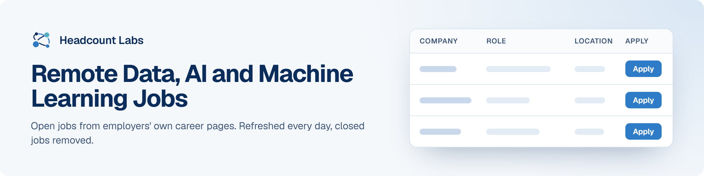

# Remote Data, AI and Machine Learning Jobs

Remote data science, data engineering, analytics, AI and machine learning jobs at US employers.

**400 open jobs** · 206 new since the last update · 206 removed because they closed or left the employer's board · updated November 14, 2026 at 4:43 AM EST

This list is built and refreshed every day by [Headcount Labs](https://headcountlabs.com/?utm_source=github&utm_medium=job-list&utm_campaign=remote-data-jobs), which reads jobs straight from employers' own career pages and job boards. Every job here was still listed on its source board when we last read that board, within the past 3 days, and was posted in the past 30 days. Copies of the same job are merged into one row, and jobs that close are removed at the next update.

Want this data in your own app or agent? Use the [Headcount Labs jobs API](https://headcountlabs.com/docs/?utm_source=github&utm_medium=job-list&utm_campaign=remote-data-jobs) (free tier), the [MCP server](https://headcountlabs.com/mcp/?utm_source=github&utm_medium=job-list&utm_campaign=remote-data-jobs) for Claude, ChatGPT and other AI assistants, or the [public dataset subsets](https://huggingface.co/HeadcountLabs) on Hugging Face (the full dataset is coming soon).

**Full dataset.** A bigger, one-off snapshot dated 2026-10-19 (all matching jobs, not only the open jobs below) is on Hugging Face: [Remote jobs](https://huggingface.co/datasets/HeadcountLabs/remote-jobs) · [Tech and software jobs](https://huggingface.co/datasets/HeadcountLabs/tech-jobs). It loads with `datasets.load_dataset` and is under the Open Database License (ODbL) 1.0.

**Jump to:** [Posted in the last 7 days (299)](#posted-in-the-last-7-days) · [Posted 8 to 30 days ago (101)](#posted-8-to-30-days-ago)

**Columns.** *Apply* opens the original posting on the employer's site. *Details* opens the job on Headcount Labs, with every posting we found for it. *Remote* shows what the employer states; a dash means the posting doesn't say. *Pay* is the range the employer published.

## Posted in the last 7 days

| Company | Role | Location | Remote | Pay | Posted | Apply | Details |
| --- | --- | --- | --- | --- | --- | :---: | :---: |
| **Seeq** | AI Software Engineer - Staff/Principal | United States | Remote | — | Nov 14 |  | <a href="https://headcountlabs.com/catalog/jobs/0537b1ce-a033-4235-9f4f-3a3bbdd0eab7?utm_source=github&utm_medium=job-list&utm_campaign=remote-data-jobs">via Headcount Labs</a> |
| **Zifo** | Data Engineer (Clinical) | United States | Remote | — | Nov 13 |  | <a href="https://headcountlabs.com/catalog/jobs/c0fc7906-f4ba-4bd8-a55a-24e8b19e2af8?utm_source=github&utm_medium=job-list&utm_campaign=remote-data-jobs">via Headcount Labs</a> |
| **Worldwide Clinical Trials Holdings, Inc.** | Associate Director, Clinical Data Management | 

7 locations
Wilmington Boston, MA Durham, NC Harford, CT New York, NY Providence, RI Research Triangle Park, NC
 | Remote | — | Nov 13 |  | <a href="https://headcountlabs.com/catalog/jobs/e8fb5d43-7251-4db6-bfda-1774bfe39e04?utm_source=github&utm_medium=job-list&utm_campaign=remote-data-jobs">via Headcount Labs</a> |
| **Worldwide Clinical Trials Holdings, Inc.** | Principal Clinical Data Manager | Wilmington | Remote | — | Nov 13 |  | <a href="https://headcountlabs.com/catalog/jobs/46b3d766-ef5a-4fb1-bcef-4a0984513667?utm_source=github&utm_medium=job-list&utm_campaign=remote-data-jobs">via Headcount Labs</a> |
| **World Wide Technology** | Senior Analytics Architect Frontier Reporting &amp; Insights | Nationwide | Remote | $188k–$200k/yr | Nov 13 |  | <a href="https://headcountlabs.com/catalog/jobs/4c51e3af-0eb6-465d-aa65-8ffd076db021?utm_source=github&utm_medium=job-list&utm_campaign=remote-data-jobs">via Headcount Labs</a> |
| **World Wide Technology** | Principal Architect – HPC &amp; AI (NVidia Ecosystem) | Nationwide | Remote | $215k–$245k/yr | Nov 13 |  | <a href="https://headcountlabs.com/catalog/jobs/07fd97a7-af0a-4b85-bfe1-4b0136671b64?utm_source=github&utm_medium=job-list&utm_campaign=remote-data-jobs">via Headcount Labs</a> |
| **UNAVAILABLE** | Data Integrity Specialist | Centennial, CO | Remote | $19.96–$30.94/hr | Nov 13 |  | <a href="https://headcountlabs.com/catalog/jobs/3476eacb-6045-4284-bd75-c40c629695a9?utm_source=github&utm_medium=job-list&utm_campaign=remote-data-jobs">via Headcount Labs</a> |
| **Turner &amp; Townsend** | Senior Cost Manager – Data Center Construction | USA wide | Remote | $145k–$165k/yr | Nov 13 |  | <a href="https://headcountlabs.com/catalog/jobs/8c9fab3f-65ae-422d-98d8-67418651fb67?utm_source=github&utm_medium=job-list&utm_campaign=remote-data-jobs">via Headcount Labs</a> |
| **Trilogy Federal** | Data Engineer | Arlington, VA | Remote | $95k–$110k/yr | Nov 13 |  | <a href="https://headcountlabs.com/catalog/jobs/d1290f75-97e6-4a5a-8e59-3db56848330f?utm_source=github&utm_medium=job-list&utm_campaign=remote-data-jobs">via Headcount Labs</a> |
| **Trilogy Federal** | Data Quality Engineer | Arlington, VA | Remote | $85k–$100k/yr | Nov 13 |  | <a href="https://headcountlabs.com/catalog/jobs/b672eaae-a42b-4640-b51c-413549a29a8d?utm_source=github&utm_medium=job-list&utm_campaign=remote-data-jobs">via Headcount Labs</a> |
| **Trilogy Federal** | AI/ML Engineer | Arlington, VA | Remote | $100k–$115k/yr | Nov 13 |  | <a href="https://headcountlabs.com/catalog/jobs/97b74cc4-087c-40a4-9355-6fc8d7e4095e?utm_source=github&utm_medium=job-list&utm_campaign=remote-data-jobs">via Headcount Labs</a> |
| **Trilogy Federal** | Data Visualization Engineer | Arlington, VA | Remote | $75k–$90k/yr | Nov 13 |  | <a href="https://headcountlabs.com/catalog/jobs/8d3e7769-828a-41ce-b199-037f20e824be?utm_source=github&utm_medium=job-list&utm_campaign=remote-data-jobs">via Headcount Labs</a> |
| **Trilogy Federal** | Data Governance Specialist | Arlington, VA | Remote | $70k–$85k/yr | Nov 13 |  | <a href="https://headcountlabs.com/catalog/jobs/88241ead-24ad-4143-b9d8-1b3ecf7dfd2d?utm_source=github&utm_medium=job-list&utm_campaign=remote-data-jobs">via Headcount Labs</a> |
| **The Hanover Insurance Group** | Manager, Data Engineering &amp; Platform Engineering (REMOTE OR MA BASED) | Worcester, MA | Remote | — | Nov 13 |  | <a href="https://headcountlabs.com/catalog/jobs/939d790e-44df-4b22-a6ca-4544e1cde64c?utm_source=github&utm_medium=job-list&utm_campaign=remote-data-jobs">via Headcount Labs</a> |
| **The Cigna Group** | Data Science Director - Remote | 

4 locations
United States Bloomfield, CT New York, NY Raleigh, NC
 | Remote | $178k–$298k/yr | Nov 13 |  | <a href="https://headcountlabs.com/catalog/jobs/57441eab-2c18-4386-a3c6-39856ecc18a3?utm_source=github&utm_medium=job-list&utm_campaign=remote-data-jobs">via Headcount Labs</a> |
| **TEKsystems** | Practice Architect AI/ML | Dallas, TX | Remote | $128k–$192k/yr | Nov 13 |  | <a href="https://headcountlabs.com/catalog/jobs/ee60c94b-d11a-4849-9b65-bacb3fd99265?utm_source=github&utm_medium=job-list&utm_campaign=remote-data-jobs">via Headcount Labs</a> |
| **TEKsystems** | Data Facilitator/Customer Service Analyst | Atlanta, GA | Remote | $25–$32/hr | Nov 13 |  | <a href="https://headcountlabs.com/catalog/jobs/a6c3ce4b-9e17-40d9-a7cb-b97ea59e7f53?utm_source=github&utm_medium=job-list&utm_campaign=remote-data-jobs">via Headcount Labs</a> |
| **Solvd** | Solution Architect, AWS Generative AI | United States | Remote | — | Nov 13 |  | <a href="https://headcountlabs.com/catalog/jobs/8ae9564c-7df8-4163-82a4-33ac7779ffe3?utm_source=github&utm_medium=job-list&utm_campaign=remote-data-jobs">via Headcount Labs</a> |
| **Solvd** | Senior AI Quality &amp; Evaluation Engineer | United States | Remote | — | Nov 13 |  | <a href="https://headcountlabs.com/catalog/jobs/8999d47c-720e-4d7c-9ae2-7a785171405e?utm_source=github&utm_medium=job-list&utm_campaign=remote-data-jobs">via Headcount Labs</a> |
| **Solvd** | Senior Data Engineer — Knowledge Ingestion | United States | Remote | — | Nov 13 |  | <a href="https://headcountlabs.com/catalog/jobs/6e7f3da6-7f64-4f08-b35f-6fb7b95112a9?utm_source=github&utm_medium=job-list&utm_campaign=remote-data-jobs">via Headcount Labs</a> |
| **Solvd** | Senior Data Engineer — Retrieval &amp; RAG Platform | United States | Remote | — | Nov 13 |  | <a href="https://headcountlabs.com/catalog/jobs/0b75876f-bec9-427b-be91-019450075998?utm_source=github&utm_medium=job-list&utm_campaign=remote-data-jobs">via Headcount Labs</a> |
| **QuinStreet** | AI Product Manager | United States | Remote | — | Nov 13 |  | <a href="https://headcountlabs.com/catalog/jobs/1b77696f-146f-45f3-91bb-088390da00b5?utm_source=github&utm_medium=job-list&utm_campaign=remote-data-jobs">via Headcount Labs</a> |
| **Oxford Nanopore Technologies** | Technical Applications Scientist - East Coast | United States | Remote | $84k–$95k/yr | Nov 13 |  | <a href="https://headcountlabs.com/catalog/jobs/2ad16a14-dbfc-4e80-8677-499190fbd254?utm_source=github&utm_medium=job-list&utm_campaign=remote-data-jobs">via Headcount Labs</a> |
| **Nemours** | Technical Data Analyst | Jacksonville, FL | Remote | $65k–$105k/yr | Nov 13 |  | <a href="https://headcountlabs.com/catalog/jobs/2995970f-39d9-4ad0-93a7-122f85b9549f?utm_source=github&utm_medium=job-list&utm_campaign=remote-data-jobs">via Headcount Labs</a> |
| **National Laboratory of the Rockies** | Year-Round Graduate Internship - AI/Machine Learning Time Series Modeling | United States | Remote | $44k–$71k/yr | Nov 13 |  | <a href="https://headcountlabs.com/catalog/jobs/f1635bb9-b1e1-4bb0-b369-b4c201e85b4a?utm_source=github&utm_medium=job-list&utm_campaign=remote-data-jobs">via Headcount Labs</a> |
| **National Debt Relief, LLC.** | Engineer, Data Engineering | United States | Remote | $125k–$144k/yr | Nov 13 |  | <a href="https://headcountlabs.com/catalog/jobs/1ca3e5e2-6b7b-4428-a7dc-a7ea3f5f80e1?utm_source=github&utm_medium=job-list&utm_campaign=remote-data-jobs">via Headcount Labs</a> |
| **Modernizing Medicine, Inc.** | Director, Customer Success Technology &amp; AI Operations | 

2 locations
United States Boca Raton, FL
 | Remote | — | Nov 13 |  | <a href="https://headcountlabs.com/catalog/jobs/8b54611d-c839-4c91-b4dc-98b63a0c5e77?utm_source=github&utm_medium=job-list&utm_campaign=remote-data-jobs">via Headcount Labs</a> |
| **Mindrift** | Physician (MD/DO) - Medical AI Evaluation | 

131 locations
Alabama Austin, TX Dallas, TX Houston, TX San Antonio, TX Texas Allentown, PA Erie, PA Philadelphia, PA Pittsburgh, PA Reading, PA Pennsylvania +119 more
 | Remote | — | Nov 13 |  | <a href="https://headcountlabs.com/catalog/jobs/a0a09dec-9b39-4a92-ba8d-740dbf186070?utm_source=github&utm_medium=job-list&utm_campaign=remote-data-jobs">via Headcount Labs</a> |
| **Mindrift** | Physician (MD/DO) - Put Medical AI to the Test, Remote | 

131 locations
Kansas City, KS Olathe, KS Overland Park, KS Topeka, KS Wichita, KS Kansas Anchorage, AK Fairbanks, AK Juneau, AK Sitka, AK Wasilla, AK Alaska +119 more
 | Remote | — | Nov 13 |  | <a href="https://headcountlabs.com/catalog/jobs/9ed843b5-17de-4be3-a918-801432dca0e5?utm_source=github&utm_medium=job-list&utm_campaign=remote-data-jobs">via Headcount Labs</a> |
| **Mindrift** | Physician Reviewer (MD/DO) - Medical AI Evaluation | 

131 locations
Alabama Ann Arbor, MI Detroit, MI Flint, MI Grand Rapids, MI Lansing, MI Michigan Aurora, CO Boulder, CO Colorado Springs, CO Denver, CO Fort Collins, CO +119 more
 | Remote | — | Nov 13 |  | <a href="https://headcountlabs.com/catalog/jobs/9ecae9d9-fe80-4b6c-a581-6ad0c5fade71?utm_source=github&utm_medium=job-list&utm_campaign=remote-data-jobs">via Headcount Labs</a> |
| **Mindrift** | Licensed Physician (MD/DO) - Freelance AI Trainer | 

131 locations
Charleston, WV Huntington, WV Morgantown, WV Parkersburg, WV Wheeling, WV West Virginia Baltimore, MD Columbia, MD Frederick, MD Rockville, MD Silver Spring, MD Maryland +119 more
 | Remote | — | Nov 13 |  | <a href="https://headcountlabs.com/catalog/jobs/9e543dfd-502c-40c3-95fc-f04a70c01d25?utm_source=github&utm_medium=job-list&utm_campaign=remote-data-jobs">via Headcount Labs</a> |
| **Lumen Technologies** | Staff Applied AI Scientist | Oregon | Remote | $152k–$253k/yr | Nov 13 |  | <a href="https://headcountlabs.com/catalog/jobs/e5e90d05-9b5c-48d5-9042-5bd7819d112f?utm_source=github&utm_medium=job-list&utm_campaign=remote-data-jobs">via Headcount Labs</a> |
| **Lumen** | Staff Applied AI Scientist | Oregon | Remote | $152k–$253k/yr | Nov 13 |  | <a href="https://headcountlabs.com/catalog/jobs/ba23b170-d498-4798-a790-73a208ee0fc9?utm_source=github&utm_medium=job-list&utm_campaign=remote-data-jobs">via Headcount Labs</a> |
| **Lenmar Consulting Inc.** | Level 4 Data Center Installer (Max $36/hr W2) | Leesburg, VA | Remote | — | Nov 13 |  | <a href="https://headcountlabs.com/catalog/jobs/99e3e4e8-54fe-4095-a623-31975e6a249d?utm_source=github&utm_medium=job-list&utm_campaign=remote-data-jobs">via Headcount Labs</a> |
| **LCS Lifespan Corporate Services d/b/a Brown University Health** | Principal Architect - Research Data | LaSalle Square Providence, RI | Remote | $134k–$221k/yr | Nov 13 |  | <a href="https://headcountlabs.com/catalog/jobs/daef3158-3cb5-4688-9e3f-d8eeddd07ce7?utm_source=github&utm_medium=job-list&utm_campaign=remote-data-jobs">via Headcount Labs</a> |
| **Jobgether** | Staff/Senior Data Engineer | United States | Remote | $135k–$170k/yr | Nov 13 |  | <a href="https://headcountlabs.com/catalog/jobs/eef0c3d9-8890-4899-806a-3de63a482f13?utm_source=github&utm_medium=job-list&utm_campaign=remote-data-jobs">via Headcount Labs</a> |
| **Jobgether** | Digital &amp; AI Change Management Lead | United States | Remote | — | Nov 13 |  | <a href="https://headcountlabs.com/catalog/jobs/e6122c9b-3eea-4ec4-b340-c860087ad437?utm_source=github&utm_medium=job-list&utm_campaign=remote-data-jobs">via Headcount Labs</a> |
| **Jobgether** | Electrical Project Manager - Data Center | United States | Remote | $80k–$150k/yr | Nov 13 |  | <a href="https://headcountlabs.com/catalog/jobs/d82f6753-18c6-4d07-990a-6d0dbeb7494f?utm_source=github&utm_medium=job-list&utm_campaign=remote-data-jobs">via Headcount Labs</a> |
| **Jobgether** | Senior Director, Data Center Design &amp; Engineering – AI Data Centers | United States | Remote | $200k–$250k/yr | Nov 13 |  | <a href="https://headcountlabs.com/catalog/jobs/d52b9184-ba5e-4e53-9df3-91d84f6a2049?utm_source=github&utm_medium=job-list&utm_campaign=remote-data-jobs">via Headcount Labs</a> |
| **Jobgether** | Sr. Director of Revenue Enablement &amp; GTM AI | United States | Remote | — | Nov 13 |  | <a href="https://headcountlabs.com/catalog/jobs/b3bf03ee-0d63-40af-a1c4-7d2882bd28fd?utm_source=github&utm_medium=job-list&utm_campaign=remote-data-jobs">via Headcount Labs</a> |
| **Jobgether** | Senior Data Center Engineer - AI / HCP Infrastructure | United States | Remote | — | Nov 13 |  | <a href="https://headcountlabs.com/catalog/jobs/957c3c27-f922-40ff-b5f6-4f1cbc2cb554?utm_source=github&utm_medium=job-list&utm_campaign=remote-data-jobs">via Headcount Labs</a> |
| **Jobgether** | Senior Data Engineer | United States | Remote | — | Nov 13 |  | <a href="https://headcountlabs.com/catalog/jobs/90044b95-951f-4dfd-9eb1-cb91261ee24c?utm_source=github&utm_medium=job-list&utm_campaign=remote-data-jobs">via Headcount Labs</a> |
| **Jobgether** | Principal Applied Scientist | United States | Remote | $200k–$300k/yr | Nov 13 |  | <a href="https://headcountlabs.com/catalog/jobs/794c502d-ec2e-45d5-badf-f0506fd6edb3?utm_source=github&utm_medium=job-list&utm_campaign=remote-data-jobs">via Headcount Labs</a> |
| **J.S. Held LLC** | Clinical Health Scientist | Redmond, WA | Remote | $85/hr | Nov 13 |  | <a href="https://headcountlabs.com/catalog/jobs/98e3bbb5-af2c-4a58-8f98-1de3ee0ae16e?utm_source=github&utm_medium=job-list&utm_campaign=remote-data-jobs">via Headcount Labs</a> |
| **Invitrogen Holdings LLC** | Field Application Scientist – Flow Cytometry (SoCal Area) | 

2 locations
San Diego, CA Los Angeles, CA
 | Remote | $83k–$120k/yr | Nov 13 |  | <a href="https://headcountlabs.com/catalog/jobs/084eea35-8834-4667-a0a5-0eca9867c000?utm_source=github&utm_medium=job-list&utm_campaign=remote-data-jobs">via Headcount Labs</a> |
| **Intermountain Health** | Machine Learning Operations (MLOps) Intern | Des Moines, IA | Remote | $21.81–$32.21/hr | Nov 13 |  | <a href="https://headcountlabs.com/catalog/jobs/72e883a9-247a-4e14-89ca-d3290185f7ae?utm_source=github&utm_medium=job-list&utm_campaign=remote-data-jobs">via Headcount Labs</a> |
| **Intermountain Health** | AI/ML Engineer Intern | Des Moines, IA | Remote | $21.81–$32.21/hr | Nov 13 |  | <a href="https://headcountlabs.com/catalog/jobs/2b64af82-eb71-41a0-8e5d-d581f18dea94?utm_source=github&utm_medium=job-list&utm_campaign=remote-data-jobs">via Headcount Labs</a> |
| **GoEngineer** | Data and Analytics Engineer | Midvale | Remote | $90k–$105k/yr | Nov 13 |  | <a href="https://headcountlabs.com/catalog/jobs/c604dbbc-e2e7-4a3f-944d-82586cea7496?utm_source=github&utm_medium=job-list&utm_campaign=remote-data-jobs">via Headcount Labs</a> |
| **EWOR GmbH** | AI Co-Founder / CTO (100 % remote) (m/f/d) | 

4 locations
Ann Arbor, MI Los Angeles, CA Madison, WI Mountain View, CA
 | Remote | — | Nov 13 |  | <a href="https://headcountlabs.com/catalog/jobs/bf8c7117-9abb-4cc4-a6ea-5217d36f084c?utm_source=github&utm_medium=job-list&utm_campaign=remote-data-jobs">via Headcount Labs</a> |
| **EWOR GmbH** | AI Co-Founder / CEO (100 % remote) (m/f/d) | 

9 locations
Salt Lake City, UT New York, NY Mountain View, CA Madison, WI Provo, UT San Jose, CA Ann Arbor, MI Los Angeles, CA Palo Alto, CA
 | Remote | — | Nov 13 |  | <a href="https://headcountlabs.com/catalog/jobs/bd606380-758b-43e4-965d-d46360d69966?utm_source=github&utm_medium=job-list&utm_campaign=remote-data-jobs">via Headcount Labs</a> |
| **EWOR GmbH** | AI Co-Founder / COO (100 % remote) (m/f/d) | 

11 locations
Palo Alto, CA Anchorage, AK Fort Wayne, IN Lubbock, TX San Jose, CA Ann Arbor, MI Madison, WI Mountain View, CA Los Angeles, CA Salt Lake City, UT Provo, UT
 | Remote | — | Nov 13 |  | <a href="https://headcountlabs.com/catalog/jobs/ba4aa6a7-aa41-4fdd-9041-a41fe18388f4?utm_source=github&utm_medium=job-list&utm_campaign=remote-data-jobs">via Headcount Labs</a> |
| **EWOR GmbH** | AI Research Lab Co-Founder / COO (100 % remote) (m/f/d) | Princeton, NJ | Remote | — | Nov 13 |  | <a href="https://headcountlabs.com/catalog/jobs/b6724aaa-4734-435b-8fa2-001676ce5683?utm_source=github&utm_medium=job-list&utm_campaign=remote-data-jobs">via Headcount Labs</a> |
| **EWOR GmbH** | AI Research Lab Co-Founder / CMO (100 % remote) (m/f/d) | 

3 locations
Kansas City, MO Tallahassee, FL Charleston, SC
 | Remote | — | Nov 13 |  | <a href="https://headcountlabs.com/catalog/jobs/aa07577a-ae2c-41fd-9e02-8ed2eb731ee3?utm_source=github&utm_medium=job-list&utm_campaign=remote-data-jobs">via Headcount Labs</a> |
| **EWOR GmbH** | Applied AI Co-Founder / CEO (100 % remote) (m/f/d) | Austin, TX | Remote | — | Nov 13 |  | <a href="https://headcountlabs.com/catalog/jobs/9e0d726a-80f9-4289-a0c6-e1b0e55b6688?utm_source=github&utm_medium=job-list&utm_campaign=remote-data-jobs">via Headcount Labs</a> |
| **EWOR GmbH** | AI Infrastructure Co-Founder / CCO (100 % remote) (m/f/d) | 

4 locations
Stockton, CA Spokane, WA Lexington, KY Cambridge, MA
 | Remote | — | Nov 13 |  | <a href="https://headcountlabs.com/catalog/jobs/9d631e9c-b79a-407c-9172-c53fef21894d?utm_source=github&utm_medium=job-list&utm_campaign=remote-data-jobs">via Headcount Labs</a> |
| **EWOR GmbH** | AI Infrastructure Co-Founder / CEO (100 % remote) (m/f/d) | 

12 locations
Anchorage, AK Lubbock, TX Modesto, CA Detroit, MI Providence, RI Washington, DC El Paso, TX Fort Wayne, IN Bakersfield, CA Fresno, CA Huntsville, AL Charlotte, NC
 | Remote | — | Nov 13 |  | <a href="https://headcountlabs.com/catalog/jobs/9a92b2bf-66fe-4894-b30f-432837a97ed0?utm_source=github&utm_medium=job-list&utm_campaign=remote-data-jobs">via Headcount Labs</a> |
| **Evidence Action** | Senior Manager, Growth, The AI Access Initiative | United States | Remote | — | Nov 13 |  | <a href="https://headcountlabs.com/catalog/jobs/cd1f5e46-42a1-46dc-9a2f-76ea838a7cf5?utm_source=github&utm_medium=job-list&utm_campaign=remote-data-jobs">via Headcount Labs</a> |
| **E2E Alignment Healthcare USA, LLC** | Director Technical Product Management - Data Platform | United States | Remote | $172k–$259k/yr | Nov 13 |  | <a href="https://headcountlabs.com/catalog/jobs/7b912ff2-4cf7-40a5-acac-2131e1f70dc9?utm_source=github&utm_medium=job-list&utm_campaign=remote-data-jobs">via Headcount Labs</a> |
| **Deel** | Associate Director, Sales Analytics | United States | Remote | $86k–$230k/yr | Nov 13 |  | <a href="https://headcountlabs.com/catalog/jobs/27b4fe38-7fb7-4f85-9000-7cd4f2c598eb?utm_source=github&utm_medium=job-list&utm_campaign=remote-data-jobs">via Headcount Labs</a> |
| **CRS** | Manager I Everyday AI &amp; Automation- (Global Remote) | United States | Remote | $83k–$101k/yr | Nov 13 |  | <a href="https://headcountlabs.com/catalog/jobs/f95a450b-56c6-4591-9ff2-b2997bbd99e8?utm_source=github&utm_medium=job-list&utm_campaign=remote-data-jobs">via Headcount Labs</a> |
| **Crazy Maple Studio** | AI-Assisted Story Writer (1099 Contract) | 

2 locations
Culver City, CA Sunnyvale, CA
 | Remote | — | Nov 13 |  | <a href="https://headcountlabs.com/catalog/jobs/f32f8425-3213-43f3-a4af-f2efe9842b59?utm_source=github&utm_medium=job-list&utm_campaign=remote-data-jobs">via Headcount Labs</a> |
| **Clarity Clinic** | Financial Planning &amp; Analytics (FP&amp;A) Manager | Chicago, IL | Remote | $95k–$120k/yr | Nov 13 |  | <a href="https://headcountlabs.com/catalog/jobs/9b1041ea-73a7-4097-b9c3-bc7316a0a736?utm_source=github&utm_medium=job-list&utm_campaign=remote-data-jobs">via Headcount Labs</a> |
| **BME Strategies** | Advisor, Data Privacy, Security, and Classification | United States | Remote | — | Nov 13 |  | <a href="https://headcountlabs.com/catalog/jobs/a7ce342c-bb74-47ed-ab21-440e6bb6f13e?utm_source=github&utm_medium=job-list&utm_campaign=remote-data-jobs">via Headcount Labs</a> |
| **Bjak** | Product Owner, Technical - AI Neobank | United States | Remote | — | Nov 13 |  | <a href="https://headcountlabs.com/catalog/jobs/2820787d-5ac0-4c1d-944b-a1750a6d414c?utm_source=github&utm_medium=job-list&utm_campaign=remote-data-jobs">via Headcount Labs</a> |
| **Bjak** | Product Owner, Technical - AI Stockbroking | United States | Remote | — | Nov 13 |  | <a href="https://headcountlabs.com/catalog/jobs/a1bc9135-f5a6-442c-b6e3-eee0f71a29e0?utm_source=github&utm_medium=job-list&utm_campaign=remote-data-jobs">via Headcount Labs</a> |
| **Bjak** | Product Owner, Technical - AI Investing | United States | Remote | — | Nov 13 |  | <a href="https://headcountlabs.com/catalog/jobs/9427c791-5db1-4333-bcc4-0e0cdb71c56f?utm_source=github&utm_medium=job-list&utm_campaign=remote-data-jobs">via Headcount Labs</a> |
| **Bjak** | Product Owner, Technical - AI Finance | United States | Remote | — | Nov 13 |  | <a href="https://headcountlabs.com/catalog/jobs/23e6844c-1e83-46c3-b55e-c332e1e820f5?utm_source=github&utm_medium=job-list&utm_campaign=remote-data-jobs">via Headcount Labs</a> |
| **Better Homes and Gardens Real Estate Advantage Realty** | Real Estate Data Entry Operator | San Antonio, TX | Remote | $27.81–$29.97/hr | Nov 13 |  | <a href="https://headcountlabs.com/catalog/jobs/8d2206cf-7e30-4a52-b3dc-0e3ce6b77e32?utm_source=github&utm_medium=job-list&utm_campaign=remote-data-jobs">via Headcount Labs</a> |
| **Bask Health** | Customer Engineer, AI &amp; Integrations | United States | Remote | — | Nov 13 |  | <a href="https://headcountlabs.com/catalog/jobs/d354aae2-d36c-417f-ab8e-1c2cc00d98bd?utm_source=github&utm_medium=job-list&utm_campaign=remote-data-jobs">via Headcount Labs</a> |
| **American Institutes for Research** | Data Scientist, Education Systems and Policy | United States | Remote | $114k–$140k/yr | Nov 13 |  | <a href="https://headcountlabs.com/catalog/jobs/e91aa7d8-2e94-40ef-b727-53075fa43852?utm_source=github&utm_medium=job-list&utm_campaign=remote-data-jobs">via Headcount Labs</a> |
| **Ally Bank** | Auto Fraud Analytics Analyst | North Carolina | Remote | $65k–$115k/yr | Nov 13 |  | <a href="https://headcountlabs.com/catalog/jobs/add84dd0-ac8d-44c5-a9fd-3a22e6949a47?utm_source=github&utm_medium=job-list&utm_campaign=remote-data-jobs">via Headcount Labs</a> |
| **Agiloft** | Staff Data Engineer | United States | Remote | — | Nov 13 |  | <a href="https://headcountlabs.com/catalog/jobs/9a1a0004-adb5-4d01-a92c-e066582f2c35?utm_source=github&utm_medium=job-list&utm_campaign=remote-data-jobs">via Headcount Labs</a> |
| **AECOM** | Senior Electrical Engineer, Data Centers - Remote (U.S.) | Arlington, VA | Remote | $160k–$190k/yr | Nov 13 |  | <a href="https://headcountlabs.com/catalog/jobs/07698685-9b00-4980-88c1-dddf7d032708?utm_source=github&utm_medium=job-list&utm_campaign=remote-data-jobs">via Headcount Labs</a> |
| ***US AMR-Jones Lang LaSalle Americas, Inc.** | Senior Technical Writer, Mission Critical - Data Centers | Texas | Remote | — | Nov 13 |  | <a href="https://headcountlabs.com/catalog/jobs/640b495c-f4cc-486e-82eb-5ed7a0a74a31?utm_source=github&utm_medium=job-list&utm_campaign=remote-data-jobs">via Headcount Labs</a> |
| **Yelp, Inc** | Enterprise Restaurant Success Manager, AI SaaS Sales (Remote - US) | 

8 locations
United States Los Angeles, CA New York City, NY Boston, MA Miami, FL Orlando, FL Jersey City, NJ Atlanta, GA
 | Remote | $110k–$130k/yr | Nov 12 |  | <a href="https://headcountlabs.com/catalog/jobs/dcce08d3-df59-42bf-82e8-eb4533b5615e?utm_source=github&utm_medium=job-list&utm_campaign=remote-data-jobs">via Headcount Labs</a> |
| **World Wildlife Fund, Inc.** | Data Integrity Associate Specialist | Washington D.C. | Remote | $56k–$70k/yr | Nov 12 |  | <a href="https://headcountlabs.com/catalog/jobs/76917520-3be7-484f-93a0-5bf9bdbb6cec?utm_source=github&utm_medium=job-list&utm_campaign=remote-data-jobs">via Headcount Labs</a> |
| **White Cap** | Corporate Intern - Product Data Management | United States | Remote | — | Nov 12 |  | <a href="https://headcountlabs.com/catalog/jobs/d9cf198d-4029-48cb-b808-9c638733c8c9?utm_source=github&utm_medium=job-list&utm_campaign=remote-data-jobs">via Headcount Labs</a> |
| **Weekday AI** | Senior Motion Designer (After Effects), AI Expert (Remote, US) | United States | Remote | — | Nov 12 |  | <a href="https://headcountlabs.com/catalog/jobs/f3cc01c2-0e86-44a9-8565-aaa069a74b5b?utm_source=github&utm_medium=job-list&utm_campaign=remote-data-jobs">via Headcount Labs</a> |
| **Weekday AI** | PhD Pharmacologist or Toxicologist (Drug Discovery), AI Expert (Remote UK or US) | United States | Remote | — | Nov 12 |  | <a href="https://headcountlabs.com/catalog/jobs/f32de836-d629-4c10-95b8-d881dd38f906?utm_source=github&utm_medium=job-list&utm_campaign=remote-data-jobs">via Headcount Labs</a> |
| **Weekday AI** | Physician (MD / DO), Medical AI Expert (Remote) | United States | Remote | — | Nov 12 |  | <a href="https://headcountlabs.com/catalog/jobs/eb0b4eb9-32d6-4106-b921-4aecb085e933?utm_source=github&utm_medium=job-list&utm_campaign=remote-data-jobs">via Headcount Labs</a> |
| **Weekday AI** | Licensed Clinician (MD, NP, PA, RN, PharmD), Healthcare AI Expert (Remote, US) | United States | Remote | — | Nov 12 |  | <a href="https://headcountlabs.com/catalog/jobs/9e8c0891-3ad4-4731-bcba-d183cf297dce?utm_source=github&utm_medium=job-list&utm_campaign=remote-data-jobs">via Headcount Labs</a> |
| **Weekday AI** | ML Infrastructure and Performance Engineer, AI Expert (Remote) | United States | Remote | — | Nov 12 |  | <a href="https://headcountlabs.com/catalog/jobs/9d2b8f57-1a40-4c69-a735-a19fa881feb5?utm_source=github&utm_medium=job-list&utm_campaign=remote-data-jobs">via Headcount Labs</a> |
| **Weekday AI** | Board-Certified Neurologist, Medical AI Expert (Remote, US) | United States | Remote | — | Nov 12 |  | <a href="https://headcountlabs.com/catalog/jobs/d94f7410-353a-4dd6-8294-e5b6944b09e3?utm_source=github&utm_medium=job-list&utm_campaign=remote-data-jobs">via Headcount Labs</a> |
| **Weekday AI** | PhD Mathematician or Statistician, AI Expert (Remote, US) | United States | Remote | — | Nov 12 |  | <a href="https://headcountlabs.com/catalog/jobs/d1bfa13c-b043-44f6-ba4a-2f186477370a?utm_source=github&utm_medium=job-list&utm_campaign=remote-data-jobs">via Headcount Labs</a> |
| **Weekday AI** | Electrical Engineer, AI Expert (Full-Time, US) | United States | Remote | — | Nov 12 |  | <a href="https://headcountlabs.com/catalog/jobs/28587e4e-4ab4-4150-a32c-3fc70ed533a6?utm_source=github&utm_medium=job-list&utm_campaign=remote-data-jobs">via Headcount Labs</a> |
| **WCM White Cap Management LLC** | Corporate Intern - Product Data Management | United States | Remote | — | Nov 12 |  | <a href="https://headcountlabs.com/catalog/jobs/db0c14bb-3aeb-465b-ad4a-c696e744f030?utm_source=github&utm_medium=job-list&utm_campaign=remote-data-jobs">via Headcount Labs</a> |
| **URUS Group** | AI Agent Developer (Microsoft Copilot) | Madison, WI | Remote | — | Nov 12 |  | <a href="https://headcountlabs.com/catalog/jobs/320f8279-306e-4cf1-9815-627fdd976be0?utm_source=github&utm_medium=job-list&utm_campaign=remote-data-jobs">via Headcount Labs</a> |
| **UNAVAILABLE** | Enterprise Restaurant Success Manager, AI SaaS Sales (Remote - US) | 

8 locations
United States Los Angeles, CA New York City, NY Boston, MA Miami, FL Orlando, FL Jersey City, NJ Atlanta, GA
 | Remote | $110k–$130k/yr | Nov 12 |  | <a href="https://headcountlabs.com/catalog/jobs/7b27d284-0a1f-40ae-bed2-186d3e55f12b?utm_source=github&utm_medium=job-list&utm_campaign=remote-data-jobs">via Headcount Labs</a> |
| **Turnitin, LLC** | Director, AI Innovation and Transformation (USA Remote) | 

2 locations
Atlanta, GA Dallas, TX
 | Remote | $153k–$256k/yr | Nov 12 |  | <a href="https://headcountlabs.com/catalog/jobs/6891cef2-1a00-4d33-9938-dc246274e0f8?utm_source=github&utm_medium=job-list&utm_campaign=remote-data-jobs">via Headcount Labs</a> |
| **Turner &amp; Townsend** | Senior Cost Manager - Data Center | USA wide | Remote | $130k–$155k/yr | Nov 12 |  | <a href="https://headcountlabs.com/catalog/jobs/b22d0516-1a9b-4ffa-acf6-b5066c17cb11?utm_source=github&utm_medium=job-list&utm_campaign=remote-data-jobs">via Headcount Labs</a> |
| **trane technologies** | Sales Account Manager - Data Center | Jacksonville, FL | Remote | $98k–$149k/yr | Nov 12 |  | <a href="https://headcountlabs.com/catalog/jobs/6d72e06a-1cc1-4235-a147-52202ac53b0b?utm_source=github&utm_medium=job-list&utm_campaign=remote-data-jobs">via Headcount Labs</a> |
| **TotalMed** | Data Entry Specialist - Stogo (Part Time) | United States | Remote | $14–$17/hr | Nov 12 |  | <a href="https://headcountlabs.com/catalog/jobs/316d9861-654c-4ad4-9790-59cebe5c0c92?utm_source=github&utm_medium=job-list&utm_campaign=remote-data-jobs">via Headcount Labs</a> |
| **Titan Technologies** | Splunk/Data Engineer | Reston, VA | Remote | — | Nov 12 |  | <a href="https://headcountlabs.com/catalog/jobs/c632b372-ba0b-411a-9982-df6337b4e415?utm_source=github&utm_medium=job-list&utm_campaign=remote-data-jobs">via Headcount Labs</a> |
| **Tendo** | Principal Product Manager, Clinical Data Analytics | 

2 locations
Salt Lake City, UT San Francisco, CA
 | Remote | $132k–$178k/yr | Nov 12 |  | <a href="https://headcountlabs.com/catalog/jobs/e814c4c4-0f31-4686-844b-335dc62ba9a2?utm_source=github&utm_medium=job-list&utm_campaign=remote-data-jobs">via Headcount Labs</a> |
| **TELUS Digital** | Program Manager, AI Data Collection | United States | Remote | $172k–$195k/yr | Nov 12 |  | <a href="https://headcountlabs.com/catalog/jobs/0ec2546c-2fd9-41a6-a9cf-62918540a644?utm_source=github&utm_medium=job-list&utm_campaign=remote-data-jobs">via Headcount Labs</a> |
| **TELUS** | Online Data Analyst - Spanish (ES) | Las Vegas, NV | Remote | — | Nov 12 |  | <a href="https://headcountlabs.com/catalog/jobs/ff83790b-50fe-4700-884e-f58de9eec729?utm_source=github&utm_medium=job-list&utm_campaign=remote-data-jobs">via Headcount Labs</a> |
| **TEKsystems** | Sr. Conversational AI Designer - 100% REMOTE - Must Work CST/EST | Atlanta, GA | Remote | $70–$85/hr | Nov 12 |  | <a href="https://headcountlabs.com/catalog/jobs/1b926511-06b5-4d64-941a-7d4eac479e4d?utm_source=github&utm_medium=job-list&utm_campaign=remote-data-jobs">via Headcount Labs</a> |
| **TEKsystems** | Central Office Technician/ISP Technician/data Center | Arlington, TX | Remote | $35–$45/hr | Nov 12 |  | <a href="https://headcountlabs.com/catalog/jobs/f2c69a56-0153-4fc6-b0ff-c19c004a74e8?utm_source=github&utm_medium=job-list&utm_campaign=remote-data-jobs">via Headcount Labs</a> |
| **STL Stellar Energy** | Sales Account Manager - Data Center | Jacksonville, FL | Remote | $98k–$149k/yr | Nov 12 |  | <a href="https://headcountlabs.com/catalog/jobs/bdefb9c8-3ffc-4dfc-8c52-dec0d875f001?utm_source=github&utm_medium=job-list&utm_campaign=remote-data-jobs">via Headcount Labs</a> |
| **Socure** | Lead Program Manager, AI &amp; Work Transformation | United States | Remote | $150k–$185k/yr | Nov 12 |  | <a href="https://headcountlabs.com/catalog/jobs/bed2dd70-cec6-4851-a930-8f169996df22?utm_source=github&utm_medium=job-list&utm_campaign=remote-data-jobs">via Headcount Labs</a> |
| **Skimmer** | Data Analyst - (B2B SaaS - Revenue Operations) | 

2 locations
Austin, TX Toronto
 | Remote | — | Nov 12 |  | <a href="https://headcountlabs.com/catalog/jobs/40eb0f8a-2364-460d-ad70-ef6baa48466e?utm_source=github&utm_medium=job-list&utm_campaign=remote-data-jobs">via Headcount Labs</a> |
| **SheerID** | Sr. Director of Revenue Enablement &amp; GTM AI | United States | Remote | — | Nov 12 |  | <a href="https://headcountlabs.com/catalog/jobs/1ee2ffce-bdda-4724-945d-d7888f044118?utm_source=github&utm_medium=job-list&utm_campaign=remote-data-jobs">via Headcount Labs</a> |
| **ServiceNow** | Sr Solution Sales Executive Data &amp; Analytics - Consumer Package Goods (East) | Philadelphia | Remote | — | Nov 12 |  | <a href="https://headcountlabs.com/catalog/jobs/79b84f93-b291-421a-9510-014cc2987fd9?utm_source=github&utm_medium=job-list&utm_campaign=remote-data-jobs">via Headcount Labs</a> |
| **Securly** | Senior Product Manager – Platform &amp; Data | United States | Remote | — | Nov 12 |  | <a href="https://headcountlabs.com/catalog/jobs/19bb077c-d8bc-4c32-962d-c5f547b98f50?utm_source=github&utm_medium=job-list&utm_campaign=remote-data-jobs">via Headcount Labs</a> |
| **Salesforce, Inc.** | Distinguised/Principal Platform Solution Engineer - Data Foundations | 

6 locations
Chicago, IL San Francisco, CA Atlanta, GA Boston, MA Illinois Dallas, TX
 | Remote | $158k–$245k/yr | Nov 12 |  | <a href="https://headcountlabs.com/catalog/jobs/91636aa8-b5a0-44f2-9963-874552724af0?utm_source=github&utm_medium=job-list&utm_campaign=remote-data-jobs">via Headcount Labs</a> |
| **Salesforce, Inc.** | Senior/Lead Platform Solution Engineer - Data Foundations | 

3 locations
San Francisco, CA California Austin, TX
 | Remote | $113k–$180k/yr | Nov 12 |  | <a href="https://headcountlabs.com/catalog/jobs/9ce8a383-993a-42d2-bf57-7bc8ae9b4032?utm_source=github&utm_medium=job-list&utm_campaign=remote-data-jobs">via Headcount Labs</a> |
| **Quavo** | Data Quality Analyst | United States | Remote | — | Nov 12 |  | <a href="https://headcountlabs.com/catalog/jobs/1620104f-e245-4d41-9756-f45633c9ae8e?utm_source=github&utm_medium=job-list&utm_campaign=remote-data-jobs">via Headcount Labs</a> |
| **ProArch** | Sr. Data Engineer | Atlanta, GA | Remote | — | Nov 12 |  | <a href="https://headcountlabs.com/catalog/jobs/0ad9c653-c28c-4eeb-bda3-e954d52a6203?utm_source=github&utm_medium=job-list&utm_campaign=remote-data-jobs">via Headcount Labs</a> |
| **Pragmatike** | Research Engineer, Synthetic Data (Pacific Time) | 

4 locations
United States Sacramento, CA Los Angeles, CA San Francisco, CA
 | Remote | — | Nov 12 |  | <a href="https://headcountlabs.com/catalog/jobs/6d1982af-1b5e-479c-96d2-6401cda461ba?utm_source=github&utm_medium=job-list&utm_campaign=remote-data-jobs">via Headcount Labs</a> |
| **Polygon Labs** | AI Platform Engineer | 

2 locations
EMEA United States
 | Remote | — | Nov 12 |  | <a href="https://headcountlabs.com/catalog/jobs/ebdb9c2e-beda-4ae2-839c-893a33202985?utm_source=github&utm_medium=job-list&utm_campaign=remote-data-jobs">via Headcount Labs</a> |
| **PointClickCare** | Director, Partnerships &amp; Data Strategy (US) | United States | Remote | $172k–$216k/yr | Nov 12 |  | <a href="https://headcountlabs.com/catalog/jobs/208868a1-5db4-4056-a76a-5d8f9ed8056e?utm_source=github&utm_medium=job-list&utm_campaign=remote-data-jobs">via Headcount Labs</a> |
| **Pillr Health** | 340B Implementation Data Analyst | Boca Raton, FL | Remote | — | Nov 12 |  | <a href="https://headcountlabs.com/catalog/jobs/3f93cd58-291f-4dc7-9df5-da503006e39d?utm_source=github&utm_medium=job-list&utm_campaign=remote-data-jobs">via Headcount Labs</a> |
| **Pavago** | Data Entry Specialist | United States | Remote | — | Nov 12 |  | <a href="https://headcountlabs.com/catalog/jobs/9aeede4c-53f1-49d1-b073-cb33d67b300e?utm_source=github&utm_medium=job-list&utm_campaign=remote-data-jobs">via Headcount Labs</a> |
| **NTT Global Data Centers Americas, Inc.** | Data Center Requirements Specialist | Virginia | Remote | $108k–$135k/yr | Nov 12 |  | <a href="https://headcountlabs.com/catalog/jobs/0f1e1f02-9a5d-4942-9f22-4b0f0f890972?utm_source=github&utm_medium=job-list&utm_campaign=remote-data-jobs">via Headcount Labs</a> |
| **Next Step Systems** | iOS Software Engineer, Artificial Intelligence (AI) Required, Work From Home | San Francisco, CA | Remote | $120k–$175k/yr | Nov 12 |  | <a href="https://headcountlabs.com/catalog/jobs/55f89fa5-ba7c-432f-acdc-ae4b3cdbdea2?utm_source=github&utm_medium=job-list&utm_campaign=remote-data-jobs">via Headcount Labs</a> |
| **Next Step Systems** | Desktop Engineer, Electron Applications and Artificial Intelligence (AI) Experience Required, Work From Home | San Francisco, CA | Remote | $140k–$170k/yr | Nov 12 |  | <a href="https://headcountlabs.com/catalog/jobs/28973a2a-9fa4-44b0-9010-3a1220f93cb6?utm_source=github&utm_medium=job-list&utm_campaign=remote-data-jobs">via Headcount Labs</a> |
| **Miratech** | Principal AI Strategist | United States | Remote | — | Nov 12 |  | <a href="https://headcountlabs.com/catalog/jobs/000af9a9-15cb-4bee-ba3b-707b51720f5f?utm_source=github&utm_medium=job-list&utm_campaign=remote-data-jobs">via Headcount Labs</a> |
| **Mindrift** | iPhone Video Data Collection - Paid Task ($70) | 

132 locations
Aberdeen, SD Brookings, SD Rapid City, SD Sioux Falls, SD Watertown, SD South Dakota Chandler, AZ Gilbert, AZ Mesa, AZ Phoenix, AZ Tucson, AZ Arizona +120 more
 | Remote | — | Nov 12 |  | <a href="https://headcountlabs.com/catalog/jobs/fa7a1439-f56a-41f5-a5e2-2e43248fd2e8?utm_source=github&utm_medium=job-list&utm_campaign=remote-data-jobs">via Headcount Labs</a> |
| **Mindrift** | Earn $70 Recording Videos at Home for AI | 

132 locations
Cranston, RI East Providence, RI Pawtucket, RI Providence, RI Warwick, RI Rhode Island Charleston, SC Columbia, SC Mount Pleasant, SC North Charleston, SC Rock Hill, SC South Carolina +120 more
 | Remote | — | Nov 12 |  | <a href="https://headcountlabs.com/catalog/jobs/f8fa52a6-f89c-4b0b-a754-2288d32049f9?utm_source=github&utm_medium=job-list&utm_campaign=remote-data-jobs">via Headcount Labs</a> |
| **Mindrift** | Record Videos at Home for AI - $70 One-Time Task | 

132 locations
Boise, ID Caldwell, ID Idaho Falls, ID Meridian, ID Nampa, ID Idaho Cedar Rapids, IA Davenport, IA Des Moines, IA Iowa City, IA Sioux City, IA Iowa +120 more
 | Remote | — | Nov 12 |  | <a href="https://headcountlabs.com/catalog/jobs/f7915818-7bde-44a5-977c-578f45918e18?utm_source=github&utm_medium=job-list&utm_campaign=remote-data-jobs">via Headcount Labs</a> |
| **Mimica** | Lead/Staff Product Manager (AI Automation) &#124; Remote | 

6 locations
London Edinburgh Dublin Amsterdam Barcelona New York, NY
 | Remote | — | Nov 12 |  | <a href="https://headcountlabs.com/catalog/jobs/25690f5f-119b-411d-b15d-3bdd2aa1537d?utm_source=github&utm_medium=job-list&utm_campaign=remote-data-jobs">via Headcount Labs</a> |
| **MeridianLink** | Sr. Product Manager - AI Products (FinTech) | United States | Remote | $139k–$197k/yr | Nov 12 |  | <a href="https://headcountlabs.com/catalog/jobs/7bb25982-5ecf-422c-94cf-b2c03fe1f1e8?utm_source=github&utm_medium=job-list&utm_campaign=remote-data-jobs">via Headcount Labs</a> |
| **Lightcast** | Economic Research Analyst / Junior Data Scientist - 1089 | 

2 locations
(Work From Home) US Moscow, ID
 | Remote | — | Nov 12 |  | <a href="https://headcountlabs.com/catalog/jobs/edbf9d39-85b0-4495-b675-181c5ac104bf?utm_source=github&utm_medium=job-list&utm_campaign=remote-data-jobs">via Headcount Labs</a> |
| **Koniag Government Services, LLC** | AI Data Scientist (REMOTE) | Washington, DC | Remote | — | Nov 12 |  | <a href="https://headcountlabs.com/catalog/jobs/9ee116b9-79a0-4dc2-9119-a4b393fa8360?utm_source=github&utm_medium=job-list&utm_campaign=remote-data-jobs">via Headcount Labs</a> |
| **Jump 450 Media** | Director, Measurement &amp; Data Science | United States | Remote | — | Nov 12 |  | <a href="https://headcountlabs.com/catalog/jobs/a48f6b91-79be-4c95-9e7f-07aad1a125f6?utm_source=github&utm_medium=job-list&utm_campaign=remote-data-jobs">via Headcount Labs</a> |
| **Johns Hopkins University** | Software Engineer - AI Focus (Center for Technology in Education) - #Staff | Baltimore, MD | Remote | $38.53–$67.44/hr | Nov 12 |  | <a href="https://headcountlabs.com/catalog/jobs/ae1cfa2b-3b17-47ee-b9b3-6d7418ea9d78?utm_source=github&utm_medium=job-list&utm_campaign=remote-data-jobs">via Headcount Labs</a> |
| **Integrated** | Data Engineer | Miramar, FL | Remote | — | Nov 12 |  | <a href="https://headcountlabs.com/catalog/jobs/8a614954-f7a4-4532-8246-bc72536b61bd?utm_source=github&utm_medium=job-list&utm_campaign=remote-data-jobs">via Headcount Labs</a> |
| **Integrated** | EDI Reconciliation Data Analyst | Miramar, FL | Remote | — | Nov 12 |  | <a href="https://headcountlabs.com/catalog/jobs/8a41b871-8289-42bf-ac57-565b5095218d?utm_source=github&utm_medium=job-list&utm_campaign=remote-data-jobs">via Headcount Labs</a> |
| **Information Systems** | Machine Learning Operations (MLOps) Intern | United States | Remote | $21.81–$32.21/hr | Nov 12 |  | <a href="https://headcountlabs.com/catalog/jobs/b8879b3b-92ae-4af2-baf1-1f262b141d56?utm_source=github&utm_medium=job-list&utm_campaign=remote-data-jobs">via Headcount Labs</a> |
| **Information Systems** | AI/ML Engineer Intern | United States | Remote | $21.81–$32.21/hr | Nov 12 |  | <a href="https://headcountlabs.com/catalog/jobs/7a9d41e0-682b-43a2-8ab4-e4378c72886c?utm_source=github&utm_medium=job-list&utm_campaign=remote-data-jobs">via Headcount Labs</a> |
| **Homedepot** | Staff Software Engineer - Enterprise Data Warehouse (Remote) | Georgia | Remote | $120k–$190k/yr | Nov 12 |  | <a href="https://headcountlabs.com/catalog/jobs/236905db-c0e6-43b0-a63b-4c3f5abd9365?utm_source=github&utm_medium=job-list&utm_campaign=remote-data-jobs">via Headcount Labs</a> |
| **Highmark Inc** | Product Manager – CRM &amp; Marketing Data | Working at Home, PA | Remote | — | Nov 12 |  | <a href="https://headcountlabs.com/catalog/jobs/fd117443-1029-4315-8fe5-13dad0f85fbb?utm_source=github&utm_medium=job-list&utm_campaign=remote-data-jobs">via Headcount Labs</a> |
| **Health Care Service Corp.** | Principal Analytics Consultant | United States | Remote | $102k–$184k/yr | Nov 12 |  | <a href="https://headcountlabs.com/catalog/jobs/8dedcb94-52e3-44a7-9a2a-14eeef7ba2a1?utm_source=github&utm_medium=job-list&utm_campaign=remote-data-jobs">via Headcount Labs</a> |
| **Health Care Service Corp.** | Analytics &amp; Reporting Analyst (Remote) | United States | Remote | $52k–$95k/yr | Nov 12 |  | <a href="https://headcountlabs.com/catalog/jobs/9a75a4e8-f734-4357-adb3-fd3bdab33d51?utm_source=github&utm_medium=job-list&utm_campaign=remote-data-jobs">via Headcount Labs</a> |
| **General Dynamics Mission Systems, Inc** | Space Force - Data Management Engineer | Scottsdale, AZ | Remote | $113k/yr | Nov 12 |  | <a href="https://headcountlabs.com/catalog/jobs/dd9af3a2-dd88-4b30-8787-5dfef7642c0d?utm_source=github&utm_medium=job-list&utm_campaign=remote-data-jobs">via Headcount Labs</a> |
| **GE HEALTHCARE** | Digital &amp; AI Change Management Lead | 

3 locations
Waukesha, WI Wisconsin Krakow
 | Remote | — | Nov 12 |  | <a href="https://headcountlabs.com/catalog/jobs/aba01fa8-f734-4ea3-aba4-5c217af99bef?utm_source=github&utm_medium=job-list&utm_campaign=remote-data-jobs">via Headcount Labs</a> |
| **GE Aerospace** | Executive Leader, AI Work Design &amp; Architecture | 

2 locations
Evendale, OH United States
 | Remote | $200k–$300k/yr | Nov 12 |  | <a href="https://headcountlabs.com/catalog/jobs/f3c6ad82-ddf5-434e-95f1-70311a0f7305?utm_source=github&utm_medium=job-list&utm_campaign=remote-data-jobs">via Headcount Labs</a> |
| **GE Aerospace** | Executive Leader, AI Workforce Capability | 

2 locations
Evendale, OH United States
 | Remote | $200k–$300k/yr | Nov 12 |  | <a href="https://headcountlabs.com/catalog/jobs/961c4d92-cf2e-46a7-b59d-fb6d8842af11?utm_source=github&utm_medium=job-list&utm_campaign=remote-data-jobs">via Headcount Labs</a> |
| **GE Aerospace** | Leader, AI Workforce Intelligence | 

2 locations
Evendale, OH United States
 | Remote | $158k–$263k/yr | Nov 12 |  | <a href="https://headcountlabs.com/catalog/jobs/070ebced-80c3-4aee-9781-9301ce2280a8?utm_source=github&utm_medium=job-list&utm_campaign=remote-data-jobs">via Headcount Labs</a> |
| **Fusemachines** | Senior Data Analyst | United States | Remote | — | Nov 12 |  | <a href="https://headcountlabs.com/catalog/jobs/6b78c122-d3f5-43b2-b813-0c2143de8a26?utm_source=github&utm_medium=job-list&utm_campaign=remote-data-jobs">via Headcount Labs</a> |
| **EXL Talent Acquisition Team** | Senior Data Engineer | United States | Remote | $100k–$150k/yr | Nov 12 |  | <a href="https://headcountlabs.com/catalog/jobs/c823e138-6066-4f54-acda-f45c7e30aac2?utm_source=github&utm_medium=job-list&utm_campaign=remote-data-jobs">via Headcount Labs</a> |
| **EPAM Systems** | Technology Consultant, Cybersecurity and AI Security | 

2 locations
United States New York, NY
 | Remote | — | Nov 12 |  | <a href="https://headcountlabs.com/catalog/jobs/e22d2d73-5729-4de1-b3f3-68c2c24fa75b?utm_source=github&utm_medium=job-list&utm_campaign=remote-data-jobs">via Headcount Labs</a> |
| **Dynatrace** | Project Manager, Data Analytics &amp; AI | United States | Remote | $116k–$145k/yr | Nov 12 |  | <a href="https://headcountlabs.com/catalog/jobs/d76cc571-7364-43bd-8ea6-7e9af360c5ce?utm_source=github&utm_medium=job-list&utm_campaign=remote-data-jobs">via Headcount Labs</a> |
| **Dell Technologies** | Principal Consultant - AI Infrastructure Services | 

2 locations
United States Seattle, WA
 | Remote | $177k–$230k/yr | Nov 12 |  | <a href="https://headcountlabs.com/catalog/jobs/c82972ad-d697-489a-a0b7-18a38a9b57e9?utm_source=github&utm_medium=job-list&utm_campaign=remote-data-jobs">via Headcount Labs</a> |
| **Dell Technologies** | Senior Consultant - AI Infrastructure Services | Hopkinton, MA | Remote | $141k–$183k/yr | Nov 12 |  | <a href="https://headcountlabs.com/catalog/jobs/7d40f810-d078-4dfe-8c6d-578feda979dc?utm_source=github&utm_medium=job-list&utm_campaign=remote-data-jobs">via Headcount Labs</a> |
| **Dell Inc.** | Principal Consultant - AI Infrastructure Services | 

2 locations
United States Seattle, WA
 | Remote | $177k–$230k/yr | Nov 12 |  | <a href="https://headcountlabs.com/catalog/jobs/fd45cd83-b81a-4116-9029-ae20009a83e8?utm_source=github&utm_medium=job-list&utm_campaign=remote-data-jobs">via Headcount Labs</a> |
| **Dell Inc.** | Senior Consultant - AI Infrastructure Services | Hopkinton, MA | Remote | $141k–$183k/yr | Nov 12 |  | <a href="https://headcountlabs.com/catalog/jobs/d438f6c2-ea9f-4930-a261-5eff9cf12624?utm_source=github&utm_medium=job-list&utm_campaign=remote-data-jobs">via Headcount Labs</a> |
| **David Kennedy Recruitment** | AI Video Creator (Generative / ComfyUI) | 

366 locations
Paris London Lisbon Milan Rome Berlin Athens Barcelona Bari Split Copenhagen Oslo +354 more
 | Remote | — | Nov 12 |  | <a href="https://headcountlabs.com/catalog/jobs/085460c9-4f1e-4437-9b61-d3e8c0aa1544?utm_source=github&utm_medium=job-list&utm_campaign=remote-data-jobs">via Headcount Labs</a> |
| **CP00001 Washington University in St Louis** | Data Analyst (PRN/Remote) - Transplant Nephrology | United States | Remote | $17.03–$24.61/hr | Nov 12 |  | <a href="https://headcountlabs.com/catalog/jobs/7e8148d4-e296-4da4-a8ca-9fa4617abe99?utm_source=github&utm_medium=job-list&utm_campaign=remote-data-jobs">via Headcount Labs</a> |
| **Cornerstone Building Brands** | IT Data Science Principal (Data Warehouse) | Cary, NC | Remote | $120k–$140k/yr | Nov 12 |  | <a href="https://headcountlabs.com/catalog/jobs/5964b535-bced-46f9-bcc4-fedbdb47967f?utm_source=github&utm_medium=job-list&utm_campaign=remote-data-jobs">via Headcount Labs</a> |
| **Confidential Company** | Software Engineer II - Applied AI | United States | Remote | $94k–$130k/yr | Nov 12 |  | <a href="https://headcountlabs.com/catalog/jobs/c8ce2729-7525-433b-96fd-7d0e1d6845ef?utm_source=github&utm_medium=job-list&utm_campaign=remote-data-jobs">via Headcount Labs</a> |
| **CO1003 CDW Technologies, LLC** | Principal Solution Architect - AI Accelerated Engineering | United States | Remote | $156k–$241k/yr | Nov 12 |  | <a href="https://headcountlabs.com/catalog/jobs/3fa14b4a-049c-4655-918d-040bba66844d?utm_source=github&utm_medium=job-list&utm_campaign=remote-data-jobs">via Headcount Labs</a> |
| **CO1003 CDW Technologies, LLC** | AI Software Consulting Engineer | Default Location | Remote | $78k–$108k/yr | Nov 12 |  | <a href="https://headcountlabs.com/catalog/jobs/76438f20-d2f4-4491-962b-0667dba2041f?utm_source=github&utm_medium=job-list&utm_campaign=remote-data-jobs">via Headcount Labs</a> |
| **ClearlyRated** | Product Manager - AI | Portland, OR | Remote | — | Nov 12 |  | <a href="https://headcountlabs.com/catalog/jobs/bafd5cef-cbb3-4692-829a-06d793c4942e?utm_source=github&utm_medium=job-list&utm_campaign=remote-data-jobs">via Headcount Labs</a> |
| **CleanSpark** | Senior Director, Data Center Design &amp; Engineering – AI Data Centers | United States | Remote | $200k–$250k/yr | Nov 12 |  | <a href="https://headcountlabs.com/catalog/jobs/a861d176-d9af-4556-8d10-f9baf8e93c33?utm_source=github&utm_medium=job-list&utm_campaign=remote-data-jobs">via Headcount Labs</a> |
| **Cisco Systems, Inc.** | Senior Software Engineer, Data Pipelines | San Francisco, CA | Remote | $168k–$245k/yr | Nov 12 |  | <a href="https://headcountlabs.com/catalog/jobs/510b9b9c-cfd6-432e-98c1-4d79e77b50c9?utm_source=github&utm_medium=job-list&utm_campaign=remote-data-jobs">via Headcount Labs</a> |
| **Cisco** | Senior Software Engineer, Data Pipelines | San Francisco, CA | Remote | $168k–$245k/yr | Nov 12 |  | <a href="https://headcountlabs.com/catalog/jobs/88a722f8-f2fa-4547-ae86-866b6191cd68?utm_source=github&utm_medium=job-list&utm_campaign=remote-data-jobs">via Headcount Labs</a> |
| **CCRC Child Care Resource Center** | Project-Based Data and Reporting Specialist | United States | Remote | $27/hr | Nov 12 |  | <a href="https://headcountlabs.com/catalog/jobs/cd27fd3d-1e13-4e53-b460-e751984428bb?utm_source=github&utm_medium=job-list&utm_campaign=remote-data-jobs">via Headcount Labs</a> |
| **CareSource Management Services LLC** | 2027 Summer Internship Program - Provider Analytics AI Intern | United States | Remote | $41k–$66k/yr | Nov 12 |  | <a href="https://headcountlabs.com/catalog/jobs/e2903ec6-7a5d-42d4-bed1-eda7b8586144?utm_source=github&utm_medium=job-list&utm_campaign=remote-data-jobs">via Headcount Labs</a> |
| **CareSource Management Services LLC** | AI Compliance Analyst II - Healthcare preferred | United States | Remote | $72k–$116k/yr | Nov 12 |  | <a href="https://headcountlabs.com/catalog/jobs/226e1e32-8059-4d9a-a512-9140f9f5047c?utm_source=github&utm_medium=job-list&utm_campaign=remote-data-jobs">via Headcount Labs</a> |
| **CareOregon, Inc.** | Provider Data Specialist I | United States | Remote | — | Nov 12 |  | <a href="https://headcountlabs.com/catalog/jobs/bd9df8ac-e474-45e7-b617-b7b6096f3cb7?utm_source=github&utm_medium=job-list&utm_campaign=remote-data-jobs">via Headcount Labs</a> |
| **Brown &amp; Brown, Inc** | Senior Consultant, EDI/Data Leader - Employee Navigator | United States | Remote | $90k–$95k/yr | Nov 12 |  | <a href="https://headcountlabs.com/catalog/jobs/a05c1690-ef20-4c94-808d-366cabe88a64?utm_source=github&utm_medium=job-list&utm_campaign=remote-data-jobs">via Headcount Labs</a> |
| **Bjak** | Technical Product Lead - AI Investing | United States | Remote | — | Nov 12 |  | <a href="https://headcountlabs.com/catalog/jobs/ed0763f4-75b9-4a8f-a603-192e63d5fcea?utm_source=github&utm_medium=job-list&utm_campaign=remote-data-jobs">via Headcount Labs</a> |
| **Bjak** | Technical Product Manager - AI Stockbroking | United States | Remote | — | Nov 12 |  | <a href="https://headcountlabs.com/catalog/jobs/cfc700b1-7eeb-48f2-b684-77d2b59239e5?utm_source=github&utm_medium=job-list&utm_campaign=remote-data-jobs">via Headcount Labs</a> |
| **Bjak** | Technical Product Lead - AI Neobank | United States | Remote | — | Nov 12 |  | <a href="https://headcountlabs.com/catalog/jobs/a1e92b72-2ba7-4dcf-8307-5e1f07e8e33d?utm_source=github&utm_medium=job-list&utm_campaign=remote-data-jobs">via Headcount Labs</a> |
| **Bjak** | Technical Product Manager - AI Finance | United States | Remote | — | Nov 12 |  | <a href="https://headcountlabs.com/catalog/jobs/53ed1c42-8710-4780-8e04-2769431c50e1?utm_source=github&utm_medium=job-list&utm_campaign=remote-data-jobs">via Headcount Labs</a> |
| **Bask Health** | Technical Product Marketing Manager, AI &amp; Data | United States | Remote | — | Nov 12 |  | <a href="https://headcountlabs.com/catalog/jobs/1b356a93-bd55-433e-af19-eab9c25719dc?utm_source=github&utm_medium=job-list&utm_campaign=remote-data-jobs">via Headcount Labs</a> |
| **Bask Health** | Forward Deployed Engineer, AI Solutions | United States | Remote | — | Nov 12 |  | <a href="https://headcountlabs.com/catalog/jobs/be1286ac-281a-470e-97a5-5bcac6e3d41f?utm_source=github&utm_medium=job-list&utm_campaign=remote-data-jobs">via Headcount Labs</a> |
| **Bask Health** | Head of Applied AI | United States | Remote | — | Nov 12 |  | <a href="https://headcountlabs.com/catalog/jobs/b2ccc57a-3d11-4d9d-8df1-63da30f70449?utm_source=github&utm_medium=job-list&utm_campaign=remote-data-jobs">via Headcount Labs</a> |
| **Bask Health** | Machine Learning Engineer, Personalization | United States | Remote | — | Nov 12 |  | <a href="https://headcountlabs.com/catalog/jobs/b1044c82-2887-479c-8439-1085e00715b7?utm_source=github&utm_medium=job-list&utm_campaign=remote-data-jobs">via Headcount Labs</a> |
| **Bask Health** | AI Engineering Intern | United States | Remote | — | Nov 12 |  | <a href="https://headcountlabs.com/catalog/jobs/f2467276-a24b-436f-b3c8-a051775e28da?utm_source=github&utm_medium=job-list&utm_campaign=remote-data-jobs">via Headcount Labs</a> |
| **Bask Health** | Junior Applied AI Engineer | United States | Remote | — | Nov 12 |  | <a href="https://headcountlabs.com/catalog/jobs/acfbb842-fa66-4489-813b-d13f7bc8ae28?utm_source=github&utm_medium=job-list&utm_campaign=remote-data-jobs">via Headcount Labs</a> |
| **Bask Health** | Senior Technical Product Marketing Manager, AI &amp; Data | United States | Remote | — | Nov 12 |  | <a href="https://headcountlabs.com/catalog/jobs/a0ed94c8-f621-43c2-9093-91edc2068584?utm_source=github&utm_medium=job-list&utm_campaign=remote-data-jobs">via Headcount Labs</a> |
| **Autodesk** | Fusion Data Technical Sales Specialist | 

5 locations
New York, NY Boston, MA San Francisco, CA Illinois, IL Michigan, MI
 | Remote | $155k–$278k/yr | Nov 12 |  | <a href="https://headcountlabs.com/catalog/jobs/653ee592-dc6a-423d-9e6f-8ea9c17b6215?utm_source=github&utm_medium=job-list&utm_campaign=remote-data-jobs">via Headcount Labs</a> |
| **Autodesk** | Fusion Data Implementation Specialist | 

5 locations
Colorado Colorado, CO Illinois, CO Michigan, CO California, CO
 | Remote | $155k–$278k/yr | Nov 12 |  | <a href="https://headcountlabs.com/catalog/jobs/041c7add-ab32-440b-8892-3f6816a0b675?utm_source=github&utm_medium=job-list&utm_campaign=remote-data-jobs">via Headcount Labs</a> |
| **Atlantic Health** | Oncology Data Specialist - Full Time, Day 7A-3P, Atlantic Health Newton Medical Center | Newton, NJ | Remote | $34.82–$61.26/hr | Nov 12 |  | <a href="https://headcountlabs.com/catalog/jobs/8753927e-92ed-4ec3-bebd-befb805e4238?utm_source=github&utm_medium=job-list&utm_campaign=remote-data-jobs">via Headcount Labs</a> |
| **Ascension** | Oncology Data Specialist | 

2 locations
United States Saint Louis, MO
 | Remote | $24.18–$43.61/hr | Nov 12 |  | <a href="https://headcountlabs.com/catalog/jobs/cfb9d7c4-4a1d-463f-a429-eb11279bba9b?utm_source=github&utm_medium=job-list&utm_campaign=remote-data-jobs">via Headcount Labs</a> |
| **Ascension** | Senior Oncology Data Specialist | 

2 locations
United States Saint Louis, MO
 | Remote | $26.12–$47.11/hr | Nov 12 |  | <a href="https://headcountlabs.com/catalog/jobs/09b02ab9-405c-4666-bbfb-3a15266962ad?utm_source=github&utm_medium=job-list&utm_campaign=remote-data-jobs">via Headcount Labs</a> |
| **American Cancer Society, Inc.** | Data Specialist - Remote | Oklahoma City, OK | Remote | $18–$23/hr | Nov 12 |  | <a href="https://headcountlabs.com/catalog/jobs/b2448e05-598a-45f7-bd94-daceb5ef4b9d?utm_source=github&utm_medium=job-list&utm_campaign=remote-data-jobs">via Headcount Labs</a> |
| **Aledade PBC** | Program Data Analyst, Michigan | United States | Remote | — | Nov 12 |  | <a href="https://headcountlabs.com/catalog/jobs/ac93f3c1-b531-416e-a0a9-129bb8ce2929?utm_source=github&utm_medium=job-list&utm_campaign=remote-data-jobs">via Headcount Labs</a> |
| **AHEAD** | Senior Technical Consultant - Network Data Center, NVIDIA | United States | Remote | $180k–$210k/yr | Nov 12 |  | <a href="https://headcountlabs.com/catalog/jobs/98457e22-8501-4083-920e-f2c7e5806af5?utm_source=github&utm_medium=job-list&utm_campaign=remote-data-jobs">via Headcount Labs</a> |
| **AECOM** | Mechanical Engineering Lead, Data Centers - Remote (U.S.) | 

7 locations
Columbus, OH Arlington, VA Dallas, TX Phoenix, AZ Los Angeles, CA Atlanta, GA Chicago, IL
 | Remote | $200k–$240k/yr | Nov 12 |  | <a href="https://headcountlabs.com/catalog/jobs/e6f8a6bb-b498-44d8-9bf5-d7774622873f?utm_source=github&utm_medium=job-list&utm_campaign=remote-data-jobs">via Headcount Labs</a> |
| ***US AMR-Jones Lang LaSalle Americas, Inc.** | Principal Architect, AI Solutions | Chicago, IL | Remote | $215k–$300k/yr | Nov 12 |  | <a href="https://headcountlabs.com/catalog/jobs/8588b4a7-123f-4241-8f5b-2c499c6d3535?utm_source=github&utm_medium=job-list&utm_campaign=remote-data-jobs">via Headcount Labs</a> |
| **Zoom** | Senior Product Manager, Analytics and Insights | 

56 locations
Montgomery, AL San Jose, CA Raleigh, NC Carson City, NV Jackson, MS Santa Fe, NM Austin, TX Olympia, WA Harrisburg, PA Sacramento, CA Baton Rouge, LA Springfield, IL +44 more
 | Remote | $124k–$271k/yr | Nov 11 |  | <a href="https://headcountlabs.com/catalog/jobs/dc4eeb7a-7291-41a7-9be7-20f1c46a9fad?utm_source=github&utm_medium=job-list&utm_campaign=remote-data-jobs">via Headcount Labs</a> |
| **Xylem** | Product Manager Data Lake and Data Science | Morrisville, NC | Remote | $130k/yr | Nov 11 |  | <a href="https://headcountlabs.com/catalog/jobs/74c754b3-824b-4c07-9d63-c70f5cc63d07?utm_source=github&utm_medium=job-list&utm_campaign=remote-data-jobs">via Headcount Labs</a> |
| **Vultr** | AI Cluster Architect | United States | Remote | — | Nov 11 |  | <a href="https://headcountlabs.com/catalog/jobs/e5e43c96-aff6-4bc4-81aa-fb50ce6a0225?utm_source=github&utm_medium=job-list&utm_campaign=remote-data-jobs">via Headcount Labs</a> |
| **Vultr** | Technical Program Manager, Data Center Architecture | United States | Remote | — | Nov 11 |  | <a href="https://headcountlabs.com/catalog/jobs/96f9ef8e-8427-442e-913c-f8c6039a51e6?utm_source=github&utm_medium=job-list&utm_campaign=remote-data-jobs">via Headcount Labs</a> |
| **Upstart** | Applied Scientist | United States | Remote | $142k–$196k/yr | Nov 11 |  | <a href="https://headcountlabs.com/catalog/jobs/833b83e8-5526-4330-8cf0-bbea6133901a?utm_source=github&utm_medium=job-list&utm_campaign=remote-data-jobs">via Headcount Labs</a> |
| **Upstart** | Staff Applied Scientist | United States | Remote | $200k–$276k/yr | Nov 11 |  | <a href="https://headcountlabs.com/catalog/jobs/3d0b535b-292b-4ea3-ace1-5abd63f52602?utm_source=github&utm_medium=job-list&utm_campaign=remote-data-jobs">via Headcount Labs</a> |
| **Upstart** | Senior Applied Scientist | United States | Remote | $168k–$232k/yr | Nov 11 |  | <a href="https://headcountlabs.com/catalog/jobs/24f1d2a9-d6d1-4a5f-bbc2-e2e69fd502f6?utm_source=github&utm_medium=job-list&utm_campaign=remote-data-jobs">via Headcount Labs</a> |
| **UM Corp (Enterprise)** | Research Data Manager | Miami, FL | Remote | — | Nov 11 |  | <a href="https://headcountlabs.com/catalog/jobs/0719c6af-e02c-4d8f-a835-d26a3d8bdfba?utm_source=github&utm_medium=job-list&utm_campaign=remote-data-jobs">via Headcount Labs</a> |
| **Turner &amp; Townsend** | Senior Program Manager - Data Center Construction | USA wide | Remote | — | Nov 11 |  | <a href="https://headcountlabs.com/catalog/jobs/0e01ea27-1fb1-4619-8f23-c5df08879710?utm_source=github&utm_medium=job-list&utm_campaign=remote-data-jobs">via Headcount Labs</a> |
| **Turner &amp; Townsend** | Pre-Lease Senior Cost Manager – Data Center Construction | USA wide | Remote | — | Nov 11 |  | <a href="https://headcountlabs.com/catalog/jobs/5de44e87-a757-46ff-b5d3-e5c8bbfb072e?utm_source=github&utm_medium=job-list&utm_campaign=remote-data-jobs">via Headcount Labs</a> |
| **TRM Labs** | AI Scientist | United States | Remote | — | Nov 11 |  | <a href="https://headcountlabs.com/catalog/jobs/b64afbeb-0aa1-4ad5-a794-84344bd92d88?utm_source=github&utm_medium=job-list&utm_campaign=remote-data-jobs">via Headcount Labs</a> |
| **The Cigna Group** | Senior Medical Cost Analytics Advisor (Remote) | United States | Remote | $113k–$188k/yr | Nov 11 |  | <a href="https://headcountlabs.com/catalog/jobs/998023e9-5132-4b3d-84e1-0d05a000e8db?utm_source=github&utm_medium=job-list&utm_campaign=remote-data-jobs">via Headcount Labs</a> |
| **TELUS Digital** | Online Data Analyst - Spanish (ES) | Las Vegas, NV | Remote | — | Nov 11 |  | <a href="https://headcountlabs.com/catalog/jobs/92c69ef3-3e08-47dc-af7b-73d2cd29cc87?utm_source=github&utm_medium=job-list&utm_campaign=remote-data-jobs">via Headcount Labs</a> |
| **Salesforce, Inc.** | Senior Recruiter, AI Labs | South Carolina | Remote | — | Nov 11 |  | <a href="https://headcountlabs.com/catalog/jobs/3f893f25-80ff-4ed0-98e9-0fd0085d9f71?utm_source=github&utm_medium=job-list&utm_campaign=remote-data-jobs">via Headcount Labs</a> |
| **SAIC** | Lead Fielding Radio Communications &amp; Data Links Subject Matter Expert (SME) | Work, VA | Remote | $120k–$160k/yr | Nov 11 |  | <a href="https://headcountlabs.com/catalog/jobs/1c456132-5751-422d-baf0-62f6daaddbd2?utm_source=github&utm_medium=job-list&utm_campaign=remote-data-jobs">via Headcount Labs</a> |
| **RGA Enterprise Services Company** | Senior Analyst, Investment Data Management Operations (open to remote) | 

52 locations
United States Alabama Alaska Arizona Arkansas California Colorado Connecticut Delaware District of Columbia Florida Georgia +40 more
 | Remote | $89k–$135k/yr | Nov 11 |  | <a href="https://headcountlabs.com/catalog/jobs/5cfa99fb-59ea-454a-8682-1c0be4d9e5e2?utm_source=github&utm_medium=job-list&utm_campaign=remote-data-jobs">via Headcount Labs</a> |
| **Red Hat** | Senior Consultant, OpenShift AI, Top Secret Clearance Required | 

2 locations
Richmond, VA Annapolis, MD
 | Remote | $130k–$215k/yr | Nov 11 |  | <a href="https://headcountlabs.com/catalog/jobs/a1bac123-7df1-461e-ad6d-39f880fcaa2a?utm_source=github&utm_medium=job-list&utm_campaign=remote-data-jobs">via Headcount Labs</a> |
| **Mindrift** | Physician - AI Clinical Reviewer | United States | Remote | — | Nov 11 |  | <a href="https://headcountlabs.com/catalog/jobs/9c81bba1-323f-438d-93ba-a76ada7cb5f3?utm_source=github&utm_medium=job-list&utm_campaign=remote-data-jobs">via Headcount Labs</a> |
| **LLS Lineage Logistics Services, LLC** | Blue Yonder Platform Data Analyst | Novi, MI | Remote | — | Nov 11 |  | <a href="https://headcountlabs.com/catalog/jobs/093c758b-aa0f-4428-aa7a-ed5b0f1facc4?utm_source=github&utm_medium=job-list&utm_campaign=remote-data-jobs">via Headcount Labs</a> |
| **Liquidity Services Inc** | AI Enablement &amp; Process Automation Lead | United States | Remote | $88k–$99k/yr | Nov 11 |  | <a href="https://headcountlabs.com/catalog/jobs/aa6079b2-e431-4bd9-9f5f-350ef141c550?utm_source=github&utm_medium=job-list&utm_campaign=remote-data-jobs">via Headcount Labs</a> |
| **Humana** | Lead AI Automation Engineer | 

11 locations
Louisville, KY Arlington, VA Atlanta Boston, MA Charlotte, NC Chicago, IL Dallas, TX Fort Lauderdale, FL Nashville, TN New York, NY Tampa, FL
 | Remote | $129k–$178k/yr | Nov 11 |  | <a href="https://headcountlabs.com/catalog/jobs/d5fdfb17-65a5-499b-aceb-c68fb902cac5?utm_source=github&utm_medium=job-list&utm_campaign=remote-data-jobs">via Headcount Labs</a> |
| **Health Care Service Corp.** | Sr Mgr Analytics Consulting | United States | Remote | $121k–$225k/yr | Nov 11 |  | <a href="https://headcountlabs.com/catalog/jobs/c8e7b419-398f-407b-82d1-5f4604f21f43?utm_source=github&utm_medium=job-list&utm_campaign=remote-data-jobs">via Headcount Labs</a> |
| **Headway** | Senior Applied AI Enginner, AI Platform | 

3 locations
San Francisco, CA Seattle, WA New York, NY
 | Remote | $183k–$278k/yr | Nov 11 |  | <a href="https://headcountlabs.com/catalog/jobs/fba20a90-f69c-4147-a571-5f53c67e8f45?utm_source=github&utm_medium=job-list&utm_campaign=remote-data-jobs">via Headcount Labs</a> |
| **Fluor** | Data Center Director I, Estimating | Greenville, SC | Remote | $160k–$302k/yr | Nov 11 |  | <a href="https://headcountlabs.com/catalog/jobs/a2e06c07-66ca-405c-a2cb-c7a97179eb43?utm_source=github&utm_medium=job-list&utm_campaign=remote-data-jobs">via Headcount Labs</a> |
| **Fi** | Lead Analytics Engineer | New York, NY | Remote | $140k–$210k/yr | Nov 11 |  | <a href="https://headcountlabs.com/catalog/jobs/71e62f0a-ae72-4e1e-b61a-4c192b699936?utm_source=github&utm_medium=job-list&utm_campaign=remote-data-jobs">via Headcount Labs</a> |
| **EPAM Systems** | Principal, Technology Consulting (Applied AI) | United States | Remote | — | Nov 11 |  | <a href="https://headcountlabs.com/catalog/jobs/a46bf131-a758-446b-bdc5-48ba901c7be8?utm_source=github&utm_medium=job-list&utm_campaign=remote-data-jobs">via Headcount Labs</a> |
| **EPAM Systems** | Senior Manager, Technology Consulting, Applied AI | 

2 locations
United States New York, NY
 | Remote | — | Nov 11 |  | <a href="https://headcountlabs.com/catalog/jobs/4e51cf00-d720-470e-8a43-ef0eac912fd4?utm_source=github&utm_medium=job-list&utm_campaign=remote-data-jobs">via Headcount Labs</a> |
| **Eli Lilly and Company** | Senior Scientist, Safety Assessment and Investigative Toxicology | United States | Remote | $81k–$119k/yr | Nov 11 |  | <a href="https://headcountlabs.com/catalog/jobs/490b1993-ae7e-46dc-9681-83e8914bca1f?utm_source=github&utm_medium=job-list&utm_campaign=remote-data-jobs">via Headcount Labs</a> |
| **Deel** | AI Compliance Lead | United States | Remote | $97k–$200k/yr | Nov 11 |  | <a href="https://headcountlabs.com/catalog/jobs/3e574b40-e796-4163-aa5c-777a601296bd?utm_source=github&utm_medium=job-list&utm_campaign=remote-data-jobs">via Headcount Labs</a> |
| **Corewell Health** | Oncology Data Specialist | Royal Oak, MI | Remote | — | Nov 11 |  | <a href="https://headcountlabs.com/catalog/jobs/0c2b9124-0fae-42d3-b321-cb802f422f60?utm_source=github&utm_medium=job-list&utm_campaign=remote-data-jobs">via Headcount Labs</a> |
| **Clarity Pediatrics** | Senior Data Analyst | United States | Remote | $150k–$175k/yr | Nov 11 |  | <a href="https://headcountlabs.com/catalog/jobs/766cb3b2-51f6-439e-b81f-0df4042da53d?utm_source=github&utm_medium=job-list&utm_campaign=remote-data-jobs">via Headcount Labs</a> |
| **Centene Corporation** | Finance Analyst III - Healthcare Analytics | Tallahassee, FL | Remote | $70k–$126k/yr | Nov 11 |  | <a href="https://headcountlabs.com/catalog/jobs/27a5449f-a139-45b9-bf4b-d5dd716961e9?utm_source=github&utm_medium=job-list&utm_campaign=remote-data-jobs">via Headcount Labs</a> |
| **C.H. Robinson Shared Services, Inc.** | Manager Software Engineering - AI Platform | United States | Remote | $113k–$254k/yr | Nov 11 |  | <a href="https://headcountlabs.com/catalog/jobs/384ed878-50ea-48e8-ad6c-b0231d897836?utm_source=github&utm_medium=job-list&utm_campaign=remote-data-jobs">via Headcount Labs</a> |
| **Arine** | Data Engineer Lead | United States | Remote | $160k–$180k/yr | Nov 11 |  | <a href="https://headcountlabs.com/catalog/jobs/3b5be586-70bb-4527-ad7e-e49ed65106c8?utm_source=github&utm_medium=job-list&utm_campaign=remote-data-jobs">via Headcount Labs</a> |
| ***US AMR-Jones Lang LaSalle Americas, Inc.** | Senior Data Analyst; Asset Services | 

7 locations
Atlanta, GA Albany, NY Charlotte, NC Colorado Springs, CO Dallas, TX Harrisburg, PA Sacramento, CA
 | Remote | $100k–$120k/yr | Nov 11 |  | <a href="https://headcountlabs.com/catalog/jobs/72410123-7240-42f5-b0eb-b479b2305660?utm_source=github&utm_medium=job-list&utm_campaign=remote-data-jobs">via Headcount Labs</a> |
| **Worldwide Clinical Trials Holdings, Inc.** | Governance, Risk and Compliance (GRC) AI Lead | 

2 locations
Durham, NC Research Triangle Park, NC
 | Remote | — | Nov 10 |  | <a href="https://headcountlabs.com/catalog/jobs/36d9d581-f9b7-422b-8747-f2b1fe1c6782?utm_source=github&utm_medium=job-list&utm_campaign=remote-data-jobs">via Headcount Labs</a> |
| **Workshop Hiring** | Technical Product Manager, Pedagogy &amp; AI Quality | 

2 locations
United States Boston, MA
 | Remote | $130k–$150k/yr | Nov 10 |  | <a href="https://headcountlabs.com/catalog/jobs/5ba4ed2e-e0c5-4709-8613-b7aa6c79a0e7?utm_source=github&utm_medium=job-list&utm_campaign=remote-data-jobs">via Headcount Labs</a> |
| **Vituity** | Enterprise Data Analytics Program Manager - Remote - Nationwide | Sacramento, CA | Remote | $85k–$106k/yr | Nov 10 |  | <a href="https://headcountlabs.com/catalog/jobs/352f3269-3237-480b-a63f-0978c2c93561?utm_source=github&utm_medium=job-list&utm_campaign=remote-data-jobs">via Headcount Labs</a> |
| **Thumbtack** | Data Scientist II, Marketing | United States | Remote | — | Nov 10 |  | <a href="https://headcountlabs.com/catalog/jobs/56beac30-8751-476c-bb96-16e201cc1619?utm_source=github&utm_medium=job-list&utm_campaign=remote-data-jobs">via Headcount Labs</a> |
| **TELUS Digital** | Roboticist (Embodied AI, Machine Learning, Computer Vision) | United States | Remote | $128k–$160k/yr | Nov 10 |  | <a href="https://headcountlabs.com/catalog/jobs/3bb34aa2-a5dd-4cf3-a4c1-590677fccf81?utm_source=github&utm_medium=job-list&utm_campaign=remote-data-jobs">via Headcount Labs</a> |
| **TD Bank, N.A.** | US Consumer Data Management Strategy Analyst | 

6 locations
Mount Laurel, NJ Charlotte, NC Greenville, SC Lexington, SC New York, NY Portland, ME
 | Remote | $72k–$118k/yr | Nov 10 |  | <a href="https://headcountlabs.com/catalog/jobs/4f7e082d-7f9c-4007-b7a7-dc988053abf8?utm_source=github&utm_medium=job-list&utm_campaign=remote-data-jobs">via Headcount Labs</a> |
| **Talkiatry** | Analytics Engineer | New York, NY | Remote | $130k–$150k/yr | Nov 10 |  | <a href="https://headcountlabs.com/catalog/jobs/f1d7f85f-8a57-4900-bc11-97725137303b?utm_source=github&utm_medium=job-list&utm_campaign=remote-data-jobs">via Headcount Labs</a> |
| **SVCS Huron Consulting Services LLC** | Healthcare Finance &amp; Performance Analytics Manager | 

12 locations
United States California-Los Angeles California-San Francisco Georgia Michigan-Detroit Minnesota New Jersey New York North Carolina Pennsylvania-Philadelphia Tennessee Washington-Seattle
 | Remote | $165k–$215k/yr | Nov 10 |  | <a href="https://headcountlabs.com/catalog/jobs/306da452-d185-4c05-a9c7-34e4e3b4aa41?utm_source=github&utm_medium=job-list&utm_campaign=remote-data-jobs">via Headcount Labs</a> |
| **ServiceNow** | Senior Staff Software Engineer, AI-Native Engineering - Flow | 

3 locations
Waltham, MA Addison, TX San Diego, CA
 | Remote | $172k–$301k/yr | Nov 10 |  | <a href="https://headcountlabs.com/catalog/jobs/5644ddb9-dc9d-4bf8-baa3-9e695e5fe413?utm_source=github&utm_medium=job-list&utm_campaign=remote-data-jobs">via Headcount Labs</a> |
| **ServiceNow** | Staff Software Engineer, AI-Native Engineering - Flow | 

3 locations
San Diego, CA Austin, TX Waltham, MA
 | Remote | $150k–$262k/yr | Nov 10 |  | <a href="https://headcountlabs.com/catalog/jobs/0952a373-a61b-4381-a295-78ee8c3e318e?utm_source=github&utm_medium=job-list&utm_campaign=remote-data-jobs">via Headcount Labs</a> |
| **Sensus USA Inc.** | Product Manager Data Lake and Data Science | Morrisville, NC | Remote | $130k–$155k/yr | Nov 10 |  | <a href="https://headcountlabs.com/catalog/jobs/37b1c46a-f570-41fc-ad3e-e5556b3f8d0b?utm_source=github&utm_medium=job-list&utm_campaign=remote-data-jobs">via Headcount Labs</a> |
| **Salesforce, Inc.** | Analytics Specialist SE (Commercial FINS &amp; Canada) - Lead Solution Engineer | San Francisco, CA | Remote | $135k–$180k/yr | Nov 10 |  | <a href="https://headcountlabs.com/catalog/jobs/20bb4f24-ffee-4eda-a772-6d17acbc5f02?utm_source=github&utm_medium=job-list&utm_campaign=remote-data-jobs">via Headcount Labs</a> |
| **Provectus** | Growth Marketer, AI-Native | 

2 locations
New York, NY San Francisco Bay Area, CA
 | Remote | $95k–$180k/yr | Nov 10 |  | <a href="https://headcountlabs.com/catalog/jobs/4f3b3ce8-9720-4ec9-bda4-7799823dc59b?utm_source=github&utm_medium=job-list&utm_campaign=remote-data-jobs">via Headcount Labs</a> |
| **Palo Alto Networks, Inc.** | Principal Product Manager, AI Platforms (GTM Excellence) | Santa Clara | Remote | $150k–$243k/yr | Nov 10 |  | <a href="https://headcountlabs.com/catalog/jobs/d30764b1-81bf-41e5-b0ea-87d03d93e60b?utm_source=github&utm_medium=job-list&utm_campaign=remote-data-jobs">via Headcount Labs</a> |
| **onX** | Manager III, Data Science | Missoula, MT | Remote | $177k–$222k/yr | Nov 10 |  | <a href="https://headcountlabs.com/catalog/jobs/459fbea0-a91e-44b0-bf78-4dc5af7249e5?utm_source=github&utm_medium=job-list&utm_campaign=remote-data-jobs">via Headcount Labs</a> |
| **Miratech** | Senior AI Engineer (Python) | 

9 locations
Edmonton Ottawa Calgary United States Toronto Vancouver All Cities Montreal Winnipeg
 | Remote | — | Nov 10 |  | <a href="https://headcountlabs.com/catalog/jobs/f1544c3e-5abf-45a6-a36e-37f938b9c41a?utm_source=github&utm_medium=job-list&utm_campaign=remote-data-jobs">via Headcount Labs</a> |
| **Life360** | Staff AI Platform Engineer | United States | Remote | $149k–$272k/yr | Nov 10 |  | <a href="https://headcountlabs.com/catalog/jobs/d3540576-91fe-476b-b6ea-377b1733006e?utm_source=github&utm_medium=job-list&utm_campaign=remote-data-jobs">via Headcount Labs</a> |
| **Life360** | Staff Decision Scientist, Direct Revenue (AI Native) | United States | Remote | $118k–$218k/yr | Nov 10 |  | <a href="https://headcountlabs.com/catalog/jobs/ce4a43bd-1a17-4538-9544-db137a395cd2?utm_source=github&utm_medium=job-list&utm_campaign=remote-data-jobs">via Headcount Labs</a> |
| **Life360** | Principal Agentic Engineer, AI Ecosystem | United States | Remote | $247k–$363k/yr | Nov 10 |  | <a href="https://headcountlabs.com/catalog/jobs/b2e73ea9-29a6-4de8-8e4d-8b96f54f31cd?utm_source=github&utm_medium=job-list&utm_campaign=remote-data-jobs">via Headcount Labs</a> |
| **Johns Hopkins University** | Research Data Analyst (Epidemiology) - #Staff | Baltimore, MD | Remote | $23.65–$41.44/hr | Nov 10 |  | <a href="https://headcountlabs.com/catalog/jobs/b3b7a182-0a59-4e04-bcd1-efbed8da7327?utm_source=github&utm_medium=job-list&utm_campaign=remote-data-jobs">via Headcount Labs</a> |
| **Janicki Industries** | Robotics AI Engineer - Robot Learning | Sedro Woolley, WA | Remote | $120k/yr | Nov 10 |  | <a href="https://headcountlabs.com/catalog/jobs/8e9d5489-fd7d-4810-b8ae-80fec75c0554?utm_source=github&utm_medium=job-list&utm_campaign=remote-data-jobs">via Headcount Labs</a> |
| **Janicki Careers** | Robotics AI Engineer - Robot Learning | Sedro Woolley, WA | Remote | $120k/yr | Nov 10 |  | <a href="https://headcountlabs.com/catalog/jobs/68abd9bc-4386-4c8a-90b5-f9885509d62e?utm_source=github&utm_medium=job-list&utm_campaign=remote-data-jobs">via Headcount Labs</a> |
| **Iron Mountain** | Senior Design Manager, Data Centers | 

26 locations
Tallahassee, FL Florida Denver, CO Colorado Phoenix, AZ Arizona Trenton, NJ New Jersey Richmond, VA Virginia Springfield, IL Illinois +14 more
 | Remote | $124k–$165k/yr | Nov 10 |  | <a href="https://headcountlabs.com/catalog/jobs/2e5bff89-f07a-4d40-b0ec-d2acd48dc2df?utm_source=github&utm_medium=job-list&utm_campaign=remote-data-jobs">via Headcount Labs</a> |
| **Instacart** | Staff Software Engineer, Ads Data Platform | United States | Remote | — | Nov 10 |  | <a href="https://headcountlabs.com/catalog/jobs/c33e7414-279a-4999-b983-7602a7b2422d?utm_source=github&utm_medium=job-list&utm_campaign=remote-data-jobs">via Headcount Labs</a> |
| **Immunic, Inc.** | Director, Applied AI Architect | United States | Remote | $220k–$250k/yr | Nov 10 |  | <a href="https://headcountlabs.com/catalog/jobs/f7008122-046b-4575-96c4-9eedfac2c518?utm_source=github&utm_medium=job-list&utm_campaign=remote-data-jobs">via Headcount Labs</a> |
| **Humana** | AI Knowledge Management &amp; Content Governance Lead | Kentucky | Remote | $95k–$130k/yr | Nov 10 |  | <a href="https://headcountlabs.com/catalog/jobs/f04d6ce9-5935-431d-af75-7bf414493bba?utm_source=github&utm_medium=job-list&utm_campaign=remote-data-jobs">via Headcount Labs</a> |
| **Hims &amp; Hers** | Principal Machine Learning Engineer | United States | Remote | $180k–$200k/yr | Nov 10 |  | <a href="https://headcountlabs.com/catalog/jobs/031fc359-89de-44f5-bebc-1831407f519d?utm_source=github&utm_medium=job-list&utm_campaign=remote-data-jobs">via Headcount Labs</a> |
| **Handshake** | Senior Software Engineer - AI Data (USA) | United States | Remote | $6k–$6k | Nov 10 |  | <a href="https://headcountlabs.com/catalog/jobs/b62e96a1-e7ea-4a2d-9065-e58054ec0e9d?utm_source=github&utm_medium=job-list&utm_campaign=remote-data-jobs">via Headcount Labs</a> |
| **Granicus** | AI Solutions Advisor | United States | Remote | $128k–$158k/yr | Nov 10 |  | <a href="https://headcountlabs.com/catalog/jobs/98d73ee1-819d-48ea-81ea-df2b3dc609b4?utm_source=github&utm_medium=job-list&utm_campaign=remote-data-jobs">via Headcount Labs</a> |
| **Gramian Consulting Group** | Competitive Data Science &amp; Machine Learning Specialist (Kaggle Expert+) | United States | Remote | — | Nov 10 |  | <a href="https://headcountlabs.com/catalog/jobs/f88950f8-cdf2-4744-a477-b51bfd66c696?utm_source=github&utm_medium=job-list&utm_campaign=remote-data-jobs">via Headcount Labs</a> |
| **Gramian Consulting Group** | Senior Hardware Engineering &amp; AI Systems Specialist (MSc/PhD) | United States | Remote | — | Nov 10 |  | <a href="https://headcountlabs.com/catalog/jobs/f4007b26-8c5f-4380-9154-165918f8b94e?utm_source=github&utm_medium=job-list&utm_campaign=remote-data-jobs">via Headcount Labs</a> |
| **Fiserv Solutions LLC** | Director AI Software Engineering | 

2 locations
Berkeley Heights, NJ New Jersey
 | Remote | $186k–$286k/yr | Nov 10 |  | <a href="https://headcountlabs.com/catalog/jobs/4ffa21d0-ff84-42c4-91b9-6f53f7fd0238?utm_source=github&utm_medium=job-list&utm_campaign=remote-data-jobs">via Headcount Labs</a> |
| **Eurofins** | Senior Data Review Specialist - Environment Testing | Lancaster, PA | Remote | — | Nov 10 |  | <a href="https://headcountlabs.com/catalog/jobs/00953eca-751b-4ee6-b5f7-685d51646694?utm_source=github&utm_medium=job-list&utm_campaign=remote-data-jobs">via Headcount Labs</a> |
| **EPAM Systems** | AI Enablement Lead | 

2 locations
United States New York, NY
 | Remote | — | Nov 10 |  | <a href="https://headcountlabs.com/catalog/jobs/9b5247cd-c6c4-4a31-8bea-f708d1c95fa7?utm_source=github&utm_medium=job-list&utm_campaign=remote-data-jobs">via Headcount Labs</a> |
| **Crawford Job Listings - Global** | Statistical &amp; Claim Data Support Analyst | Lake Zurich, IL | Remote | $16.10–$29.44/hr | Nov 10 |  | <a href="https://headcountlabs.com/catalog/jobs/fdd26556-71c9-49db-99ca-026f42c0c1ba?utm_source=github&utm_medium=job-list&utm_campaign=remote-data-jobs">via Headcount Labs</a> |
| **Cohere** | Data Partnerships Coordinator (1-year contract) | 

5 locations
Toronto United States New York, NY Ottawa Montreal
 | Remote | $100k–$150k/yr | Nov 10 |  | <a href="https://headcountlabs.com/catalog/jobs/1e97c276-4443-4519-b22f-94ff692c4088?utm_source=github&utm_medium=job-list&utm_campaign=remote-data-jobs">via Headcount Labs</a> |
| **Celestica International LP** | Customer Systems Architect - Data Center Solutions | 

18 locations
San Diego, CA Employee US, NH Las Vegas, NV Seattle, WA Chicago, IL Boston, MA Orlando, FL Boise, ID Tucson, AZ Portland, OR San Jose, CA Phoenix, AZ +6 more
 | Remote | $102k–$135k/yr | Nov 10 |  | <a href="https://headcountlabs.com/catalog/jobs/1619fe13-4d2b-4053-9c56-979e00e3baf1?utm_source=github&utm_medium=job-list&utm_campaign=remote-data-jobs">via Headcount Labs</a> |
| **Brown &amp; Brown, Inc** | Financial Analytics Manager | United States | Remote | $100k–$130k/yr | Nov 10 |  | <a href="https://headcountlabs.com/catalog/jobs/f2456733-21df-4357-bcd2-5a1f4c441420?utm_source=github&utm_medium=job-list&utm_campaign=remote-data-jobs">via Headcount Labs</a> |
| **Arista Networks** | Data Analytics Intern | Austin, TX | Remote | — | Nov 10 |  | <a href="https://headcountlabs.com/catalog/jobs/6d55e861-0dfb-4abf-9fe9-e7a0d773591d?utm_source=github&utm_medium=job-list&utm_campaign=remote-data-jobs">via Headcount Labs</a> |
| **Alimentiv** | Sr. Clinical Data Manager | 

15 locations
San Diego, CA Atlanta, GA Austin, TX Baltimore, MD Boston, MA Buffalo, NY Chicago, IL Cincinatti, OH Columbus, OH Dallas, TX Denver, CO Detroit, MI +3 more
 | Remote | $86k–$1,430k/yr | Nov 10 |  | <a href="https://headcountlabs.com/catalog/jobs/5b4ea68e-5c59-4e8d-b0f5-84561dda1c96?utm_source=github&utm_medium=job-list&utm_campaign=remote-data-jobs">via Headcount Labs</a> |
| **Akima** | Data AI ServiceNow Engineer | Alexandria, VA | Remote | $150k–$194k/yr | Nov 10 |  | <a href="https://headcountlabs.com/catalog/jobs/5338299f-09f0-4c5b-9321-f099fff07c82?utm_source=github&utm_medium=job-list&utm_campaign=remote-data-jobs">via Headcount Labs</a> |
| **AHEAD** | Senior Forward Deployed Engineer, AI Security | United States | Remote | $170k–$200k/yr | Nov 10 |  | <a href="https://headcountlabs.com/catalog/jobs/2dae5ce1-86ab-48b5-be0d-9d4d8ee0e56f?utm_source=github&utm_medium=job-list&utm_campaign=remote-data-jobs">via Headcount Labs</a> |
| **82-3070213 ServiceMac, LLC** | Senior Data Engineer, Back End Systems (Remote-CST/EST) | South Carolina | Remote | $122k–$131k/yr | Nov 10 |  | <a href="https://headcountlabs.com/catalog/jobs/c6b0b864-9c1a-4dda-80ca-3d133e1b583e?utm_source=github&utm_medium=job-list&utm_campaign=remote-data-jobs">via Headcount Labs</a> |
| **003 Humana Inc.** | Lead Cloud &amp; Data Platform Engineer | Louisville, KY | Remote | $129k–$178k/yr | Nov 10 |  | <a href="https://headcountlabs.com/catalog/jobs/2c3ee41c-4210-4093-be0b-dbba77487b46?utm_source=github&utm_medium=job-list&utm_campaign=remote-data-jobs">via Headcount Labs</a> |
| **Wesco** | Data Platform Administration Architect | Glenview, IL | Remote | $119k–$161k/yr | Nov 9 |  | <a href="https://headcountlabs.com/catalog/jobs/b41d10ff-730d-4199-8c90-92f73a7cb9e3?utm_source=github&utm_medium=job-list&utm_campaign=remote-data-jobs">via Headcount Labs</a> |
| **Versant Health** | Senior Data Scientist | Troy, NY | Remote | — | Nov 9 |  | <a href="https://headcountlabs.com/catalog/jobs/5555756a-9101-4f7b-ba67-0d7e34d29991?utm_source=github&utm_medium=job-list&utm_campaign=remote-data-jobs">via Headcount Labs</a> |
| **USA 3M Company** | Manager, Key Accounts - Data Center Materials (Acoustics) | United States | Remote | $188k–$230k/yr | Nov 9 |  | <a href="https://headcountlabs.com/catalog/jobs/ae53adc2-79a6-4c67-a828-f3bacd2147ba?utm_source=github&utm_medium=job-list&utm_campaign=remote-data-jobs">via Headcount Labs</a> |
| **UpToDate, Inc.** | Director, Product Management, Content Strategy &amp; AI Readiness | 

11 locations
Massachusetts Austin, MA Coppell, MA Glen Allen, MA Greenwood Village, MA Indianapolis, MA Philadelphia, MA Princeton, MA Tampa, MA Waltham, MA Washington, MA
 | Remote | $152k–$271k/yr | Nov 9 |  | <a href="https://headcountlabs.com/catalog/jobs/daf5f328-4cb0-400e-b3f6-49087a21efa4?utm_source=github&utm_medium=job-list&utm_campaign=remote-data-jobs">via Headcount Labs</a> |
| **United Concordia Companies Inc** | Summer 2027 UCD Reporting and Analytics Undergraduate Intern | 

50 locations
Working at Home, PA Working at Home, AK Working at Home, AL Working at Home, AR Working at Home, AZ Working at Home, CA Working at Home, CO Working at Home, CT Working at Home, DC Working at Home, DE Working at Home, FL Working at Home, GA +38 more
 | Remote | — | Nov 9 |  | <a href="https://headcountlabs.com/catalog/jobs/c932fd8c-88b1-4a3f-8a67-66db3e619951?utm_source=github&utm_medium=job-list&utm_campaign=remote-data-jobs">via Headcount Labs</a> |
| **TD Bank, N.A.** | Data Scientist III - FCRM Risk Modeling | 

5 locations
Mount Laurel, NJ Boston, MA Charlotte, NC New York, NY Wilmington, DE
 | Remote | $96k–$156k/yr | Nov 9 |  | <a href="https://headcountlabs.com/catalog/jobs/2a9db506-898b-499e-b0f1-941dc1726c20?utm_source=github&utm_medium=job-list&utm_campaign=remote-data-jobs">via Headcount Labs</a> |
| **Spotify** | Machine Learning Engineering Manager II | 

2 locations
New York, NY Boston, MA
 | Remote | $227k–$263k/yr | Nov 9 |  | <a href="https://headcountlabs.com/catalog/jobs/ef803012-04ac-4b96-a167-d721f592f24d?utm_source=github&utm_medium=job-list&utm_campaign=remote-data-jobs">via Headcount Labs</a> |
| **ServiceNow** | Sr Solution Sales Executive Data &amp; Analytics - State and Local Government | Boston, MA | Remote | $125k–$207k/yr | Nov 9 |  | <a href="https://headcountlabs.com/catalog/jobs/3a3395c1-4b3f-426a-9d6a-a82ab2115c41?utm_source=github&utm_medium=job-list&utm_campaign=remote-data-jobs">via Headcount Labs</a> |
| **ServiceNow** | Staff AI Agent Engineer &#124; Moveworks | Des Moines, IA | Remote | — | Nov 9 |  | <a href="https://headcountlabs.com/catalog/jobs/611552e0-5049-4077-863b-ecaeaa7f8d07?utm_source=github&utm_medium=job-list&utm_campaign=remote-data-jobs">via Headcount Labs</a> |
| **ServiceNow** | Sr Solution Sales Executive Data &amp; Analytics - Financial Markets | New York, NY | Remote | $139k–$230k/yr | Nov 9 |  | <a href="https://headcountlabs.com/catalog/jobs/a4094782-4780-419b-9867-fb76a5f4bac2?utm_source=github&utm_medium=job-list&utm_campaign=remote-data-jobs">via Headcount Labs</a> |
| **ServiceNow** | Senior Solutions Sales Executive - Data &amp; Analytics - Banking (FINS) - TX | Austin, TX | Remote | $125k–$187k/yr | Nov 9 |  | <a href="https://headcountlabs.com/catalog/jobs/a0d00bef-f4bb-4bcb-b797-77b082e20c13?utm_source=github&utm_medium=job-list&utm_campaign=remote-data-jobs">via Headcount Labs</a> |
| **Rackner** | Telemetry &amp; Performance Data Analyst — Federal Health IT | United States | Remote | — | Nov 9 |  | <a href="https://headcountlabs.com/catalog/jobs/b77295f7-7aa9-436d-9488-339f47c052b1?utm_source=github&utm_medium=job-list&utm_campaign=remote-data-jobs">via Headcount Labs</a> |
| **Palo Alto Networks, Inc.** | Sr Domain Consultant (AI Security) | 

11 locations
Dallas, TX Atlanta Boston Charlotte Denver Kansas City, MO Minneapolis Nashville New York City Santa Clara Seattle
 | Remote | $233k–$320k/yr | Nov 9 |  | <a href="https://headcountlabs.com/catalog/jobs/bdcd7a8c-c9db-4e12-b7bd-3a16d08ea1cb?utm_source=github&utm_medium=job-list&utm_campaign=remote-data-jobs">via Headcount Labs</a> |
| **Palo Alto Networks, Inc.** | Global Solutions Architect – AI Security | California | Remote | $175k–$241k/yr | Nov 9 |  | <a href="https://headcountlabs.com/catalog/jobs/ab1a8c44-1c4d-4190-8725-73ead9d2aadf?utm_source=github&utm_medium=job-list&utm_campaign=remote-data-jobs">via Headcount Labs</a> |
| **Palo Alto Networks, Inc.** | Senior Consulting Director, AI Security, Proactive Services (Unit 42) | Santa Clara | Remote | $248k–$289k/yr | Nov 9 |  | <a href="https://headcountlabs.com/catalog/jobs/06b91ab4-abe1-4033-9e21-64a9b6a29d57?utm_source=github&utm_medium=job-list&utm_campaign=remote-data-jobs">via Headcount Labs</a> |
| **Palo Alto Networks, Inc.** | Distinguished Forward Deployed Engineer, AI Security | 

2 locations
Charlotte United States
 | Remote | $249k–$341k/yr | Nov 9 |  | <a href="https://headcountlabs.com/catalog/jobs/59fd31b4-e0af-4420-a406-29281e1ffe61?utm_source=github&utm_medium=job-list&utm_campaign=remote-data-jobs">via Headcount Labs</a> |
| **Palo Alto Networks, Inc.** | Global Solutions Architect - AI and Automation | Texas | Remote | $175k–$241k/yr | Nov 9 |  | <a href="https://headcountlabs.com/catalog/jobs/3565b8d1-c855-4e88-8680-07254cc36e1d?utm_source=github&utm_medium=job-list&utm_campaign=remote-data-jobs">via Headcount Labs</a> |
| **Palo Alto Networks, Inc.** | Senior Data Automation/Marketing Ops Lead (Digital Marketing) | United States | Remote | $175k–$284k/yr | Nov 9 |  | <a href="https://headcountlabs.com/catalog/jobs/6e131b78-d499-48d5-833c-c830723e1a5d?utm_source=github&utm_medium=job-list&utm_campaign=remote-data-jobs">via Headcount Labs</a> |
| **Openly** | VP, Insurance Data Science | United States | Remote | $285k–$350k/yr | Nov 9 |  | <a href="https://headcountlabs.com/catalog/jobs/e117c539-d601-415f-a07c-67a8c6e2996e?utm_source=github&utm_medium=job-list&utm_campaign=remote-data-jobs">via Headcount Labs</a> |
| **North Memorial Health** | Lead Data Architect | MN/WI | Remote | $46.76–$70.14/hr | Nov 9 |  | <a href="https://headcountlabs.com/catalog/jobs/0fbd3cc8-bbe9-4c4a-b5b1-4ae462d9ef5e?utm_source=github&utm_medium=job-list&utm_campaign=remote-data-jobs">via Headcount Labs</a> |
| **MDU Medtronic USA Inc** | Sr. Principal Clinical Data and Solutions Architect | Minneapolis, MN | Remote | $166k–$250k/yr | Nov 9 |  | <a href="https://headcountlabs.com/catalog/jobs/451e7033-8ddd-4f65-8494-b2427a829042?utm_source=github&utm_medium=job-list&utm_campaign=remote-data-jobs">via Headcount Labs</a> |
| **Mayo Career Site US** | AI/ML Engineer - Revenue Cycle Automation-Remote | Rochester, MN | Remote | $116k–$142k/yr | Nov 9 |  | <a href="https://headcountlabs.com/catalog/jobs/8c851404-bc97-46a6-8230-15049a141225?utm_source=github&utm_medium=job-list&utm_campaign=remote-data-jobs">via Headcount Labs</a> |
| **Lumen Technologies** | Senior Lead Marketing Data Platform Architect | Oregon | Remote | $132k–$176k/yr | Nov 9 |  | <a href="https://headcountlabs.com/catalog/jobs/2bbf27f7-34d3-468f-88ad-0b9ace3a7b00?utm_source=github&utm_medium=job-list&utm_campaign=remote-data-jobs">via Headcount Labs</a> |
| **Life360** | Senior Data Engineer, Ads Data (AI Native) | United States | Remote | $129k–$192k/yr | Nov 9 |  | <a href="https://headcountlabs.com/catalog/jobs/81a5703d-4fd5-477b-89bb-e52259687691?utm_source=github&utm_medium=job-list&utm_campaign=remote-data-jobs">via Headcount Labs</a> |
| **INC Huron Consulting Group Inc.** | Multi-platform AI Admin (Senior Associate) | United States | Remote | $95k–$130k/yr | Nov 9 |  | <a href="https://headcountlabs.com/catalog/jobs/462fdaf4-7edb-4d99-9b02-14b2e2a8fd71?utm_source=github&utm_medium=job-list&utm_campaign=remote-data-jobs">via Headcount Labs</a> |
| **Global Payment Holding Company** | Lead Product Manager - Genius AI Platform | CHARLOTTE, NC | Remote | $140k–$160k/yr | Nov 9 |  | <a href="https://headcountlabs.com/catalog/jobs/b529f2f7-730c-4d3f-9497-0ffb76d5a1d8?utm_source=github&utm_medium=job-list&utm_campaign=remote-data-jobs">via Headcount Labs</a> |
| **Distru** | Staff AI Product Engineer &#124; REMOTE | Worldwide | Remote | $200k–$300k/yr | Nov 9 |  | <a href="https://headcountlabs.com/catalog/jobs/e1bdf51a-1714-4424-9a0c-e55b76b72300?utm_source=github&utm_medium=job-list&utm_campaign=remote-data-jobs">via Headcount Labs</a> |
| **Cohere Health** | Manager, Business Analytics - Data Platform | United States | Remote | $116k–$125k/yr | Nov 9 |  | <a href="https://headcountlabs.com/catalog/jobs/7cbaa352-1cc7-4179-98cc-a1be6d1e79a0?utm_source=github&utm_medium=job-list&utm_campaign=remote-data-jobs">via Headcount Labs</a> |
| **Clera** | Applied AI Researcher | New York, NY | Remote | — | Nov 9 |  | <a href="https://headcountlabs.com/catalog/jobs/40e4d72a-e9ad-4ce8-bd02-8c6e6a6e93c3?utm_source=github&utm_medium=job-list&utm_campaign=remote-data-jobs">via Headcount Labs</a> |
| **CleanSpark** | Vice President of Procurement - Data Centers | United States | Remote | $275k–$325k/yr | Nov 9 |  | <a href="https://headcountlabs.com/catalog/jobs/5491f306-f3ff-4667-ab93-09dbdeb6d22a?utm_source=github&utm_medium=job-list&utm_campaign=remote-data-jobs">via Headcount Labs</a> |
| **Atmosera** | Principal Consultant, Data &amp; AI (Remote US) | United States | Remote | — | Nov 9 |  | <a href="https://headcountlabs.com/catalog/jobs/8554e337-1ca7-4af3-97c9-a5d4a7332311?utm_source=github&utm_medium=job-list&utm_campaign=remote-data-jobs">via Headcount Labs</a> |
| ***US AMR-Jones Lang LaSalle Americas, Inc.** | Principal Data Security Engineer | Chicago, IL | Remote | $289k–$300k/yr | Nov 9 |  | <a href="https://headcountlabs.com/catalog/jobs/3edc47b0-a200-4f47-8bac-875ab7b4d1fe?utm_source=github&utm_medium=job-list&utm_campaign=remote-data-jobs">via Headcount Labs</a> |
| **Cisco Systems, Inc.** | Sustainability Specialist: GHG Accounting &amp; Analytics | 

2 locations
North Carolina Austin, TX
 | Remote | $94k–$126k/yr | Nov 8 |  | <a href="https://headcountlabs.com/catalog/jobs/940b50f2-fe6a-4181-a814-766a07833d0e?utm_source=github&utm_medium=job-list&utm_campaign=remote-data-jobs">via Headcount Labs</a> |
| **TSPi** | Medicaid Data Analyst | United States | Remote | $73k–$93k/yr | Nov 7 |  | <a href="https://headcountlabs.com/catalog/jobs/9cef498f-6083-4f39-8485-98661cf7ab6f?utm_source=github&utm_medium=job-list&utm_campaign=remote-data-jobs">via Headcount Labs</a> |
| **SitusAMC** | AI Operations Administrator - Gravitee - Remote US | 

44 locations
Bismarck, ND Des Moines, IA Phoenix, AZ Oklahoma City, OK Baton Rouge, LA Saint Paul, MN Albany, NY Topeka, KS Springfield, IL Lincoln, NE Montgomery, AL Lansing, MI +32 more
 | Remote | $140k–$185k/yr | Nov 7 |  | <a href="https://headcountlabs.com/catalog/jobs/76492cb7-f5c2-47c4-b8d0-de0f0c17e1b4?utm_source=github&utm_medium=job-list&utm_campaign=remote-data-jobs">via Headcount Labs</a> |
| **Pinterest** | Sr. Product Designer - Measurement, Data, &amp; AI | San Francisco, CA | Remote | $132k–$273k/yr | Nov 7 |  | <a href="https://headcountlabs.com/catalog/jobs/f2a44667-58bf-4f7e-8096-a8c9cdb0b1a9?utm_source=github&utm_medium=job-list&utm_campaign=remote-data-jobs">via Headcount Labs</a> |
| **Datavail** | Snowflake Data Architect | 

2 locations
Anywhere USA Boulder, CO
 | Remote | — | Nov 7 |  | <a href="https://headcountlabs.com/catalog/jobs/815fa957-f282-4eda-a386-64d9c3332b59?utm_source=github&utm_medium=job-list&utm_campaign=remote-data-jobs">via Headcount Labs</a> |

## Posted 8 to 30 days ago

| Company | Role | Location | Remote | Pay | Posted | Apply | Details |
| --- | --- | --- | --- | --- | --- | :---: | :---: |
| **UM Corp (Enterprise)** | Manager, Academic Affairs Data Analytics | Coral Gables, FL | Remote | — | Nov 6 |  | <a href="https://headcountlabs.com/catalog/jobs/8ad34e20-270b-4f69-aff1-385f4ef7796a?utm_source=github&utm_medium=job-list&utm_campaign=remote-data-jobs">via Headcount Labs</a> |
| **UFORCE** | AI Enablement Lead | United States | Remote | — | Nov 6 |  | <a href="https://headcountlabs.com/catalog/jobs/c6806d10-d8fc-4395-840a-dbeb834606ea?utm_source=github&utm_medium=job-list&utm_campaign=remote-data-jobs">via Headcount Labs</a> |
| **Turner &amp; Townsend** | Senior Cost Manager / Quantity Surveyor - Data Center Construction | Frederick, MD | Remote | $140k–$160k/yr | Nov 6 |  | <a href="https://headcountlabs.com/catalog/jobs/74ab648e-935e-4ec6-bf6c-00b03c79eb76?utm_source=github&utm_medium=job-list&utm_campaign=remote-data-jobs">via Headcount Labs</a> |
| **The Emily Program** | Data Architect | Roseville, MN | Remote | $140k–$160k/yr | Nov 6 |  | <a href="https://headcountlabs.com/catalog/jobs/3e1502ec-0292-4ac2-9e18-279419f09776?utm_source=github&utm_medium=job-list&utm_campaign=remote-data-jobs">via Headcount Labs</a> |
| **ServiceNow** | Sr Solution Sales Executive Data &amp; Analytics - Energy | San Diego, CA | Remote | $125k–$187k/yr | Nov 6 |  | <a href="https://headcountlabs.com/catalog/jobs/c4f3b79d-32bc-48ea-8d52-9552d49f2ab7?utm_source=github&utm_medium=job-list&utm_campaign=remote-data-jobs">via Headcount Labs</a> |
| **Samsara** | Staff Machine Learning Engineer - Edge AI | United States | Remote | — | Nov 6 |  | <a href="https://headcountlabs.com/catalog/jobs/114e216c-7ae8-41f8-8bc1-5182c9f27aff?utm_source=github&utm_medium=job-list&utm_campaign=remote-data-jobs">via Headcount Labs</a> |
| **Samsara** | ML/AI - Supply Chain | United States | Remote | $179k–$319k/yr | Nov 6 |  | <a href="https://headcountlabs.com/catalog/jobs/3faba14b-b35e-4d58-a7be-7db246fe7f7a?utm_source=github&utm_medium=job-list&utm_campaign=remote-data-jobs">via Headcount Labs</a> |
| **Samsara** | Senior Manager, Safety AI | United States | Remote | $179k–$287k/yr | Nov 6 |  | <a href="https://headcountlabs.com/catalog/jobs/3e325d28-25f4-4ecb-a8fc-e5630f1936bc?utm_source=github&utm_medium=job-list&utm_campaign=remote-data-jobs">via Headcount Labs</a> |
| **Saint-Gobain** | Project Manager, Strategy; PMO, Gen AI/IT; Remote | United States | Remote | $11k–$177k/yr | Nov 6 |  | <a href="https://headcountlabs.com/catalog/jobs/1f46a3da-c9ef-4ab1-89e5-6d77504dcc4a?utm_source=github&utm_medium=job-list&utm_campaign=remote-data-jobs">via Headcount Labs</a> |
| **Raft Company Website** | AI/ML Intern - Summer 2027 | McLean, VA | Remote | $30–$40/hr | Nov 6 |  | <a href="https://headcountlabs.com/catalog/jobs/b76acb06-14bf-407a-84d1-213c858b6df1?utm_source=github&utm_medium=job-list&utm_campaign=remote-data-jobs">via Headcount Labs</a> |
| **Provectus** | Account Executive - AI Consulting | 

9 locations
New York, NY Manhattan, NY Brooklyn, NY Trenton, NJ Yonkers, NY New York City Metropolitan Area Newark, NJ Boston, MA United States
 | Remote | $90k–$120k/yr | Nov 6 |  | <a href="https://headcountlabs.com/catalog/jobs/b34728f6-547e-4dd6-aaf4-e1b08b38380c?utm_source=github&utm_medium=job-list&utm_campaign=remote-data-jobs">via Headcount Labs</a> |
| **Provectus** | Associate Account Executive, AI Consulting | 

4 locations
New York City Metropolitan Area New York, NY San Francisco Bay Area, CA Newark, NJ
 | Remote | $90k–$120k/yr | Nov 6 |  | <a href="https://headcountlabs.com/catalog/jobs/95cd7c3c-3a70-477e-bc8a-8abbec604ec6?utm_source=github&utm_medium=job-list&utm_campaign=remote-data-jobs">via Headcount Labs</a> |
| **P-1 AI** | Super SWE - AI Factory | United States | Remote | $200k–$275k/yr | Nov 6 |  | <a href="https://headcountlabs.com/catalog/jobs/89805029-2df2-4d80-85ef-929c0431a552?utm_source=github&utm_medium=job-list&utm_campaign=remote-data-jobs">via Headcount Labs</a> |
| **Owens &amp; Minor** | AI Solutions Architect | United States | Remote | $180k/yr | Nov 6 |  | <a href="https://headcountlabs.com/catalog/jobs/61fadc34-0f60-4a23-a774-f00debc467bc?utm_source=github&utm_medium=job-list&utm_campaign=remote-data-jobs">via Headcount Labs</a> |
| **Neuron 7** | Regional Vice President, Sales – Enterprise AI &amp; Agentic Solutions &#124; US-Remote | United States | Remote | — | Nov 6 |  | <a href="https://headcountlabs.com/catalog/jobs/8ec116fb-110c-41f9-a6e2-7c79ac9252d3?utm_source=github&utm_medium=job-list&utm_campaign=remote-data-jobs">via Headcount Labs</a> |
| **LE0010 Stanford Health Care** | Genomics Sr Staff Scientist | United States | Remote | $68.52–$90.78/hr | Nov 6 |  | <a href="https://headcountlabs.com/catalog/jobs/13f2c831-bd97-417b-9073-cb0c1b7e4510?utm_source=github&utm_medium=job-list&utm_campaign=remote-data-jobs">via Headcount Labs</a> |
| **Fortive Corporation** | Senior Director, Product &amp; AI Security | 

2 locations
Everett, WA United States
 | Remote | $192k–$358k/yr | Nov 6 |  | <a href="https://headcountlabs.com/catalog/jobs/cf780478-4fc0-4661-8670-14a99e5b5086?utm_source=github&utm_medium=job-list&utm_campaign=remote-data-jobs">via Headcount Labs</a> |
| **Cummins Talent Acquisition** | Manager, Data Posture Monitoring | Troy, MI | Remote | — | Nov 6 |  | <a href="https://headcountlabs.com/catalog/jobs/3161970a-fb6b-417b-8b14-047ffcb2e1de?utm_source=github&utm_medium=job-list&utm_campaign=remote-data-jobs">via Headcount Labs</a> |
| **Cisco Systems, Inc.** | Technical Data &amp; Talent Intelligence Lead, Talent Communities &amp; Insights (TC&amp;I) - Remote | 

4 locations
North Carolina Atlanta, GA Austin, TX Chicago, IL
 | Remote | $124k–$163k/yr | Nov 6 |  | <a href="https://headcountlabs.com/catalog/jobs/f182e457-dbe9-4ef7-9ce5-3ad8241f1df9?utm_source=github&utm_medium=job-list&utm_campaign=remote-data-jobs">via Headcount Labs</a> |
| **Autodesk** | Fusion Data Sales Specialist | 

4 locations
Boston, MA San Francisco, CA Denver, CO Albany, NY
 | Remote | $155k–$278k/yr | Nov 6 |  | <a href="https://headcountlabs.com/catalog/jobs/6389e3d9-0a5a-4aab-ad31-9a08301e0d5e?utm_source=github&utm_medium=job-list&utm_campaign=remote-data-jobs">via Headcount Labs</a> |
| **Augmodo** | Data Collection Coordinator | United States | Remote | — | Nov 6 |  | <a href="https://headcountlabs.com/catalog/jobs/a3879732-6d4d-4a03-aaaf-ba92e6c82f45?utm_source=github&utm_medium=job-list&utm_campaign=remote-data-jobs">via Headcount Labs</a> |
| **Aledade PBC** | Encounter Data Submissions Program Manager | United States | Remote | — | Nov 6 |  | <a href="https://headcountlabs.com/catalog/jobs/5dbea47e-843f-41f1-95be-dfbb1f715682?utm_source=github&utm_medium=job-list&utm_campaign=remote-data-jobs">via Headcount Labs</a> |
| **Akamai** | Machine Learning Senior Software Engineer | United States | Remote | $121k–$219k/yr | Nov 6 |  | <a href="https://headcountlabs.com/catalog/jobs/88bc3336-b567-4d91-92b0-2c672cf3844f?utm_source=github&utm_medium=job-list&utm_campaign=remote-data-jobs">via Headcount Labs</a> |
| **Affirm** | Analytics Lead, Full Stack | United States | Remote | — | Nov 6 |  | <a href="https://headcountlabs.com/catalog/jobs/458c393b-16ac-4ef3-a8e1-bb831633124d?utm_source=github&utm_medium=job-list&utm_campaign=remote-data-jobs">via Headcount Labs</a> |
| **Accanto Health** | Data Architect | Roseville, MN | Remote | $140k–$160k/yr | Nov 6 |  | <a href="https://headcountlabs.com/catalog/jobs/89ea09a5-b244-484b-a29b-685fc7b2b1ab?utm_source=github&utm_medium=job-list&utm_campaign=remote-data-jobs">via Headcount Labs</a> |
| **Wipfli Advisory LLC** | Data Management &amp; Governance Analyst III | United States | Remote | $88k–$132k/yr | Nov 5 |  | <a href="https://headcountlabs.com/catalog/jobs/e98ab06f-ef51-4778-a5e2-09ef2ebbb5bf?utm_source=github&utm_medium=job-list&utm_campaign=remote-data-jobs">via Headcount Labs</a> |
| **Waters Corporation** | Sr Lab Analytics Sales Development Specialist | 

2 locations
San Francisco, CA San Diego, CA
 | Remote | — | Nov 5 |  | <a href="https://headcountlabs.com/catalog/jobs/4ea1f87c-a711-467b-ae2d-84faeddf5617?utm_source=github&utm_medium=job-list&utm_campaign=remote-data-jobs">via Headcount Labs</a> |
| **US Foods, Inc.** | Sr Data Scientist | Rosemont, IL | Remote | $100k–$155k/yr | Nov 5 |  | <a href="https://headcountlabs.com/catalog/jobs/196d4829-6569-4cc3-957c-e09b7c16f8c0?utm_source=github&utm_medium=job-list&utm_campaign=remote-data-jobs">via Headcount Labs</a> |
| **TRM Labs** | Senior AI Engineer (AI Automation) | 

4 locations
United States Toronto San Francisco, CA São Paulo
 | Remote | — | Nov 5 |  | <a href="https://headcountlabs.com/catalog/jobs/7e9e2b21-f3b3-4814-9b2b-79d0bb6a5a67?utm_source=github&utm_medium=job-list&utm_campaign=remote-data-jobs">via Headcount Labs</a> |
| **Prolific Academic Ltd** | Aesthetic Physician - AI Research Participants - United States (Remote) | United States | Remote | $130/hr | Nov 5 |  | <a href="https://headcountlabs.com/catalog/jobs/c64581d5-fb2c-4fce-a269-9e175e5aee66?utm_source=github&utm_medium=job-list&utm_campaign=remote-data-jobs">via Headcount Labs</a> |
| **Prolific Academic Ltd** | Clinical Research Physician - AI Research Participants - United States (Remote) | United States | Remote | $130/hr | Nov 5 |  | <a href="https://headcountlabs.com/catalog/jobs/32960445-aa40-4bf2-b558-a074022d5f7f?utm_source=github&utm_medium=job-list&utm_campaign=remote-data-jobs">via Headcount Labs</a> |
| **Pearson** | Senior Data Engineering | United States | Remote | $100k–$110k/yr | Nov 5 |  | <a href="https://headcountlabs.com/catalog/jobs/b2de049c-5079-4436-be67-a5a93ab28361?utm_source=github&utm_medium=job-list&utm_campaign=remote-data-jobs">via Headcount Labs</a> |
| **PAR Technology** | AI Solutions Architect | United States | Remote | $140k–$160k/yr | Nov 5 |  | <a href="https://headcountlabs.com/catalog/jobs/38590053-a249-4dea-8bd1-9e7538575000?utm_source=github&utm_medium=job-list&utm_campaign=remote-data-jobs">via Headcount Labs</a> |
| **INC Huron Consulting Group Inc.** | Data &amp; Analytics Product Owner - Resource Management Analytics | United States | Remote | $100k–$135k/yr | Nov 5 |  | <a href="https://headcountlabs.com/catalog/jobs/c1ae68d0-f48d-45c2-871c-0c55db9b3532?utm_source=github&utm_medium=job-list&utm_campaign=remote-data-jobs">via Headcount Labs</a> |
| **Giga Energy** | Account Executive, Data Center | United States | Remote | — | Nov 5 |  | <a href="https://headcountlabs.com/catalog/jobs/c967d4b5-30ad-41ca-b9ab-9530667bc710?utm_source=github&utm_medium=job-list&utm_campaign=remote-data-jobs">via Headcount Labs</a> |
| **Giga Energy** | Enterprise Account Executive, AI/Hyperscalers | United States | Remote | — | Nov 5 |  | <a href="https://headcountlabs.com/catalog/jobs/c3076b6f-ba24-46f4-b04c-4f41aa0a8c63?utm_source=github&utm_medium=job-list&utm_campaign=remote-data-jobs">via Headcount Labs</a> |
| **Fortive** | Senior Director, Product &amp; AI Security | 

2 locations
Everett, WA Washington
 | Remote | $192k–$358k/yr | Nov 5 |  | <a href="https://headcountlabs.com/catalog/jobs/e5ef6c3c-2972-462b-a06a-b1e34653280f?utm_source=github&utm_medium=job-list&utm_campaign=remote-data-jobs">via Headcount Labs</a> |
| **Fly.io** | AI-Native Detection and Triage Engineer | United States | Remote | $180k–$225k/yr | Nov 5 |  | <a href="https://headcountlabs.com/catalog/jobs/833e2bcf-b5ff-48ba-9fb5-738dda21ac45?utm_source=github&utm_medium=job-list&utm_campaign=remote-data-jobs">via Headcount Labs</a> |
| **DigitalOcean** | Senior Solutions Architect II (AI/ML) | San Francisco | Remote | $100k–$120k/yr | Nov 5 |  | <a href="https://headcountlabs.com/catalog/jobs/1efc3bf4-42b6-4655-9ea0-4c5cfbbcd8d1?utm_source=github&utm_medium=job-list&utm_campaign=remote-data-jobs">via Headcount Labs</a> |
| **Cognito Therapeutics** | Data Architecture and Engineering Lead | United States | Remote | — | Nov 5 |  | <a href="https://headcountlabs.com/catalog/jobs/c7023551-478b-4ffd-bdf4-859feaec44b6?utm_source=github&utm_medium=job-list&utm_campaign=remote-data-jobs">via Headcount Labs</a> |
| **Cognito Therapeutics** | Data Platform and Infrastructure Engineer | United States | Remote | — | Nov 5 |  | <a href="https://headcountlabs.com/catalog/jobs/17df8eb8-d529-43dc-97ed-d162432d5d4e?utm_source=github&utm_medium=job-list&utm_campaign=remote-data-jobs">via Headcount Labs</a> |
| **Axon** | Data Analytics Support Engineer | Scottsdale, AZ | Remote | — | Nov 5 |  | <a href="https://headcountlabs.com/catalog/jobs/078606bd-dd3a-492d-98c2-7d14c1486ff9?utm_source=github&utm_medium=job-list&utm_campaign=remote-data-jobs">via Headcount Labs</a> |
| **AEP Service Corporation** | Infrastructure Engineer Lead – Cloud AI | Gahanna, OH | Remote | $137k–$178k/yr | Nov 5 |  | <a href="https://headcountlabs.com/catalog/jobs/42935fdc-64e4-4e9e-af04-97d751acdccc?utm_source=github&utm_medium=job-list&utm_campaign=remote-data-jobs">via Headcount Labs</a> |
| **Abt Global Inc.** | Data Engineer 3 | 

5 locations
Austin, TX Cambridge, MA Durham, NC Rockville, MD Atlanta, GA
 | Remote | $95k–$120k/yr | Nov 5 |  | <a href="https://headcountlabs.com/catalog/jobs/3c403d72-88db-4ea4-b7e3-76758b73f7f7?utm_source=github&utm_medium=job-list&utm_campaign=remote-data-jobs">via Headcount Labs</a> |
| **ZipRecruiter** | Engineering Manager, Machine Learning, Ranking | Santa Monica, CA | Remote | $200k–$265k/yr | Nov 4 |  | <a href="https://headcountlabs.com/catalog/jobs/0d1297b3-4b43-40ac-8a0f-ebfa2393ad36?utm_source=github&utm_medium=job-list&utm_campaign=remote-data-jobs">via Headcount Labs</a> |
| **Worldwide Clinical Trials Holdings, Inc.** | Program Clinical Data Manager | Durham, NC | Remote | — | Nov 4 |  | <a href="https://headcountlabs.com/catalog/jobs/c9a3dc0e-33a7-423c-af79-462e6d2b19ee?utm_source=github&utm_medium=job-list&utm_campaign=remote-data-jobs">via Headcount Labs</a> |
| **Staples Inc.** | Senior AI Solution Architect | 

2 locations
Framingham, MA United States
 | Remote | $129k–$180k/yr | Nov 4 |  | <a href="https://headcountlabs.com/catalog/jobs/0bd66104-5969-4fea-9534-32de3225f9d1?utm_source=github&utm_medium=job-list&utm_campaign=remote-data-jobs">via Headcount Labs</a> |
| **Pearson** | Lead Specialist, AI Scientist | United States | Remote | $140k–$160k/yr | Nov 4 |  | <a href="https://headcountlabs.com/catalog/jobs/3bebab07-1abb-40eb-9708-8b0f65af0ba5?utm_source=github&utm_medium=job-list&utm_campaign=remote-data-jobs">via Headcount Labs</a> |
| **NerdWallet** | Senior Data Scientist (Applied ML) | NerdWallet US | Remote | $136k–$252k/yr | Nov 4 |  | <a href="https://headcountlabs.com/catalog/jobs/b1d5c16d-2d6a-4019-bd92-2daa4454ceff?utm_source=github&utm_medium=job-list&utm_campaign=remote-data-jobs">via Headcount Labs</a> |
| **NerdWallet** | Staff Data Product Manager (Machine Learning) | NerdWallet US | Remote | $140k–$246k/yr | Nov 4 |  | <a href="https://headcountlabs.com/catalog/jobs/6e2f74eb-ef08-4edc-9b52-61c659569c2f?utm_source=github&utm_medium=job-list&utm_campaign=remote-data-jobs">via Headcount Labs</a> |
| **MED Medtronic Inc** | Principal Business Process Improvement Analyst (Service &amp; Repair Master Data Strategy) | State of Minnesota | Remote | $110k–$166k/yr | Nov 4 |  | <a href="https://headcountlabs.com/catalog/jobs/1c9b2448-af41-4dea-a8b4-e43aaf0dfe39?utm_source=github&utm_medium=job-list&utm_campaign=remote-data-jobs">via Headcount Labs</a> |
| **ION Group** | Freelance Reporter/Analyst – Cybersecurity and AI Law Report and Anti-Corruption Report | United States | Remote | $750–$1k/yr | Nov 4 |  | <a href="https://headcountlabs.com/catalog/jobs/c0d7c46f-65af-4efb-a540-0bdb4c12d4af?utm_source=github&utm_medium=job-list&utm_campaign=remote-data-jobs">via Headcount Labs</a> |
| **Fanatics Betting &amp; Gaming** | Staff Data Engineer | New York, NY | Remote | $180k–$238k/yr | Nov 4 |  | <a href="https://headcountlabs.com/catalog/jobs/de483aea-d3a8-4218-a206-59a9134d1956?utm_source=github&utm_medium=job-list&utm_campaign=remote-data-jobs">via Headcount Labs</a> |
| **EXL** | Senior Manager - Data Mining &amp; Exploratory Intelligence | United States | Remote | $94k–$154k/yr | Nov 4 |  | <a href="https://headcountlabs.com/catalog/jobs/619b1c05-b71e-444b-b453-775a5bdb50ae?utm_source=github&utm_medium=job-list&utm_campaign=remote-data-jobs">via Headcount Labs</a> |
| **Ethos Life** | Staff Machine Learning Engineer | United States | Remote | $156k–$275k/yr | Nov 4 |  | <a href="https://headcountlabs.com/catalog/jobs/3b1afc84-5eed-49d8-838f-b8786f9ff9c6?utm_source=github&utm_medium=job-list&utm_campaign=remote-data-jobs">via Headcount Labs</a> |
| **Deckers Outdoor Corporation** | Customer Experience Data Analyst | United States | Remote | $62k–$71k/yr | Nov 4 |  | <a href="https://headcountlabs.com/catalog/jobs/e17d0234-bb63-459c-a10a-9f4c3f5347e8?utm_source=github&utm_medium=job-list&utm_campaign=remote-data-jobs">via Headcount Labs</a> |
| **CreatorIQ** | MLOps / DevOps Engineer – AI Infrastructure | 

3 locations
United States Los Angeles, CA San Francisco, CA
 | Remote | $121k–$155k/yr | Nov 4 |  | <a href="https://headcountlabs.com/catalog/jobs/9293b941-bc75-4cdd-aa9d-30d5a816eb6f?utm_source=github&utm_medium=job-list&utm_campaign=remote-data-jobs">via Headcount Labs</a> |
| **Cerebras Systems** | Staff Technical Program Manager, Data Center Data &amp; Tooling | 

3 locations
Sunnyvale, CA Toronto United States
 | Remote | — | Nov 4 |  | <a href="https://headcountlabs.com/catalog/jobs/58156bb1-202a-4f61-b0c3-827c32496d3b?utm_source=github&utm_medium=job-list&utm_campaign=remote-data-jobs">via Headcount Labs</a> |
| **Cerebras Systems** | Staff Technical Program Manager, Data Center New Product Introduction | 

2 locations
Sunnyvale, CA United States
 | Remote | — | Nov 4 |  | <a href="https://headcountlabs.com/catalog/jobs/32d03fb6-1b3c-4cf1-b23f-6e9361e63eec?utm_source=github&utm_medium=job-list&utm_campaign=remote-data-jobs">via Headcount Labs</a> |
| **ZipRecruiter** | Software Engineer, Big Data, Tech Enablement | Santa Monica, CA | Remote | $135k–$185k/yr | Nov 3 |  | <a href="https://headcountlabs.com/catalog/jobs/f9d397b0-17a3-456d-a79d-0d36fa6d2fc1?utm_source=github&utm_medium=job-list&utm_campaign=remote-data-jobs">via Headcount Labs</a> |
| **ZipRecruiter** | Senior Software Engineer, Big Data, Tech Enablement | Santa Monica, CA | Remote | $190k–$250k/yr | Nov 3 |  | <a href="https://headcountlabs.com/catalog/jobs/1b20fd6d-202e-49a1-a325-dd651a2076ab?utm_source=github&utm_medium=job-list&utm_campaign=remote-data-jobs">via Headcount Labs</a> |
| **Virta Health** | Senior Engineer, Machine Learning | 

3 locations
San Francisco, CA Seattle, WA New York, NY
 | Remote | $230k–$250k/yr | Nov 3 |  | <a href="https://headcountlabs.com/catalog/jobs/1aa81443-7450-4b94-a82b-20a44341f6ea?utm_source=github&utm_medium=job-list&utm_campaign=remote-data-jobs">via Headcount Labs</a> |
| **Vanta** | Senior Software Engineer, AI Platform | United States | Remote | $224k–$263k/yr | Nov 3 |  | <a href="https://headcountlabs.com/catalog/jobs/b7a22e7f-ba22-454e-aaa4-3f94ebe8f990?utm_source=github&utm_medium=job-list&utm_campaign=remote-data-jobs">via Headcount Labs</a> |
| **Vanna Health, Inc** | Senior Data Engineer, Platform | United States | Remote | — | Nov 3 |  | <a href="https://headcountlabs.com/catalog/jobs/2d420b20-ba22-4ca1-a8db-08d91e31a59b?utm_source=github&utm_medium=job-list&utm_campaign=remote-data-jobs">via Headcount Labs</a> |
| **Thomson Power Systems America LLC** | Sales Application Engineer - Data Centers | United States | Remote | $140k–$150k/yr | Nov 3 |  | <a href="https://headcountlabs.com/catalog/jobs/92e682dc-aa0d-46dc-80f4-9a55c293b439?utm_source=github&utm_medium=job-list&utm_campaign=remote-data-jobs">via Headcount Labs</a> |
| **Syndio** | GTM AI Builder | 

2 locations
Calgary United States
 | Remote | — | Nov 3 |  | <a href="https://headcountlabs.com/catalog/jobs/da01109f-bfd8-4453-ba5c-84051d49eefc?utm_source=github&utm_medium=job-list&utm_campaign=remote-data-jobs">via Headcount Labs</a> |
| **Salesforce, Inc.** | Lead Product Designer - Qualified, AI Products | Seattle, WA | Remote | $172k–$260k/yr | Nov 3 |  | <a href="https://headcountlabs.com/catalog/jobs/1784eb2a-3cc2-4ade-a6f0-7fa6f9554897?utm_source=github&utm_medium=job-list&utm_campaign=remote-data-jobs">via Headcount Labs</a> |
| **Salesforce, Inc.** | Head of Technology and AI Innovation - Life Sciences | 

5 locations
New York San Francisco Metro, NY Atlanta Metro, NY Chicago Metro, NY Washington DC Metro, NY
 | Remote | $191k–$321k/yr | Nov 3 |  | <a href="https://headcountlabs.com/catalog/jobs/cb23c5bb-1ce6-4c81-a828-8473b8ecb933?utm_source=github&utm_medium=job-list&utm_campaign=remote-data-jobs">via Headcount Labs</a> |
| **RLDatix** | Technical Implementation Analyst (Data Services) | United States | Remote | $91k/yr | Nov 3 |  | <a href="https://headcountlabs.com/catalog/jobs/0ed71327-da20-4544-85fd-10a82eb51715?utm_source=github&utm_medium=job-list&utm_campaign=remote-data-jobs">via Headcount Labs</a> |
| **Precisely US Jobs** | Associate Software Developer (AI) | United States | Remote | — | Nov 3 |  | <a href="https://headcountlabs.com/catalog/jobs/f759046b-00a0-4050-827b-27bc8fc932b0?utm_source=github&utm_medium=job-list&utm_campaign=remote-data-jobs">via Headcount Labs</a> |
| **PointClickCare** | Senior AI Architect (US) | United States | Remote | $183k–$229k/yr | Nov 3 |  | <a href="https://headcountlabs.com/catalog/jobs/f6989eae-c5af-404b-a72c-6174343d6f2b?utm_source=github&utm_medium=job-list&utm_campaign=remote-data-jobs">via Headcount Labs</a> |
| **Perficient** | AI Architect / Technical Lead - AWS / React | United States | Remote | $134k–$174k/yr | Nov 3 |  | <a href="https://headcountlabs.com/catalog/jobs/8ec31b46-28e3-4c75-be23-89cc722aa611?utm_source=github&utm_medium=job-list&utm_campaign=remote-data-jobs">via Headcount Labs</a> |
| **Muck Rack** | Senior Software Engineer, Search &amp; AI | (Bulgaria, Canada, Ireland | Remote | — | Nov 3 |  | <a href="https://headcountlabs.com/catalog/jobs/03050a14-ee1a-4580-a762-bcc58cc4ae00?utm_source=github&utm_medium=job-list&utm_campaign=remote-data-jobs">via Headcount Labs</a> |
| **Miovision** | Account Executive, Data Collection and Traffic Studies | United States | Remote | — | Nov 3 |  | <a href="https://headcountlabs.com/catalog/jobs/32acda94-5844-48fc-b314-70679b98580e?utm_source=github&utm_medium=job-list&utm_campaign=remote-data-jobs">via Headcount Labs</a> |
| **Michael Baker International** | Program Manager (Infrastructure, AI and M&amp;A) | 

2 locations
United States Katy, TX
 | Remote | $124k–$175k/yr | Nov 3 |  | <a href="https://headcountlabs.com/catalog/jobs/7621f68c-1852-40a5-82aa-c876e7237446?utm_source=github&utm_medium=job-list&utm_campaign=remote-data-jobs">via Headcount Labs</a> |
| **MeridianLink** | Data Analytics Consultant | United States | Remote | $70k–$96k/yr | Nov 3 |  | <a href="https://headcountlabs.com/catalog/jobs/2d6ae8b7-a0de-4b01-8317-0a713e69838b?utm_source=github&utm_medium=job-list&utm_campaign=remote-data-jobs">via Headcount Labs</a> |
| **Lumin Digital** | Senior Data Engineer | United States | Remote | $180k–$200k/yr | Nov 3 |  | <a href="https://headcountlabs.com/catalog/jobs/da380d1e-65e2-4bd2-a3a4-73be7f6322bc?utm_source=github&utm_medium=job-list&utm_campaign=remote-data-jobs">via Headcount Labs</a> |
| **Life360** | Senior Decision Scientist, Core Experiences | United States | Remote | $106k–$196k/yr | Nov 3 |  | <a href="https://headcountlabs.com/catalog/jobs/57d64754-2ba3-447d-9592-b7626b15e25b?utm_source=github&utm_medium=job-list&utm_campaign=remote-data-jobs">via Headcount Labs</a> |
| **Life360** | Senior Software Engineer II, Mobile - On App Ads (AI Native) | United States | Remote | $118k–$216k/yr | Nov 3 |  | <a href="https://headcountlabs.com/catalog/jobs/3c4067b9-6669-4327-8224-a54eb78aaac3?utm_source=github&utm_medium=job-list&utm_campaign=remote-data-jobs">via Headcount Labs</a> |
| **Lavendo** | Forward Deployed Engineer, Enterprise Document AI (SF) | San Francisco, CA | Remote | $220k–$320k/yr | Nov 3 |  | <a href="https://headcountlabs.com/catalog/jobs/33dc6b3a-cee4-411d-9ba2-dd5efaaa63ec?utm_source=github&utm_medium=job-list&utm_campaign=remote-data-jobs">via Headcount Labs</a> |
| **Infinitive Inc** | AI Lead Architect | Ashburn, VA | Remote | $140k–$210k/yr | Nov 3 |  | <a href="https://headcountlabs.com/catalog/jobs/225dafec-dd5d-4269-b23a-aae12721799c?utm_source=github&utm_medium=job-list&utm_campaign=remote-data-jobs">via Headcount Labs</a> |
| **iHeartMedia** | Data Collection Manager | Richmond, VA | Remote | $17.70–$22.12/hr | Nov 3 |  | <a href="https://headcountlabs.com/catalog/jobs/e8f13387-c5d8-4ae8-aa26-3f80ce64bbf6?utm_source=github&utm_medium=job-list&utm_campaign=remote-data-jobs">via Headcount Labs</a> |
| **Hims &amp; Hers** | Staff Data Scientist | United States | Remote | $190k–$230k/yr | Nov 3 |  | <a href="https://headcountlabs.com/catalog/jobs/39714157-cb49-4669-bff2-4daf79c82e4b?utm_source=github&utm_medium=job-list&utm_campaign=remote-data-jobs">via Headcount Labs</a> |
| **Highmark Health** | Summer 2027 Responsible AI Undergraduate Intern | 

50 locations
Working at Home, PA Working at Home, AK Working at Home, AL Working at Home, AR Working at Home, AZ Working at Home, CA Working at Home, CO Working at Home, CT Working at Home, DC Working at Home, DE Working at Home, FL Working at Home, GA +38 more
 | Remote | — | Nov 3 |  | <a href="https://headcountlabs.com/catalog/jobs/e4567bec-c342-42e6-9691-fd8db4f60dfe?utm_source=github&utm_medium=job-list&utm_campaign=remote-data-jobs">via Headcount Labs</a> |
| **Ethos Life** | Staff Data Scientist | United States | Remote | $127k–$224k/yr | Nov 3 |  | <a href="https://headcountlabs.com/catalog/jobs/518ddb32-7815-478d-84a7-9f7d8a67cfc6?utm_source=github&utm_medium=job-list&utm_campaign=remote-data-jobs">via Headcount Labs</a> |
| **EDB** | Analytics &amp; AI Account Executive, Sales | United States | Remote | — | Nov 3 |  | <a href="https://headcountlabs.com/catalog/jobs/1e4242cb-24d4-4e67-a81e-831d32bd80b0?utm_source=github&utm_medium=job-list&utm_campaign=remote-data-jobs">via Headcount Labs</a> |
| **CooperVision** | Data Products Program Lead (Contract to Hire) | 

2 locations
Victor, NY San Ramon, CA
 | Remote | $121k–$202k/yr | Nov 3 |  | <a href="https://headcountlabs.com/catalog/jobs/4d4173db-bbdd-4aa2-8207-771073e835de?utm_source=github&utm_medium=job-list&utm_campaign=remote-data-jobs">via Headcount Labs</a> |
| **Conduent State Healthcare, LLC** | Enterprise Data Warehouse (EDW) End User &amp; Vendor Support Manager | 

2 locations
Denver, CO United States
 | Remote | $71k–$92k/yr | Nov 3 |  | <a href="https://headcountlabs.com/catalog/jobs/82f9c7c6-aef4-43a9-bdf4-8623ff71db1c?utm_source=github&utm_medium=job-list&utm_campaign=remote-data-jobs">via Headcount Labs</a> |
| **Conduent** | Enterprise Data Warehouse (EDW) End User &amp; Vendor Support Manager | 

3 locations
Denver, CO United States Colorado
 | Remote | $71k–$92k/yr | Nov 3 |  | <a href="https://headcountlabs.com/catalog/jobs/5fffa914-ab52-4f9b-b5aa-10dde2062216?utm_source=github&utm_medium=job-list&utm_campaign=remote-data-jobs">via Headcount Labs</a> |
| **Cin7** | Business Intelligence &amp; AI Analyst | Denver, CO | Remote | $85k–$100k/yr | Nov 3 |  | <a href="https://headcountlabs.com/catalog/jobs/aa1de563-a37e-4167-b1c5-11011efc8280?utm_source=github&utm_medium=job-list&utm_campaign=remote-data-jobs">via Headcount Labs</a> |
| **causaLens** | Lead Forward-Deployed AI Engineer | Anywhere in the US, DC | Remote | $130k–$200k/yr | Nov 3 |  | <a href="https://headcountlabs.com/catalog/jobs/4561f283-ad57-4eef-85f9-71ad3ee860df?utm_source=github&utm_medium=job-list&utm_campaign=remote-data-jobs">via Headcount Labs</a> |
| **Brown &amp; Brown, Inc** | Director, AI &amp; Security Development | United States | Remote | $210k–$214k/yr | Nov 3 |  | <a href="https://headcountlabs.com/catalog/jobs/bd82aa37-77dc-4e38-9089-c54aed589226?utm_source=github&utm_medium=job-list&utm_campaign=remote-data-jobs">via Headcount Labs</a> |
| **BLOCKCHAIN CAPITAL, LLC** | Staff Product Designer - AI Products | United States | Remote | $127k–$254k/yr | Nov 3 |  | <a href="https://headcountlabs.com/catalog/jobs/5b8c9500-32f9-478c-896f-2cfd83c03be6?utm_source=github&utm_medium=job-list&utm_campaign=remote-data-jobs">via Headcount Labs</a> |
| **Arine** | Data Engineering - Reporting/BI Intern | California | Remote | $25/hr | Nov 3 |  | <a href="https://headcountlabs.com/catalog/jobs/49c56033-6736-462a-ae66-65134ab1ba53?utm_source=github&utm_medium=job-list&utm_campaign=remote-data-jobs">via Headcount Labs</a> |
| **Worldwide Clinical Trials Holdings, Inc.** | Senior Business Analyst, AI Evaluation &amp; Value Realization | Research Triangle Park, NC | Remote | — | Nov 2 |  | <a href="https://headcountlabs.com/catalog/jobs/917df0c4-2868-4d75-8606-335e0319f0e6?utm_source=github&utm_medium=job-list&utm_campaign=remote-data-jobs">via Headcount Labs</a> |
| **Worldwide Clinical Trials Holdings, Inc.** | Senior Clinical Data Manager | Durham, NC | Remote | — | Nov 2 |  | <a href="https://headcountlabs.com/catalog/jobs/1b86a31c-4b84-42ef-b65f-01fa23580da9?utm_source=github&utm_medium=job-list&utm_campaign=remote-data-jobs">via Headcount Labs</a> |
| **vCluster Labs** | Staff Network Engineer (AI Infrastructure) | United States | Remote | $170k–$210k/yr | Nov 2 |  | <a href="https://headcountlabs.com/catalog/jobs/f1e9ae05-01ae-4f93-9b84-aaa9d4261e4b?utm_source=github&utm_medium=job-list&utm_campaign=remote-data-jobs">via Headcount Labs</a> |
| **UpToDate, Inc.** | Clinical Content Associate Director – Clinical AI Scientific Evidence and Publications (UpToDate®) | 

14 locations
Waltham, MA United States Clayton, MO Dallas, TX Hagerstown, MD Kennesaw, GA Minneapolis, MN New York City, NY Riverwoods, IL Saint Cloud, MN Tampa, FL Victoria, MN +2 more
 | Remote | $174k–$310k/yr | Nov 2 |  | <a href="https://headcountlabs.com/catalog/jobs/75ac28e7-3473-4c87-8289-7e1561f5bbdf?utm_source=github&utm_medium=job-list&utm_campaign=remote-data-jobs">via Headcount Labs</a> |
| **UiPath** | Principal AI Solutions Architect – Healthcare (Presales) | United States | Remote | — | Nov 2 |  | <a href="https://headcountlabs.com/catalog/jobs/51ef60ff-7bfa-4476-9aa5-392b207612c5?utm_source=github&utm_medium=job-list&utm_campaign=remote-data-jobs">via Headcount Labs</a> |
| **Salesforce, Inc.** | Senior Technical Architect / Technical Architect Director - Data Strategy Delivery (Informatica, Mulesoft, Data360) | Indiana | Remote | $172k–$314k/yr | Nov 2 |  | <a href="https://headcountlabs.com/catalog/jobs/2d766486-492c-4a67-bc00-e3e28e6fbb9d?utm_source=github&utm_medium=job-list&utm_campaign=remote-data-jobs">via Headcount Labs</a> |
| **Pinterest** | Staff Machine Learning Engineer, Homefeed | San Francisco, CA | Remote | $189k–$390k/yr | Nov 2 |  | <a href="https://headcountlabs.com/catalog/jobs/27b5bdc7-d106-4b0e-ac57-f1a519f5bddd?utm_source=github&utm_medium=job-list&utm_campaign=remote-data-jobs">via Headcount Labs</a> |

## Related data on Headcount Labs

- [Data scientist salary data from posted pay](https://headcountlabs.com/salary-data/data-scientist/)
- [Data engineer job postings dataset](https://headcountlabs.com/data/data-engineer-job-postings/)
- [US job market report: open jobs by state, top employers, pay and remote share](https://headcountlabs.com/reports/us-job-market/)

## More lists from Headcount Labs

[Software Engineering Internships](https://github.com/HeadcountLabs/software-engineering-internships) · [Data Science, AI and Machine Learning Internships](https://github.com/HeadcountLabs/data-science-ai-internships) · [Engineering Internships](https://github.com/HeadcountLabs/engineering-internships) · [Business, Finance and Marketing Internships](https://github.com/HeadcountLabs/business-finance-internships) · [Internships in the US](https://github.com/HeadcountLabs/internships) · [New Grad Software Engineer Jobs](https://github.com/HeadcountLabs/new-grad-software-engineer-jobs) · [Entry-Level and New Grad Jobs](https://github.com/HeadcountLabs/entry-level-jobs) · [Entry-Level Data Analyst Jobs](https://github.com/HeadcountLabs/entry-level-data-analyst-jobs) · [Remote Software Engineer Jobs](https://github.com/HeadcountLabs/remote-software-engineer-jobs) · [Remote Product Manager Jobs](https://github.com/HeadcountLabs/remote-product-manager-jobs) · [Remote Marketing Jobs](https://github.com/HeadcountLabs/remote-marketing-jobs) · [Remote Sales Jobs](https://github.com/HeadcountLabs/remote-sales-jobs) · [Remote Customer Support and Success Jobs](https://github.com/HeadcountLabs/remote-customer-support-jobs) · [Remote Healthcare Jobs](https://github.com/HeadcountLabs/remote-healthcare-jobs) · [Remote Finance and Accounting Jobs](https://github.com/HeadcountLabs/remote-finance-accounting-jobs) · [Remote Jobs in the US](https://github.com/HeadcountLabs/remote-jobs) · [AI and Machine Learning Engineer Jobs](https://github.com/HeadcountLabs/ai-ml-engineer-jobs) · [Data Engineer Jobs](https://github.com/HeadcountLabs/data-engineer-jobs) · [Cybersecurity Jobs](https://github.com/HeadcountLabs/cybersecurity-jobs) · [Product Manager Jobs](https://github.com/HeadcountLabs/product-manager-jobs) · [Registered Nurse Jobs](https://github.com/HeadcountLabs/registered-nurse-jobs) · [Software Jobs Paying $200k+](https://github.com/HeadcountLabs/high-paying-software-jobs) · [Tech and Software Jobs in the US](https://github.com/HeadcountLabs/tech-jobs) · [Jobs with Salary Listed in the US](https://github.com/HeadcountLabs/pay-transparency-jobs) · [San Francisco Bay Area Tech Jobs](https://github.com/HeadcountLabs/bay-area-tech-jobs) · [New York City Tech Jobs](https://github.com/HeadcountLabs/new-york-tech-jobs) · [Seattle Tech Jobs](https://github.com/HeadcountLabs/seattle-tech-jobs) · [Austin Tech Jobs](https://github.com/HeadcountLabs/austin-tech-jobs) · [Boston Tech Jobs](https://github.com/HeadcountLabs/boston-tech-jobs) · [Los Angeles Tech Jobs](https://github.com/HeadcountLabs/los-angeles-tech-jobs) · [Washington, DC Tech Jobs](https://github.com/HeadcountLabs/washington-dc-tech-jobs)

## Contributing

This README is generated, so edits to it are overwritten at the next update. If a job is closed, a link is broken or a detail is wrong, [open an issue](../../issues/new) with the link and we'll fix it in the data, which fixes it everywhere. Requests for new lists are welcome too.

## License

The list data is under the [Open Database License (ODbL) 1.0](LICENSE). Our own values in it are under the [Database Contents License (DbCL) 1.0](https://opendatacommons.org/licenses/dbcl/1-0/). Credit "Headcount Labs (https://headcountlabs.com)" when you reuse it. Job description text is the employer's own text and is not licensed by us. Takedown requests: [https://headcountlabs.com/remove/](https://headcountlabs.com/remove/). Location data includes data from OpenStreetMap contributors (ODbL) and Overture Maps. The same rows are in [`data/jobs.csv`](data/jobs.csv).

Generated by Headcount Labs from the jobs API on November 14, 2026 at 4:43 AM EST. At most 8 jobs per employer are shown in each list.
